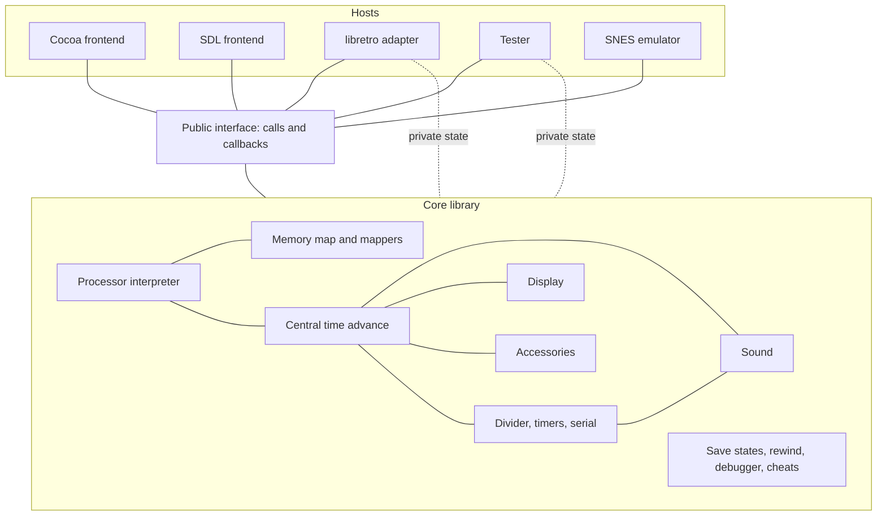

# SameBoy

## Summary

[SameBoy][sb-readme] is an emulator of the Game Boy (DMG) and Game Boy Color (CGB), and,
by its [features page][sb-features], of the Super Game Boy.
It is written in C, has been released since 2016, and is carried largely by one author.
Its core is a library with a flat interface of calls and callbacks; a macOS frontend, an SDL frontend,
a libretro adapter, a headless tester, and the SNES emulator bsnes all sit on it.
Of the two open-source emulators that lead the [GB Emulator Shootout][shootout],
it is the one that also models the Super Game Boy and selectable hardware revisions ([survey][survey-accuracy]);
the other, docboy, scores higher on that page, 258 of 261 against 253 of 264.
There SameBoy passes every blargg and Mooneye test and all 61 SameSuite sound tests,
and fails nine DMG mid-line video tests and two Super Game Boy tests.

Three mechanisms explain most of that result.
The processor is a plain interpreter,
but every bus access first brings the rest of the machine up to the same machine cycle,
and a small per-model table places individual register writes inside the cycle.
The display and the divider are resumable state machines that can stop at any tick,
and the display and the sound unit run lazily, forced up to date only when something could observe them.
Save states have two tiers: an exact dump of the machine for the same version, and BESS,
a portable footer that other versions and other emulators can load.

The weaknesses are as instructive.
Wall-clock pacing, sleeping, and file access live inside the core;
model and mapper differences are conditionals scattered over several files;
the exact save state is a memory image tied to the compiler's layout;
and the automated regression gate is six screenshot hashes on two revisions.
It reruns three of blargg's ROMs and two acid2 ROMs,
so most of what the project claims to pass is not rerun by any automation in its repository.

For Rustalgia the note recommends the catch-up-before-access timing scheme, the half-master-clock tick,
resumable state machines with named states, lazy parts with declared observation points, band-limited sound synthesis,
BESS beside a designed exact state format, and a headless test runner on the public interface from the first day.
It recommends against core-side pacing, process-wide state, a public state layout, and frame-hash tests.
The owner decides.

## Scope

- Version: release v1.0.5 of 2026-11-02, read at the head of `master`,
  commit `ea667ad79aa28409f034b1fd6da7304e1844750d` of the same day, three minutes before the release was published
  ([release list][sb-releases]).
  That the commit is the release's code is an inference from the two times and from the version file.
  Everything was read on 2026-11-27, and links to repository files are pinned to that commit.
- Sources: the repository's source files, read one at a time; its README, contributing guide, build notes,
  and [BESS specification][sb-bess]; the project site's [changelog][sb-changelog], [features][sb-features],
  [debugger][sb-debugger-doc], and [automation][sb-auto] pages; the [API reference wiki][sb-wiki]
  (its home page and at least 14 of 185 pages);
  26 issue and pull-request threads; and published third-party results, chiefly the shootout and its harness.
- Licence and tier: Expat and open tier,
  as the family survey records under ["The emulators at a glance"][survey-glance]
  and ["Register re-check"][survey-recheck].
  The code was read, as [ADR 0006][adr6] allows for the open tier, and nothing was copied or ported.
  Every description of a mechanism in this note was written after reading the implementation.
  It is kept to the level of parts and uses none of the implementation's internal names.
- Deliberately not opened: `BootROMs/` (replacement boot ROMs, closed by ADR 0006); `Core/sgb.c` and `Core/sgb.h`
  (the high-level model of the Super Game Boy's SNES program)
  and `Core/graphics/` (built-in borders and logo), both closed as a precaution in [the register][register];
  `iOS/` and `HexFiend/` (walled).
  The five test ROM binaries in `.github/actions/`, release binaries, and issue attachments were not downloaded.
  The Cocoa frontend's source was not read, and the SDL frontend only in part.
  Four addresses met in permitted files were left unopened and are not linked here because they are closed:
  three files in the boot ROM download folder `gbdev.gg8.se/files/roms/bootroms`, which the shootout's harness names,
  and `slack.net/~ant`, which a sound-file comment names.
- Hazards met: the Super Game Boy appears in permitted files only as call sites and saved data;
  no file read reimplements system software, and no key, firmware, or game bytes were met (research log).
  A short section of [`Core/gb.c`][sb-gb-c] that generates a small player program for music files was not read
  and is reported to the owner as a candidate for the closure list.
- Published results only: nothing was built or run for this note.
  Test figures are the project's own or a third party's, and each says which.
- How claims were checked: four evidence gatherers each took one area
  (structure and timing; video, audio, and state; accuracy and tests; project history and weaknesses),
  fetched raw text with curl or the GitHub API, and confirmed every quotation against it.
  The note was written from their reports alone.
  Four independent verifiers, who saw only the note, then checked its claims against the sources,
  and a fix pass applied their findings.
- Markers: a claim cited to a repository source file was read in that source; one cited to the README,
  the contributing guide, the BESS specification, the site, or the wiki was read in the project's documentation;
  one cited to an issue was read in that thread, as the author's words unless it says otherwise.
  Such claims carry no marker.
  Reasoning, leads, and unquoted observations carry the markers of the [research guide][guide-claims].
  Several large files were read in part: the opcode handlers in the middle of the processor file,
  the register case list of the memory file, and the channel logic of the sound file were searched, not read through.

## Architecture

### Parts and what each owns

The project is one portable core and several hosts of it.
The README describes "an open source Game Boy (DMG) and Game Boy Color (CGB) emulator, written in portable C",
with "a native Cocoa frontend for macOS, an SDL frontend for other operating systems, and a libretro core"
([README][sb-readme], opening paragraph).

| Part | Owns | Language |
|---|---|---|
| Core | All emulation, save states, rewind, cheats, the debugger, and accessories | C |
| SDL frontend | Window, menus, configuration; swappable audio back ends | C |
| Cocoa frontend | macOS application, graphical debugger views; shares view and audio code with iOS | Objective-C |
| libretro adapter | One file that maps the core to libretro, including two linked machines | C |
| Tester | Headless batch runner that writes a screenshot and a log for each game | C |
| Shaders | Scaling and blending filters shared by the frontends | GLSL and Metal |

The table is drawn from the [contributing guide][sb-contrib], "Languages and Compilers",
and from the repository's file listing (observed).

The core is meant to be a library.
The contributing guide says the "core is intended to be used as a library,
so it shouldn't contaminate the global namespace without prefixes"
([contributing guide][sb-contrib], "Other Coding Conventions"),
and the build has a library target that produces static and dynamic libraries with a cleaned set of headers
([README][sb-readme], "Compilation").
Rewind, the debugger, cheats, cheat search, and host-time pacing can each be compiled out,
but the top-level build refuses those switches for any target except the library and its headers
([`Makefile`][sb-makefile], opening section).
The libretro build has its own build files, which always compile out pacing, rewind, the debugger,
and cheats ([`libretro/Makefile.common`][sb-libretro-mk]).

### The boundary between core and host

A host gives the core a model, a cartridge image, a pixel buffer it owns,
a function that packs a colour into its own pixel format, a sample rate, and key states.
The core hands back finished frames, one stereo sample at a time, the emulated time each run call consumed,
and events such as rumble strength, log text, and printer output
([`Core/gb.h`][sb-gb-h]; [`Core/display.h`][sb-display-h]; [`Core/apu.h`][sb-apu-h]).
Three points of that boundary matter most.

- **The host pulls, one processor step at a time.**
  The basic run call executes one instruction, interrupt entry, or halt step and returns the time it took;
  a header comment says it "Returns the time passed, in 8MHz ticks."
  A second call repeats that until the next vertical blank and returns nanoseconds
  ([`Core/gb.h`][sb-gb-h], comments on the two run calls).
- **The boot ROM is supplied on request.**
  The core calls back naming which of ten kinds of boot ROM it needs, and the host loads a file or a buffer.
  A cartridge reset always starts from the boot ROM; no post-boot register state was found in the reset path
  ([`Core/gb.c`][sb-gb-c], reset section).
  One path does skip it: playback of a music file (GBS) resets the machine,
  sets the processor's start state from the file's header, and marks the boot ROM as finished
  ([`Core/gb.c`][sb-gb-c], track-switch section).
- **Links are bit-level callbacks.**
  For the serial port the core tells the host when an outgoing bit starts and asks for the incoming bit when it ends;
  when the other side supplies the clock, the host pushes bits in.
  Infrared is an on/off light state in and a callback out ([`Core/gb.h`][sb-gb-h], serial and infrared sections).

The public and private faces of the core are the same header files.
Behind one build-time switch every field of the machine state is visible; without it,
callers see an opaque block of the right size ([`Core/gb.h`][sb-gb-h], end of the state definition).
The SDL frontend builds without the switch ([`Makefile`][sb-makefile], compilation rules).
The Tester and the libretro adapter build with it and read private state directly
([`Tester/main.c`][sb-tester], opening lines; [`libretro/Makefile`][sb-libretro-makefile], object rule;
[`libretro/libretro.c`][sb-libretro-c], memory routine).
A second, narrower boundary serves SNES emulators: per-pixel and per-row callbacks,
a callback for joypad-register writes, and model variants that switch off the core's own pacing so the host keeps time,
under a header comment that reads "For integration with SFC/SNES emulators" ([`Core/gb.h`][sb-gb-h]).
The family survey records that [bsnes and BizHawk embed the core][survey-multi].

### How time advances

The unit of time is half a period of the 4,194,304 Hz master clock: 1/8,388,608 s,
which the project calls an 8 MHz tick.
A frame is 70,224 master-clock periods.
The processor counts its own clock periods, four to a machine cycle;
the count is doubled in normal speed and passed unchanged in the Color's double speed,
so a double-speed clock period is a whole tick
([`Core/timing.c`][sb-timing-c], central advance routine; [`Core/gb.h`][sb-gb-h], constants).

There is no scheduler and no event queue.
One central routine advances every other part by the same amount: the divider and timers, the camera and printer timers,
the joypad, sound, the display, the sprite-memory copy (OAM DMA), infrared, and the real-time clock.
Parts tied to the processor clock receive processor-clock counts, and parts tied to the fixed clock receive ticks
([`Core/timing.c`][sb-timing-c], end of file).

Four mechanisms give that simple structure its precision.

- **Catch-up before each bus access.**
  The interpreter keeps a count of time owed to the rest of the machine.
  Every bus access sees the rest of the machine advanced to the machine cycle in which the access falls;
  time for cycles without an access is carried forward until the next one
  ([`Core/sm83_cpu.c`][sb-cpu], access helpers and run routine).
- **A per-model table of write alignments.**
  For writes to the I/O page, one of four tables
  (monochrome, Super Game Boy, Color, Color in double speed)
  says how the write lines up against the part that reads the register: the other part sees the old value,
  sees the new value, or the processor's write wins.
  Entries for some display registers write an intermediate value for one clock period first,
  and some branch on the exact Color revision ([`Core/sm83_cpu.c`][sb-cpu], tables and write helper).
- **Resumable state machines.**
  The display and the divider each keep a signed time balance and a state number, both saved in the state.
  Time handed in is added to the balance; each wait subtracts from it,
  and when it runs out the part records where it is and returns
  ([`Core/timing.h`][sb-timing-h]; [`Core/display.c`][sb-display-c], entry of the display routine).
- **One divider as the source of edges.**
  A 16-bit counter rises by four each machine cycle.
  A falling edge on one of its bits steps the timer, on another toggles the serial clock,
  and on a third steps the sound unit's frame sequencer.
  Writes to the divider go through the same edge test,
  so the hardware's known side effects of such writes need no special case; timer overflow is modelled in three states,
  which gives the one-cycle delay before reload ([`Core/timing.c`][sb-timing-c], timer routines).

The display and sound are lazy.
The display may let time accumulate at set points of a line,
and any access to a register or memory it cares about forces it up to date first; the sound unit does the same,
running only when a register is touched, a host sample is due, or a glitch-sensitive countdown is live
([`Core/display.c`][sb-display-c], batch points; [`Core/memory.c`][sb-memory], register list before high-memory access;
[`Core/apu.c`][sb-apu-c], run routine).
That the forced-update list is what keeps the laziness correct is an inference from those call sites.

Two linked machines are kept in step by the host, not the core.
The libretro adapter holds two instances and always steps whichever is behind in returned ticks
until both reach a vertical blank, with each machine's serial and infrared callbacks wired to the other
([`libretro/libretro.c`][sb-libretro-c], frame routine).
The author explains in [issue 18][i18]
(comment of 2018-01-27) that alternating whole frames fails, because the serial port moves about 17 bytes in a frame.

By default the core also paces itself to wall-clock time: it compares emulated ticks with the host's clock,
sleeps the difference, and resets its reference when it is off by more than about one and a fifth frames
(a frame plus 20 per cent, about 20 ms; calculated from the constants); a smaller lag is left to even out.
The run-to-vertical-blank call switches that off so the caller paces
([`Core/timing.c`][sb-timing-c], first section; [`Core/gb.c`][sb-gb-c], run-frame section).

### Processor, memory, and models

The processor is an interpreter with a table of 256 handlers and a second level for the prefixed opcodes.
There is no recompiler and no cached decode.
Interrupt entry, halt, and stop are handled outside the handlers;
interrupt entry takes five machine cycles and chooses its vector late,
so a push that overwrites an interrupt register changes or cancels the dispatch
([`Core/sm83_cpu.c`][sb-cpu], run routine).
The DMG's sprite-memory corruption bug is raised from the processor
when a 16-bit register value appears on the address bus
([`Core/sm83_cpu.c`][sb-cpu]; [`Core/memory.c`][sb-memory], opening section).

The memory map is two tables of 16 entries, for reads and writes, indexed by the top four address bits.
Before the table, every access passes watchpoints, DMA bus conflicts, cheats,
and an open-bus latch that decays to all ones after a time the host can set
([`Core/memory.c`][sb-memory], top-level read and write).
Mappers are not separate units.
A 256-entry table maps the cartridge header's type byte to one of eleven mapper kinds and four flags,
the mapper registers share one record,
and after any mapper write a single routine recomputes the three banks that reads use
([`Core/mbc.c`][sb-mbc-c]; [`Core/gb.h`][sb-gb-h], mapper section).

A model is one number with structure: a family, a position ordered by revision, and flags for PAL, the Game Boy Player,
and "no SNES side".
Thirteen models can be selected: DMG revision B, the Pocket, Super Game Boy in NTSC and PAL, Super Game Boy 2,
Color revisions 0 and A to E, Advance revision A, and the Game Boy Player ([`Core/model.h`][sb-model-h]).
Model differences are tests on that number spread through the code: memory sizes, power-on patterns, the clock rate,
the boot ROM requested, the write-alignment table, DMA conflicts, and sound quirks
([`Core/gb.c`][sb-gb-c]; [`Core/sm83_cpu.c`][sb-cpu]; [`Core/memory.c`][sb-memory]; [`Core/apu.c`][sb-apu-c]).

### Video

The display is a per-dot state machine of about 40 states that feeds a pixel pipeline.
During drawing a tile fetcher fills two queues of eight entries, for background and for sprites,
and one pixel is mixed and written each dot
([`Core/display.c`][sb-display-c], main, fetcher, and pixel routines; [`Core/display.h`][sb-display-h]).
The control, scroll, and monochrome palette registers are read live as each pixel is mixed
([`Core/display.c`][sb-display-c], pixel routine).
Most mid-line changes therefore fall out of the per-dot reads (inference);
the same file handles known hardware glitches on writes to the window position and tile selection separately.
The features page claims "T-cycle accurate emulation of LCD timing effects" ([features][sb-features], "Accuracy").

A whole-line fast path replaces the pipeline when nothing can observe the difference.
At the start of drawing the core decides whether the line can be drawn at once by a separate line renderer.

| Situation at the start of drawing | Result |
|---|---|
| A DMA is active, the processor is stopped, the window has triggered, or a SNES host takes pixels | Per-dot pipeline |
| No visible sprites and no active window | Whole line; the drawing time is known exactly |
| Sprites or window, but no interrupt or transfer depends on when drawing ends | Whole line, time bounded above |
| Otherwise | Per-dot pipeline |

The table condenses the batching routine of [`Core/display.c`][sb-display-c].
The changelog introduced the fast paths as "improving performance by up to 34% with no accuracy losses"
([changelog][sb-changelog], 0.15).

The core writes into the host's buffer and reports each vertical blank with one of five frame kinds: normal,
display off, artificial, repeat the previous picture, and skipped during turbo ([`Core/display.h`][sb-display-h]).
Frames keep arriving while the display is off, once in each nominal frame period.
Colour correction, in seven modes including "disabled", is applied once for each palette entry when the game writes it,
through a response curve for each model family, and the result is cached
([`Core/display.c`][sb-display-c], colour conversion routine).
Frame blending is the frontend's work: the SDL frontend keeps two buffers and a shader mixes them,
([`SDL/main.c`][sb-sdl-main]; [`Shaders/MasterShader.fsh`][sb-shader]);
the core contributes only whether the frame is odd or even
([`SDL/gui.c`][sb-sdl-gui], render routine; [`Core/display.h`][sb-display-h]).

### Audio

The sound unit is stepped at 2 MHz and holds four channel models:
the two pulse channels and the noise channel are clocked at 1 MHz and the wave channel at 2 MHz,
with the frame sequencer driven by the divider
([`Core/apu.c`][sb-apu-c]; [`Core/apu.h`][sb-apu-h], comments on the sound state).
Resampling is band-limited step synthesis for each channel: a channel records only changes of its output level,
each change is spread into a short ring buffer through a windowed-sinc step table built once,
and a host sample is the integral of that buffer ([`Core/apu.c`][sb-apu-c], opening section).
The method replaced a box filter in version 1.0, "vastly improving audio quality in all frontends"
([changelog][sb-changelog], 1.0).
The host chooses any sample rate, and at 2 MHz the filter is bypassed.
The analogue stage is modelled after synthesis: a high-pass filter in three modes,
and on models before the Advance a fade as each channel's converter switches on or off
([`Core/apu.c`][sb-apu-c], render routine).

Samples are pushed to the host one at a time through a callback.
The SDL frontend queues them and drops samples once more than 0.125 s is queued
([`SDL/main.c`][sb-sdl-main], audio callback).
There is no dynamic rate control, and nothing links the audio buffer's fill to emulation speed;
[`Core/apu.c`][sb-apu-c] and [`SDL/main.c`][sb-sdl-main] were searched for any other use of the queue length.
That drift is therefore absorbed by dropped samples is an inference from those two files.

### State, rewind, and debugging

All machine state lives in one record divided into named sections: header, core, DMA, mapper, high memory, timing,
sound, real-time clock, video, and accessory, followed by an unsaved section of pointers, callbacks, and host settings.
The native save state writes each section as a 32-bit length and its raw bytes, then the large memories
([`Core/gb.h`][sb-gb-h], section layout; [`Core/save_state.c`][sb-save-c]).
Three rules keep it loadable across versions.

- Fields are only appended to a section;
  a header comment says this "allows adding data to the end of the section without worrying about future compatibility"
  ([`Core/gb.h`][sb-gb-h], comment above the record).
  A shorter section on load leaves the newer fields alone.
- A removed field leaves named padding, and old meanings are converted on load
  ([`Core/save_state.h`][sb-save-h]; [`Core/apu.h`][sb-apu-h]).
- A structure version, 15 at the commit read, and a magic value that also encodes byte order guard the layout.
  A mismatch does not fail: the loader falls back to the BESS block in the same file
  ([`Core/save_state.c`][sb-save-c], compatibility check).

BESS, "Best Effort Save State", is a footer appended to any emulator's native state.
The last eight bytes of the file hold an offset and the four letters `BESS`, which the format requires as its signature;
the offset leads to a chain of named, length-prefixed blocks ([BESS specification][sb-bess], "BESS footer").
Its stated purpose is "to allow different emulators, as well as majorly different versions of the same emulator,
to import save states from other BESS-compliant save states" ([BESS specification][sb-bess], "Motivation").
Three choices carry most of its value ([BESS specification][sb-bess], "Specification").

| Choice | Effect |
|---|---|
| Large memories are referenced by file offset, not copied | The footer reuses the native state's bytes |
| Mapper state is an ordered list of register writes to replay | An importer need not know the exporter's mapper model |
| Registers are restored as if the game wrote them, with listed exceptions | Side effects rebuild derived state |

BESS is lossy by design: the specification says it "represents a state accurately enough to be restored in casual
use-cases" ([BESS specification][sb-bess], "Motivation").
Its core block carries the processor's registers and the values of the I/O registers only,
so nothing finer than a register value survives: no position inside an instruction or a line,
and no internal sound counters (inference from the block's field list).
Every state SameBoy writes to a file carries the footer; only rewind
and debugger-undo states omit it ([`Core/save_state.c`][sb-save-c]).
Loaded states are sanitised: fields that could index out of range or stall the machine are clamped or reset,
and a state for another model family or memory size is refused
([`Core/save_state.c`][sb-save-c], sanitise and compatibility routines).

Battery saves are the cartridge memory followed by a clock trailer in the layout other emulators use,
and the loader also accepts the older 32-bit layout ([`Core/gb.c`][sb-gb-c], battery routines).
The real-time clock has two modes: one follows the host's clock, and one advances a second for each emulated second,
which is deterministic ([`Core/timing.c`][sb-timing-c], clock routine).

Rewind is a ring of key states, each followed by up to 255 frames stored as run-length differences against the key,
pushed once a frame ([`Core/rewind.c`][sb-rewind]; [`Core/gb.h`][sb-gb-h], constants; [`Core/gb.c`][sb-gb-c],
run routine).
The debugger's back-step restores the latest pushed frame and re-runs one instruction fewer;
its help text says it works "assuming constant inputs"
([`Core/debugger.c`][sb-debugger-c]; [debugger page][sb-debugger-doc]).
The debugger itself is text-based, lives in the core, and reaches the host through text input callbacks,
blocking and asynchronous, log output, and one reload notification ([`Core/debugger.c`][sb-debugger-c]).
Cheats are patches on memory reads, found through a small hash on the address ([`Core/cheats.c`][sb-cheats]).
There is no run-ahead in the core or its own frontends: none appears in the features page, the changelog,
or the public header, which were searched for it.

## What works well

- **Machine-cycle bus timing at the cost of an instruction interpreter.**
  Catch-up before each access gives every read
  and write the right view of the machine without stepping the processor by cycle ([`Core/sm83_cpu.c`][sb-cpu]).
  The release that introduced this timing system claimed "an up to 100% performance boost" in the same entry
  that first claims all three main suites
  ([changelog][sb-changelog], 0.11),
  so the project's own record does not show accuracy costing speed
  (inference; the figure is the author's and was not measured here).
- **Effects within a machine cycle, paid for only on I/O writes.**
  The write-alignment tables reproduce single-clock-period behaviour without a processor stepped by clock period
  ([`Core/sm83_cpu.c`][sb-cpu]).
- **A time unit that keeps double speed exact.**
  Half master-clock periods keep every clock period a whole number in both speeds,
  and give hosts one unit for elapsed time and for keeping linked machines in step
  ([`Core/timing.c`][sb-timing-c]; [`libretro/libretro.c`][sb-libretro-c]).
- **Resumable state machines whose position is saved.**
  A hardware sequence reads as straight-line steps, can stop at any tick,
  and its position is two integers in the state ([`Core/timing.h`][sb-timing-h]).
- **Laziness with explicit observation points, and a guarded fast path.**
  The 0.15 changelog credits the display fast paths with up to 34% and lazy sound generation with up to 17%,
  and says of the first "no accuracy losses" ([changelog][sb-changelog], 0.15).
  The guard batches only when no interrupt
  or transfer could observe the drawing time ([`Core/display.c`][sb-display-c]).
- **Sound without aliasing at any host rate.**
  Band-limited step synthesis means the 2 MHz model is never averaged by a box,
  and the analogue stage is a separate step after it
  ([`Core/apu.c`][sb-apu-c]; [changelog][sb-changelog], 1.0 and 1.0.2).
- **A two-tier save state with a compatibility promise.**
  Every release from 0.15 to 1.0.5 opens by saying it is "backwards compatible with save states from SameBoy 0.14.3
  and newer, as well as save states from any BESS compliant emulator" ([changelog][sb-changelog]).
  Before 0.12, six releases each broke older states ([changelog][sb-changelog], 0.4 to 0.11).
- **A frame hand-off that hides the reason for a frame.**
  A host-owned buffer, a host-defined pixel format,
  and a frame kind mean a frontend never needs to know why a frame is blank
  or repeated ([`Core/display.h`][sb-display-h]).
- **One instance, one record, several machines in a process.**
  Nearly every public call takes the instance first, reset is one clearing operation,
  and the libretro adapter runs two instances side by side
  ([`Core/gb.h`][sb-gb-h]; [`libretro/libretro.c`][sb-libretro-c]).
  The exceptions are the calls that allocate an instance and those that seed and enable the random source
  ([`Core/gb.h`][sb-gb-h]; [`Core/random.c`][sb-random]).
- **A deterministic headless tester on the same core.**
  The Tester turns off random initial memory and joypad bounce, ties the real-time clock to emulated time,
  selects any of the 13 models, and ends a run early on signs of a crash: a deep call stack,
  a halt with interrupts disabled, or execution stuck on a `0xFF` byte ([`Tester/main.c`][sb-tester]).
  With it the project reports "2790 out of 2791 games passed" for 1.0.5
  ([automation page][sb-auto]),
  which the survey reads as [a compatibility check, not a hardware oracle][survey-accuracy].
- **The core states its own limits.**
  A speed switch that would leave the display out of phase with the processor is logged, not hidden:
  "ROM triggered a PPU odd mode, which is currently not supported.
  Reverting to even-mode." ([`Core/sm83_cpu.c`][sb-cpu], stop handling).
  In the 1.0.5 automation results that line appears 87 times in full, in the logs of 19 of the 2,791 games
  ([automation page][sb-auto]; counted by text search of the raw page).
- **Independent results confirm two of the README's three claims.**
  The README claims every blargg, Mooneye, and Wilbert Pol test ([README][sb-readme], "Compatibility").
  The [shootout][shootout], stamped 2026-06-04, confirms the first two and does not run Wilbert Pol's tests.
  Its [harness][shootout-harness] replaces three bundled boot ROM files with downloads;
  that these are the original boot ROMs is an inference from the host and the file names, which were not opened.
  The harness fetches the latest release when it runs,
  and the [release list][sb-releases] shows v1.0.3 of 2026-03-04 as the latest on that day,
  so the page most likely measures v1.0.3 unless a cached download was reused (inference).
  The page gives this breakdown, counted from SameBoy's column of the raw page.

  | Suite | Pass | Fail |
  |---|---|---|
  | blargg | 51 | 0 |
  | Mooneye | 97 | 0 |
  | SameSuite | 67 | 1 |
  | Mealybug Tearoom, DMG | 15 | 9 |
  | acid, ax6, Ashiepaws, daid | 17 | 0 |
  | CasualPokePlayer | 3 | 1 |

  The page's own total is 253 of 264; it counts three informational rows, so strict passes are 250 and fails 11
  (inference from the tally).
  Two emulators score higher on the page's own totals: docboy, which is open source, with 258 of 261,
  and Emulicious with 254 of 261; the survey notes
  that of the two open leaders [only SameBoy also models the Super Game Boy and selectable revisions][survey-accuracy].
- **Hardware revisions are added from measurement (inference from the author's reluctance).**
  The author is "rather hesitant" to add revisions he does not own, though he "might consider it":
  without knowing how the first DMG revisions differ, "it's guaranteed to be inaccurate"
  ([issue 468][i468], comments of 2022-07-07 and 2022-07-08).
  The project also publishes its discoveries as hardware tests, with results for each console revision
  ([SameSuite, `apu/README.md`][samesuite-apu], "Results").

## What works poorly

- **Host concerns sit inside the core.**
  Wall-clock pacing, sleeping, file access by path, and audio recording to a file all live in the core.
  Pacing and sleeping can be compiled out in the library build and are compiled out in the libretro build;
  file access by path and audio recording have no switch
  ([`Core/timing.c`][sb-timing-c]; [`Core/gb.c`][sb-gb-c]; [`Core/apu.c`][sb-apu-c]; [`Makefile`][sb-makefile];
  [`libretro/Makefile.common`][sb-libretro-mk]).
  The cost shows in libretro: the machine's frame length varies when a game turns the display off
  ([issue 161][i161], open since 2019, comment of 2019-06-16),
  and the author later writes that "the libretro API can't handle cores with variable frame rates correct"
  (the same thread, comment of 2022-10-08).
- **Model and mapper differences are scattered conditionals.**
  A new revision or mapper would touch tables and case lists in several files
  ([`Core/mbc.c`][sb-mbc-c]; [`Core/gb.c`][sb-gb-c]; [`Core/memory.c`][sb-memory];
  inference from the model and mapper tests spread over those files).
  Some branches carry their own doubt:
  comments mark the Pocket and Super Game Boy write tables as unverified on hardware,
  and one says of two entries that "it appears
  that there's some off-by-1-T-cycle timing issue in the PPU implementation",
  while holding the values accurate for every measurable case ([`Core/sm83_cpu.c`][sb-cpu], table comments).
- **Parts reach into each other.**
  The processor and DMA code test the display's bare state number,
  and the write table patches around the display's suspected error
  ([`Core/sm83_cpu.c`][sb-cpu]; [`Core/memory.c`][sb-memory]).
- **The processor's phase against the display is not modelled.**
  The "odd mode" above is forced back into phase,
  and comments call the speed-switch countdown a compensation for "the lack of pipeline emulation"
  ([`Core/sm83_cpu.c`][sb-cpu]; [`Core/gb.h`][sb-gb-h], timing section).
- **Two renderers must agree, and nothing shown checks that they do.**
  The line renderer and the per-dot pipeline are separate implementations of one picture;
  no test in the files read compares them (inference from [`Core/display.c`][sb-display-c] and the test scripts).
- **The exact save state is a memory image.**
  Its layout follows the compiler's rules, which produced portability bugs:
  "Fixed a bug that made save states created on Windows incompatible with other operating systems, and vice versa"
  ([changelog][sb-changelog], 0.16).
  After a structure-version change an old state loads through BESS and silently loses timing and sound phase
  (inference from the loader and the specification).
  Between releases the format is not stable; the author says unreleased commits "have save state compatibility issues"
  ([issue 448][i448], comment of 2022-04-12).
- **The state layout is public, and the author calls that historical.**
  A host may allocate the instance statically only if its headers and library are the same version,
  and exposing the record leaked C11 constructs into C++ hosts until 1.0.2
  ([wiki][sb-wiki], "Instance Allocation"; [issue 477][i477], comment of 2022-07-31; [changelog][sb-changelog], 1.0.2).
- **The interface was documented late and incompletely.**
  The changelog declares the interface "stable and documented" only at 1.0
  ([changelog][sb-changelog], 1.0), released on 2025-03-15 ([release list][sb-releases]).
  The wiki says it "is currently a work in progress",
  and the Description section of all seven pages in its SNES integration group reads "TBD"
  ([wiki][sb-wiki], home page and the group's pages).
  That group serves hosts such as bsnes, which [embeds the core][survey-multi] (inference).
- **Process-wide state remains.**
  The random source is one seed shared by every instance and seeded from the host clock at load,
  so determinism is a setting of the process, not the instance
  ([`Core/random.c`][sb-random]; [`Tester/main.c`][sb-tester]).
- **Thread safety is a contract that failed at least once.**
  A documented thread-safe input call could make a game see every button pressed;
  1.0.5 fixed it by deferring the update to the next run step ([issue 774][i774]; [changelog][sb-changelog], 1.0.5).
- **The automated gate is thin.**
  Continuous integration builds every target on macOS and two Ubuntu images with two compilers,
  then runs five test ROMs in six runs on two models, DMG-B and CGB-E, and compares a hash of each final screenshot
  ([`sanity.yml`][sb-sanity-yml]; [`sanity_tests.sh`][sb-sanity-sh]).
  The five are blargg's two sound ROMs and his OAM-bug ROM, and the two acid2 ROMs
  ([`sanity_tests.sh`][sb-sanity-sh]; [the licence file beside the ROMs][sb-actions-lic]).
  The gate has no processor, timer, Mooneye, SameSuite, or Mealybug test, no pull-request trigger, and no Windows job,
  so the rest of blargg's tests, Mooneye, and Wilbert Pol's tests are not rerun by any automation in the repository.
  A hash names the failing ROM but not what changed,
  and it also depends on the replacement boot ROMs built beside the Tester (inference from the build file).
  Regressions escape: the changelog records "a regression that caused some PPU test ROMs to fail"
  ([changelog][sb-changelog], 0.12.2) and three more in 0.15.7.
- **The Tester is coupled to the core's inside.**
  Its opening comment says it "requires low-level access to the GB struct to detect failures",
  and it carries a hand-kept list of about 29 titles that need special input
  or relaxed crash detection ([`Tester/main.c`][sb-tester]).
- **Accuracy claims carry no version, date, revision, or counts.**
  The README and features page name suites only ([README][sb-readme]; [features][sb-features]).
  No published result covers the Pocket, Super Game Boy 2, the Advance, or Color revisions 0, A, and B; the shootout,
  the survey's tables, and the test suites' READMEs were searched.
- **Known accuracy gaps.**
  The nine Mealybug fails are all changes to the control and scroll registers during drawing on the DMG,
  which docboy passes ([shootout][shootout]; [survey][survey-tests]).
  That suite's expected images come from its author's emulator ([Mealybug README][mealybug]).
  The two Super Game Boy fails may be fixed since the run, which predates 1.0.4 and 1.0.5:
  1.0.5 lists "More accurate emulation of invalid MLT_REQ SGB commands"
  ([changelog][sb-changelog], 1.0.5), but no published rerun confirms it (inference).
  An unanswered 2020 report of fails in Gambatte's sound tests is a lead only ([issue 239][i239]).
- **Sound on models before the Color is an open area that the author calls hard without the Color's test registers.**
  The author found four outcomes of one noise-channel test across six consoles and doubts
  that part of the behaviour is deterministic on hardware ([issue 397][i397], comments of 2025-09-30 to 2026-01-25).
  The hardware observations are his own and were not confirmed against a second source.
  Some constants are unmeasured: the optional interference levels are "based on ear based on several recordings"
  ([`Core/apu.c`][sb-apu-c], interference routine).
- **Raw-rate audio costs weak hosts.**
  Since 1.0.1 the libretro core "provides libretro with the original, unfiltered 2MHz audio stream"
  ([issue 723][i723], maintainer's comment of 2025-09-10);
  the user's report of stutter on a phone in that thread is a lead.
- **Rewind serialises the whole state every frame.**
  Each push writes the full state and compares it with a key state up to 255 frames old ([`Core/rewind.c`][sb-rewind]).
  That this is costly is an inference; no measurement was found in the changelog or the issues searched.
- **Features depend on the frontend.**
  The features page marks the memory and video viewers, cheat search, link cable,
  and infrared as in the Cocoa frontend only
  ([features][sb-features], footnotes),
  though the libretro adapter also links two instances by cable and infrared ([`libretro/libretro.c`][sb-libretro-c]).
  Asked to make the Cocoa frontend reusable,
  the author answered that the C interface is the intended route for frontends and that he had not expected that use;
  the request is open without a decision ([issue 324][i324], comment of 2021-01-15).
  The libretro build removes the debugger, cheats, and rewind ([`libretro/Makefile.common`][sb-libretro-mk]).
- **The build is one GNU Makefile and two compilers.**
  The contributing guide says "Other compilers
  (e.g. MSVC)
  are not supported", and the core leans on compiler extensions for the sections of its state record
  ([contributing guide][sb-contrib], "Languages and Compilers"; [`Core/save_state.h`][sb-save-h]).
  The default build also needs an assembler for the replacement boot ROMs ([README][sb-readme], "Compilation").
- **Downstream drifts, and one person carries the project.** libretro's fork still reads version 0.15.4 on its default
  branch while upstream is 1.0.5 ([libretro fork][lr-fork], observed).
  The first release, v0.1, is dated 2016-04-01 ([release list][sb-releases]).
  The author has about 2,480 commits against 79 for the next contributor
  ([contributors listing][sb-contributors], observed),
  though the changelog credits another contributor with many of 1.0.5's sound improvements
  ([changelog][sb-changelog], 1.0.5).
- **Video and sound were each replaced once and reworked in parts several times.**
  The changelog records a new display model in 0.11 and a complete rewrite of sound emulation in 0.10.
  Around them it records rewrites of LCD timing and window behaviour (0.9), of the window again (0.13),
  and of three sound components (0.14), and a new downsampling method (1.0)
  ([changelog][sb-changelog], entries for those versions).

## Implications for Rustalgia

Each recommendation rests on a finding above; the owner decides.

- **Timing.**
  For an 8-bit handheld core, catch-up before each bus access with the debt kept explicit is recommended
  as the baseline, because it kept SameBoy's processor a simple interpreter at machine-cycle precision.
  The time unit should make the fastest clock mode a whole number, as the half-master-clock tick does.
  The processor's phase against the display should be representable from the start,
  since SameBoy does not model it and forces the display back into phase.
  These feed [`R2-01`][phase2] and [`R2-03`][phase2].
- **Write alignment as data.**
  The per-model table of register and alignment rule is worth taking, with each entry carrying its hardware evidence,
  because SameBoy's own tables hold unverified and compensating entries.
- **State machines with names.**
  Resumable state machines suit display-like parts, and Rust can express them as an explicit set of named states.
  The position should stay serialisable, and no other part should test a raw state number.
- **Lazy parts with a declared interface.**
  Lazy display and sound are recommended,
  with the list of observation points a property of each part's interface and not a list kept in the memory map.
  A whole-line fast path should come with a test that renders frames both ways and compares them,
  which SameBoy does not show; the conditions table above is the list of observers to guard.
- **Models and mappers as units.**
  A model should resolve once, at creation, into a set of named traits, so a new revision is one table row;
  each mapper should be one unit behind a small interface that yields the derived banks.
  Each revision-specific behaviour should name the hardware it was measured on.
- **Keep the host out of the core.**
  The primary run call should be "run until an event and return the emulated time", with no sleeping, no host clock,
  and no file paths inside the core; SameBoy offers a second call that turns pacing off and, since 0.16,
  a library build that can compile it out ([changelog][sb-changelog], 0.16).
  The loop should allow frames of variable length and fine interleaving of two machines by emulated time.
  This feeds [`R2-07`][phase2], [`R2-09`][phase2], and [`R2-10`][phase2].
- **An opaque instance and no process-wide state.**
  Hosts should receive handles, never the layout,
  and the random source should live in the instance with an explicit seed.
  Input from another thread should be a queued message applied at a step boundary, the fix SameBoy reached.
  The interface should be documented in the repository before the first outside host.
- **Frames and colour.**
  The frame hand-off of a host-owned buffer, a host pixel format, and an explicit frame kind is recommended;
  other systems' blanking will need the same.
  Colour correction belongs at palette-write time, and blending in the presentation layer with frame parity exposed.
- **Sound.**
  Band-limited step synthesis is recommended for step-wave sound chips,
  with the analogue stage separate and no unmeasured constant in the default path.
  Resampling to the host's rate should be a separate, tested component under Rustalgia's control,
  and a megahertz stream should not be handed to a generic host.
  This feeds [`R2-06`][phase2].
- **Save states.**
  A designed format is recommended over a memory dump: named sections with length prefixes, append-only growth,
  and a version, serialised field by field at fixed widths and byte order, with range checks on load.
  BESS is recommended for Game Boy states as an interchange footer beside the exact format, as SameBoy uses it.
  State size should be fixed or cheaply bounded for a loaded game,
  with a serialise call that omits the footer for rewind, run-ahead, and netplay.
  Reverse stepping should record inputs.
  These feed [`R2-08`][phase2].
- **Saves and clock.**
  The common battery-and-clock-trailer layout lets saves move between emulators.
  Both clock modes are worth offering, with the deterministic one the default for tests.
- **Testing.**
  A headless runner is recommended as a first-class frontend that uses only the public interface,
  with model selection and switches for determinism.
  The hardware-referenced suites should run in continuous integration for each model, on pull requests,
  against a stored table of expected results, using each test's own pass signal in preference to frame hashes.
  Every published result should carry version, date, model, boot path, and counts.
  The [shootout][shootout]'s nine failing DMG rows are a target list, and docboy, which passes them on that page,
  is the better reference for them.
  This feeds [`R2-15`][phase2].
- **Boot path.**
  "Always start from a boot ROM that the host supplies on request" keeps post-boot state out of the core
  and is worth keeping as an interface shape.
  What Rustalgia supplies when the user has none is the choice the survey raises under
  ["How to start a game"][survey-boot], and tests should record which path they used.
- **Features behind the core interface.**
  The debugger, cheats, and rewind should be optional parts of the core that any frontend can use,
  so that no feature is tied to one platform's interface code.
  This feeds [`R2-14`][phase2].
- **Plan for rewrites.**
  SameBoy replaced its display model once (0.11) and its sound model once (0.10),
  and rewrote parts of both before and after ([changelog][sb-changelog], 0.9, 0.13, 0.14, and 1.0).
  Stable internal interfaces around video and sound are recommended, so that a rewrite breaks neither states nor hosts.

## Open questions

- Which exact revisions does the [shootout][shootout] measure, and do the two Super Game Boy fails persist in 1.0.5?
  The harness selects models through three binary preference files, which were not read.
  A rerun of the shootout, or revisions printed by its maintainers, would answer it; [`R2-15`][phase2] could rerun it.
- Does run-ahead work correctly with this core under RetroArch?
  A run would answer it, which this study does not do; [`R2-08`][phase2].
- What do a state save and a rewind push cost for each frame?
  A benchmark would answer it; a spike under [`R2-08`][phase2].
- How do the Pocket, Super Game Boy 2, Advance, and Color revisions 0, A, and B score on the hardware-referenced suites?
  No published result exists; a run for each revision would answer it.
- Do the line renderer and the per-dot pipeline ever disagree?
  A differential run would answer it.
- Does the closed Super Game Boy model hold further process-wide state?
  The file is closed to this project; a statement from the author would answer it.
- How does the [automation page][sb-auto] decide that a game passed?
  The page does not say; the maintainer's unpublished script, or a question on the tracker, would answer it.

## Sources

Every source below was read on 2026-11-27.
SameBoy's repository files were read at commit `ea667ad79aa28409f034b1fd6da7304e1844750d`, release v1.0.5; its site,
wiki, and issues as they stood that day.

SameBoy repository, documentation:

- [README][sb-readme]; [contributing guide][sb-contrib]; [BESS specification][sb-bess]
  (BESS 1.0, block version 1.1); [release list][sb-releases]; [contributors listing][sb-contributors].
- [API reference wiki][sb-wiki], which says it reflects SameBoy 1.0; home page last edited 2024-12-13.

SameBoy repository, source and build files:

- Core: [`Core/gb.h`][sb-gb-h], [`Core/gb.c`][sb-gb-c], [`Core/timing.c`][sb-timing-c], [`Core/timing.h`][sb-timing-h],
  [`Core/sm83_cpu.c`][sb-cpu], [`Core/memory.c`][sb-memory], [`Core/mbc.c`][sb-mbc-c], [`Core/model.h`][sb-model-h],
  [`Core/display.c`][sb-display-c], [`Core/display.h`][sb-display-h], [`Core/apu.c`][sb-apu-c],
  [`Core/apu.h`][sb-apu-h], [`Core/save_state.c`][sb-save-c], [`Core/save_state.h`][sb-save-h],
  [`Core/rewind.c`][sb-rewind], [`Core/debugger.c`][sb-debugger-c], [`Core/cheats.c`][sb-cheats],
  [`Core/random.c`][sb-random].
- Hosts: [`SDL/main.c`][sb-sdl-main], [`SDL/gui.c`][sb-sdl-gui], [`Shaders/MasterShader.fsh`][sb-shader],
  [`libretro/libretro.c`][sb-libretro-c], [`libretro/Makefile`][sb-libretro-makefile],
  [`libretro/Makefile.common`][sb-libretro-mk], [`Tester/main.c`][sb-tester].
- Build and automation: [`Makefile`][sb-makefile], [`.github/workflows/sanity.yml`][sb-sanity-yml],
  [`.github/actions/sanity_tests.sh`][sb-sanity-sh], [`.github/actions/LICENSE`][sb-actions-lic].

SameBoy site (headed for version 1.0.5):

- [Changelog][sb-changelog]; [features][sb-features]; [debugger documentation][sb-debugger-doc];
  [automation results][sb-auto].

SameBoy issue tracker (the author's comments, by the dates given in the text):

- [Issue 18][i18], link cable between instances; [issue 161][i161], libretro frame pacing; [issue 239][i239],
  Gambatte sound tests (a user's report, a lead); [issue 324][i324], reuse of the Cocoa frontend; [issue 397][i397],
  noise channel on consoles before the Color; [issue 448][i448], libretro builds; [issue 468][i468],
  early DMG revisions; [issue 477][i477], headers in C++ hosts; [issue 723][i723], libretro audio performance;
  [issue 774][i774], thread-safe input.

Published results and other projects:

- [GB Emulator Shootout][shootout], page stamped 2026-06-04, and its [harness for SameBoy][shootout-harness],
  default branch.
  The harness file names download addresses of original boot ROM images; they were not opened and are not given.
- [SameSuite, `apu/README.md`][samesuite-apu], default branch; [Mealybug Tearoom tests README][mealybug],
  default branch.
- [libretro's fork of SameBoy][lr-fork], default branch `buildbot`, commit `aa158a889a48b538a0302873704a34577c8eb67d`:
  its version file only.

Project documents:

- [The Game Boy family survey][survey]; [ADR 0006][adr6]; [the source register][register];
  [the research roadmap][roadmap]; [the research guide][guide].

[sb-readme]: https://github.com/LIJI32/SameBoy/blob/ea667ad79aa28409f034b1fd6da7304e1844750d/README.md
[sb-contrib]: https://github.com/LIJI32/SameBoy/blob/ea667ad79aa28409f034b1fd6da7304e1844750d/CONTRIBUTING.md
[sb-bess]: https://github.com/LIJI32/SameBoy/blob/ea667ad79aa28409f034b1fd6da7304e1844750d/BESS.md
[sb-makefile]: https://github.com/LIJI32/SameBoy/blob/ea667ad79aa28409f034b1fd6da7304e1844750d/Makefile
[sb-gb-h]: https://github.com/LIJI32/SameBoy/blob/ea667ad79aa28409f034b1fd6da7304e1844750d/Core/gb.h
[sb-gb-c]: https://github.com/LIJI32/SameBoy/blob/ea667ad79aa28409f034b1fd6da7304e1844750d/Core/gb.c
[sb-timing-c]: https://github.com/LIJI32/SameBoy/blob/ea667ad79aa28409f034b1fd6da7304e1844750d/Core/timing.c
[sb-timing-h]: https://github.com/LIJI32/SameBoy/blob/ea667ad79aa28409f034b1fd6da7304e1844750d/Core/timing.h
[sb-cpu]: https://github.com/LIJI32/SameBoy/blob/ea667ad79aa28409f034b1fd6da7304e1844750d/Core/sm83_cpu.c
[sb-memory]: https://github.com/LIJI32/SameBoy/blob/ea667ad79aa28409f034b1fd6da7304e1844750d/Core/memory.c
[sb-mbc-c]: https://github.com/LIJI32/SameBoy/blob/ea667ad79aa28409f034b1fd6da7304e1844750d/Core/mbc.c
[sb-model-h]: https://github.com/LIJI32/SameBoy/blob/ea667ad79aa28409f034b1fd6da7304e1844750d/Core/model.h
[sb-display-c]: https://github.com/LIJI32/SameBoy/blob/ea667ad79aa28409f034b1fd6da7304e1844750d/Core/display.c
[sb-display-h]: https://github.com/LIJI32/SameBoy/blob/ea667ad79aa28409f034b1fd6da7304e1844750d/Core/display.h
[sb-apu-c]: https://github.com/LIJI32/SameBoy/blob/ea667ad79aa28409f034b1fd6da7304e1844750d/Core/apu.c
[sb-apu-h]: https://github.com/LIJI32/SameBoy/blob/ea667ad79aa28409f034b1fd6da7304e1844750d/Core/apu.h
[sb-save-c]: https://github.com/LIJI32/SameBoy/blob/ea667ad79aa28409f034b1fd6da7304e1844750d/Core/save_state.c
[sb-save-h]: https://github.com/LIJI32/SameBoy/blob/ea667ad79aa28409f034b1fd6da7304e1844750d/Core/save_state.h
[sb-rewind]: https://github.com/LIJI32/SameBoy/blob/ea667ad79aa28409f034b1fd6da7304e1844750d/Core/rewind.c
[sb-debugger-c]: https://github.com/LIJI32/SameBoy/blob/ea667ad79aa28409f034b1fd6da7304e1844750d/Core/debugger.c
[sb-cheats]: https://github.com/LIJI32/SameBoy/blob/ea667ad79aa28409f034b1fd6da7304e1844750d/Core/cheats.c
[sb-random]: https://github.com/LIJI32/SameBoy/blob/ea667ad79aa28409f034b1fd6da7304e1844750d/Core/random.c
[sb-sdl-main]: https://github.com/LIJI32/SameBoy/blob/ea667ad79aa28409f034b1fd6da7304e1844750d/SDL/main.c
[sb-shader]: https://github.com/LIJI32/SameBoy/blob/ea667ad79aa28409f034b1fd6da7304e1844750d/Shaders/MasterShader.fsh
[sb-libretro-c]: https://github.com/LIJI32/SameBoy/blob/ea667ad79aa28409f034b1fd6da7304e1844750d/libretro/libretro.c
[sb-libretro-mk]: https://github.com/LIJI32/SameBoy/blob/ea667ad79aa28409f034b1fd6da7304e1844750d/libretro/Makefile.common
[sb-tester]: https://github.com/LIJI32/SameBoy/blob/ea667ad79aa28409f034b1fd6da7304e1844750d/Tester/main.c
[sb-sanity-yml]: https://github.com/LIJI32/SameBoy/blob/ea667ad79aa28409f034b1fd6da7304e1844750d/.github/workflows/sanity.yml
[sb-sanity-sh]: https://github.com/LIJI32/SameBoy/blob/ea667ad79aa28409f034b1fd6da7304e1844750d/.github/actions/sanity_tests.sh
[sb-sdl-gui]: https://github.com/LIJI32/SameBoy/blob/ea667ad79aa28409f034b1fd6da7304e1844750d/SDL/gui.c
[sb-libretro-makefile]: https://github.com/LIJI32/SameBoy/blob/ea667ad79aa28409f034b1fd6da7304e1844750d/libretro/Makefile
[sb-actions-lic]: https://github.com/LIJI32/SameBoy/blob/ea667ad79aa28409f034b1fd6da7304e1844750d/.github/actions/LICENSE
[sb-releases]: https://github.com/LIJI32/SameBoy/releases
[sb-contributors]: https://github.com/LIJI32/SameBoy/graphs/contributors
[sb-wiki]: https://github.com/LIJI32/SameBoy/wiki
[sb-changelog]: https://sameboy.github.io/changelog/
[sb-features]: https://sameboy.github.io/features/
[sb-debugger-doc]: https://sameboy.github.io/debugger/
[sb-auto]: https://sameboy.github.io/automation_frame/
[i18]: https://github.com/LIJI32/SameBoy/issues/18
[i161]: https://github.com/LIJI32/SameBoy/issues/161
[i239]: https://github.com/LIJI32/SameBoy/issues/239
[i324]: https://github.com/LIJI32/SameBoy/issues/324
[i397]: https://github.com/LIJI32/SameBoy/issues/397
[i448]: https://github.com/LIJI32/SameBoy/issues/448
[i468]: https://github.com/LIJI32/SameBoy/issues/468
[i477]: https://github.com/LIJI32/SameBoy/issues/477
[i723]: https://github.com/LIJI32/SameBoy/issues/723
[i774]: https://github.com/LIJI32/SameBoy/issues/774
[shootout]: https://gbdev.io/GBEmulatorShootout/
[shootout-harness]: https://github.com/gbdev/GBEmulatorShootout/blob/main/emulators/sameboy.py
[samesuite-apu]: https://github.com/LIJI32/SameSuite/blob/master/apu/README.md
[mealybug]: https://github.com/mattcurrie/mealybug-tearoom-tests/blob/master/README.md
[lr-fork]: https://github.com/libretro/SameBoy
[survey]: ../topics/R1-10-game-boy-family.md
[survey-glance]: ../topics/R1-10-game-boy-family.md#the-emulators-at-a-glance
[survey-recheck]: ../topics/R1-10-game-boy-family.md#register-re-check
[survey-accuracy]: ../topics/R1-10-game-boy-family.md#accuracy-led-emulators
[survey-multi]: ../topics/R1-10-game-boy-family.md#multi-system-emulators
[survey-tests]: ../topics/R1-10-game-boy-family.md#test-suites-oracles-and-published-results
[survey-boot]: ../topics/R1-10-game-boy-family.md#how-to-start-a-game
[adr6]: ../../adr/0006-read-sources-by-tier-under-a-compatibility-test.md
[register]: ../../../.claude/hooks/source-register.txt
[roadmap]: ../../roadmap/research.md
[guide]: ../README.md
[guide-claims]: ../README.md#claim-status
[phase2]: ../../roadmap/research.md#phase-2-cross-cutting-engineering
