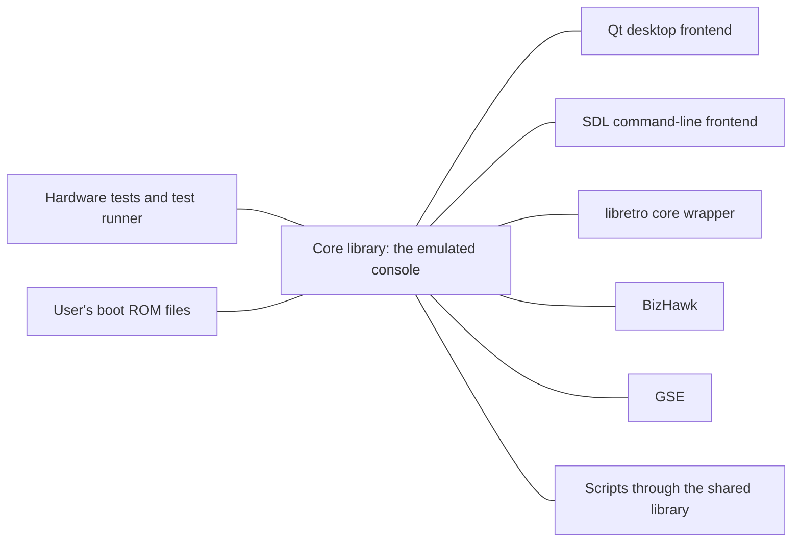

# Gambatte

## Summary

Gambatte is a Game Boy and Game Boy Color emulator in C++ by one author,
built on tests that were written for it and verified on consoles; other emulator authors have named it, with BGB,
among the most accurate emulators of the system.
Its original repository has been taken private, and it lives on in forks: a libretro core,
and a speedrunning core that [GSE][gse-readme] and [BizHawk][bizhawk] embed.

This study rests on prose and published results only: no Gambatte code was read,
so the note says what the parts are and how the emulator behaves in tests, but not how the core keeps time,
draws a line, or lays out a save state.

Three lessons matter most to Rustalgia: a core library with no host dependencies outlived its frontends and its origin,
though its interface was never documented or declared stable;
the fork line treats determinism as a contract of a cycle count, a named console platform, real boot ROMs,
and a listed set of settings that affect sync; and accuracy that lives only in code,
under an unclear licence and one person's custody, does not transfer.
The published tables also show where the lineage is behind today's leaders:
the tests of the DMG's sprite-memory corruption bug, register changes in the middle of a scanline,
and Color sound timing.

## Scope

- **Versions and date.** Examined on 2026-11-27.
  No fork's current release, nor the release that the shootout ran, could be identified,
  because the source guard blocks release and commit metadata for walled repositories (research log).
  Cited pages name two fork releases: speedrun rules allow Gambatte-Speedrun from r717
  ([Pokémon Speedruns wiki, rules][psr-rules]),
  and BizHawk 2.6 took the library at "r729+" ([BizHawk release history][tv-prev], 2.6).
  The forks' READMEs were read at the head of `master` that each repository's front page showed on that day:
  gambatte-core `5a41a68c`, Gambatte-Speedrun `c931353a`, gambatte-libretro `b14881d3`, and GSE `16951373`.
  The dates of those commits could not be read.
  The last upstream release that any page names is r571 ([What works poorly](#what-works-poorly)).
- **Kinds of source.**
  The forks' READMEs; the [SourceForge project page][sf] and an archived copy of the old project home page;
  the [libretro documentation][lr-docs] and two libretro blog posts;
  BizHawk's README and its pages and release notes on [TASVideos][tv-gb]; a speedrunning community's rule pages;
  packaging metadata; and published test tables, chiefly the [GB Emulator Shootout][shootout].
  The shootout's own harness, which is open tier and is not Gambatte code, was read in source.
- **Licence, tier, and code.**
  The [family survey][survey-acc] records the licence, and its [table][survey-glance], its [re-check][survey-reg],
  and the [register][register] record the tiers that [ADR 0006][adr6] defines.
  The original is closed, and every fork is walled:
  the libretro and speedrunning forks as GPL version 2 with "or later" not stated,
  and GSE as an unresolved mix of MPL-2.0 with that core.
  [What works poorly](#what-works-poorly) adds what this run learned about the notice.
  No Gambatte code was read by anyone in this run: not in a fork, a mirror, a download, or an embedder's copy.
  Every description below is written from prose and from published behaviour, never from an implementation.
- **Not examined, and blocked prose.**
  These addresses are in code spans because a reader must not open them.
  `github.com/sinamas/gambatte` is closed, and only its front page was read.
  `github.com/gb-archive/gambatte`, a copy of Gambatte, is walled in the register and was not read;
  any other copy is unregistered, so walled until it is evaluated, and none was opened.
  `sourceforge.net/projects/gambatte/files` and `sourceforge.net/p/gambatte/code` hold the old downloads
  and source tree, and are walled.
  The code, test, and hardware-test folders of every fork were not opened, nor was any embedder's copy of the core.
  The shootout's harness names download addresses inside `gbdev.gg8.se/files/roms/bootroms`,
  a closed folder of boot ROM images; they were not followed.
  Boot ROM checksums printed by the libretro page are not repeated.
  The guard also blocked prose that ADR 0006 would allow in principle: the forks' changelog files, release pages,
  and install guide, the Gambatte-Speedrun wiki, and a test collection's how-to page for Gambatte's suite
  (research log).
  [Open questions](#open-questions) lists what each would answer.
- **How claims were checked.**
  Nothing was built or run, and test results are published ones.
  Counts by suite were made by script from the shootout page's raw text; the page's own totals are authoritative.
  Four evidence gatherers, one for each area
  (documented design, history and forks, accuracy and tests, reception and weaknesses),
  fetched pages as raw text and confirmed each quotation against it.
  The note was written from their reports alone, with no further fetching.
  Four independent verifiers, who saw only the note, then checked its claims against the sources,
  and a fix pass fetched each disputed source again and applied their findings.
  That makes two independent passes over each claim: the gatherer's and a verifier's.
  A claim with no marker rests on the original text; the other markers are those of the [research guide][guide].

## Architecture

This section separates three things: what the projects' prose states, what is inferred from it,
and what could not be learned without a reader session under [ADR 0006][adr6].

### The parts, as the prose states them

The author's README, which the libretro fork still carries, divides the program in two.
The emulation is "contained in a separate library back-end (libgambatte) written in platform-independent C++"
([gambatte-libretro README][lr-readme], "About").
Beside it stood two frontends: a desktop one on Qt4, with platform extensions for video, sound, and timers,
and a small command-line one on SDL (same section).
The same section warns that "the library API should in no way be considered stable".

The README's build requirements show what each part needs.
The core asks for a C++ compiler and the SCons build tool, with zlib optional.
The Qt frontend adds Qt4 and, by platform, DirectSound, DirectDraw7, and Direct3D9 on Windows, or OSS, ALSA, X11,
XVideo, XRandR, and XShm on Unix-like systems ([gambatte-libretro README][lr-readme], "Compiling").
The core therefore has no host dependency beyond the language's standard library and an optional compression library,
and all host video, audio, and timing live in the frontends (inference).

The author's own account of the project, kept in the plain README that the speedrunning repositories ship,
puts the tests beside the emulator: "The development of numerous tests, and their verification on hardware,
is as much an emphasis as the development of an efficient software implementation"
([gambatte-core plain README][core-plain], "About").
The fork's README calls this the "upstream hwtests suite" and describes a test runner beside it:
the tests are assembled from their sources once, and one script then runs them all,
with the user's DMG and CGB boot ROMs placed in the test folder ([gambatte-core README][core-readme], "Testrunner").

Later hosts replaced the two original frontends without changing this division.

| Host | What it is | Source |
|---|---|---|
| libretro core | "Hard fork of Gambatte to the libretro API" | [repository description][lr-repo] |
| Gambatte-Speedrun | the Qt frontend, moved to Qt5; the core since split off | [README][gsr-readme]; [2.6.3][tv-prev] |
| Shared-library build | the core alone, "for programmatic use" by scripts and tools | [core README][core-readme] |
| BizHawk | a tool-assisted-run host that embeds the speedrunning core | [README][bizhawk]; [Bizhawk/GB][tv-gb] |
| GSE | a C# program that embeds the same core for Game Boy and Color | [GSE README][gse-readme] |

The [survey][survey-front] lists the mobile, web, and desktop frontends that embed Gambatte.

### What the core offers a host

No document describes the library's interface.
What follows is what embedders' documentation and release notes say they get from the core.
Each row is a statement about behaviour, and that all of it passes through one interface is an inference.

| Capability | Evidence | Source |
|---|---|---|
| Save states, in slots | SDL keys; 100 slots in GSE | [README][lr-readme], "Usage"; [GSE README][gse-readme] |
| Rewind and frontend cheats | listed as supported; native cheats are not | [libretro docs][lr-docs], "Features" |
| A battery save file for each game | listed among the core's files | [libretro docs][lr-docs], "Directories" |
| A count of executed cycles | BizHawk 2.3; GSE's bar | [releases][tv-prev]; [GSE README][gse-readme] |
| Memory callbacks, tracing, disassembly | BizHawk 2.6.3, 2.8, and 2.11 | [earlier][tv-prev]; [later][tv-rel] |
| Layer toggles for background, objects, window | BizHawk 2.6 | [earlier releases][tv-prev] |
| Link play between two to four units, and infrared | BizHawk 2.8 and 2.9 | [earlier releases][tv-prev] |
| Link over a network | core options for server or client | [libretro docs][lr-docs], "Core options" |
| Frame boundary set by the host | vertical blank, or a set length | [sync settings guide][tv-sync], "Frame Length" |
| Initial clock state and divisor offset | set by the host before a recording | [sync settings guide][tv-sync] |

In the callbacks row, 2.6.3 fixed the trace logger, 2.8 added callback scopes and disassembly for link play, and 2.11,
which is on the later page, passed the value read to a read callback.
In the link row, 2.8 added three and four units and linking with a Color cartridge's infrared,
and 2.9 extended remote-control emulation to the console's own infrared.

The [sync settings guide][tv-sync] is a user page on TASVideos, which the site marks as personal opinion,
so it documents BizHawk's settings with less authority than a project page (secondary).
Its author's account name is the one under which [GSE][gse-readme] is published,
so the guide is read here as written by GSE's author (inference).

### Time, the processor, and staying in step

The prose says little, and nothing about method.
The core counts cycles and reports the count to its host (table above).
A host can end a frame at the console's vertical blank or after a length it sets, which allows input within a frame
([sync settings guide][tv-sync], "Frame Length").
The speedrunning fork offers a real-time clock that advances with emulated cycles and not with the host's clock,
so that speed-up, pause, and save states do not disturb it ([gambatte-core README][core-readme], "Emulation core").

The frame rate is given as 59.7275005696 frames per second by the [libretro docs][lr-docs]
("Geometry and timing"), and GSE says it always runs at about 59.7275 ([GSE README][gse-readme]).
The Super Game Boy mode exists in the fork "to match the SGB2 platform/framerate" ([gambatte-core README][core-readme]).

No page read says how the processor is executed.
BizHawk 2.9 reports a 10 to 15% speed gain from work on the fork's processor loop and memory access
([BizHawk release history][tv-prev], 2.9), which is the only prose on the subject.
No page mentions a recompiler, and the published results show timing finer than one instruction:
GSE and Gambatte-Speedrun both pass all 66 Mooneye acceptance tests on the [shootout][shootout],
many of which are believed to turn on the cycle within an instruction at which a memory access falls (from memory).
The core therefore resolves time below the instruction, by a means the prose does not give (inference).

### Hardware modes and boot

Upstream called itself a Game Boy Color emulator that also runs Game Boy programs
([gambatte-libretro README][lr-readme], "About", "Usage").
The lines have since diverged.

| Line | Selectable hardware | Source |
|---|---|---|
| libretro core | Auto, GB, GBC, GBA | [libretro docs][lr-docs], "Emulated hardware" |
| Speedrunning fork | Game Boy Player by default; GB, GBC, GBA, SGB2 in the other build | [core README][core-readme] |
| GSE | adds Game Boy Player and SGB2 with their reset timing | [GSE README][gse-readme], "Emulation core" |
| BizHawk | Auto, GBC, and GBA are named; Super Game Boy | [sync settings guide][tv-sync]; [BizHawk README][bizhawk] |

The guide names those three values of BizHawk's console mode and does not list the full set.
"GBA" here means the Color hardware inside a Game Boy Advance, not Advance games
([GSE README][gse-readme], "Emulation core", which speaks for GSE).
BizHawk's 2.4.1 notes describe the same mode, say the setting applies only in Color mode,
and say it exists so that timing matches the Advance and the Game Boy Player
([BizHawk release history][tv-prev], 2.4.1).
The Super Game Boy is a fork addition, at high level: BizHawk's 2.6.3 notes announce it,
and 2.7 made Gambatte the default Super Game Boy core ([BizHawk release history][tv-prev], 2.6.3 and 2.7).

The lines also differ on boot ROMs, which the [survey][survey-start] outlines.
Upstream started a game by setting the state that the boot ROM leaves behind;
BizHawk's 2.6.3 notes describe a return to that original behaviour ([BizHawk release history][tv-prev], 2.6.3).
The libretro core uses the user's files only when an option is on ([libretro docs][lr-docs], "BIOS").
The speedrunning fork requires them and ties the requirement to timing: "Timing parity with official consoles
(bootroms required; GBP/SGB2 hard reset fades emulated)" ([gambatte-core README][core-readme], "Speedrun features").
GSE requires them and states no reason ([GSE README][gse-readme], "Speedrunning").
The guide describes starting without one as booting by "hacks" ([sync settings guide][tv-sync]).

### Video and audio

The core hands finished frames and sound to its host, and the hosts add presentation.
The libretro core colours monochrome games from the game's Color palette, its Super Game Boy palette,
a built-in palette, or a user file, and chooses among them automatically by a stated order
([libretro docs][lr-docs], "Core options").
It can correct colour for the Color's screen by two methods, of which the older "fast" one is the original default,
and it adds a filter that darkens bright pixels for hosts that cannot run shaders
([libretro, "Gambatte Progress Report"][lr-blog-2018]).
It can blend each frame with the one before, as an option,
because some games draw on alternate frames and rely on the slow screen ([libretro docs][lr-docs], "Mix frames").
A 2020 post renames that option "Interframe Blending", adds two screen-ghosting modes to the two simple mixes,
and gives the typical overhead of the four settings as between 13% and 48%: 13% and 30% for the simple mixes,
28% and 48% for the ghosting modes ([libretro progress report, February 2020][lr-blog-2020]).
BizHawk 2.9 added a colour correction by SameBoy's formula and made it the default
([BizHawk release history][tv-prev], 2.9).

BizHawk marks one sound fix as a change that does not affect sync ([BizHawk release history][tv-rel], 2.11).
Palettes, colour correction, blending, and at least part of sound output are therefore stages after the emulated state,
which a host can change without invalidating a recording (inference).

The README's credits are a list of names only ([gambatte-libretro README][lr-readme], "Thanks").
Several are believed to be authors of well-known scaling and television filters
(from memory), which suggests that the Qt frontend offered such filters (inference); no page read lists them.

### Save states

States exist in every line (table above), and their format is not described anywhere.
BizHawk's 2.3 notes warn that a fix broke compatibility with earlier states,
and its 2.6.3 notes list state consistency among improvements ([BizHawk release history][tv-prev], 2.3 and 2.6.3).
BizHawk's embedding therefore broke state compatibility at least once,
and nothing read promises that the format is stable between versions (inference).

### What could not be learned

A reader session, and nothing less, would answer these:

- how the core schedules its components and reaches timing below the instruction;
- how the video chip is modelled, and whether drawing is by line or by dot;
- how sound is generated and resampled, and at what rate;
- the shape of the library's interface, and the layout and versioning of states and battery saves.

One more could be answered from prose that the guard blocked:
the scheme by which the hardware tests are named and the console revisions on which they were verified.
The tests are believed to carry their expected result and the consoles it holds on in each file's name
(from memory); no page read confirms it.

## What works well

- **A core with no host dependencies, embedded six ways.**
  The library needs a C++ compiler and the SCons build tool, with zlib optional, and no windowing, video,
  or sound library from the host ([gambatte-libretro README][lr-readme], "Compiling").
  That is the mechanism by which one core serves a Qt program, a command-line program, libretro, BizHawk, a C# frontend,
  and scripts ([Architecture](#architecture)).
  It is also why the core outlived both of its original frontends and its own origin (inference).
- **Tests verified on hardware, treated as a product.**
  The author made the tests "as much an emphasis" as the implementation ([gambatte-core plain README][core-plain]).
  The project's old home page counted "a few thousand corner-case hardware tests"
  ([archived home page][old-home], "About this project"),
  where the older README says "hundreds" ([gambatte-libretro README][lr-readme], "About").
  The suite outlived the origin: a third-party collection distributes it and now takes it from gambatte-core,
  "as the original Gambatte repository is not public anymore" ([game-boy-test-roms README][csp]).
  [TASVideos][tv-acc] sets "Gambatte's extensive test suite" apart from the public suites as a separate oracle.
- **Timing of the processor, interrupts, and timer on the public suites.**
  GSE and Gambatte-Speedrun, the two entries on the [shootout][shootout] of 2026-06-04 that embed the fork's core,
  pass all 66 Mooneye acceptance tests, level with SameBoy (counted by script).
  "Both" below means those two entries.
  A snapshot from March 2015 passed 2 of 13 timer tests and 2 of 9 video tests of the Mooneye set of that day
  ([wilbertpol's Mooneye GB README][wp-mooneye], "Accuracy comparison"),
  so the lineage kept improving after its last release (inference; the test set also changed).
  It has passed blargg's processor and sound suites since the [gbdev wiki's table][gg8-tests] of version 0.5.5.
- **Determinism as a declared contract.**
  A guide by GSE's author lists the settings of BizHawk's core that affect sync, among them boot ROM use, console mode,
  the pull-up time of the cartridge bus, the initial clock state, frame length, and layer display
  ([sync settings guide][tv-sync]) (secondary).
  GSE claims emulation "capable of replicating Pokémon RNG manipulations and creating console verifiable TASes",
  and adds that such runs are made in BizHawk, which shares the core ([GSE README][gse-readme], "Features").
  That the cycle count, the cycle-based clock,
  and the listed settings are what let a recording replay on a console is the note's reasoning (inference).
- **A named verification platform.**
  The fork line models the machine that runners and verifiers use, the Game Boy Player, and the SGB2,
  including reset fades and frame rate ([gambatte-core README][core-readme]).
  TASVideos says the core "has since been rebased on Gambatte-Speedrun
  which has focused on extreme attention to accuracy with the Game Boy Player" ([TASVideos, Bizhawk/GB][tv-gb]).
  A speedrunning wiki gives the result as its reason for allowing the emulator: "As far as we are aware,
  the timing on Gambatte is exactly the same as on console"
  ([Pokémon Speedruns wiki, "Emulators"][psr-emus], last edited 2021-02-15).
- **Replay of console-verified runs as a second oracle.**
  A contributor's page reports that 41 of 46 runs verified on a Game Boy Player pass when replayed,
  36 from the console's input logs and 5 from the original BizHawk movies,
  and argues that such replays catch regressions that test ROMs miss ([GSR automation page][gsr-auto])
  (lead: a personal page, undated).
- **Evidence a verifier can read from a recording.**
  Gambatte-Speedrun shows its version and the game's identity after a hard reset, and disables cheats, turbo,
  and frame-rate changes ([Gambatte-Speedrun README][gsr-readme], "Speedrun features").
  GSE shows the game's CRC32 and the running cycle count in a bar that capture software records,
  forbids opposing directions, and keeps "Input logs stored for all runs,
  giving run verifiers a secondary source of proof" ([GSE README][gse-readme], "Speedrunning").
  These match the community's rules, which ask for a hard reset on video or a capture of the whole emulator window,
  and ban states and speed-ups ([Pokémon Speedruns wiki, rules][psr-rules]) (inference).
- **Lower cost than a rival of similar accuracy.**
  BizHawk's page says its own GBHawk core has comparable or better accuracy and wider mapper support,
  "but runs significantly slower at uncapped framerate" ([TASVideos, Bizhawk/GB][tv-gb]).
  The cause of Gambatte's speed is not in any prose read;
  the author's README says only that "efficiency and convenience are often emphasised" over clarity
  ([gambatte-core plain README][core-plain]).

## What works poorly

- **Accurate, but not a reference.**
  The author warns that "the source code is not intended to serve as documentation for the hardware being emulated"
  ([gambatte-core plain README][core-plain], "About").
  Mooneye GB's author rates Gambatte and BGB as highly accurate,
  and says they are not documented well enough to serve developers as a reference ([Mooneye GB README][mooneye-gb]).
  In 2017 mGBA's author called them "by far the two most accurate Game Boy emulators",
  in a post on a game that fails in both for a timing cause the post calls unknown
  ([mGBA, "'Holy Grail' Bugs in Emulation, Part 1"][mgba-blog]).
  No design document exists; the forks' READMEs list differences and build steps only,
  and gambatte-core's README still carries the title of the frontend it was split from
  ([gambatte-core README][core-readme]) (observed).
- **An interface that was never written down or fixed.**
  Upstream disclaimed stability ([gambatte-libretro README][lr-readme], "About"), and no page describes the interface.
  BizHawk is the documented case of the cost: it carried its own changes until they were merged in 2021
  ([BizHawk release history][tv-prev], 2.6.3).
  That every embedder had to learn the interface from the code is likely but not stated anywhere (inference).
- **One author's custody, and no releases for years.**
  The last release that packagers and catalogues name is r571:
  [Repology][repology] shows every distribution that packages upstream at 571, as does [pkgsrc][pkgsrc],
  and a fan catalogue dates it 2014-09-28 ([Zophar's Domain][zophar]) (lead).
  The author's notice is dated 2007 ([gambatte-libretro README][lr-readme]),
  and the [SourceForge page][sf] gives the project's registration as 2007-08-20 and its last update as 2019-05-07;
  the survey records the last push to the original repository as 2021-07-06.
  No page gives the date on which it was taken private.
  The original repository now holds one commit and one file, which says that the project has been taken private
  (front page of the closed repository, which is not linked).
  No page states a reason: the README gives none, the SourceForge page still points at the old address,
  and the project's own site now redirects to that page.
  Every living fork descends from an unreleased head, while distributions ship a build from 2014 (inference).
- **A licence notice one clause short.**
  The author's notice grants "the terms of the GNU General Public License version 2
  as published by the Free Software Foundation", without the customary later-version clause
  ([gambatte-libretro README][lr-readme]).
  The forks restate it as "Under GPLv2."
  ([gambatte-core README][core-readme]),
  and packagers record it both ways: one as version 2 or later, others as version 2 ([Repology][repology]).
  The per-file notices, where an "or later" grant would sit, were not read.
  The author is not reachable through any channel found, so the origin cannot settle it (inference).
  The [survey][survey-reg] holds the tier that follows.
- **Four lines and no shared upstream.**
  The libretro hard fork adds presentation features; gambatte-core serves speedrunning and BizHawk;
  Gambatte JG serves the [Jolly Good framework][jg]; and a copy that the [register][register] lists was not read.
  No prose says which accuracy fixes each line has, and published tables test only the speedrunning line.
  The speedrunning frontend has itself been replaced: its README opens by saying that it is superseded
  ([Gambatte-Speedrun README][gsr-readme]).
  Speedrun rules ban "standard Gambatte" by name
  ([Pokémon Speedruns wiki, rules][psr-rules]),
  so "Gambatte" in a table or a rule means a particular fork at a particular date.
- **The tests of the DMG's sprite-memory corruption bug fail.**
  Both fail the same four of blargg's OAM-bug tests on the [shootout][shootout]
  (counted by script), where SameBoy, docboy, Emulicious, and Beaten Dying Moon pass all 51 blargg tests.
  The failure is old: version 0.5.5 failed 5 of 8 sub-tests on the [gbdev wiki][gg8-tests],
  and r571 failed the same five on [TASVideos][tv-acc].
  On the gbdev wiki's hardware table a Game Boy Color fails the same five sub-tests and a DMG passes,
  so those old versions, run as a DMG, behaved here as a Color does (inference).
  The two shootout entries now fail four of the five and pass the seventh, so the match is no longer exact.
  The tables show failed tests, not that the bug is absent from the model.
- **Register changes in the middle of a scanline.**
  Both pass 12 of the 24 DMG tests of Mealybug Tearoom and fail the same 12, which cover palette, sprite,
  and window changes during drawing; docboy and Beaten Dying Moon pass all 24 ([shootout][shootout], counted by script).
  Both also fail the test of sprite-memory transfer during drawing, and Gambatte-Speedrun fails cgb-acid-hell.
- **Color sound timing.**
  GSE passes 42 of the 68 SameSuite tests,
  and all 26 failures are sound tests of the two square channels and the noise channel; SameBoy passes those
  ([shootout][shootout], counted by script).
  BizHawk was still fixing sound in the core in 2025 and 2026 ([BizHawk release history][tv-rel], 2.11 and 2.11.1).
  Why the tests fail is not known from prose.
- **Mappers and peripherals.**
  The libretro core does not emulate MBC6, MBC7, TAMA5, or the Pocket Camera, and five named games crash on start
  ([libretro docs][lr-docs], "Compatibility").
  The last Gambatte-Speedrun release fails 10 of Mooneye's mapper tests, for MBC1 and MBC2,
  and all three real-time-clock tests by ax6; GSE fails one and none ([shootout][shootout], counted by script).
  BizHawk's notes record mapper work in the core as late as 2.9, released 2023-04-07
  ([BizHawk release history][tv-prev], 2.9).
  The speedrunning wiki sends Gold's glitched any% and Yellow's glitched categories to BGB,
  "because Gambatte does not emulate some glitches correctly" ([Pokémon Speedruns wiki, "Emulators"][psr-emus]).
- **The start without a boot ROM is a set state, and it moved.**
  BizHawk's notes record accuracy work on that path in 2.6.3,
  and say that a change to the boot setting in 2.5 broke older recordings ([BizHawk release history][tv-prev]).
  The starting state is part of what a recording depends on (inference).
  The fork's claim of timing parity holds only with the user's boot ROMs ([gambatte-core README][core-readme]).
- **The project's own test evidence is unpublished, and needs copyrighted files.**
  Running the hardware tests needs the user's DMG and CGB boot ROMs and an assembly step
  ([gambatte-core README][core-readme], "Testrunner"), so a clean build server cannot run them (inference).
  No pass count, list of failures, or naming scheme appears in any README read,
  and the [shootout][shootout-readme] does not run the suite, so no public table shows how any emulator,
  the forks included, scores on it.
- **Save states have broken between versions** at least once, as [Architecture](#save-states) records.
- **Platform fixed at build time, and ageing toolkits.**
  The fork's default build fixes the platform to the Game Boy Player,
  and the build with selectable platforms needs a separate configuration ([gambatte-core README][core-readme]).
  The desktop frontend moved from Qt4 to Qt5 and was then replaced by a C# program
  ([Gambatte-Speedrun README][gsr-readme]; [GSE README][gse-readme]).
- **Embedders' documentation drifts from the core.**
  The [libretro docs][lr-docs] page leaves the sample rate and screen size as unfilled placeholders,
  carries a rumble paragraph that names another core, and still links the private original (observed).

Two cautions apply to the shootout figures.
The header counts for the three emulators named here include three rows marked as information,
which are not scored tests, so their scored passes are three fewer: 215 for GSE and 166 for Gambatte-Speedrun,
against 250 for SameBoy (calculated from the counts by suite).
Gambatte-Speedrun's total is out of 207 and not 264 because the harness skips 57 sound tests for it:
they need a feature that its entry in the harness does not declare
([shootout repository][shootout-repo], read in source).
The page prints no emulator versions; the harness takes each emulator's latest release when it runs.
It also tests the plain DMG, Color, and SGB platforms, not the Game Boy Player mode that speedrun rules require.

## Implications for Rustalgia

- **A core library with no host dependencies is recommended, with its interface documented and versioned.**
  Gambatte shows both halves: the split let six hosts embed one core,
  and the undocumented interface left BizHawk carrying its own changes for years,
  and probably left each host to learn it from code (inference).
  This feeds [`R2-10`][phase2].
- **A declared determinism surface is recommended from the first design.**
  The settings that the [sync settings guide][tv-sync] lists for BizHawk are a starting list: boot path, console model,
  multicart handling, the pull-up time of the cartridge bus, the initial clock state and divisor offset,
  the frame boundary, and layer display.
  A cycle count belongs beside them, though the guide does not list one.
  Presentation settings stay outside the surface, as Gambatte's hosts show they can;
  BizHawk nonetheless treats layer display, which is presentation, as a sync setting.
  This feeds [`R2-08`][phase2].
- **Console models are better treated as data that includes the verification platforms.**
  The Game Boy Player and the SGB2 are what runs are verified on, and Gambatte's fork fixed one of them at build time.
  A model chosen at run time, with reset behaviour and frame rate as part of it, is recommended.
  This feeds [`R2-03`][phase2].
- **The start without a boot ROM is recommended as a state verified for each model, and treated as part of the
  contract.**
  Gambatte's set state needed later accuracy work, and a change to the boot setting broke older recordings.
  The [survey][survey-start] recommends the same start; the addition here is that the state is versioned,
  and that the note for [`R2-12`][phase2] says which results depend on a real boot ROM.
- **Two oracles are recommended: test ROMs and replays of console-verified input logs.**
  The forks pass every Mooneye acceptance test and still fail half of one video suite and many sound tests,
  so no single suite is a target.
  Mealybug Tearoom, SameSuite, blargg's OAM-bug tests, cgb-acid-hell,
  and the clock and mapper suites belong in the tracked set, with pass lists published for each.
  The tests are best runnable without copyrighted files, and the shootout's harness is not run as it stands,
  because it fetches boot ROMs from a closed folder.
  This feeds [`R2-15`][phase2].
- **For the failures above, Gambatte is not the source to learn from.**
  The corruption bug and Color sound timing are answered better by SameBoy, which is open tier
  and passes those tests ([`R1-30`][studies]).
  For register changes in the middle of a scanline, the table's full passes are docboy,
  which the [survey][survey-glance] records as open tier, and Beaten Dying Moon; SameBoy passes 15 of the 24
  ([shootout][shootout], counted by script).
- **Facts belong in notes and tests, with the reason beside each behaviour.**
  Gambatte's knowledge is locked in code that its author said was not documentation.
  Each timing behaviour in Rustalgia would cite the test or measurement that fixed it.
- **An unambiguous licence notice and shared custody are recommended from the first commit.**
  That means the full identifier, with "only" or "or later", in the README and in every file,
  with regular tagged releases, more than one person holding rights, and a mirror.
- **Verifier-facing identity is worth planning with the frontend.**
  That means the build version, a game hash stronger than CRC32, a cycle count, and an input log,
  with a mode that removes cheat-capable features instead of hiding them.
  It also means a version field in the save-state format, and a statement of which versions load.
- **A reader session on Gambatte, as [ADR 0006][adr6] defines one, is not recommended now.**
  It would answer the questions listed under [Architecture](#what-could-not-be-learned), and no prose can.
  Against that: the author disclaims the code as documentation,
  SameBoy answers the same design questions in the open tier and scores higher on the published tables,
  and a reader's output is limited to functional description.
  Two cheaper steps are recommended first, both for the owner to allow:
  widening the guard's list of prose files to changelogs, release notes, and test documentation,
  and a check of the header notices of a few files, which would settle "or later" and could move the forks' tier.
  If a session is held later, gambatte-core is the candidate: its front page lists the core library, the tests,
  and build scripts, with no frontend folder (observed), and the published results measure emulators that embed it.

## Open questions

- Why was the original repository taken private?
  No public statement was found on its front page, on SourceForge, or by a web search;
  only a statement from the author would answer it.
- How do the forks, and other emulators, score on Gambatte's own hardware tests?
  No table is published.
  A run of the suite would answer it, which needs the tests to be readable and the user's boot ROMs;
  the oracle work in [`R2-15`][phase2] would decide whether to make one.
- Has gambatte-libretro taken gambatte-core's accuracy work since 2021?
  No published table includes it, and its history is walled.
  A reader session under [ADR 0006][adr6], or a run of the public suites against it, would answer.
- Which releases of Gambatte-Speedrun and GSE does the shootout table of 2026-06-04 measure,
  and what do the tests' names encode?
  Both sit in prose that the guard blocks: release pages, and test documentation below a repository's root.
  An owner's change to the guard's list of prose files would allow them to be read.
- How does the core keep time and draw, and how are its states laid out?
  Only a reader session would answer; [Implications](#implications-for-rustalgia) recommends against one for now.

## Sources

Every source was read on 2026-11-27.
A repository file was read at the head of its default branch on that day, and its commit is given.

Gambatte and its forks (walled tier, prose only):

- [gambatte-libretro README][lr-readme] and [repository front page][lr-repo], commit `b14881d3`.
- [gambatte-core README][core-readme] and [plain README][core-plain], commit `5a41a68c`.
- [Gambatte-Speedrun README][gsr-readme], commit `c931353a`.
- [GSE README][gse-readme], commit `16951373`.
- `github.com/sinamas/gambatte`, front page only, commit `4f0157e8`; closed, so not linked.

The project's own pages:

- [Gambatte on SourceForge][sf], last update 2019-05-07.
- ["SourceForge.net: Gambatte - Project Web Hosting - Open Source Software"][old-home], the old home page,
  in an existing capture of 2012-12-04 01:20:50.

Embedders:

- [BizHawk README][bizhawk], walled tier, prose only; commit `70449050`.
- TASVideos: ["Bizhawk/GB"][tv-gb], last edited 2026-04-05; ["Bizhawk/ReleaseHistory"][tv-rel], last edited 2026-05-31;
  ["Bizhawk/PreviousReleaseHistory"][tv-prev], last edited 2026-05-26; ["GBCSync Settings Guide"][tv-sync], a user page,
  last edited 2022-01-02.
- [libretro docs, "Nintendo - Game Boy / Color (Gambatte)"][lr-docs], footer date 2026-10-22.
- libretro blog: ["Gambatte Progress Report"][lr-blog-2018], 2018-10-25;
  ["Libretro Cores Progress Report – February 29, 2020"][lr-blog-2020].

Tests and published results:

- [GB Emulator Shootout][shootout], page updated 2026-06-04;
  its [README][shootout-readme] and [repository][shootout-repo], commit `e7e6d807`.
- [TASVideos, "EmulatorResources/GBAccuracyTests"][tv-acc], last edited 2023-07-11.
- [gbdev wiki, "Test ROMs"][gg8-tests], last modified 2020-03-31.
- [wilbertpol's Mooneye GB README][wp-mooneye], commit `b78dd21f`; [Mooneye GB README][mooneye-gb], commit `3856dcbc`.
- [game-boy-test-roms README][csp], walled tier, README only; commit `f8c3da84`.

Reception, rules, and packaging:

- [mGBA, "'Holy Grail' Bugs in Emulation, Part 1"][mgba-blog], 2017-05-29.
- Pokémon Speedruns wiki: ["Emulators"][psr-emus], last edited 2021-02-15;
  ["Pokémon GSC Category Extensions/Rules"][psr-rules], last edited 2024-05-10.
- ["GB TAS Verification as Test Automation for Gambatte Speedrun"][gsr-auto], a personal page, undated; a lead.
- [Repology, project "gambatte"][repology]; [pkgsrc, "emulators/gambatte"][pkgsrc], source version 571nb1;
  [Zophar's Domain, "Gambatte"][zophar], a lead.
- [Jolly Good Emulation][jg], home page.

This repository:

- [The family survey, R1-10][survey]; [the research guide][guide]; [the research roadmap][studies]; [ADR 0006][adr6];
  [the source register][register].

[survey]: ../topics/R1-10-game-boy-family.md
[survey-acc]: ../topics/R1-10-game-boy-family.md#accuracy-led-emulators
[survey-glance]: ../topics/R1-10-game-boy-family.md#the-emulators-at-a-glance
[survey-reg]: ../topics/R1-10-game-boy-family.md#register-re-check
[survey-start]: ../topics/R1-10-game-boy-family.md#how-to-start-a-game
[survey-front]: ../topics/R1-10-game-boy-family.md#frontends-and-mobile-apps
[guide]: ../README.md#claim-status
[adr6]: ../../adr/0006-read-sources-by-tier-under-a-compatibility-test.md
[register]: ../../../.claude/hooks/source-register.txt
[studies]: ../../roadmap/research.md#emulator-studies
[phase2]: ../../roadmap/research.md#phase-2-cross-cutting-engineering
[lr-readme]: https://github.com/libretro/gambatte-libretro/blob/b14881d382d251c75dcf465ccc9e0f1e1bb39ca9/README.md
[lr-repo]: https://github.com/libretro/gambatte-libretro
[core-readme]: https://github.com/pokemon-speedrunning/gambatte-core/blob/5a41a68c25402421fb1983ddadc9faf2418ddb0f/README.md
[core-plain]: https://github.com/pokemon-speedrunning/gambatte-core/blob/5a41a68c25402421fb1983ddadc9faf2418ddb0f/README
[gsr-readme]: https://github.com/pokemon-speedrunning/gambatte-speedrun/blob/c931353a3ee8dd464feadbae9806b5c14acfab33/README.md
[gse-readme]: https://github.com/CasualPokePlayer/GSE/blob/169513730ed3e62d362908abfc95bf7468ea66d2/README.md
[bizhawk]: https://github.com/TASEmulators/BizHawk/blob/70449050af581f42e4b8d289dc431f3ac19cc6bc/README.md
[csp]: https://github.com/c-sp/game-boy-test-roms/blob/f8c3da8431dc60d752007bce571f50fd380b445e/README.md
[sf]: https://sourceforge.net/projects/gambatte
[old-home]: https://web.archive.org/web/20121204012050/http://gambatte.sourceforge.net/
[lr-docs]: https://docs.libretro.com/library/gambatte/
[lr-blog-2018]: https://www.libretro.com/index.php/gambatte-progress-report/
[lr-blog-2020]: https://www.libretro.com/index.php/libretro-cores-progress-report-february-29-2020/
[tv-gb]: https://tasvideos.org/Bizhawk/GB
[tv-rel]: https://tasvideos.org/Bizhawk/ReleaseHistory
[tv-prev]: https://tasvideos.org/Bizhawk/PreviousReleaseHistory
[tv-sync]: https://tasvideos.org/HomePages/CasualPokePlayer/GBCSyncSettingsGuide
[tv-acc]: https://tasvideos.org/EmulatorResources/GBAccuracyTests
[shootout]: https://gbdev.io/GBEmulatorShootout/
[shootout-readme]: https://github.com/gbdev/GBEmulatorShootout/blob/e7e6d80768bfea8139bfe1fb51e53acb508ab27a/README.md
[shootout-repo]: https://github.com/gbdev/GBEmulatorShootout/tree/e7e6d80768bfea8139bfe1fb51e53acb508ab27a
[gg8-tests]: https://gbdev.gg8.se/wiki/articles/Test_ROMs
[wp-mooneye]: https://github.com/wilbertpol/mooneye-gb/blob/b78dd21f0b6d00513bdeab20f7950e897a0379b3/README.markdown
[mooneye-gb]: https://github.com/Gekkio/mooneye-gb/blob/3856dcbca82a7d32bd438cc92fd9693f868e2e23/README.markdown
[mgba-blog]: https://mgba.io/2017/05/29/holy-grail-bugs/
[psr-emus]: https://wiki.pokemonspeedruns.com/index.php?title=Emulators
[psr-rules]: https://wiki.pokemonspeedruns.com/index.php?title=Pok%C3%A9mon_GSC_Category_Extensions/Rules
[gsr-auto]: https://tikevin83.github.io/gsr-automation-site/
[repology]: https://repology.org/api/v1/project/gambatte
[pkgsrc]: https://ftp.netbsd.org/pub/pkgsrc/current/pkgsrc/emulators/gambatte/index.html
[zophar]: https://www.zophar.net/gb/gambatte.html
[jg]: https://jgemu.gitlab.io/
