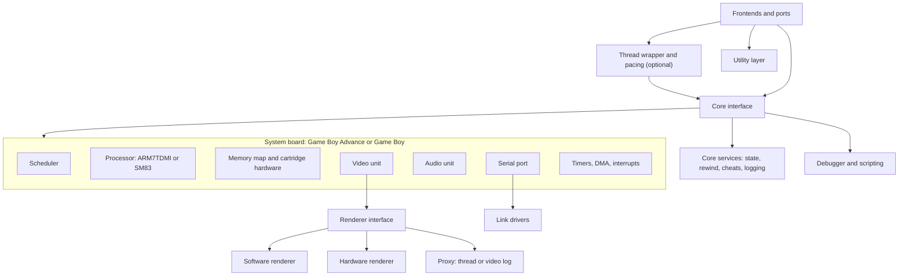

# mGBA

## Summary

mGBA is an open-tier emulator of the Game Boy Advance and the Game Boy, maintained by one regular committer,
and the default Game Boy Advance core of most frontends
([family survey](../topics/R1-11-game-boy-advance-family.md#frontends-libretro-cores-and-phone-apps)).
It set out to be fast enough for lower-end hardware, and needs no file from the user but a game.

Its structure is what to learn from: a system-independent core reached through one narrow interface, with threads,
pacing, and resampling outside it; a scheduler that hands each event the number of cycles by which it fired late;
a video unit that reports writes to a renderer through an interface narrow enough to record and replay;
and a regression tree that compares frames exactly and pins known-wrong output.

Its limits are as instructive: Game Boy Advance instructions run whole,
which the author says caps timing accuracy short of a rewrite
([accuracy post][acc]),
and its timing scores are the same in the two third-party tables found for 0.10.3 and for a 2026 build
(secondary and lead);
the picture is drawn one line at a time; the save state is one hand-kept byte map;
and the embedding interface is neither stable nor documented.

For the owner, the note recommends timed bus steps in every processor, video writes recorded with their position,
a state format described per part, and an embedding interface with a version, kept in the main tree.

## Scope

- Examined on 2026-11-27: the head of `master`, commit `c4fe856f2b33d116b8f54267359d4c81653759f6` of 2026-11-25,
  which is the unreleased 0.11 line.
  The latest release is 0.10.5, tagged 2025-03-09 UTC and dated 2025-03-08 in the [change log][changes],
  through which alone it was examined.
  The test suite `mgba-emu/suite` was read at commit `e6942030d25ffe3ba76c72b73a86da073ec857cc` of 2026-07-09.
- Kinds of source: the repository's source files and file listing; its README, change log, and guides;
  the project's site and blog; maintainer comments in issue threads; the project's build server logs;
  and third parties' published score tables.
  A forum thread and a user wiki are used as leads only.
- Licence and tier: MPL-2.0, open tier,
  as the [survey's table](../topics/R1-11-game-boy-advance-family.md#the-emulators-at-a-glance)
  and the [register](../../../.claude/hooks/source-register.txt) record.
  The source was read, and nothing was copied or ported.
  The Architecture section was written after reading the implementation, and describes it at the level of its parts.
- Not examined, as closed by [ADR 0006](../../adr/0006-read-sources-by-tier-under-a-compatibility-test.md#closed-tier):
  the built-in replacement BIOS and the BIOS-call files, `src/gba/hle-bios.*`, `src/gba/bios.c`,
  and `include/mgba/internal/gba/bios.h`, which are replacement system software,
  and the dumping tool `mgba-emu/bios-dump`.
  None is linked here, for that reason.
  Not examined, by choice: `src/third-party/`;
  the routines in the two board files that set the state a boot program would leave, known from an outline only;
  the vendor cheat-code decoders, which may hold seed tables; the e-Reader files; the suite's BIOS-math expectations;
  and every file under `cinema/`, whose video logs may embed graphics of commercial games (inference).
  The Qt frontend was read for its defaults only.
- Nothing was built or run.
  Every result below is one that the project or a third party published.
- How claims were checked: a claim cited to a repository file was read in that file at the commit above,
  and a claim cited to the README, the change log, a post, or an issue thread was read there as raw text.
  Other claims carry a marker from the [research guide](../README.md#claim-status).
  Four evidence gatherers each covered one area
  (structure and timing; video, audio, and state; accuracy and tests; the project and its weaknesses);
  the writer worked from their reports alone;
  four independent verifiers who saw only the note then checked it against its sources;
  and a fix pass applied their findings.
  The source guard blocked no request (research log).

## Architecture

### Parts

The tree has six layers, each one or more directories under `src/` (file listing, observed).
A system-independent core owns the core interface, the event scheduler, the thread wrapper, pacing, configuration,
logging, the save-state container, rewind, cheats, and input mapping.
Two processors, the ARM7TDMI and the SM83, sit beside two system boards, the Game Boy Advance and the Game Boy.
Optional features (debugger, scripting, video logging) and a utility layer
(a virtual file abstraction, threading primitives for each host, an audio buffer and resampler, patch formats)
complete the core side.
Frontends and ports each have a folder under one platform directory: Qt, SDL, libretro, Python bindings, 3DS, Vita,
Switch, Wii, and a headless test set.

The port rule is written down: "Folders for each port should be under the `src/platform` folder,
and make minimally invasive changes to the rest of the tree" ([PORTING.md][porting]).
Only two systems exist on `master` ([`core.h`][f-core-h]);
the DS work is a separate branch that the author said in 2017 would be merged back later ([medusa post][medusa]).

### The boundary between core and frontend

One record of operations is the whole boundary ([`core.h`][f-core-h]).
A core object holds opaque handles to its processor and board, a pointer to its scheduler,
and 88 operations at the commit read:

| Group | What it covers |
|---|---|
| Lifecycle and media | Create, reset, destroy; probe and load a ROM, a save, a BIOS file, a patch |
| Running | Run one frame, run until the next batch of events, step one instruction |
| Video and audio | Sizes, the host's pixel buffer or texture, the core's audio buffer and its rate |
| Input | The key state as a bitmask |
| State | Size, save and load to a flat buffer, extra items |
| Peripherals | Rotation, rumble, an image source, a clock source |
| Introspection | Bus and raw memory access, lists of memory blocks, registers, video layers, audio channels |

A frontend finds a core by offering the file to each compiled-in system in turn ([`core.c`][f-core-c]).
The [example server][f-example] shows the least a frontend does: find a core, ask the video size,
hand over a pixel buffer, load the file and the configuration, reset, and then for each frame set the keys,
run one frame, and read the buffer.

The core calls back through sets of callbacks
(frame started and ended, crashed, keys read, save data updated)
and an optional stream sink that receives each finished frame, each audio sample pair, and changes of size or rate.
Host devices are small interfaces the frontend implements: a clock, rotation, rumble,
and a camera ([`interface.h`][f-interface]), and
for the Game Boy Advance a light sensor ([`gba/interface.h`][f-gba-interface]).
The clock source can pass wall time, a fixed time, a fake epoch, or wall time plus an offset,
and its setting is saved with states.

The [libretro port][f-libretro] drives the same interface without the thread wrapper, one frame for each host call.
That port keeps its core in file-level variables, so one instance in a process is a property of the port,
not of the core.

### Threads and pacing

The core has no thread of its own.
An optional wrapper owns one emulation thread that runs the core from one batch of events to the next,
and other threads control it through a guarded state machine with requests to pause, reset,
or run a function on that thread ([`thread.h`][f-thread-h], [`thread.c`][f-thread-c]).
Another thread touches the core by interrupting the emulation thread, doing its work, and letting it continue.
A debugger or a script context, when attached, hangs off the same thread.

Pacing is a separate object with two blocking points ([`sync.c`][f-sync]).
With video sync on, the emulation thread waits after posting a frame until the display thread has taken it.
With audio sync on, it waits while the audio buffer is above a high-water mark, 512 samples by default,
until the host's audio callback drains it.
The SDL port shows the shape: the main thread starts the emulation thread and then runs the display's loop,
and the host audio callback drains the core's audio ([`sdl/main.c`][f-sdl-main], [`sdl-audio.c`][f-sdl-audio]).
In Qt audio sync is on and video sync is off by default, with a target of 60 frames a second
([`ConfigController.cpp`][f-qt-config], [`CoreController.h`][f-qt-core]).

### Time

Each board owns one scheduler that counts cycles of its master clock.
The Game Boy Advance counts 16,777,216 cycles a second, the ARM7TDMI's clock ([`gba.h`][f-gba-h]).
The Game Boy's unit is half a cycle of the normal-speed processor clock:
the core reports a timing frequency of 8,388,608 units a second against a processor clock of 4,194,304 Hz,
and twice the processor clock on a Super Game Boy
([`gb/core.c`][f-gb-core]; the constants are in [`gb/gb.c`][f-gb-c] and [`gb/audio.c`][f-gb-audio]).
The processor adds two units for each T-cycle at normal speed and one at double speed
([`sm83.c`][f-sm83], [`gb/timer.c`][f-gb-timer]),
so the peripherals' clock stays fixed when a Game Boy Color doubles its processor speed (inference).

Events sit in one list sorted by due time, then by a fixed priority ([`timing.c`][f-timing]).
Each event record belongs to the part that uses it, so scheduling allocates nothing.
Due times are 32 bits wide and wrap, which at the Game Boy Advance's rate is every 256 seconds
(calculated from the rate), so every comparison is a signed difference from now.
The priorities settle the order of events due on the same cycle: interrupt delivery first at `0`, then video at `0x08`,
the audio sequencer and sampler, the timers, DMA, the save-chip event, and serial completion last at `0x80`
([`gba.c`][f-gba-c], [`video.c`][f-gba-video], [`gb/audio.c`][f-gb-audio], [`audio.c`][f-gba-audio],
[`timer.c`][f-gba-timer], [`dma.c`][f-gba-dma], [`savedata.c`][f-savedata], [`sio.c`][f-gba-sio]).

The processor and the scheduler share two counters: cycles consumed since the last tick,
and cycles until the next event ([`arm.h`][f-arm-h]).
Scheduling an event sooner than that horizon shortens it at once,
so the processor runs to the horizon without asking the scheduler anything.
At the horizon the board advances the scheduler, and each due event learns by how many cycles it is overdue.
An event that reschedules itself subtracts that lateness, so periodic events do not drift though instructions overshoot.
This is what the author means by "by being able to schedule these hardware bits to appear in the past,
they can all still take the right amount of time" ([accuracy post][acc]).
The design dates from 0.6.0 of 2017-07-16, listed as "Core: New, faster event timing subsystem"
([change log][changes], 0.6.0).

On the Game Boy Advance the parts use the scheduler as follows.

| Part | How it is driven |
|---|---|
| Display | One event alternates between the start of a line and the start of horizontal blank |
| Timers | One event at the next overflow; a read computes the count from elapsed time |
| DMA | One event for each unit moved, with the processor frozen, so other events interleave |
| Interrupts | A request raises the interrupt through an event a fixed seven cycles later |
| Halt | Time jumps from event to event |
| Sound | A sample event at a fixed interval; channels are brought up to date on demand |
| Serial port | One completion event for each transfer; a replaceable driver supplies the far end |
| Save chips | Flash programming, flash erase, and EEPROM settling are each a "busy until" event |

The table rests on [`video.c`][f-gba-video], [`timer.c`][f-gba-timer], [`dma.c`][f-gba-dma], [`gba.c`][f-gba-c],
[`audio.c`][f-gba-audio] with [`gb/audio.c`][f-gb-audio], [`sio.c`][f-gba-sio], and [`savedata.c`][f-savedata].
A cascaded timer is incremented directly by the overflow of the one before it.
An end-of-frame signal ends a batch early, so that "run one frame" returns promptly.

Bus timing is held in tables ([`memory.c`][f-gba-memory]).
Wait states are looked up by the top byte of the address, for sequential and non-sequential access at two widths,
and the tables are rebuilt when the game writes the wait-state control register.
Instruction fetch does not go through the bus: the board keeps the region the program counter is in,
recomputed on a branch, and the processor reads from it directly and keeps a two-entry prefetch latch.
Fetches therefore cannot trigger side effects for each access,
and code that runs across a region boundary without a branch is a special case (inference).
Cartridge prefetch is approximated by arithmetic:
a stall is turned into a discount by estimating how many sequential fetches fit in it,
keeping only the address the last estimate reached, not the buffer's contents or fill level.
Contention for video memory is a 32-entry pattern combined with a mask for each line.

### Processors

The ARM7TDMI is a table-driven interpreter ([`arm.c`][f-arm-c], [`isa-arm.c`][f-isa-arm]).
ARM state selects one of 4,096 handlers by twelve bits of the instruction, after a condition check;
Thumb state selects one of 1,024 by the top ten bits.
A handler runs the whole instruction and adds its cycles to the consumed count as it finishes, never yielding part-way;
the extra cycle of a shift by a register is added on the way.
The author's description is the same: no instruction is interrupted part-way,
and the other hardware does its work between instructions ([accuracy post][acc]).
She adds that this approach, done well, gives results close to a cycle-accurate one's and often identical (same post).

There is no recompiler: the listing has no such directory (observed),
and [PORTING.md][porting] lists one only as a to-do for a port that never merged.
The branches for a recompiler and a cached interpreter, `feature/dynarec` and `feature/cached-interp`,
have heads authored in November and July 2016 ([branch list][branches], observed).
This answers the survey's [open question](../topics/R1-11-game-boy-advance-family.md#open-questions):
`master` ships only interpreters.

The handler tables and the decoder tables come from one layout, written once and instantiated twice
([`emitter-arm.h`][f-emitter], [`decoder-arm.c`][f-decoder]).
The decoder serves the debugger and its disassembly ([`arm/debugger/debugger.c`][f-arm-debugger])
and the analysis of idle loops ([`memory.c`][f-gba-memory]).
The processor knows nothing of the system: it sees memory through a record of load, store, and stall operations,
and the board through a record of handlers for reset, events, software interrupts,
and illegal instructions ([`arm.h`][f-arm-h]).

The SM83 is built differently ([`sm83.c`][f-sm83], [`isa-sm83.c`][f-isa-sm83]).
Each machine cycle performs at most one bus operation and then one step of the instruction.
Within a machine cycle the processor advances several T-cycles at once when no event is due,
and one at a time when one is.
The author says this core "is designed with cycle accuracy in mind.
Instruction emulation is divided into tasks which occur on individual clock cycles
and in between these operations other hardware can be emulated" ([accuracy post][acc]).
Game Boy devices use that grain: the timer schedules its interrupt from the processor's phase within the machine cycle
([`gb/timer.c`][f-gb-timer]).

### Memory and cartridge hardware

The Game Boy Advance memory map dispatches on the top byte of the address to each region,
with a path for bad addresses that returns open-bus values ([`memory.c`][f-gba-memory]).
Two parallel families serve tools: a view that has no side effects, and a patch that writes to RAM, the video memories,
ROM, and SRAM, but not to I/O registers or the BIOS region.

Cartridge hardware is five parts of the memory component ([`memory.h`][f-gba-memory-h], [`gpio.h`][f-gpio]).
The save device is SRAM, flash, or EEPROM, each in two sizes, forced or detected on the first access that reveals it.
A pin block carries the real-time clock, rumble, light sensor, and gyro behind shared pin state;
the tilt sensor lives in the same part but is read and written by address.
The other three parts are a Matrix mapper, unlicensed-cartridge mappers, and the e-Reader.
A built-in table keyed by game code supplies what detection cannot: save type, hardware, a known idle-loop address
([`overrides.c`][f-overrides]).
Idle-loop skipping is part of branch handling: a loop that leaves registers unchanged can be detected,
analysed with the decoder, and then treated as a halt.

Game Boy mappers are a read hook and a write hook with their own state ([`gb/memory.h`][f-gb-memory-h]),
covering the licensed families and many unlicensed ones ([`gb/interface.h`][f-gb-interface]).

Emulation state belongs to an instance.
The processor (by reference), scheduler, memory, video, audio,
and serial parts are fields of one board object ([`gba.h`][f-gba-h]).
The file-level mutable state found was the default logger, a thread-local logger context,
a process-wide registry of log categories
(a counter and two tables of names),
and a thread-local pointer to the current core thread
([`log.c`][f-log-c], [`thread.c`][f-thread-c]);
the scan covered the core, both boards, and both processors, not every file.

### Video

The video unit is driven by two events for each line, and draws each visible line whole ([`video.c`][f-gba-video]).
The renderer is asked for line N once, at the start of that line's horizontal blank.
The core speaks to any renderer through one interface: a video register was written; video memory, the palette,
or sprite memory changed at this address; draw this line; finish the frame; get
and put pixels ([`video.h`][f-gba-video-h]).
The core owns the video memories and the renderer refers to them.

The software renderer splits a line into at most five window segments and composes sprites
and backgrounds by priority into entries that carry a colour
and flags, then resolves blending ([`video-software.c`][f-sw]).
It keeps last frame's registers for each line and a dirty bit, and leaves a clean line's pixels in place.
Line-level special cases stand in for finer timing:
a background enabled mid-frame appears after a delay counted in lines,
sprites are drawn against a cycle budget for each line, and comments mark both as unfinished.
In [`video.c`][f-gba-video] the horizontal-blank interrupt's offset is marked as of unknown origin,
and one scan-line choice as unverified on hardware.
The Game Boy video unit is finer: it asks its renderer for a range of dots within a line as time advances
([`gb/video.c`][f-gb-video]; call sites only).

The hardware renderer is a second implementation of the interface, not a scaler over the first ([`gl.c`][f-gl]).
It draws each layer to a texture with shaders at an integer scale and composes them,
gathering consecutive lines into one batch until a change forces a flush.
At high resolution it needs guesses the console never did, such as detecting that window edges trace a circle.

A proxy renderer turns the interface into a stream of small packets
([`proxy.c`][f-proxy], [`video-logger.c`][f-video-logger]).
Sent to a ring buffer, the stream feeds a rendering thread ([`thread-proxy.c`][f-thread-proxy])
that keeps its own copies of the video memories.
Written to a file with a starting save state, it is a "video log",
which a player core replays with the processor halted and interrupts off.
At reset the core picks the hardware renderer if the host gave it a texture and hardware-accelerated video is enabled,
and wraps the choice in the proxy if threaded video is on ([`gba/core.c`][f-gba-core]).

Frames reach the host three ways ([`core.h`][f-core-h]): lines written straight into the host's pixel buffer,
a texture for the hardware renderer, or the stream sink, which encoders use.
Frame skipping skips drawing and keeps timing.

### Audio

The Game Boy Advance audio unit embeds the Game Boy's as a part and adds the two direct-sound channels and the mixer
([`audio.c`][f-gba-audio], [`gb/audio.c`][f-gb-audio]).
A tone or wave channel is not stepped each cycle:
when a sample is needed it jumps by the whole periods that have elapsed.
The output is a point sample of each channel, with no band-limited synthesis found in the sampling path (inference).

One event fires 16,384 times an emulated second and produces 2, 4, 8, or 16 stereo samples,
as the resolution field of the sound bias register selects.
The core's output rate is therefore 32,768 Hz to 262,144 Hz and can change while running;
the host is told through a callback.
The [0.10.0 post][v0100] gives the reasons: the old fixed rate aliased, most games select 65,536 Hz,
and audio is the third most costly part after video and the processor, so samples are batched.
The author checked the result against recordings of a console with MDFourier (same post).
Each direct-sound channel has a queue fed by DMA, takes a byte when its timer overflows,
and writes it into the current batch from the position that matches the time.

Resampling is outside the core.
The core fills a buffer of 16-bit stereo samples at its own rate,
and a utility resampler converts to the device's rate with a sinc kernel under a flat-top window
or a cheaper cosine kernel ([`audio-resampler.c`][f-resampler], [`interpolator.c`][f-interpolator]).
The SDL callback scales the source rate by the ratio of the console's frame rate to the target,
and no feedback from the buffer's fill level to
that ratio was found in the SDL path, the only one read ([`sdl-audio.c`][f-sdl-audio]).
The high-level mixer the survey records as present is gone: "GBA Audio: Remove broken XQ audio pending rewrite"
([change log][changes], 0.11.0).

### Saved state

A Game Boy Advance state is one block of 397,312 bytes
(388 KiB) in a fixed, documented layout ([`serialize.h`][f-gba-serialize-h]).
A header holds a combined magic and version word, a BIOS checksum, the ROM's CRC-32, and the game's title and code.
The body holds the processor, each device's state, and the memories in full.
Times are stored as differences from now.
Neither renderer saves state of its own; both hooks are empty and marked as to do
([`video-software.c`][f-sw], [`gl.c`][f-gl]).

The version is one counter, now at its eleventh revision,
and the loader tolerates the past only ([`serialize.c`][f-gba-serialize]):

| Loaded state | Result |
|---|---|
| Newer than the build, or a different game title or code | Refused |
| Older than the build | Accepted with a warning |
| Different ROM checksum | Warning only |
| Cycle counts out of range, or a different ROM size | Refused |

Old states stay loadable mostly through reserved space: a new field takes bytes
that the layout had marked reserved ([`serialize.h`][f-gba-serialize-h]), which older versions left zero,
and zero means absent (inference).
A few device loaders also branch on the version:
those for audio and video take another path for a state older than the seventh revision
([`audio.c`][f-gba-audio], [`video.c`][f-gba-video]).

On disk a state is a PNG image when a screenshot is requested and PNG support is built in;
otherwise it is the raw block followed by the extras ([`core/serialize.c`][f-core-serialize]).
In the image the screenshot is the picture, the block is compressed in one private chunk,
and each extra item is a further tagged chunk: battery save, cheats, clock override, creation metadata.
The caller chooses on load which extras to apply, so a state need not overwrite a battery save.
Battery saves are a mapped file, flushed once writes have settled ([`savedata.c`][f-savedata]).

Rewind is states and differences ([`rewind.c`][f-rewind]).
At an interval the core saves a full state to memory,
and a second thread stores only the difference from the previous one in a ring.
The Qt frontend's defaults are every frame and 300 entries, with rewind off
until enabled ([`ConfigController.cpp`][f-qt-config]).
Rewind, the video log's starting point, the libretro port's serialisation, and scripting all depend on the state.

### Other features

One debugger core takes pluggable front ends: a command line, a GDB remote stub, and in 0.11 a memory-access logger
([`debugger.h`][f-debugger], [change log][changes]).
The command line reads and writes memory through the core interface's introspection operations
([`cli-debugger.c`][f-cli-debugger]).
Scripting is Lua, since 0.10, with classes for the core, memory domains, callbacks, a console, and sockets
([scripting reference][script]).
A system-independent cheat engine models each code as a typed operation ([`cheats.h`][f-cheats]).
Link play goes through the serial driver:
a lockstep driver joins up to four cores in one process under a coordinator that holds a shared clock,
and was rewritten for 0.11 ([`lockstep.c`][f-lockstep], structure only; the limit of four is in [`sio.h`][f-sio-h]).
Logging gives each part a named category and seven levels,
among them one for an unimplemented feature and one for an invalid act by the game ([`log.h`][f-log-h]).
There is no input recording in the tree; the [README][readme] lists it as planned ("Planned features").

### Tests and continuous integration

"Cinema" is a tree of frame-comparison tests ([`cinema-main.c`][f-cinema]).
Each leaf directory holds one input, optional settings, and numbered reference frames as lossless images.
Settings cascade down the tree: frames to skip, frames to capture, scripted key input, and configuration overrides.
The runner gives each test an empty save and a fixed clock, and compares every pixel exactly.
A test flagged as an expected failure has a second set of references that records its current wrong output,
so the outcomes are pass, fail, expected failure, unexpected pass, error, and skip,
and only a fail or an error fails the run.

The tree holds 272 tests, 246 for the Game Boy and 26 for the Game Boy Advance (counted from the listing, observed).
The Game Boy tests wrap third-party suites; 33 tests are video logs, many named for commercial games
(inference, from directory names).
The 26 Game Boy Advance tests cover rendering and one interrupt case, and none covers the processor, timing, DMA,
timers, or audio.

The project's build server ran the tree at the examined commit on 2026-11-26:
184 passes and 88 expected failures in about 6.6 seconds,
with 67 of the expected failures in the 79 SameSuite tests and all 26 Game Boy Advance tests passing
([Buildbot, test log of build 170471][bb-test]).
On that builder the unit-test framework was missing and the core's unit tests were switched off
([configure log][bb-configure]); three test programs of the Qt frontend ran beside the tree.
The core's unit tests are in any case peripheral, with none for either processor's instructions
([`core.c` tests][f-gba-test]).
Whether another builder runs them was not checked.

The tree also holds fuzzing harnesses and a performance harness ([`fuzz-main.c`][f-fuzz], [`perf-main.c`][f-perf]).
The server has builders that run the latter on consoles
(how often was not checked):
on 2026-11-26 the 3DS builder ran 39 games for 4,800 frames with the software renderer at 41.8 to 210.4 frames a second,
3 of them under full speed ([Buildbot, log of build 170488][bb-perf]).
There is no workflow in the repository; the server is self-hosted, with 133 builders ([builder list][bb-builders]).

The [mGBA suite][suite] is a separate Game Boy Advance program that scores itself on the device in 14 groups,
shows actual against expected values, and writes its results as text to save memory
and to the emulator's log ([`main.c`][f-suite-main]).
Its history bears on the survey's open question about its oracle.
Commit subjects show expectations updated "to match with hardware" in 2023,
and in 2026 tests changed to resist compiler updates ([suite history][suite-commits]).
The expectations come from consoles, but some depend on the code the compiler emits,
so scores from different revisions do not compare (inference).
The build server has a builder named for the suite; no builder's name points to one that scores the emulator with it,
and the builders' steps were not read (observed, [builder list][bb-builders]).

### Published results

Scores for the suite's groups, as passes of the total:

| Group | 0.8.x, BIOS not stated | 0.10.3 | 0.11 development build, official BIOS |
|---|---|---|---|
| Memory | 1532 of 1552 | 1552 | pass |
| I/O read | 116 of 123 | 120 of 130 | 128 of 130 |
| Timing | 1520 of 1560 | 1768 of 2020 | 1768 of 2020 |
| Timer count-up (936) | 610 | 744 | 744 |
| Timer IRQ (90) | 70 | 70 | 70 |
| Multiply long (72) | 52 | 52 | 52 |
| DMA (1256) | 1232 | 1232 | pass |
| Edge cases | not listed | 4 of 10 | 12 of 12 |
| Video (7) | not listed | not listed | 4 |
| SIO register (90) | not listed | not listed | 61 |

The first column is the author's [forum list][forum] (lead).
It states a BIOS condition for two rows only: the timing figure is the line not labelled "BIOS",
and the count-up figure is labelled "no BIOS".
The second is NanoBoyAdvance's table
as the [survey](../topics/R1-11-game-boy-advance-family.md#tests-oracles-and-published-results) records it (secondary);
it was not read again, and its BIOS condition is not known.
The third is the Emulation General Wiki's [GBA Tests][egw] at revision 146557 (lead), on suite build r93.
In that table NanoBoyAdvance 1.8.2 passes every group above but video
(6 of 7) and the SIO register group, and SkyEmu v5 passes timing and timer IRQ.

The forum list gives the only pairs found with and without the official BIOS: with it,
mGBA scored 20 more on timing and 134 more on timer count-up (lead).
[SkyEmu's table][skyemu-acc] of 2022 has mGBA 0.9.3 at 1708 of 2020 on timing and 7 of 10 hard games.

The timing, count-up, and timer IRQ scores are the same for 0.10.3, released 2024-01-07
([change log][changes]),
and the 2026 build, while DMA and edge cases rose to full marks on `master` (secondary and lead).
The flat groups are those that need events placed inside an instruction (inference).

The project's claims are older than these tables.
The [README][readme] says "Highly accurate Game Boy Advance hardware support" ("Features"),
and the [FAQ][faq] that mGBA "now boasts being the most accurate GBA emulator around",
which no table above supports (inference).

### Project and embedding

The development version has been open for more than four years: the last feature release is 0.10.0 of 2022-10-11
([change log][changes]).
The [timeline][timeline] gave "ETA Early 2026" for 0.11.0,
and the [downloads page][downloads] offered no preview release on the day of reading.
The author writes "I'm not the only contributor by a wide margin, but I'm the only person who regularly commits code,
and I'm the only person who's written major features" ([ten-year post][ten]).
The [FAQ][faq] gives the founding aim: "being fast enough to run on lower end hardware than other emulators support,
without sacrificing accuracy or portability".

The embedding interface is the public headers, split from the internal ones by directory only.
The version header gives version strings and no interface version ([`version.h`][f-version]).
In [issue 2847][i2847] the author says documentation waits on an interface still in flux,
and that nothing in the internal headers is stable or meant for use.
A stable interface is listed as a requirement for 1.0 ([0.10.0 post][v0100], "What about 1.0?").
The libretro core lives twice: upstream keeps a port in its tree,
and the [libretro fork][lr-fork] was 1,013 commits ahead of and 90 behind it (observed, compare view).
The FAQ warns: "Please note that the libretro core is not always in sync with the standalone version
and may have issues no longer present upstream."
The [libretro documentation][lr-docs] marks netplay, sensors, and camera as unsupported in that core ("Features").

The user supplies a game and nothing else: the README lists "A built-in BIOS implementation,
and ability to load external BIOS files".
For an embedder the licence is file-level copyleft;
[CONTRIBUTING.md][contributing] says "GPL-licensed code cannot be added to mGBA upstream,
but can be linked with mGBA when compiled" ("Licensing").
The same guide has stated since 2026-01-30 that pull requests of AI-generated code are closed,
which bars Rustalgia from contributing such patches and does not affect reading.

## What works well

- **A narrow, uniform core interface.**
  One record of operations, with opaque handles and host devices as small interfaces, lets a dozen ports,
  a headless test runner, and a short example drive either system the same way
  ([`core.h`][f-core-h], [example server][f-example]).
- **Threads, pacing, and resampling outside the core.**
  The core only advances when called, so the libretro port uses none of the thread machinery and SDL uses all of it,
  and a test can run frames with a fixed clock and get the same pixels
  ([`thread.c`][f-thread-c], [`libretro.c`][f-libretro], [`cinema-main.c`][f-cinema]).
- **Scheduling that is cheap and does not drift.**
  Events owned by their parts need no allocation, the processor checks one horizon,
  and lateness handed to each event lets it reschedule from its ideal time ([`timing.c`][f-timing]).
- **Idle hardware costs nothing.**
  Timers are computed on read, halted time jumps between events, and sound channels jump by elapsed periods
  ([`timer.c`][f-gba-timer], [`gba.c`][f-gba-c], [`gb/audio.c`][f-gb-audio]).
  DMA as one event for each unit lets timers and video fire inside a long transfer ([`dma.c`][f-gba-dma]).
- **A renderer interface that can be recorded.**
  Because the core only reports writes and asks for lines, one stream of packets gives a rendering thread,
  bug-report capture, and renderer tests with no game present: the 33 video-log tests pass on the build server
  ([`proxy.c`][f-proxy], [Buildbot test log][bb-test]).
- **Known failures are pinned, not ignored.**
  A recorded wrong output turns "known broken" into a regression check and makes an accidental fix visible;
  with exact comparison and a deterministic runner, 272 tests take under seven seconds
  ([`cinema-main.c`][f-cinema], [Buildbot test log][bb-test]).
- **One layout for interpreter and decoder.**
  The disassembler and the interpreter cannot disagree on decoding,
  because both tables come from the same layout ([`emitter-arm.h`][f-emitter]).
- **State as an image with tagged extras, and rewind as differences.**
  A state opens as a thumbnail, grows by new tags, and loads without overwriting a battery save;
  rewind costs what changed in a frame, computed off the emulation thread
  ([`core/serialize.c`][f-core-serialize], [`rewind.c`][f-rewind]).
- **Fuzzing aimed at state loading, and speed measured on the weak targets.**
  A day of fuzzing the then-new Game Boy core found six bugs reachable through state fields,
  five out-of-bounds accesses and one null pointer dereference,
  and the lesson drawn was to validate every loaded state again ([fuzzing post][fuzzing]).
  Performance is measured on the weak consoles the speed aim is about ([Buildbot perf log][bb-perf]).
- **No emulation state shared between instances.**
  Lockstep link play runs several cores in one process ([`lockstep.c`][f-lockstep]);
  that it works in practice is an inference, since nothing was run.

## What works poorly

- **Whole instructions cap Game Boy Advance timing.**
  All of an instruction's bus accesses happen at once and its cycles are added at the end,
  so "concurrent operations which would interact on the original hardware cannot be properly interlaced"
  ([accuracy post][acc]).
  The author says a fix needs a rewrite of foundations, and the timing-sensitive scores in the tables above,
  which are leads, have not moved (inference).
  The same post gives a case from the DS branch: an instruction that must stall part-way through,
  which the model cannot express.
- **Prefetch and contention are estimates.**
  Arithmetic discounts and a lookup table stand in for a model of the prefetch buffer ([`memory.c`][f-gba-memory]).
  The change log shows the tuning, with entries that improve prefetch timing and one that partly reverts them,
  and in [issue 2108][i2108], open since 2021,
  the author attributes a failed aging-cartridge memory test to it and calls it hard to fix.
  In 2015 she called prefetch "extremely poorly documented" ([prefetch post][prefetch]).
- **The picture has no grain finer than a line.**
  A line is drawn once, at its end, with no record of when a register changed, so effects within a line cannot be shown.
  The author: "mGBA does not currently have much, if any,
  sub-scanline precision when it comes to rendering or register latching,
  which leads to fun issues with affine rendering overall.
  I'll fix that someday." ([issue 2589][i2589], comment of 2022-07-14).
  She adds there that another event in the middle of each line is expensive, and the fix moved from 0.10 to 0.11.
- **Two renderers, two sets of behaviour.**
  The hardware renderer reimplements composition in shaders ([`gl.c`][f-gl]),
  so each hardware quirk has to be fixed twice, and upscaling needs guesses (inference).
- **A fixed-layout state.**
  One byte map with one counter and "zero means absent" gives no downgrade path
  and accepts old states with fields missing ([`serialize.c`][f-gba-serialize]).
  Thirty lines of the [change log][changes] carry the Serialize label, 26 of them under a fixes heading
  (counted, observed): fields left out of the state, wrong reload order, crashes on invalid states.
  The renderers' internal state for each line is not saved,
  so a state loaded mid-frame can show one wrong partial frame (inference).
- **Pacing has no rate control.**
  The emulation thread blocks on audio or video, and the resampling ratio is fixed ([`sdl-audio.c`][f-sdl-audio]).
  [Issue 8][i8], open since 2015, records
  that syncing to both needs dynamic rate control the author had not managed to implement;
  [issue 2199][i2199] on periodic dropped frames was deferred out of 0.10.0.
  The rate that changes with the game also makes every frontend resample,
  and a comment in [`audio.c`][f-gba-audio] admits
  that a change of the sample interval between samples can break their placement.
- **An unstable, undocumented embedding interface, and a forked libretro core.**
  The split between public and internal headers is a convention
  ([issue 2847][i2847], the author),
  there is no interface version ([`version.h`][f-version]),
  and the issue's reporter learned the library by reading the Qt frontend's files (lead).
  The fork drifts from upstream, which warns of issues no longer present upstream ([FAQ][faq]).
- **Tests miss the hard parts.**
  Automated Game Boy Advance coverage is rendering and one interrupt case ([Buildbot test log][bb-test]).
  No builder was found that scores the project's own timing suite
  (observed, builder names only),
  and the core's unit tests were off on the builder examined ([configure log][bb-configure]).
  A wrapped third-party test is judged by comparing frames with reference images, not by reading its own result,
  so it shows that a test fails and not why ([`cinema-main.c`][f-cinema]):
  88 of 246 Game Boy tests are expected failures (test log).
  Results also depend on the BIOS used ([forum list][forum], lead).
- **One maintainer, slow releases.**
  Feature releases went from about four months apart to eighteen, and the current gap exceeds four years
  (calculated from the dates in the [change log][changes]).
  Netplay, which the author says has "always been the plan" and whose first prototypes were never merged,
  is "currently planned for 0.12, but that may slip"
  ([issue 2379][i2379]);
  of the web port the author wrote in 2026 that "Bandwidth is a difficult thing to come by these days"
  ([issue 1296][i1296]).
  High-level audio shipped as experimental in 0.8.0 and was removed in 0.11.0 (change log).
  The change log records input recording work up to 0.4.0, and the tree now holds none
  (observed, file listing), so it was dropped and not restored (inference).
- **Smaller debts.**
  The 32-bit time forces relative arithmetic everywhere,
  and the sorted list is linear in pending events ([`timing.c`][f-timing]).
  Game-specific overrides live in a compiled table ([`overrides.c`][f-overrides]).
  Logging is selected for a process or a thread, not for a core ([`log.c`][f-log-c]).
  [PORTING.md][porting] still describes a staging branch and a PSP port on a branch; the tree holds no PSP port
  (observed, file listing).
  The build server's definitions are not in the repository (observed, file listing).

## Implications for Rustalgia

Each item is a recommendation for the owner, tied to the findings above.

- **Core boundary.**
  Recommended: one interface for each system with run-frame, run-to-event, and step; buffers and key state in;
  state save and load; host devices as small interfaces; and the introspection group from the start,
  since mGBA's command-line debugger rests on it.
  Threads, pacing, and resampling stay outside the core.
  Unlike mGBA, give the interface a version, document it with an example,
  and keep any libretro adapter in the main tree so that no fork drifts.
  This feeds [R2-10](../../roadmap/research.md#phase-2-cross-cutting-engineering).
- **Instruction grain.**
  A design choice for the owner. mGBA's evidence is that whole instructions come close, by its author's account,
  yet closed off cycle accuracy short of a rewrite, while its Game Boy core,
  built from timed steps and batched for speed, has no such ceiling (inference, from her account of that core).
  Recommended: processors expose each bus access as a timed step even where a system first runs them whole,
  and fetch goes through the same bus path as data, with a fast path as an optimisation.
  This supports the survey's
  [accuracy recommendation](../topics/R1-11-game-boy-advance-family.md#which-accuracy-target).
- **Scheduler.**
  Recommended: take the three ideas (events owned by parts, a horizon the processor compares against,
  lateness handed to events), with a 64-bit time and a structure that stays cheap with more events.
  Compute idle hardware on demand, and run DMA as events with the processor blocked.
  Model prefetch and contention as state, given mGBA's history of tuning estimates.
- **Video.**
  Recommended: a renderer interface of write notices and draw requests that can be recorded, so threading, bug capture,
  and renderer tests come from one design.
  Record the horizontal position of each register write even if lines are first drawn whole;
  mGBA shows that adding this later is put off for years.
  Keep one renderer of record, and drive any GPU path from its decisions.
- **Audio and pacing.**
  Recommended: make the sample rate a parameter from the first version, decide who resamples,
  and plan rate control from the buffer's fill level so that audio and display clocks are reconciled.
  These feed [R2-06 and R2-07](../../roadmap/research.md#phase-2-cross-cutting-engineering).
- **State.**
  Recommended: keep the container (image, tagged extras, flags on load) and rewind by differences,
  but describe the core block for each part, with a version for each and explicit validation;
  save renderer state or derive nothing from it;
  treat a loaded state as hostile input and fuzz it from the first format.
  Keep input recording in scope early.
- **Tests.**
  Recommended: take the cinema shape whole, including the stored wrong-output reference and the determinism rules.
  Add what it lacks: timing suites scored in CI for each change,
  read from the results text where a suite writes one as mGBA's does, and the suite revision, emulator version,
  BIOS condition, and date recorded with every score.
  Make a missing test framework a build failure, keep CI definitions in the repository,
  and keep a headless performance harness.
- **Legal risk of video logs.**
  A log captured from a commercial game would embed that game's graphics
  (inference, from the proxy's copies of the video memories; no log was opened).
  Recommended: build the mechanism, and store only logs made from test programs or homebrew whose licence allows it.
- **Data and state ownership.**
  Recommended: all state for each instance, logging included; link play as several cores under a coordinator;
  per-game data in a data file with its provenance; cartridge hardware as parts that compose,
  each with its own state and events.
- **Project practice.**
  Recommended: small, frequent releases and current architecture documents,
  since mGBA's delays coincide with one person writing every major feature
  (inference, from the ten-year post and the release dates).

## Open questions

- Which of the 252 timing cases mGBA fails, and whether each needs timing inside an instruction:
  only running the suite shows the list,
  which a headless runner ([R5-05](../../roadmap/research.md#phase-5-hands-on-spikes)) would do.
- Whether several mGBA cores in one process stay in step in practice, and at what cost:
  a run under [R2-09](../../roadmap/research.md#phase-2-cross-cutting-engineering) would show it.

## Sources

Every source was read on 2026-11-27, as raw text.
Repository files are pinned to commit `c4fe856f2b33d116b8f54267359d4c81653759f6` of `mgba-emu/mgba`.
The closed paths named in Scope are in code spans there and are not linked,
because they hold replacement system software.

- mGBA prose: [README][readme]; [change log][changes]; [PORTING.md][porting]; [CONTRIBUTING.md][contributing].
- Core: [`core.h`][f-core-h]; [`core.c`][f-core-c]; [`interface.h`][f-interface]; [`thread.h`][f-thread-h];
  [`thread.c`][f-thread-c]; [`sync.c`][f-sync]; [`timing.c`][f-timing]; [`core/serialize.c`][f-core-serialize];
  [`rewind.c`][f-rewind]; [`cheats.h`][f-cheats]; [`log.h`][f-log-h]; [`log.c`][f-log-c]; [`version.h`][f-version];
  [`debugger.h`][f-debugger]; [`cli-debugger.c`][f-cli-debugger]; [`thread-proxy.c`][f-thread-proxy].
- Processors: [`arm.h`][f-arm-h]; [`arm.c`][f-arm-c]; [`isa-arm.c`][f-isa-arm]; [`emitter-arm.h`][f-emitter];
  [`decoder-arm.c`][f-decoder]; [`arm/debugger/debugger.c`][f-arm-debugger]; [`sm83.c`][f-sm83];
  [`isa-sm83.c`][f-isa-sm83].
- Game Boy Advance: [`gba.h`][f-gba-h]; [`gba.c`][f-gba-c]; [`gba/core.c`][f-gba-core]; [`memory.h`][f-gba-memory-h];
  [`memory.c`][f-gba-memory]; [`gpio.h`][f-gpio]; [`overrides.c`][f-overrides]; [`video.h`][f-gba-video-h];
  [`video.c`][f-gba-video]; [`video-software.c`][f-sw]; [`gl.c`][f-gl]; [`proxy.c`][f-proxy];
  [`video-logger.c`][f-video-logger]; [`audio.c`][f-gba-audio]; [`timer.c`][f-gba-timer]; [`dma.c`][f-gba-dma];
  [`sio.c`][f-gba-sio]; [`sio.h`][f-sio-h]; [`gba/interface.h`][f-gba-interface]; [`lockstep.c`][f-lockstep];
  [`savedata.c`][f-savedata]; [`serialize.h`][f-gba-serialize-h]; [`serialize.c`][f-gba-serialize];
  [`core.c` tests][f-gba-test].
- Game Boy: [`gb/interface.h`][f-gb-interface]; [`gb/memory.h`][f-gb-memory-h]; [`gb/core.c`][f-gb-core];
  [`gb/gb.c`][f-gb-c]; [`gb/audio.c`][f-gb-audio]; [`gb/timer.c`][f-gb-timer]; [`gb/video.c`][f-gb-video].
- Utility, ports, and tests: [`audio-resampler.c`][f-resampler]; [`interpolator.c`][f-interpolator];
  [`sdl/main.c`][f-sdl-main]; [`sdl-audio.c`][f-sdl-audio]; [`ConfigController.cpp`][f-qt-config];
  [`CoreController.h`][f-qt-core]; [`libretro.c`][f-libretro]; [example server][f-example]; [`cinema-main.c`][f-cinema];
  [`fuzz-main.c`][f-fuzz]; [`perf-main.c`][f-perf].
- Issue threads, maintainer comments, and the reporter's post in 2847: [8][i8]; [1296][i1296]; [2108][i2108];
  [2199][i2199]; [2379][i2379]; [2589][i2589]; [2847][i2847].
- [Branch list][branches] of `mgba-emu/mgba`, searched for `dynarec` and `cache`.
- Site and blog: ["Emulation Accuracy, Speed, and Optimization"][acc] (2017-04-30);
  ["Cycle Counting, Memory Stalls, Prefetch and Other Pitfalls"][prefetch] (2015-06-27);
  ["A Taste of mGBA 2.0"][medusa] (2017-04-08); ["The Importance of Fuzzing...Emulators?"][fuzzing] (2016-09-13);
  ["mGBA 0.10.0"][v0100] (2022-10-11); ["mGBA Turns Ten"][ten] (2023-04-03); [FAQ][faq]; [timeline][timeline];
  [downloads][downloads]; [scripting reference][script].
- Build server, mGBA Buildbot: [test log][bb-test] and [configure log][bb-configure] of build 170471;
  [performance log][bb-perf] of build 170488; [builder list][bb-builders].
- mGBA suite at commit `e6942030`: [repository][suite]; [`main.c`][f-suite-main]; [commit history][suite-commits].
- Published tables: [SkyEmu `Accuracy.md`][skyemu-acc]
  (branch `dev`, last changed 2022-10-23);
  [Emulation General Wiki, "GBA Tests"][egw] (revision 146557, lead); [mGBA forum, suite score thread][forum]
  (lead, first post as it stood on 2026-11-27).
- Embedding: [libretro fork][lr-fork]
  (head `7a12d6d4` of 2026-09-17, compare view); [libretro documentation, "mGBA"][lr-docs].

[readme]: https://github.com/mgba-emu/mgba/blob/c4fe856f2b33d116b8f54267359d4c81653759f6/README.md
[changes]: https://github.com/mgba-emu/mgba/blob/c4fe856f2b33d116b8f54267359d4c81653759f6/CHANGES
[porting]: https://github.com/mgba-emu/mgba/blob/c4fe856f2b33d116b8f54267359d4c81653759f6/PORTING.md
[contributing]: https://github.com/mgba-emu/mgba/blob/c4fe856f2b33d116b8f54267359d4c81653759f6/CONTRIBUTING.md
[f-core-h]: https://github.com/mgba-emu/mgba/blob/c4fe856f2b33d116b8f54267359d4c81653759f6/include/mgba/core/core.h
[f-core-c]: https://github.com/mgba-emu/mgba/blob/c4fe856f2b33d116b8f54267359d4c81653759f6/src/core/core.c
[f-interface]: https://github.com/mgba-emu/mgba/blob/c4fe856f2b33d116b8f54267359d4c81653759f6/include/mgba/core/interface.h
[f-thread-h]: https://github.com/mgba-emu/mgba/blob/c4fe856f2b33d116b8f54267359d4c81653759f6/include/mgba/core/thread.h
[f-thread-c]: https://github.com/mgba-emu/mgba/blob/c4fe856f2b33d116b8f54267359d4c81653759f6/src/core/thread.c
[f-sync]: https://github.com/mgba-emu/mgba/blob/c4fe856f2b33d116b8f54267359d4c81653759f6/src/core/sync.c
[f-timing]: https://github.com/mgba-emu/mgba/blob/c4fe856f2b33d116b8f54267359d4c81653759f6/src/core/timing.c
[f-core-serialize]: https://github.com/mgba-emu/mgba/blob/c4fe856f2b33d116b8f54267359d4c81653759f6/src/core/serialize.c
[f-rewind]: https://github.com/mgba-emu/mgba/blob/c4fe856f2b33d116b8f54267359d4c81653759f6/src/core/rewind.c
[f-cheats]: https://github.com/mgba-emu/mgba/blob/c4fe856f2b33d116b8f54267359d4c81653759f6/include/mgba/core/cheats.h
[f-log-h]: https://github.com/mgba-emu/mgba/blob/c4fe856f2b33d116b8f54267359d4c81653759f6/include/mgba/core/log.h
[f-log-c]: https://github.com/mgba-emu/mgba/blob/c4fe856f2b33d116b8f54267359d4c81653759f6/src/core/log.c
[f-version]: https://github.com/mgba-emu/mgba/blob/c4fe856f2b33d116b8f54267359d4c81653759f6/include/mgba/core/version.h
[f-debugger]: https://github.com/mgba-emu/mgba/blob/c4fe856f2b33d116b8f54267359d4c81653759f6/include/mgba/debugger/debugger.h
[f-cli-debugger]: https://github.com/mgba-emu/mgba/blob/c4fe856f2b33d116b8f54267359d4c81653759f6/src/debugger/cli-debugger.c
[f-thread-proxy]: https://github.com/mgba-emu/mgba/blob/c4fe856f2b33d116b8f54267359d4c81653759f6/src/feature/thread-proxy.c
[f-arm-debugger]: https://github.com/mgba-emu/mgba/blob/c4fe856f2b33d116b8f54267359d4c81653759f6/src/arm/debugger/debugger.c
[f-gba-interface]: https://github.com/mgba-emu/mgba/blob/c4fe856f2b33d116b8f54267359d4c81653759f6/include/mgba/gba/interface.h
[f-sio-h]: https://github.com/mgba-emu/mgba/blob/c4fe856f2b33d116b8f54267359d4c81653759f6/include/mgba/internal/gba/sio.h
[f-gb-memory-h]: https://github.com/mgba-emu/mgba/blob/c4fe856f2b33d116b8f54267359d4c81653759f6/include/mgba/internal/gb/memory.h
[f-gb-core]: https://github.com/mgba-emu/mgba/blob/c4fe856f2b33d116b8f54267359d4c81653759f6/src/gb/core.c
[f-gb-c]: https://github.com/mgba-emu/mgba/blob/c4fe856f2b33d116b8f54267359d4c81653759f6/src/gb/gb.c
[f-interpolator]: https://github.com/mgba-emu/mgba/blob/c4fe856f2b33d116b8f54267359d4c81653759f6/src/util/interpolator.c
[f-sdl-main]: https://github.com/mgba-emu/mgba/blob/c4fe856f2b33d116b8f54267359d4c81653759f6/src/platform/sdl/main.c
[f-qt-core]: https://github.com/mgba-emu/mgba/blob/c4fe856f2b33d116b8f54267359d4c81653759f6/src/platform/qt/CoreController.h
[branches]: https://github.com/mgba-emu/mgba/branches/all?query=dynarec
[f-arm-h]: https://github.com/mgba-emu/mgba/blob/c4fe856f2b33d116b8f54267359d4c81653759f6/include/mgba/internal/arm/arm.h
[f-arm-c]: https://github.com/mgba-emu/mgba/blob/c4fe856f2b33d116b8f54267359d4c81653759f6/src/arm/arm.c
[f-isa-arm]: https://github.com/mgba-emu/mgba/blob/c4fe856f2b33d116b8f54267359d4c81653759f6/src/arm/isa-arm.c
[f-emitter]: https://github.com/mgba-emu/mgba/blob/c4fe856f2b33d116b8f54267359d4c81653759f6/include/mgba/internal/arm/emitter-arm.h
[f-decoder]: https://github.com/mgba-emu/mgba/blob/c4fe856f2b33d116b8f54267359d4c81653759f6/src/arm/decoder-arm.c
[f-sm83]: https://github.com/mgba-emu/mgba/blob/c4fe856f2b33d116b8f54267359d4c81653759f6/src/sm83/sm83.c
[f-isa-sm83]: https://github.com/mgba-emu/mgba/blob/c4fe856f2b33d116b8f54267359d4c81653759f6/src/sm83/isa-sm83.c
[f-gba-h]: https://github.com/mgba-emu/mgba/blob/c4fe856f2b33d116b8f54267359d4c81653759f6/include/mgba/internal/gba/gba.h
[f-gba-c]: https://github.com/mgba-emu/mgba/blob/c4fe856f2b33d116b8f54267359d4c81653759f6/src/gba/gba.c
[f-gba-core]: https://github.com/mgba-emu/mgba/blob/c4fe856f2b33d116b8f54267359d4c81653759f6/src/gba/core.c
[f-gba-memory-h]: https://github.com/mgba-emu/mgba/blob/c4fe856f2b33d116b8f54267359d4c81653759f6/include/mgba/internal/gba/memory.h
[f-gba-memory]: https://github.com/mgba-emu/mgba/blob/c4fe856f2b33d116b8f54267359d4c81653759f6/src/gba/memory.c
[f-gpio]: https://github.com/mgba-emu/mgba/blob/c4fe856f2b33d116b8f54267359d4c81653759f6/include/mgba/internal/gba/cart/gpio.h
[f-overrides]: https://github.com/mgba-emu/mgba/blob/c4fe856f2b33d116b8f54267359d4c81653759f6/src/gba/overrides.c
[f-gba-video-h]: https://github.com/mgba-emu/mgba/blob/c4fe856f2b33d116b8f54267359d4c81653759f6/include/mgba/internal/gba/video.h
[f-gba-video]: https://github.com/mgba-emu/mgba/blob/c4fe856f2b33d116b8f54267359d4c81653759f6/src/gba/video.c
[f-sw]: https://github.com/mgba-emu/mgba/blob/c4fe856f2b33d116b8f54267359d4c81653759f6/src/gba/renderers/video-software.c
[f-gl]: https://github.com/mgba-emu/mgba/blob/c4fe856f2b33d116b8f54267359d4c81653759f6/src/gba/renderers/gl.c
[f-proxy]: https://github.com/mgba-emu/mgba/blob/c4fe856f2b33d116b8f54267359d4c81653759f6/src/gba/extra/proxy.c
[f-video-logger]: https://github.com/mgba-emu/mgba/blob/c4fe856f2b33d116b8f54267359d4c81653759f6/src/feature/video-logger.c
[f-gba-audio]: https://github.com/mgba-emu/mgba/blob/c4fe856f2b33d116b8f54267359d4c81653759f6/src/gba/audio.c
[f-gba-timer]: https://github.com/mgba-emu/mgba/blob/c4fe856f2b33d116b8f54267359d4c81653759f6/src/gba/timer.c
[f-gba-dma]: https://github.com/mgba-emu/mgba/blob/c4fe856f2b33d116b8f54267359d4c81653759f6/src/gba/dma.c
[f-gba-sio]: https://github.com/mgba-emu/mgba/blob/c4fe856f2b33d116b8f54267359d4c81653759f6/src/gba/sio.c
[f-lockstep]: https://github.com/mgba-emu/mgba/blob/c4fe856f2b33d116b8f54267359d4c81653759f6/src/gba/sio/lockstep.c
[f-savedata]: https://github.com/mgba-emu/mgba/blob/c4fe856f2b33d116b8f54267359d4c81653759f6/src/gba/savedata.c
[f-gba-serialize-h]: https://github.com/mgba-emu/mgba/blob/c4fe856f2b33d116b8f54267359d4c81653759f6/include/mgba/internal/gba/serialize.h
[f-gba-serialize]: https://github.com/mgba-emu/mgba/blob/c4fe856f2b33d116b8f54267359d4c81653759f6/src/gba/serialize.c
[f-gba-test]: https://github.com/mgba-emu/mgba/blob/c4fe856f2b33d116b8f54267359d4c81653759f6/src/gba/test/core.c
[f-gb-interface]: https://github.com/mgba-emu/mgba/blob/c4fe856f2b33d116b8f54267359d4c81653759f6/include/mgba/gb/interface.h
[f-gb-audio]: https://github.com/mgba-emu/mgba/blob/c4fe856f2b33d116b8f54267359d4c81653759f6/src/gb/audio.c
[f-gb-timer]: https://github.com/mgba-emu/mgba/blob/c4fe856f2b33d116b8f54267359d4c81653759f6/src/gb/timer.c
[f-gb-video]: https://github.com/mgba-emu/mgba/blob/c4fe856f2b33d116b8f54267359d4c81653759f6/src/gb/video.c
[f-resampler]: https://github.com/mgba-emu/mgba/blob/c4fe856f2b33d116b8f54267359d4c81653759f6/src/util/audio-resampler.c
[f-sdl-audio]: https://github.com/mgba-emu/mgba/blob/c4fe856f2b33d116b8f54267359d4c81653759f6/src/platform/sdl/sdl-audio.c
[f-qt-config]: https://github.com/mgba-emu/mgba/blob/c4fe856f2b33d116b8f54267359d4c81653759f6/src/platform/qt/ConfigController.cpp
[f-libretro]: https://github.com/mgba-emu/mgba/blob/c4fe856f2b33d116b8f54267359d4c81653759f6/src/platform/libretro/libretro.c
[f-example]: https://github.com/mgba-emu/mgba/blob/c4fe856f2b33d116b8f54267359d4c81653759f6/src/platform/example/client-server/server.c
[f-cinema]: https://github.com/mgba-emu/mgba/blob/c4fe856f2b33d116b8f54267359d4c81653759f6/src/platform/test/cinema-main.c
[f-fuzz]: https://github.com/mgba-emu/mgba/blob/c4fe856f2b33d116b8f54267359d4c81653759f6/src/platform/test/fuzz-main.c
[f-perf]: https://github.com/mgba-emu/mgba/blob/c4fe856f2b33d116b8f54267359d4c81653759f6/src/platform/test/perf-main.c
[i8]: https://github.com/mgba-emu/mgba/issues/8
[i1296]: https://github.com/mgba-emu/mgba/issues/1296
[i2108]: https://github.com/mgba-emu/mgba/issues/2108
[i2199]: https://github.com/mgba-emu/mgba/issues/2199
[i2379]: https://github.com/mgba-emu/mgba/issues/2379
[i2589]: https://github.com/mgba-emu/mgba/issues/2589
[i2847]: https://github.com/mgba-emu/mgba/issues/2847
[acc]: https://mgba.io/2017/04/30/emulation-accuracy/
[prefetch]: https://mgba.io/2015/06/27/cycle-counting-prefetch/
[medusa]: https://mgba.io/2017/04/08/medusa/
[fuzzing]: https://mgba.io/2016/09/13/fuzzing-emulators/
[v0100]: https://mgba.io/2022/10/11/mgba-0.10.0/
[ten]: https://mgba.io/2023/04/03/mgba-turns-ten/
[faq]: https://mgba.io/faq.html
[timeline]: https://mgba.io/timeline.html
[downloads]: https://mgba.io/downloads.html
[script]: https://mgba.io/docs/scripting.html
[bb-test]: https://buildbot.mgba.io/api/v2/logs/1884002/raw
[bb-configure]: https://buildbot.mgba.io/api/v2/logs/1883742/raw
[bb-perf]: https://buildbot.mgba.io/api/v2/logs/1884077/raw
[bb-builders]: https://buildbot.mgba.io/api/v2/builders
[suite]: https://github.com/mgba-emu/suite
[f-suite-main]: https://github.com/mgba-emu/suite/blob/e6942030d25ffe3ba76c72b73a86da073ec857cc/src/main.c
[suite-commits]: https://github.com/mgba-emu/suite/commits/e6942030d25ffe3ba76c72b73a86da073ec857cc
[skyemu-acc]: https://github.com/skylersaleh/SkyEmu/blob/dev/docs/Accuracy.md
[egw]: https://emulation.gametechwiki.com/index.php?title=GBA_Tests&oldid=146557
[forum]: https://forums.mgba.io/printthread.php?tid=18
[lr-fork]: https://github.com/libretro/mgba
[lr-docs]: https://docs.libretro.com/library/mgba/
