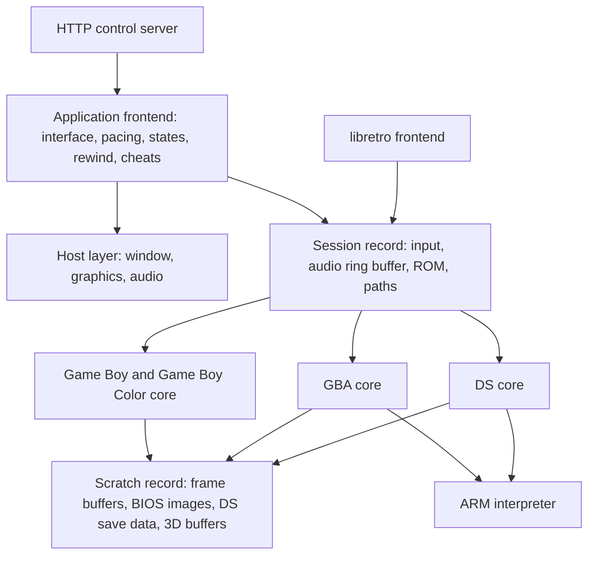

# SkyEmu

## Summary

[SkyEmu][repo] is one author's MIT-licensed emulator of the Game Boy, Game Boy Color, Game Boy Advance (GBA),
and Nintendo DS (DS), with one application for desktop, phones, and the web, and a separate libretro core.
It is known for a GBA core that passes the timing group of the mGBA suite, 2020 of 2020, with the official BIOS.

Its strongest ideas are structural.
Each machine is one flat record of plain data, with every host resource held outside it,
so save states and rewind are memory copies.
One ARM interpreter serves the GBA and the DS because bus timing lives in the system, not in the interpreter.
The GBA core steps its hardware per cycle and skips idle time with two counters in place of an event queue.

Its weakest points are what Rustalgia most needs to avoid.
No test runs in its continuous integration, and its accuracy document, which covers only the GBA,
has not changed since 2022.
There is no core interface, so each frontend branches on the system in dozens of places.
The save-state file is the in-memory layout of one build,
and audio is produced at a fixed 48,000 Hz with no resampler and no rate control.
The three cores differ widely in timing quality: the project's only Game Boy table dates from October 2022,
and it publishes no DS result.

## Scope

- **Version:** branch `dev` at commit `14fa65eaa0dca91c4d3f5de188a342ff14645c11`, committed 2026-11-24,
  and the release notes of v2 to v5; the latest release is v5, published 2026-02-12.
  Everything was read on 2026-11-27.
  Line numbers are approximate pinpoints at that commit.
- **Sources:** the project's source code; its documentation
  (README, acknowledgments, contributor guidance, release notes, and five files under `docs/`: the accuracy,
  control-server, library-modification, and theme documents, and a chat transcript); its issues and pull requests;
  published test tables by the project and by third parties; and the libretro documentation page for the core.
  No talk, video, or chat server was opened; the chat transcript is used as a lead.
- **Licence and tier:** MIT, open tier, as the family survey records
  ([R1-11, "Dedicated emulators, open tier"](../topics/R1-11-game-boy-advance-family.md#dedicated-emulators-open-tier);
  [register](../../../.claude/hooks/source-register.txt)).
  The code was read, as [ADR 0006](../../adr/0006-read-sources-by-tier-under-a-compatibility-test.md) allows,
  and nothing was copied or ported.
  Every description under "Architecture" was written after reading the implementation, and stays at the level of parts,
  with no code and no internal names.
- **Not examined, as closed:** the bundled replacement BIOS images, `src/freebios/` and `src/gba_bios.h`,
  which are replacement system software and closed whatever the emulator's tier; the web build at `web.skyemu.app`,
  which is taken to embed them (inference, from the README's statement that SkyEmu bundles them);
  and the upstream `cult-of-gba/bios`, named but not opened.
  Three ranges of otherwise readable files were skipped because they stand in for the BIOS, firmware, or boot ROM:
  `src/gba.h` about lines 1740 to 1830, `src/nds.h` about lines 3026 to 3410, and `src/gb.h` about lines 1585 to 1700.
  The only lines read inside them are the single lines, cited below, that load the BIOS images, name the trace log,
  and start the clock.
  The cheat-device range of `src/gba.h`, about lines 2835 to 3230, was skipped because it may hold seed constants.
  The three core headers stay linked because the files are open tier and only those ranges are closed.
  What the replacements are is stated from the [README][readme]'s prose only.
- **Not examined, by choice:** `src/nds_rom_database.h`, `src/cacert_pem.h`, every bundled third-party library,
  the screenshot images, the Android signing store, and most of the interface code in `src/main.c`.
  The cloud-sync source, `src/cloud.cpp`, embeds the application's sign-in credentials; it was searched by keyword,
  no value is repeated, and for that reason it is named in a code span and not linked.
  Results for Nintendo's aging cartridge and aging card are recorded only as emulators' claims.
- **Published results only:** nothing was built or run.
  Sizes and counts are read or calculated, not measured.
- **How claims were checked:** four evidence gatherers each covered a share
  (structure and timing; video, audio, and state; accuracy and tests; project and weaknesses)
  and read every file as raw text.
  This note was written from their reports alone.
  Four independent verifiers, who saw only the note, then checked its claims, quotations, and links against the sources,
  and a fix pass applied their findings.
  Counts of lines, calls, table rows, and issues are the gatherers' own, taken that day (observed).

SkyEmu also appears in the DS survey
([R1-12, "Dedicated emulators"](../topics/R1-12-nintendo-ds-family.md#dedicated-emulators)).
The Game Boy survey, [R1-10](../topics/R1-10-game-boy-family.md), does not mention it (observed, by search).

## Architecture

### Project and goals

The README states the aim as a balance, not maximum accuracy:
"Its primary focus is to preserve these great systems for future generations
while providing a good user experience through a good mixture of tradeoffs of accuracy, performance,
features and usability." ([README][readme], opening paragraph).
It ranks its own cores: "However, the GBA emulation is significantly more accurate than the GB/GBC emulation."
and it lists DS emulation as "Beta Quality" ([README][readme], "Accuracy/Compatibility" and "Features").

Releases are v1 and v2 in October 2022, v3 on 2023-08-13, v4 on 2025-09-20,
and v5 on 2026-02-12 ([releases][rel]). v3 added the DS core, the phone and FreeBSD builds, cheats,
and the HTTP interface ([v3 notes][rel-v3]); v4 added RetroAchievements, the libretro core, cloud sync of save states,
and themes ([v4 notes][rel-v4]).
One person does most of the work: the contributor counts are 915 commits for the owner and 93, 31, 13,
and 8 for the next four (observed, [GitHub contributor data][contrib]).
The project accepts no AI-written code: "AI may be used to debug issues, profiling, and to understand the code base.
However, AI may not be trained on this code and all code
for this repo must be written by hand by a human." ([AGENTS.md][agents]).
Translation strings are the stated exception ([README][readme], "AI Policy").

### Parts and ownership

Four header files hold all emulation: one core each for the Game Boy and Game Boy Color
([`src/gb.h`][gb-h], about 2,060 lines),
the GBA ([`src/gba.h`][gba-h], about 3,840), and the DS
([`src/nds.h`][nds-h], about 7,560),
and the ARM interpreter that the GBA and DS share ([`src/arm7.h`][arm7-h], about 2,280) (observed, line counts).
The Game Boy processor is a table in a separate file that is marked as generated ([`src/sb_instr_tables.h`][gb-tab]).

One application file is the whole frontend for desktop, phones, and the web ([`src/main.c`][main-c], about 9,040 lines).
It includes the three cores directly, with the windowing, graphics, audio, interface, archive, network, cloud,
and achievements libraries (lines 12 to 76).
Platform differences are conditional sections inside that file ([`CMakeLists.txt`][cmake]).
The window, graphics, and audio layer is the [sokol][sokol] header set, a zlib-licensed library that is not an emulator,
and the interface is an immediate-mode library drawn through it ([`CMakeLists.txt`][cmake], library blocks).
The owner confirms that sokol does the windowing even where SDL is linked, which ties Linux builds to X11
([issue 535][i535]).

Shared types sit in one small header ([`src/sb_types.h`][types-h]).
It defines the session record handed to every core: run mode, system identifier, current and previous input,
a render-this-frame flag, the audio ring buffer, the ROM bytes and paths, and a ghosting strength.
A second small file holds the cheat table and the output sample rate, and both frontends link it
([`src/shared.h`][shared-h]; [`src/shared.c`][shared-c]).

The libretro core is a second, thin frontend of about 1,090 lines over the same core headers
([`src/libretro.c`][libretro-c], lines 22 to 34 and 930 to 995).
It is built from three source files only and is not part of the default build ([`CMakeLists.txt`][cmake]).
It arrived as an outside contribution ([pull request 377][pr377], merged 2024-08-30).

### How a frontend drives a core

The core interface is a convention, not a type.
Each core offers the same informal set of operations: load a ROM, advance one frame,
describe its state for a tolerant restore, and run a cheat.
Unloading and the debugger tables were not traced for every core.
A frame call receives the session record, the core's state record, and the core's scratch record
([`src/main.c`][main-c], about lines 2475 to 2483 and 2768 to 2783).
The application picks the system by trial: it offers the ROM to the GBA loader, then the Game Boy loader,
then the DS loader, and the first to accept sets the system identifier.
Every later operation branches on that identifier: frame step, save flush, state size, frame rate, debugger tables,
memory access, and screenshot (about lines 2462 to 3000).
The application names the three system identifiers about 60 times and the libretro frontend about 30 times
(observed, by a count of whole-word occurrences in each file).

State is split in two.
The state record is plain data: memory, registers, and device state.
The scratch record holds what must stay out of a save state: frame buffers, BIOS and firmware images,
DS save data and 3D buffers, and debug log handles.
The state record keeps pointers into scratch and to the ROM, and the processor's bus callbacks,
and every frame call rewrites them all first
([`src/gba.h`][gba-h], about lines 3752 to 3772; [`src/nds.h`][nds-h], about 7019 to 7068; [`src/gb.h`][gb-h],
about 1338 to 1345).
A state restored by a raw byte copy therefore becomes valid again at the next frame
(inference, from the raw copies in both frontends).

The boundary is not enforced.
The cores print to standard output, open the save file at ROM load, and read the host clock;
the print calls number about 5, 21, and 93 in the Game Boy, GBA, and DS cores (observed, by count).
BIOS loading is a callback that each frontend must supply ([`src/sb_types.h`][types-h], line 336).
If it fails, the GBA core, and the DS core for its two BIOS images, copy in the bundled replacements
([`src/gba.h`][gba-h], about lines 1743 to 1747; [`src/nds.h`][nds-h], about 3105 to 3109).
In the other direction, the application reads and writes core fields directly, for example work RAM for achievements,
the Game Boy palette before each frame, and frame-buffer pointers for drawing
([`src/main.c`][main-c], about lines 1910 to 1960 and 7852 to 7870).
The cores hold little process-wide state:
the interpreter's decode tables and one value of its trace comparator were the only file-level objects seen,
in a read that was not exhaustive ([`src/arm7.h`][arm7-h], about lines 415 to 423).
Each frontend keeps its session, core, scratch, and rewind storage as single file-level objects,
so a process runs one machine ([`src/main.c`][main-c], lines 512 and 1172 to 1177).
That the cores would allow several is an inference.

### Time and synchronisation

No core has an event queue.
Each advances the processor by one instruction and then lets the rest of the hardware catch up.

| Core | Clock counted | What sets the cost of a step | Frame length |
|---|---|---|---|
| Game Boy | 4,194,304 Hz | The instruction table, with a branch adjustment | 70,224 cycles |
| GBA | 16,777,216 Hz | Bus waits of every access, plus internal cycles | 280,896 cycles |
| DS | 33,513,982 Hz | One cycle, or the ARM9 charge described below if not zero | 355 by 263 dots of 6 cycles |

Sources: [`src/gb.h`][gb-h], about lines 1317 to 1470; [`src/gba.h`][gba-h], about 1848 to 1900 and 3769 to 3835;
[`src/nds.h`][nds-h], about 5597 to 5625 and 7066 to 7140.
Those figures give 59.727 frames a second for the Game Boy and GBA and 59.826 for the DS
(calculated from the rows),
which match the rates the application paces to ([`src/main.c`][main-c], about lines 2706 to 2712).

**GBA.**
The processor's step cost is the sum of the wait cycles of each memory access it made and its internal cycles.
The interrupt delay line, the timers, and the display then advance by that many cycles of the master clock,
one cycle at a time, and sound advances once by the elapsed time ([`src/gba.h`][gba-h], about lines 3769 to 3835).
The serial stub is stepped once for each pass of the loop, whatever the pass cost.
Two counters replace a scheduler.
The display reports how many cycles can pass before it has work: to the next blanking edge, or to the next dot,
which is four cycles.
The timers report the cycles to the nearest overflow or start-up delay, and otherwise only accumulate a deferred count.
The frame loop applies the smaller figure in bulk, and a halted processor skips the whole distance
(about lines 1838 to 1852, 2697 to 2785, and 3795 to 3812).

Interrupt requests pass through a delay line of up to four cycles before they reach the flag register;
a source comment reads "Some HW has up to a 4 cycle delay before its IF propagates." (about lines 818 to 821).
A DMA transfer takes the place of the processor step, after a start-up delay,
with the first access charged as non-sequential and the rest as sequential;
two cycles are added when the processor resumes (about lines 2444 to 2670).
The serial port is a stub that completes a transfer after 64 passes of the frame loop with the internal clock selected
(about lines 2671 to 2696).

**DS.**
Time is not derived from instruction cost.
Each step of the frame loop runs one ARM9 instruction, and a second if the first had no internal cycles.
The step costs one cycle of the 33,513,982 Hz clock, or, when that sum is not zero,
the slow-bus cycles of the ARM9's accesses plus half its internal cycles, rounded down.
The ARM7 runs one instruction only on a step where that sum is zero and no ARM7 DMA ran
([`src/nds.h`][nds-h], about lines 7066 to 7140).
The ARM9 bus charges fixed costs in main RAM, for accesses that are not the processor's own, and in shared work RAM,
I/O, palette, video RAM, and sprite memory; DMA is spared the non-sequential cost in the last four.
A cache-timing model exists only as a disabled block (about lines 2688 to 2800).
Every slow-bus charge found is in the ARM9 path, so ARM7 memory accesses appear to cost nothing beyond the step
(inference, from a search for those charges and not from a full read of the ARM7 path).
One loop interleaves the two processors instruction by instruction,
with the ARM7 held back on steps where the ARM9 was charged bus or internal cycles,
and both stall while the 3D command queue is full.
The skip-ahead scheme is the GBA's with a third limit, the end of the 3D command in progress (about lines 7108 to 7137).

**Game Boy.**
The step is one instruction, and the display, timers, serial port, and sound then advance by its cycles
([`src/gb.h`][gb-h], about lines 1317 to 1470).
Memory accesses are not placed on individual machine cycles.
The charging arithmetic has the effect that each instruction's work lands at about its last machine cycle
(inference, from about lines 1390 to 1445).

The Game Boy and DS clocks copy host local time every frame;
the GBA clock is the host time at ROM load plus counted cycles, and lives in the state
([`src/gb.h`][gb-h], about lines 1330 to 1337; [`src/nds.h`][nds-h], about 6846 to 6856; [`src/gba.h`][gba-h],
about 1010 to 1039).

### Processor execution

All three processors are interpreted.
A search of the core files finds no recompiler, no vector instructions, and no threads (inference, from that search).

The ARM interpreter decodes through tables built at start-up.
Each instruction class is one row: a handler, a name, and a bit-pattern string.
The patterns fill four tables, ARM and Thumb for each of ARMv4 and ARMv5, and the same rows drive the disassembler,
whose field labels come from the pattern string
([`src/arm7.h`][arm7-h], about lines 214 to 423, 559 to 588, and 620 to 650).
One processor state type serves both the ARM7 and the ARM9, with a separate execute path and prefetch depth for each.
Memory access goes through callbacks that the system core supplies,
and each fetch carries a flag that says whether it is sequential (lines 36 to 100 and 799 to 960).

The pipeline is modelled by fetching ahead for real.
After each instruction the interpreter fetches the opcode two instructions ahead through the timed bus,
and a changed program counter starts a refill that does one fetch per step.
Block load and store is the other operation that can pause between accesses,
and an interrupt is taken only when neither is in progress (about lines 596 to 615, 799 to 862, and 1492 to 1580).
That block transfers do one access per step rests on the start of that path, which was not read to its end.
The interpreter counts only internal cycles, such as those of a multiply; it knows nothing about wait states
(about lines 1135 to 1141 and 1225 to 1238).

The GBA core owns bus timing.
A table of 16 address regions by four access cases
(16 or 32 bits, sequential or not)
is rebuilt whenever the wait-control register is written ([`src/gba.h`][gba-h], about lines 1247 to 1315).
The cartridge prefetch unit is modelled as a cycle credit: time spent away from the cartridge bus accumulates,
a sequential cartridge fetch spends it, and a non-sequential one clears it (about lines 1316 to 1355).
Open bus is a latched last-bus-value word.

| Read from | Value returned |
|---|---|
| An unmapped region, or an invalid I/O register | The latched bus word |
| The BIOS region, from code outside it | The last BIOS word fetched |
| Cartridge ROM beyond the image | A pattern made from the address |
| Cartridge RAM | The byte, repeated in all four byte lanes |
| A valid I/O register | The register, masked by a per-register table |

Source: [`src/gba.h`][gba-h], about lines 1425 to 1570; the rows are this note's selection.

The interpreter has a built-in trace comparator.
If a log file with the save file's name sits in the save location,
each instruction's registers are compared with the next record,
and a mismatch prints the difference and stops at a breakpoint
([`src/arm7.h`][arm7-h], about lines 700 to 790; [`src/sb_types.h`][types-h], lines 337 to 346).
The acknowledgments say "NBA was used to generate golden test vectors
which were essential to the early bring up of the SkyEmu GBA core" ([ACKNOWLEDGMENTS.md][ack]).

The Game Boy processor is one table of 512 rows, 256 base opcodes and 256 prefixed ones.
Each row holds a handler, a mnemonic, a flag mask, the length, the machine cycles with and without a taken branch,
and two operand descriptors ([`src/sb_instr_tables.h`][gb-tab], lines 1 to 40; row count observed).

### Video

The GBA composites backgrounds one dot at a time and reads the display registers live for each dot,
so a register write between two dots changes the next dot with no catch-up scheme.
Sprites for a line are drawn in one pass at the start of the previous line's horizontal blank,
so sprite effects are per line only (inference, from that pass).
Display control passes through a three-stage latch ([`src/gba.h`][gba-h], about lines 1838 to 2392).
The Game Boy also draws one dot at a time during its drawing mode,
with the horizontal position derived from the line's cycle count; no pixel-queue model was seen in the part read
([`src/gb.h`][gb-h], about lines 895 to 950 and 1150 to 1172).
In 2022 the owner called that renderer a scanline renderer and blamed it for half the Game Boy bugs
([issue 75][i75], open);
at the commit read, the README's "Dotclk based PPU implementation" describes the stepping,
and the missing pixel queue is consistent with the faults that issue lists (inference).

The DS draws its two 2D engines a whole line at a time; a per-dot path exists and is switched off
([`src/nds.h`][nds-h], line 9 and about 5608 to 6362).
The 3D renderer is software only, in floating point, at the native 256 by 192.
Triangles are drawn as geometry commands arrive, into a colour buffer and a floating-point depth buffer
(about lines 3916 to 3934 and 4166 to 4358).
Shadow polygons are skipped, polygons past 2,048 a frame are ignored, bitmap sprites are not drawn,
and the control bits for anti-aliasing, edge marking, fog, and the rear-plane bitmap are decoded but not used
(lines 4167 to 4214 and 5875; the control bits are read at lines 4174 to 4179 and named nowhere else, by search).

Screen ghosting happens inside the cores: each new pixel is blended with what the output buffer already held
([`src/gba.h`][gba-h], lines 2381 to 2391; [`src/gb.h`][gb-h], 1164 to 1171).
Each host frame the application uploads the 32-bit frame buffer as a new texture and draws it with one shader
([`src/main.c`][main-c], lines 3386 to 3523).
The shader has five display modes, from plain pixels to an LCD grid with sub-pixels and an upscaling filter,
and corrects colour with a gamma and a 3 by 3 matrix chosen for each system
([`src/lcd_shaders.shd`][shader], lines 70 to 78 and 366 to 446; [`src/main.c`][main-c], 2719 to 2766).

### Audio

Each core synthesises audio directly at 48,000 Hz:
it advances an emulated-time counter and emits one stereo sample each time that counter passes the next sample boundary.
There is no resampler, and the rate is a build constant
([`src/shared.h`][shared-h], line 7; [`src/gba.h`][gba-h], lines 3506 to 3700).
The GBA reuses the Game Boy sound code as a second textual copy, placed between renaming definitions,
so the two copies are kept in step by hand ([`src/gba.h`][gba-h], about lines 3186 to 3200; the upkeep is an inference).
Square waves are band-limited at each edge;
the wave and noise channels and the GBA's sample queues are sampled as they stand
([`src/gb.h`][gb-h], lines 1475 to 1491 and about 2005 to 2013; [`src/gba.h`][gba-h], about 3649 to 3656).
The DS reads all 16 channels once for each output sample, with no interpolation of sampled channels
([`src/nds.h`][nds-h], lines 6857 to 7017);
a rework merged on 2026-10-10 fixed timing and decoding faults there ([pull request 583][pr583]).

One ring buffer of 16,384 16-bit entries joins core and host ([`src/sb_types.h`][types-h], lines 106 to 139).
That is 8,192 stereo frames, about 171 ms at 48,000 Hz (calculated); its comment,
"8192 samples gives ~85ms maximal latency for 48kHz", matches half that size.
A core discards a new sample when the ring is nearly full.
The application drains the ring once each host frame, from the main thread, in blocks of 64 frames;
if the ring runs low it is reset to silence ([`src/main.c`][main-c], lines 7620 to 7643).
Nothing steers the rate: audio absorbs any mismatch between host and emulated time by dropping samples
or inserting silence (inference, from those two paths and the pacing below).
The author asked SameBoy's author how to synchronise audio and video and kept the chat in the repository
([transcript][sync-chat]; lead).

### Pacing and threads

In normal running, emulation happens on the interface thread, inside the display callback.
Each host frame the application compares a simulated-time counter with the wall clock and runs zero
or more whole emulated frames; only the first is rendered.
A lag of more than ten frames resets simulated time ([`src/main.c`][main-c], about lines 5414 to 5512).

The HTTP control server has its own thread.
Its step command runs emulated frames on that thread and renders only the last frame of the step.
The headless launch runs one frame update outside the display callback and then waits on the server thread
(about lines 5466 to 5471, 6819 to 6830, and 8966 to 8974).
A lock is held for the whole host-frame update, so commands run only between host-frame updates,
never during the emulated frames of one
(about lines 5415 to 5420 and 5508 to 5511; the thread is in [`src/http_control_server.cpp`][http-cpp], lines 12 to 15,
64 to 68, and 84 to 88).

### State, rewind, and saves

A save state is the raw memory image of the core's state record, with a screenshot.
The application keeps the three core states in one union,
and a comment on it reads "Do not reorder items in this struct otherwise you may break save states."
([`src/main.c`][main-c], lines 514 to 529).
The file is a PNG screenshot with the data hidden in the two lowest bits of each colour channel.
The payload is a header, the core state, and the achievements buffer (lines 1325 to 1395).
The header names the emulator, the host platform and architecture, and the exact build commit (lines 555 to 563).

Loading has two paths (lines 1414 to 1499).
If the name string and build hash match the running build, the state is copied back whole.
Otherwise a best-effort restore starts from the running machine
and overlays only what a small versioned descriptor inside the state lists.
Each core has its own descriptor.
The GBA's lists the processor registers, four timer reload values, and, by offset, both work RAMs, the I/O registers,
palette, video RAM, sprite memory, and cartridge backup memory.
The DS's covers both processors and adds the coprocessor registers, memory-region settings,
and the data and position of a card transfer in progress.
The Game Boy's carries the cartridge bank selection and no timer values
([`src/gba.h`][gba-h], lines 758 to 790 and 845 to 880; [`src/nds.h`][nds-h], about 2143 to 2196; [`src/gb.h`][gb-h],
393 to 404 and 439 to 487).
Audio state, the video unit's counters, and interrupt delay lines are in none of the three,
and the DS descriptor has no 3D engine state, so they stay as they were in the running machine
(inference, from the descriptors' contents).
A state moved to another platform always takes that path, because the compared name includes platform
and architecture (inference).
One layout slip is patched by a list of ten build hashes whose states had the achievements buffer misplaced
(lines 1458 to 1488).
The v2 notes promise that states "persist across app launches, switching games, and future SkyEmu versions"
([v2 notes][rel-v2]).
The libretro frontend serialises with a bare copy and a size check
([`src/libretro.c`][libretro-c], lines 373 to 388, 524 to 539, and 760 to 775; dispatched from lines 999 to 1028).

Rewind is a ring of changed blocks.
Every 8 emulated frames the whole state union is compared with a shadow copy, 64 bytes at a time,
and each changed block's old contents go into a ring of 1,048,576 entries
([`src/main.c`][main-c], lines 536 to 546 and 1179 to 1247).
The ring is allocated statically at about 72 MiB
(calculated from 72 bytes an entry; the padding is read, not measured),
and each scan covers a union sized for the DS, whatever system is running (inference).

Battery saves are whole-file rewrites.
The core sets a dirty flag, and about every ten frames the application writes the backup memory over the save file in
place, with no temporary file (lines 2651 to 2692 and 5427 to 5437).
Game Boy and GBA backup memory is inside the state record and DS save data is in scratch,
so loading a state rolls back the in-game save on the first two and not on the DS (inference, from those placements).
Cloud sync covers save states only, through one provider, and keeps its refresh token in a plain text file
(`src/cloud.cpp`, searched by keyword and not linked, as Scope says; [`src/main.c`][main-c], lines 3023 to 3108).

### Automation

The HTTP control server offers commands to step frames, run, set input, read and write memory bytes, fetch the screen,
save and load states, load a ROM, and report status with the build's commit hash.
A headless launch form exists: "SkyEmu won't render the UI
and will run without sleeping to synchronize with real time." ([HTTP_CONTROL_SERVER.md][http-doc]).
The server listens on every network interface and has no authentication
(a keyword search found none);
it can load a ROM from any path, write memory, and write a state to any path
([`src/http_control_server.cpp`][http-cpp], lines 12 to 15 and 67 to 79).
The emulator offers no scripting interface of its own: a keyword search of `src/main.c` found none,
and a Lua interpreter is bundled and linked only for the achievements library
([`CMakeLists.txt`][cmake], lines 335 to 343).
Scripts drive it through this server ([`tools/tas-example.py`][tas]).
Two launch forms that the README and the control-server document do not mention,
one for the Game Boy and one for the GBA, open a native-size window, switch off the shader and colour correction,
fix a four-grey palette, and run unthrottled ([`src/main.c`][main-c], near lines 3454 to 3465 and 8998 to 9010).
They hold no pass or fail logic and there is no DS form.

### Tests and published results

Continuous integration builds and never tests.
Ten workflows build on every push and pull request; nine upload an artefact and the tenth deploys the web build.
None has a test step, a ROM, or a call to the control server ([workflows][workflows]),
and the build file defines no test target ([`CMakeLists.txt`][cmake]).
The web workflow publishes each commit as a playable build under its own address ([`deploy_web.yml`][deploy-web]).

The project's own accuracy document covers the GBA only.
It compares "SkyEmu 1.0" with NanoBoyAdvance 1.5 and 1.6, mGBA 0.9.3, and VBA-M 2.1.4.
Its test table lists four groups of the mGBA suite and two processor test programs, all passing for SkyEmu,
and it was last changed on 2022-10-23 ([Accuracy.md][acc]; dates observed in the file's commit history).
An issue that calls the tables outdated has been open since 2023-01-22 with no reply ([issue 222][i222]).
The README's headline claim names its condition:
"Passes 2020/2020 GBA Suite timing tests when utilizing the official GBA BIOS
(SkyEmu is one of the few emulators capable of passing this test)." ([README][readme], "Accuracy/Compatibility").
No result with the bundled replacement BIOS is published for any system
(searched: the README, the accuracy document, the release notes, and the two wiki pages below).

Third-party GBA tables agree on the older suites.
NanoBoyAdvance's deleted comparison, which the survey reproduces,
has SkyEmu V3 equal to NanoBoyAdvance 1.8 on every group but timer count-up and edge cases
([ACCURACY.md at `e83ea6cf`][nba-acc];
[R1-11](../topics/R1-11-game-boy-advance-family.md#tests-oracles-and-published-results)).
The Emulation General Wiki's page, tested "using the official BIOS", has SkyEmu v5 passing the memory, I/O read, timing,
timer IRQ, and DMA groups of the mGBA suite and every aging-cartridge group run.
It fails timer count-up at 687 of 936, with a footnote that the result varies between runs, and multiply long,
both serial groups, edge cases, and video ([GBA Tests][egw-gba], revision 146557; lead).

The same page adds newer timing suites, and there SkyEmu falls behind.
Counted as rows fully passed (the gatherer's count, by script):

| Suite, as the wiki names it (rows run) | GBAHawk | Mesen | ares | NanoBoyAdvance | SkyEmu v5 | mGBA |
|---|---|---|---|---|---|---|
| mGBA suite (14) | 12 | 10 | 10 | 11 | 8 | 6 |
| Aging cartridge (6) | 6 | 6 | 5 | 6 | 6 | 5 |
| jsmolka (9) | 7 | 7 | 9 | 9 | 7 | 5 |
| alyosha gba-tests (104) | 103 | 102 | 73 | 52 | 24 | 14 |
| png183 gba-tests (9) | 6 | 7 | 9 | 2 | 2 | 1 |
| NanoBoyAdvance hw-test (16) | 16 | 16 | 14 | 13 | 2 | 2 |
| Hades-Tests (4) | 4 | 4 | 3 | 4 | 2 | 1 |
| AGBEEG aging (3) | 3 | 3 | 2 | 3 | 1 | 0 |
| Other single tests (9) | 9 | 8 | 5 | 7 | 4 | 3 |
| Sum (174) | 166 | 163 | 130 | 107 | 56 | 37 |

Source: [GBA Tests][egw-gba], revision 146557 (lead); none of the suites was opened for this note.
SkyEmu ranks fifth of the eight software emulators on the page.
Its failures cluster on DMA start delay, interrupt delay, the halt control, timer reload, prefetch boundaries,
the audio queues, and video register latching.
The largest suite is by the author of GBAHawk (from memory), so it may favour that emulator's model.

For the Game Boy the only figures are the project's own, from October 2022.
A page linked from the v2 notes, in the format of the [GB Emulator Shootout][shootout],
gives "SkyEmu v2 (109/182)" and "SkyEmu v1 (51/170)" ([skyemu-v2-vs-v1][gb-table]).
Counted without the informational rows, v2 passes 104 of the 177 tests run (the gatherer's count, by script).
It passes all 11 of blargg's processor instruction tests, and fails most of Mooneye's instruction-timing tests,
10 of its 12 video acceptance tests, and 4 of blargg's 7 sprite-memory corruption tests.
SkyEmu is not in the live shootout, whose page of 2026-06-04 lists 18 emulators (observed, by search of the page).

For the DS the only table found is the wiki's, on v3 of 2023, which the DS survey records
([R1-12](../topics/R1-12-nintendo-ds-family.md#tests-and-published-results); [NDS Tests][egw-nds], revision 140213;
lead).
No measured performance figure is published
(searched: the README, the release notes of v2 to v5, and the [libretro page][lr-doc]);
a request for a benchmark tool is open ([issue 190][i190]).

## What works well

- **Plain-data machine state with host resources held apart.**
  The whole machine is one flat record and every host pointer is rebuilt at each frame start, so save states, rewind,
  and libretro serialisation are memory copies with no per-component code to forget
  ([`src/gba.h`][gba-h], about lines 3752 to 3772; [`src/main.c`][main-c], lines 514 to 529; read in the source).
- **Cycle-stepped hardware without an event queue.**
  The display and the timers each publish the cycles until they next have work, and the loop skips the smaller figure.
  That keeps per-cycle behaviour at dot boundaries, in the interrupt delay line, and at DMA start-up,
  and lets a halted processor jump to the next event ([`src/gba.h`][gba-h], about lines 1838 to 1852 and 3795 to 3812).
  The three GBA tables above, of 2022, 2024, and 2026, show full passes of the mGBA suite's timing, memory,
  and DMA groups.
- **Bus timing kept out of the interpreter.**
  The interpreter counts internal cycles and tags each fetch as sequential or not;
  the system applies its own wait table, prefetch credit, and open-bus latch.
  This is what lets one interpreter serve a timing-exact GBA and a coarse DS
  ([`src/arm7.h`][arm7-h], lines 36 to 100; [`src/gba.h`][gba-h], about 1247 to 1355 and 1425 to 1570).
- **A pipeline that fetches ahead for real.**
  Prefetch and open-bus values fall out of the model instead of being special cases,
  and the two operations that can pause between accesses let hardware advance inside them
  ([`src/arm7.h`][arm7-h], about lines 799 to 862; the purpose is an inference).
- **Decode tables written as readable bit patterns.**
  The same rows are the decoder, the disassembler, and its field labels, for both ARM processors
  ([`src/arm7.h`][arm7-h], about lines 214 to 423, 559 to 588, and 620 to 650).
- **Trace comparison built into the interpreter.**
  The interpreter can check each instruction against a reference log ([`src/arm7.h`][arm7-h], about lines 700 to 790).
  The author credits reference vectors generated with NanoBoyAdvance
  as "essential to the early bring up" of the GBA core ([ACKNOWLEDGMENTS.md][ack]);
  that the built-in comparator is what consumed them is an inference.
- **A small core contract and one thin host layer.**
  A second frontend took about 1,090 lines and three source files, and one application file reaches seven hosts,
  because the cores depend on nothing but the standard library
  ([`src/libretro.c`][libretro-c]; [`CMakeLists.txt`][cmake]).
- **Rewind that stores only what changed.**
  Block differences taken every 8 frames give long rewind from a buffer of fixed size
  ([`src/main.c`][main-c], lines 491 to 492, 1179 to 1247, 5441, and 5488 to 5492).
- **An automation interface that needs no embedded language.**
  Frame stepping, input, memory, screenshots that carry a state,
  and a headless unthrottled mode are enough to build a test harness on ([HTTP_CONTROL_SERVER.md][http-doc]).
- **Honest scoping in its prose.**
  The timing claim names its BIOS, the Game Boy core is called less accurate, the DS is called beta,
  and the replacements are said to be "not as accurate"
  ([README][readme], "Features", "Accuracy/Compatibility", and "Download / Usage").

## What works poorly

- **No automated tests.**
  The pieces of a harness exist, but nothing wires them to continuous integration or to expected results
  ([workflows][workflows]; [`CMakeLists.txt`][cmake]).
  Faults are found by users: a hardware test that "passed in v1 and is failing in v2" has been open since 2022
  ([issue 116][i116]),
  a video test failure was reported in 2025
  ([issue 539][i539]), and the headless mode itself aborts in the v5 macOS build ([issue 576][i576]).
- **An accuracy record frozen at the first release.**
  The table appears to be made by hand
  (inference: no script or workflow produces it),
  covers the GBA only, and lists only groups that SkyEmu passes;
  later third-party tables show the omitted groups failing
  ([Accuracy.md][acc]; [issue 222][i222]; [GBA Tests][egw-gba], lead).
- **Second-tier on the newer GBA suites.**
  SkyEmu v5 passes 24 of 104 rows of the largest suite, against mGBA's 14,
  and 2 of 16 of NanoBoyAdvance's hardware tests, the same as mGBA.
  The failures are on timing facts that the 2022 suites do not test,
  which suggests a model tuned until the suites of the day passed (inference; [GBA Tests][egw-gba], lead).
  The timer count-up result is footnoted as varying between runs, which points at state
  that is not fixed at power-on (inference).
- **No core interface.**
  Every frontend operation is a chain of branches on the system, in two frontends,
  and the application reads core fields directly, so adding a system means editing dozens of sites
  ([`src/main.c`][main-c], about lines 2462 to 3000; counts observed).
- **Three timing qualities under one roof.**
  The GBA counts bus cycles with prefetch; the Game Boy places a whole instruction's bus activity at one point;
  the DS advances time by step, charges the ARM7 nothing for memory, and has cache timing disabled
  ([`src/gb.h`][gb-h], about lines 1390 to 1445; [`src/nds.h`][nds-h], about 2688 to 2800 and 7066 to 7140).
  The shared structure does not carry the GBA's accuracy to the others,
  and the published Game Boy and DS figures show the gap ([skyemu-v2-vs-v1][gb-table]; [NDS Tests][egw-nds], lead).
- **Hardware catches up only after a whole instruction.**
  A device register read in the middle of an ordinary instruction sees the device as it was before the instruction,
  except in the two operations that pause between accesses (inference, from the stepping described above).
- **The state file is the memory layout of one build.**
  It depends on field order, compiler, and architecture, and is guarded only by a comment;
  one slip needed a patch list of ten build hashes, and every other build falls to a lossy restore
  ([`src/main.c`][main-c], lines 1414 to 1499).
  The libretro core has no version protection
  ([`src/libretro.c`][libretro-c], lines 373 to 388, 524 to 539, and 760 to 775).
- **Audio and video are not kept in step by design.**
  Wall-clock pacing with dropped samples or inserted silence at the ring, no rate control, and no resampler
  ([`src/main.c`][main-c], lines 7620 to 7643; inference;
  a search for the word "resampl" in the application and the three cores found nothing).
  The author's kept chat records the trouble
  ([transcript][sync-chat]; lead), and an open request asks for a better GBA mixer ([issue 549][i549]).
- **Emulation shares the interface thread.**
  Pacing depends on the display callback, so a slow frame stalls interface and emulation together
  ([`src/main.c`][main-c], about lines 5414 to 5512; the consequence is an inference).
- **Host dependence inside the cores.**
  Host-clock reads, floating point in sound timing and in the DS rasteriser,
  and a fast floating-point build setting on one compiler weaken reproducibility across hosts
  ([`CMakeLists.txt`][cmake], line 57; [`src/gba.h`][gba-h], about lines 722 to 738, 1039 to 1040, and 1828;
  [`src/gb.h`][gb-h], line 1331; [`src/nds.h`][nds-h], line 6847 and about 4186 to 4300; inference).
  Where the clock runs on emulated time, as the GBA's does in the source read,
  fast-forward pushes it ahead of the wall clock, and a user's game then reported clock tampering.
  The owner explains that "several games check if the RTC and the CPU/timer ticks are aligned" ([issue 571][i571]).
- **No link cable or network play.**
  The request has been open since 2022; the owner says the obstacle is networking and interface work,
  and that with those "I could wire up the rollback and frontend communication stuff to the emulation cores no problem."
  ([issue 44][i44], comment of 2026-08-02).
- **A DS core that is incomplete.**
  The 3D renderer lacks shadows, fog, edge marking, and anti-aliasing and is fixed at native resolution,
  and the 2D engines give up the per-dot model ([`src/nds.h`][nds-h], lines 4167 to 4214 and about 5608 to 5625).
  Wireless is a register store with a stubbed baseband read and write path and no radio or network behaviour
  (line 1896 and about lines 2834 to 2850; that nothing further exists is an inference, by search).
  Work to enable a per-dot path and a cache model is open ([pull request 541][pr541]).
- **An open control server and plain-text credentials.**
  The server accepts commands from the local network with no authentication,
  and cloud sync stores its refresh token unencrypted
  ([`src/http_control_server.cpp`][http-cpp]; `src/cloud.cpp`, not linked, as Scope says).
- **Maintenance load on one person.**
  About nine tenths of the tree is copied third-party source with no licence inventory
  (observed, from a file listing);
  the tracker has 244 open issues against 200 closed, and eight of the twelve oldest open issues have no reply
  (observed, [issues][issues]).
  There is no architecture or state-format document (observed, from the listing of `docs/`).

## Implications for Rustalgia

Each item is a recommendation for the owner, who decides.

- **Split machine state from host resources.**
  Recommended: machine state as plain owned data with no host handles, and frame buffers, ROM, BIOS,
  and files in a separate structure passed beside it.
  SkyEmu shows that this makes snapshots and rewind cheap; in Rust it needs no pointer repair.
- **Keep the snapshot and the file as two formats.**
  Recommended: a fast in-memory copy for rewind and run-ahead, and an explicit, versioned, per-component file format.
  SkyEmu uses one layout for both and pays in compatibility;
  its descriptor of named regions is the right idea applied too narrowly.
  A screenshot in the state file is worth taking, in a standard metadata chunk, not in the low bits of the pixels.
- **Define a core trait, and keep hosts behind it.**
  Recommended: one trait for load, run a frame, video and audio out, input in, backup memory, state, and debug access,
  with file access, logging, and the clock on the frontend's side.
  This follows from the branching frontends and the leaks across SkyEmu's boundary.
  Instances should be values, so that link play, network play, and tests can run several.
- **Share one ARM interpreter through a bus trait.**
  Recommended: the interpreter is generic over a bus that receives the width and a sequential flag,
  and each system owns wait tables, prefetch, and open bus.
  Static dispatch gives the inlining that SkyEmu gets from single headers (inference), without the single files.
  Decode tables from bit patterns that also drive disassembly, and a built-in trace comparator, are worth taking.
- **Go one step past instruction-granular catch-up for the GBA.**
  Recommended: fetch-ahead and pausable multi-access instructions as SkyEmu has them,
  with hardware advanced at every bus access.
  On the wiki's table SkyEmu v5 fails the rows for DMA start delay, interrupt delay, halt, and timer reload,
  which the newer suites test ([GBA Tests][egw-gba], lead).
- **Choose the scheduler by system.**
  Skip-ahead counters are a cheap alternative to a scheduler for a system with few time sources.
  For the DS, with two processors, a 3D engine, and many timers, SkyEmu's version shows the limit;
  an event scheduler with cycle accounting for each processor is recommended there.
- **Make the automation interface the test harness from the start.**
  Recommended: frame step, input, memory read, screenshot, state, and a version string,
  run headless in continuous integration against expected results,
  with a test mode that fixes palette and filters and starts from clean settings.
  Bind it to the local machine and require a token.
  Run-to-run identical results should be a test in themselves.
- **Generate the accuracy table, and report every group.**
  Recommended: each row carries the emulator commit, the suite revision, the date, and the BIOS condition,
  with results for both an official BIOS and whatever Rustalgia ships
  ([R1-11, "How to handle the BIOS"](../topics/R1-11-game-boy-advance-family.md#how-to-handle-the-bios)).
  Each system needs its own suite list and gate; the mGBA suite and the aging cartridge are not the finish line.
  Agreement with one reference emulator counts as one source,
  since SkyEmu's GBA core was brought up against NanoBoyAdvance's output.
- **Derive audio from the emulated clock.**
  Recommended: generate at a rate tied to the emulated clock, resample with a filter,
  and steer the ratio from buffer fill; run emulation off the interface thread.
  Ghosting belongs in the display stage, so that captured frames stay exact.
- **Decide determinism early.**
  If replay or rollback is wanted, the core should not read the host clock or keep floating point in its state,
  and DS 3D should be rasterised in fixed point.
  The clock's time base, emulated or wall, is better a setting stored with the save,
  and whether a state includes battery memory should be one rule for every system, with atomic save writes.
- **Depend, do not copy.**
  Recommended: Cargo dependencies with a licence check, optional network features, and crates split by hardware part.
  Replacement system software stays out of Rustalgia's tree under
  [ADR 0006](../../adr/0006-read-sources-by-tier-under-a-compatibility-test.md).
- **Report defects upstream in prose.**
  SkyEmu refuses AI-written code, so anything Rustalgia finds goes to it as a written explanation.

## Open questions

- What do the GBA, Game Boy, and DS cores score with the bundled replacement BIOS?
  None is published; a spike that runs the open suites would answer it.
- What does the DS core score at v4 or later?
  The only table is on v3; the same spike would answer it.
- Did the timer count-up and edge-case scores fall between V3 and v5, or did the suite revision change?
  The 2024 table ([ACCURACY.md at `e83ea6cf`][nba-acc]) does not state its revision;
  running both revisions would answer it.
- Is the failing test of [issue 539][i539] the row that the 2024 table shows passing?
  The mGBA study, [R1-32](../../roadmap/research.md#emulator-studies), reads that suite's video test list.
- Why are the cores single headers?
  No document or issue found says (searched: the README, the contributor and acknowledgment files,
  and the tracker by three keyword searches); only the author could answer.
- How fast is it on a given host?
  No figure is published; a benchmark spike would answer it.

## Sources

Every source below was read on 2026-11-27, as raw text.
Repository files are fixed by commit `14fa65eaa0dca91c4d3f5de188a342ff14645c11` of branch `dev`; issues, pull requests,
and release notes are as they stood that day.
Addresses in code spans are closed, or hold credentials, and are not linked.

- Repository notes and files: [R1-10](../topics/R1-10-game-boy-family.md);
  [R1-11](../topics/R1-11-game-boy-advance-family.md); [R1-12](../topics/R1-12-nintendo-ds-family.md);
  [ADR 0006](../../adr/0006-read-sources-by-tier-under-a-compatibility-test.md);
  the [source register](../../../.claude/hooks/source-register.txt); the [research roadmap](../../roadmap/research.md).
- SkyEmu, [repository][repo] (MIT; branch `dev`), [releases][rel], the notes of [v2][rel-v2], [v3][rel-v3],
  [v4][rel-v4], and [v5][rel-v5], and its [contributor data][contrib], read through GitHub's contributors endpoint.
- SkyEmu documentation: [README][readme]; [ACKNOWLEDGMENTS.md][ack]; [AGENTS.md][agents]; [Accuracy.md][acc];
  [HTTP_CONTROL_SERVER.md][http-doc]; [LibraryModifications.md][lib-mod]; ["Theme control strips"][theme-doc];
  ["SameBoy Audio Video Sync"][sync-chat], a chat transcript (lead).
- SkyEmu source: [`src/gb.h`][gb-h]; [`src/gba.h`][gba-h]; [`src/nds.h`][nds-h]; [`src/arm7.h`][arm7-h];
  [`src/sb_instr_tables.h`][gb-tab]; [`src/sb_types.h`][types-h]; [`src/shared.h`][shared-h];
  [`src/shared.c`][shared-c]; [`src/main.c`][main-c]; [`src/libretro.c`][libretro-c]; [`src/lcd_shaders.shd`][shader];
  [`src/http_control_server.cpp`][http-cpp]; [`tools/tas-example.py`][tas]; [`CMakeLists.txt`][cmake];
  [workflows][workflows]; [`deploy_web.yml`][deploy-web].
- SkyEmu tracker: [issue list][issues]; issues [44][i44], [75][i75], [116][i116], [190][i190], [222][i222], [535][i535],
  [539][i539], [549][i549], [571][i571], and [576][i576]; pull requests [377][pr377], [541][pr541], and [583][pr583].
- SkyEmu's Game Boy results, ["skyemu-v2-vs-v1"][gb-table] (page dated 2022-10-01).
- [GB Emulator Shootout][shootout] (page updated 2026-06-04).
- NanoBoyAdvance, [ACCURACY.md at commit `e83ea6cf`][nba-acc] (since deleted).
- Emulation General Wiki, ["GBA Tests"][egw-gba] (revision 146557, 2026-07-17; lead) and ["NDS Tests"][egw-nds]
  (revision 140213, 2026-03-15; lead).
- libretro documentation, ["Nintendo - Game Boy/GBA/NDS (SkyEmu)"][lr-doc] (page dated 2026-10-22).
- [sokol][sokol], its licence file and README only (default branch).
- Not linked, as closed: `src/freebios/` and `src/gba_bios.h` in the SkyEmu repository, `web.skyemu.app`,
  and `cult-of-gba/bios`.
- Not linked, because it embeds the application's sign-in credentials: `src/cloud.cpp` in the SkyEmu repository,
  searched by keyword.

[repo]: https://github.com/skylersaleh/SkyEmu
[contrib]: https://github.com/skylersaleh/SkyEmu/graphs/contributors
[rel-v5]: https://github.com/skylersaleh/SkyEmu/releases/tag/v5
[lib-mod]: https://github.com/skylersaleh/SkyEmu/blob/14fa65eaa0dca91c4d3f5de188a342ff14645c11/docs/LibraryModifications.md
[theme-doc]: https://github.com/skylersaleh/SkyEmu/blob/14fa65eaa0dca91c4d3f5de188a342ff14645c11/docs/Theme%20control%20strips.md
[rel]: https://github.com/skylersaleh/SkyEmu/releases
[rel-v2]: https://github.com/skylersaleh/SkyEmu/releases/tag/v2
[rel-v3]: https://github.com/skylersaleh/SkyEmu/releases/tag/v3
[rel-v4]: https://github.com/skylersaleh/SkyEmu/releases/tag/v4
[readme]: https://github.com/skylersaleh/SkyEmu/blob/14fa65eaa0dca91c4d3f5de188a342ff14645c11/README.md
[ack]: https://github.com/skylersaleh/SkyEmu/blob/14fa65eaa0dca91c4d3f5de188a342ff14645c11/ACKNOWLEDGMENTS.md
[agents]: https://github.com/skylersaleh/SkyEmu/blob/14fa65eaa0dca91c4d3f5de188a342ff14645c11/AGENTS.md
[acc]: https://github.com/skylersaleh/SkyEmu/blob/14fa65eaa0dca91c4d3f5de188a342ff14645c11/docs/Accuracy.md
[http-doc]: https://github.com/skylersaleh/SkyEmu/blob/14fa65eaa0dca91c4d3f5de188a342ff14645c11/docs/HTTP_CONTROL_SERVER.md
[sync-chat]: https://github.com/skylersaleh/SkyEmu/blob/14fa65eaa0dca91c4d3f5de188a342ff14645c11/docs/SameBoy%20Audio%20Video%20Sync.txt
[gb-h]: https://github.com/skylersaleh/SkyEmu/blob/14fa65eaa0dca91c4d3f5de188a342ff14645c11/src/gb.h
[gba-h]: https://github.com/skylersaleh/SkyEmu/blob/14fa65eaa0dca91c4d3f5de188a342ff14645c11/src/gba.h
[nds-h]: https://github.com/skylersaleh/SkyEmu/blob/14fa65eaa0dca91c4d3f5de188a342ff14645c11/src/nds.h
[arm7-h]: https://github.com/skylersaleh/SkyEmu/blob/14fa65eaa0dca91c4d3f5de188a342ff14645c11/src/arm7.h
[gb-tab]: https://github.com/skylersaleh/SkyEmu/blob/14fa65eaa0dca91c4d3f5de188a342ff14645c11/src/sb_instr_tables.h
[types-h]: https://github.com/skylersaleh/SkyEmu/blob/14fa65eaa0dca91c4d3f5de188a342ff14645c11/src/sb_types.h
[shared-h]: https://github.com/skylersaleh/SkyEmu/blob/14fa65eaa0dca91c4d3f5de188a342ff14645c11/src/shared.h
[shared-c]: https://github.com/skylersaleh/SkyEmu/blob/14fa65eaa0dca91c4d3f5de188a342ff14645c11/src/shared.c
[main-c]: https://github.com/skylersaleh/SkyEmu/blob/14fa65eaa0dca91c4d3f5de188a342ff14645c11/src/main.c
[libretro-c]: https://github.com/skylersaleh/SkyEmu/blob/14fa65eaa0dca91c4d3f5de188a342ff14645c11/src/libretro.c
[shader]: https://github.com/skylersaleh/SkyEmu/blob/14fa65eaa0dca91c4d3f5de188a342ff14645c11/src/lcd_shaders.shd
[http-cpp]: https://github.com/skylersaleh/SkyEmu/blob/14fa65eaa0dca91c4d3f5de188a342ff14645c11/src/http_control_server.cpp
[tas]: https://github.com/skylersaleh/SkyEmu/blob/14fa65eaa0dca91c4d3f5de188a342ff14645c11/tools/tas-example.py
[cmake]: https://github.com/skylersaleh/SkyEmu/blob/14fa65eaa0dca91c4d3f5de188a342ff14645c11/CMakeLists.txt
[workflows]: https://github.com/skylersaleh/SkyEmu/tree/14fa65eaa0dca91c4d3f5de188a342ff14645c11/.github/workflows
[deploy-web]: https://github.com/skylersaleh/SkyEmu/blob/14fa65eaa0dca91c4d3f5de188a342ff14645c11/.github/workflows/deploy_web.yml
[issues]: https://github.com/skylersaleh/SkyEmu/issues
[i44]: https://github.com/skylersaleh/SkyEmu/issues/44
[i75]: https://github.com/skylersaleh/SkyEmu/issues/75
[i116]: https://github.com/skylersaleh/SkyEmu/issues/116
[i190]: https://github.com/skylersaleh/SkyEmu/issues/190
[i222]: https://github.com/skylersaleh/SkyEmu/issues/222
[i535]: https://github.com/skylersaleh/SkyEmu/issues/535
[i539]: https://github.com/skylersaleh/SkyEmu/issues/539
[i549]: https://github.com/skylersaleh/SkyEmu/issues/549
[i571]: https://github.com/skylersaleh/SkyEmu/issues/571
[i576]: https://github.com/skylersaleh/SkyEmu/issues/576
[pr377]: https://github.com/skylersaleh/SkyEmu/pull/377
[pr541]: https://github.com/skylersaleh/SkyEmu/pull/541
[pr583]: https://github.com/skylersaleh/SkyEmu/pull/583
[gb-table]: https://skyemu.app/skyemu-v2-vs-v1.html
[shootout]: https://gbdev.io/GBEmulatorShootout/
[nba-acc]: https://github.com/nba-emu/NanoBoyAdvance/blob/e83ea6cffa07d5b05f53ea273d524ea727018031/docs/ACCURACY.md
[egw-gba]: https://emulation.gametechwiki.com/index.php?title=GBA_Tests&oldid=146557
[egw-nds]: https://emulation.gametechwiki.com/index.php?title=NDS_Tests&oldid=140213
[lr-doc]: https://docs.libretro.com/library/skyemu/
[sokol]: https://github.com/floooh/sokol
