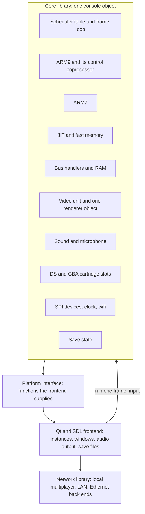

# melonDS

## Summary

melonDS is the most used engine for the Nintendo DS and DSi, and the one inside most ports and frontends
(family survey, [Summary][s-sum] and ["Which emulators the studies cover"][s-studies]).
Its README sets the goal "to do things right and fast" ([README][m-readme]),
and its author says it "is not cycle-accurate, and was never built for that" ([post 252][mb-252]; lead).
This note describes how it is built, and contrasts it with [DualSOUP][d-readme], which puts cycle accuracy first,
and with the debugger of no$gba, described from its [own pages][nocash-dev].

Three lessons matter most to Rustalgia.

First, the cost model fixes the accuracy ceiling: melonDS charges each instruction one number after it has run,
stands a constant in for the ARM9's caches,
and keeps the two processors in step only every 64 system-clock cycles or so.
The work that would lift the ceiling has been an open draft pull request since 2024;
by its own description it halves the interpreter's speed and breaks the JIT.
DualSOUP shows that a bus-level model can be built, at a stated 15 to 30 frames a second.

Second, the most accurate parts rest on hardware measurement: the software 3D rasteriser by its own comments,
and the geometry engine's timing and the DMA bursts by the author's account (leads).
Yet the project runs no automated test, so timing changes are checked by people (inference).

Third, a console that is one owned object behind a small host boundary is what made the ports possible,
and melonDS paid for a large refactor to get there.

## Scope

- Examined on 2026-11-27: melonDS at the head of `master`,
  commit `ff972523f8a70e877dd054439876c3c8c6b79197` of 2026-11-22, a year past release 1.1 of 2025-11-18.
  Statements read in the source hold for that commit, not for 1.1, which was not compared with it file by file;
  the release notes date the instances and the JIT before 1.1.
  DualSOUP was read at commit `170fba440bf6a6abf8adada05b702cf5aa431b74` of 2026-11-24
  (it has no release), and no$gba is described at version 3.06 from its pages.
  The JIT back end was read for x86-64 only.
- Sources: the source code of melonDS and DualSOUP, read file by file; READMEs, build files, CI workflows,
  release notes, pull request descriptions, and issues; the melonDS blog and FAQ; the no$gba pages and help text;
  the BlocksDS debugging guide; and one user wiki's test table.
  Only published test results are used; nothing was built or run.
- Licence and tier: the [family survey][s-emus] and the [register][register] record them. melonDS
  and DualSOUP are open tier, so their code was read; nothing is copied or ported,
  and every description of them here was written after reading the implementation. no$gba is closed,
  so only its prose was read, and the program was not downloaded.
- Not examined in melonDS, because the register closes them
  (a replacement BIOS, generated firmware, DSi key handling, and DSP programs):
  `freebios/`, `src/freebios`, `src/spi_firmware`, `src/dsi_aes`, `src/dsi_nand`, `src/dsi_tmd`, `src/dsi.cpp`,
  `src/dsi.h`, and `src/dsp_hle`, as the register spells them; and `src/frontend/duckstation`, walled.
  Also left unopened as a precaution: `src/NDSCart.cpp`, `src/NDS_Header.h`, `src/SPI.cpp`, the other DSi files,
  and the body of the slot class in `src/NDSCart.h`, which may hold cartridge encryption.
  The direct-boot set-up in [`src/NDS.cpp`][m-nds-cpp], at about lines 280 to 437, stands in for the BIOS and firmware;
  it was not read and is not described (research log).
- Not examined elsewhere: in DualSOUP,
  the routine in [`src/core/console.c`][d-console-c] that starts a cartridge directly, at about lines 416 to 542,
  and its card module, `src/core/carts/gamecard.c`, for the same reasons; on the no$gba site,
  `problemkaputt.de/gbabios.htm` and `problemkaputt.de/gba-xboo.htm`, which concern BIOS images.
  The test programs `arisotura/arm7wrestler`, `rockpolish/rockwrestler`,
  and `desperateprogrammer/dsmemorycyclecounter` are closed in the register and were not opened.
  None of these addresses is a link, because a reader of this note must not open them.
- How claims were checked: five evidence gatherers each read one area and confirmed each quotation against raw text.
  This note was written from their reports alone.
  Four independent verifiers who saw only the note then re-checked it, and a fix pass applied their findings.
  A claim with no marker rests on the text or file named beside it; markers follow the [research guide][guide].
  The blog is the developers' own, but the register treats it as leads, so its posts are marked lead;
  a developer's account of her own program's limits weighs more than an ordinary lead (inference).

## Architecture

### Parts and the boundary

The build makes a static library named "core" from the files directly in `src/`, and an optional frontend
([`CMakeLists.txt`][m-cmake]; [`src/CMakeLists.txt`][m-src-cmake]).
The frontend's build adds a second static library for the network layer,
which is therefore not built when the frontend is left out
([`src/net/CMakeLists.txt`][m-net-cmake]; [`qt_sdl/CMakeLists.txt`][m-fe-cmake]).
Build options leave out the JIT, the GDB stub, or the OpenGL renderers,
and the JIT is offered only on x86-64 and ARM64 hosts.

A console is an object that the frontend constructs.
It owns the JIT, both processors, sound, the microphone, the SPI bus, the clock, wifi, both cartridge slots,
the video unit, the cheat engine, eight DMA channels, and the scheduler's table, and it cannot be copied
or moved ([`src/NDS.h`][m-nds-h]).
Construction takes one bundle of arguments, each with a default: the BIOS and firmware images, the JIT settings,
audio settings, GDB ports, and the 3D renderer ([`src/Args.h`][m-args]).
The DSi is a second console class built on the DS one,
with its own bundle of constructor arguments derived from the first
([`src/Args.h`][m-args]; its own files were not opened).

The frontend drives the core one frame at a time.
It pushes the key mask, touch, and lid state in, asks for one frame, and gets back the number of scanlines emulated;
audio synchronisation and frame limiting are the frontend's work
([`src/NDS.h`][m-nds-h]; [`EmuThread.cpp`][m-emuthread]).

In the other direction the core calls a platform interface:
a set of free functions that the frontend supplies at link time ([`src/Platform.h`][m-platform]).
It asks the host for files and logging; threads, locks, and host time; write-back of DS saves, GBA saves, and firmware,
each with the changed byte range, and clock changes as a new date and time;
multiplayer packets with timestamps and Ethernet frames; camera frames, microphone samples, and add-on input;
and an AAC decoder for the DSi DSP's high-level path.

Most per-console functions carry an opaque pointer that the core passes back unchanged.
A process therefore holds one implementation, chosen at link time,
and that pointer is the only way it serves several consoles (inference).
Since 2023 the frontend loads BIOS and firmware images and hands them to the core,
and the core reports firmware writes through the interface instead of writing files;
the libretro core's author made the change for that core's needs ([pull request 1826][pr-1826], description only).

There is one official frontend, built on Qt and SDL.
It keeps a table of up to 16 instances ([`main.cpp`][m-main]), and each instance owns one console, one emulation thread,
and up to 4 windows ([`EmuInstance.h`][m-emuinstance-h]).
Several consoles in one process date from 1.0rc,
whose notes list "refactor core to support multiple instances in one process" ([release notes][m-rel], 1.0rc).
Three things stayed process-wide (inference from the files named): a thread-local pointer to the current console,
set at the start of each frame and used by the JIT's slow paths and its fault handler
([`src/NDS.cpp`][m-nds-cpp]; [`src/ARMJIT_Memory.cpp`][m-jit-mem]);
the JIT's executable memory, shared from one pool, with one fault handler
for the process ([`src/ARMJIT_Global.cpp`][m-jit-global]);
and the multiplayer transport, a single object ([`src/net/MPInterface.h`][m-mpi]).
So an embedder must run each console's frames on a thread of its own (inference).

The network library sits beside the core,
which reaches it only through the multiplayer
and network functions of the platform interface ([`src/Platform.h`][m-platform]).

### Time and synchronisation

The unit of time is one cycle of the system clock, which is the ARM7's clock.
A nominal frame is 560,190 system-clock cycles, or 263 lines of 355 by 6 cycles (calculated);
the loop uses that figure only while the console sleeps, and otherwise ends a frame when the video unit finishes one.
The ARM9 keeps its own counter at twice the system clock in DS mode and four times in DSi mode,
and all counters are 64 bits wide ([`src/NDS.h`][m-nds-h]; [`src/NDS.cpp`][m-nds-cpp], reset and frame loop).

The scheduler is a fixed table with one slot for each kind of event, and a bit mask of the armed slots.
There are 25 kinds, 13 of them for the DSi; the DS kinds cover the LCD, sound, wifi, the clock, the display FIFO,
cartridge transfers, the SPI bus, the divider, and the square-root unit ([`src/NDS.h`][m-nds-h], the event list).
Finding the next event and firing due events are both scans of the armed slots
([`src/NDS.cpp`][m-nds-cpp], scheduler section).
Three limits follow (inference): a kind can have only one pending event;
two events due in one slice fire in table order, not in time order;
and an event fires at the end of the slice it falls in, not at its exact cycle.

The two processors run in short slices, the ARM9 first.
The target of a slice is the earliest armed event, capped at about 64 system-clock cycles ahead.
The ARM9 side runs to the target: the processor, or its DMA channels when one holds the bus,
or only the passage of time when the 3D command FIFO has stalled it.
Its timers and the geometry engine then catch up, the ARM7 side runs to the point where the ARM9 stopped,
and due events fire.
The frame ends when the video unit reports a finished frame
([`src/NDS.cpp`][m-nds-cpp], frame loop, about lines 926 to 1075).
The author describes the same scheme and says it is less accurate than lockstep but far cheaper,
and that "it makes it impossible to model things such as main RAM contention" ([post 255][mb-255]; lead).

A processor that overshoots its target is not rolled back.
The interpreter adds an instruction's whole cost after executing it
and tests the target only between instructions ([`src/ARM.cpp`][m-arm-cpp]).
An event armed while a processor runs shortens that processor's slice, but the other processor is not run again.
The ARM7 therefore sees ARM9 writes from up to one slice in its own future,
and the ARM9 never sees ARM7 writes made in the same slice (inference).

Timers are not events: they advance by the cycles elapsed, after each slice.
DMA, sleep, and the 3D FIFO stall share one mask of reasons that a processor is stopped,
which the frame loop tests to choose what each side runs ([`src/NDS.h`][m-nds-h]; [`src/NDS.cpp`][m-nds-cpp]).

### Processor execution and its cost model

**Interpreter.**
The ARM9 and ARM7 are two classes over a common base; the ARM9 adds the control coprocessor,
two tightly coupled memories, and the protection unit.
Each dispatches through a table indexed by bits of the instruction word
([`src/ARM.h`][m-arm-h]; [`src/ARM.cpp`][m-arm-cpp]).

**Bus costs.**
Costs come from a table for each address block, filled when a region's settings change:
one row for each 16 KiB for the ARM9 and each 32 KiB for the ARM7.
A row is set from the region's bus width and its costs for a first and a following access.
Main RAM is a 16-bit bus at 8 cycles for a first access and 1 for a following one;
palette and video memory are 16-bit at 1 and 1; BIOS, work RAM, I/O, and sprite memory are 32-bit at 1 and 1;
the GBA slot and wifi take theirs from the wait-control registers.
The ARM9 pays 3 more cycles on a non-sequential access outside main RAM, and DMA does not
([`src/NDS.cpp`][m-nds-cpp], the timing notes and region set-up, about lines 55 to 280).

**Caches.** The ARM9's caches are not modelled.
In a region that the protection unit marks as cached, a data access costs 3 ARM9 cycles,
each following word of a multi-word transfer costs 1,
and a code fetch costs 3 on a branch or at the start of each 32-byte line and 1 otherwise.
The comment beside the constant says "this would be an average between cache hits and cache misses"
and "this was measured to be close to hardware average", and adds that a perfect cache makes games run too fast
([`src/CP15.cpp`][m-cp15], lines 33 to 39).
A real instruction-cache look-up exists in that file, but the call to it is commented out.
There is no data cache and no write buffer.

**Combining costs.**
Each instruction ends by choosing one of four cost shapes: code only, or code with internal cycles, data, or both.
For the ARM9, code and data cost the larger of either
or their sum less 6, an approximation of overlapping stages ([`src/ARM.h`][m-arm-h]);
the ARM7's rule depends on whether code, data, or both lie in main RAM ([`src/ARM.cpp`][m-arm-cpp]).
Contention between the processors for main RAM is not modelled, which the author puts down to the slice scheme
([post 255][mb-255]; lead).

**DMA.**
A DMA channel runs as the bus owner in place of its processor, one unit at a time, charged from the region table,
with burst tables for main RAM as source or destination ([`src/DMA.cpp`][m-dma]).
The burst rules come from the author's ARM9-side hardware tests ([post 145][mb-145]; lead).

**JIT.**
The JIT shipped in 0.9, credited to RSDuck ([release notes][m-rel], 0.9); the tree has back ends for x86-64 and ARM64
([`CMakeLists.txt`][m-cmake]; [`src/CMakeLists.txt`][m-src-cmake]).
A block is compiled by interpreting it once.
When no block exists at the current address, the JIT walks forward and, for each instruction,
decodes a description of it and also executes it with the interpreter's own handler,
recording the fetch cost and the data cost that the execution produced.
The list then goes to the back end ([`src/ARMJIT.cpp`][m-jit], block compilation).

A block holds at most 32 instructions, and the limit is a setting.
With branch optimisation the walk follows a taken direct branch, so a block can span several address ranges
([`src/ARMJIT.cpp`][m-jit]; [`src/Args.h`][m-args]).

Timing inside compiled code is fixed at compile time.
The back end sums the recorded costs and emits one addition to the cycle counter for each straight stretch,
and the processor tests its target only between blocks ([`ARMJIT_Compiler.cpp`][m-jit-x64]; x86-64 only).
Under the JIT a processor can thus overshoot by a whole block,
and a load or store keeps the cost of the region it touched when compiled (inference).

What the back end cannot compile is emitted as a call to the interpreter's handler for that instruction,
and both paths use one processor state.
The frame loop is one piece of code built three ways
(interpreter, interpreter with GDB stub, and JIT),
and the JIT can be switched on a live console ([`src/NDS.cpp`][m-nds-cpp]).
Its block cache is cleared when it is switched off or its settings change ([`src/ARMJIT.cpp`][m-jit]).

**Fast memory.**
For each console the JIT reserves about 8 GiB of host address space: a 4 GiB window for each processor,
and the backing memory.
RAM regions are mapped into the windows at the addresses the guest sees, mirrors included, and only on demand.
Compiled loads and stores access host memory directly.
An access to something unmapped faults,
and the handler either maps the region and retries or rewrites
that one access into a call to the slow path ([`src/ARMJIT_Memory.cpp`][m-jit-mem]).

Main RAM and the work RAMs come from this memory manager even when the JIT is off
([`src/NDS.cpp`][m-nds-cpp], constructor; observed: no condition on the JIT there).

**Self-modifying code.**
Every executable RAM region has an index with one entry for each 512 bytes,
holding a mask with one bit for each 16 bytes of compiled code and the blocks that touch it.
Slow-path writes test the mask and discard the blocks at the written address ([`src/ARMJIT.h`][m-jit-h]).
On the fast path, a host page is write-protected when it first receives compiled code,
so a direct write faults and is sent to the slow path.
A discarded block is kept by a hash of its instruction words and reused if the same code is compiled again there
([`src/ARMJIT.cpp`][m-jit], invalidation).

**Protection unit.**
The interpreter checks the protection map on every ARM9 data access and raises a data abort
([`src/CP15.cpp`][m-cp15]; release 0.9.4 adds it "in interpreter mode").
The JIT front end and the x86-64 back end never consult it (observed: no reference in the files read).

### Memory map, cartridges, and DSi

Each processor has six bus handlers, for reads and writes at 8, 16, and 32 bits,
that branch on the top byte of the address, and six more for the I/O page that branch on the register
([`src/NDS.cpp`][m-nds-cpp], about lines 1976 to 4222).
Only the access widths met in testing were implemented, by the author's account:
"my policy is to avoid implementing things without proper testing" ([post 246][mb-246]; lead).

Each cartridge slot holds a cartridge object of one of several kinds.
The DS slot's files name a common base, retail, retail with NAND save, with infrared, with Bluetooth, an SD card kind,
homebrew, and an R4 flash cart (observed in the file listing, `src/NDSCart/`);
a parse step inspects a ROM image and returns the right kind
([`src/NDSCart.h`][m-ndscart-h], top comment and parse comment only).

DSi mode is recorded in the [family survey][s-emus].
What the open files add is small: the scheduler table and the interrupt list carry DSi entries in the DS header,
and a to-do says DSi-specific timings are missing ([`src/NDS.h`][m-nds-h]; [`src/NDS.cpp`][m-nds-cpp]).
The author says DSi DMA was attached to code shaped for DS DMA, and calls the result poor ([post 252][mb-252]; lead).

### Video

At the head, the video unit keeps the hardware state
(registers, video memory banks and their mappings, the display FIFO, and capture state)
and delegates drawing to one replaceable renderer object, software or OpenGL,
that owns the two 2D renderers and the 3D renderer ([`src/GPU.h`][m-gpu-h]).

**2D.**
Each visible line is drawn in one call when its horizontal blanking begins, and sprites are drawn one line ahead,
as on hardware.
A comment says drawing "should start 48 cycles after the scanline start", so the draw point is known to be approximate
([`src/GPU.cpp`][m-gpu-cpp], about lines 1140 to 1340).
Register changes inside a line take effect at line boundaries only (inference from the one call for each line).

The one event finer than a scanline is the main-memory display FIFO, which runs every 8 pixels,
or 48 system-clock cycles, and only while it feeds the display, a capture, or a DMA
([`src/GPU.cpp`][m-gpu-cpp], about lines 1104 to 1135).

Every write to video memory marks a 512-byte granule dirty in its bank,
and renderers derive a dirty set for each mapped region ([`src/GPU.h`][m-gpu-h]).

With a GPU renderer, display captures may stay in GPU memory,
so the video unit tracks which blocks of video memory hold captures and syncs them back
when they must be read ([`src/GPU.h`][m-gpu-h]).

**3D geometry.**
Geometry is done when a command runs, and rasterisation uses registers latched at vertical blank.
The source's notes say GBATEK's timings are for single commands and that real lists differ:
vertex commands overlap with others, and each vertex that completes a polygon occupies slots of 9 cycles.
A 64-entry queue absorbs commands written while the command FIFO is full ([`src/GPU3D.cpp`][m-gpu3d]).
The team fed command lists to hardware and timed them ([post 60][mb-60]; lead).

**3D rasterisation.**
The software rasteriser works a scanline at a time over a 258 by 194 buffer
that keeps the two topmost pixels at each position and an attribute word.
It reproduces the hardware's arithmetic and fill rules:
an approximate perspective factor with 9 bits along Y and 8 along X, slopes stepped with an 18-bit fraction,
fill rules by slope and by swapped edges, the depth-test exceptions with their margins of `0x200` and `0xFF`, shadows,
fog, and edge marking and anti-aliasing as a last pass on each line
([`src/GPU3D_Soft.h`][m-gpu3d-soft-h]; [`src/GPU3D_Soft.cpp`][m-gpu3d-soft]).
Its comments are candid: "This is a theory on how the DS hardware interpolates values.
It matches hardware output in the tests I did, but the hardware may be doing it differently."
The render starts at scanline 215 and must end by scanline 192 of the next frame ([`src/GPU.cpp`][m-gpu-cpp]),
and an unchanged frame is not drawn again ([`src/GPU3D_Soft.cpp`][m-gpu3d-soft]; [`src/GPU3D.cpp`][m-gpu3d]).

The classic OpenGL renderer draws triangles with the host's rasteriser and depth buffer,
so the DS rules are approximated: polygons are split into triangles, the "equal" depth test is a stated to-do,
and edge marking is a pass that the source flags as poor ([`src/GPU3D_OpenGL.cpp`][m-gpu3d-gl]).
The compute-shader renderer moves the software algorithm to the GPU:
it computes the spans of each polygon on each line with the same slope arithmetic, bins polygons into screen tiles,
rasterises tile by tile, and composes the final image.
It needs OpenGL 4.3 ([`src/GPU3D_Compute.cpp`][m-gpu3d-comp]), so it is unavailable on macOS
([melonDS DS README][mds-readme], "Platforms").
Only the OpenGL renderer has an internal resolution setting ([FAQ][m-faq]),
and the software rasteriser's two files never use the scale factor (observed).

**Threads and hand-off.**
Only the software 3D rasteriser has a thread of its own, and it is optional.
Three signals join it to the emulation thread: start a frame, a count posted after each finished scanline,
and frame done.
The 2D renderer waits for one scanline signal when it needs a 3D line,
so 2D can consume lines while lower ones are still being drawn ([`src/GPU3D_Soft.cpp`][m-gpu3d-soft]).
The renderer keeps a front and a back buffer and swaps them at the end of the frame.
The frontend draws once a frame ([`EmuThread.cpp`][m-emuthread]):
a software renderer returns two buffers of 256 by 192 pixels,
and a GPU renderer prepares a texture for the frontend to draw ([`src/GPU.h`][m-gpu-h]).

### Audio

The 16 channels and 2 capture units are advanced by a scheduler event once for each output sample:
every 1024 system-clock cycles, about 32.7 kHz, on the DS, or every 704, about 47.6 kHz, in the DSi's higher-rate mode.
Each channel has its own timer and catches up inside that event,
so channel state is exact at sample boundaries and not between them ([`src/SPU.cpp`][m-spu]).
Interpolation is an enhancement that is off by default;
the source states that the hardware "performs no interpolation" ([`src/SPU.h`][m-spu-h]).

The core feeds sample changes into a bundled band-limited resampler, which was not read,
and writes output at the rate the frontend asks for into a ring buffer ([`src/SPU.cpp`][m-spu]).
Synchronisation has three parts ([`EmuInstanceAudio.cpp`][m-fe-audio]; [`EmuThread.cpp`][m-emuthread]).
The frontend's audio callback pulls samples and sets a rate skew from the target frame rate.
An optional setting makes the emulation thread wait on the callback when the buffer is full.
A frame limiter sleeps, scaled by the scanlines emulated.

### Save states and saves

A save state is one buffer in memory: a 16-byte header
(magic, major and minor version, length, and a reserved word)
followed by sections, each with a 4-character tag and its length.
A section is found on load by scanning for its tag.
The fields inside a section are raw values in fixed order with no tags,
and one routine for each component both saves and loads ([`src/Savestate.cpp`][m-savestate], format comment).
The version is major 14, minor 0.
A different major version is refused, as is a newer minor one,
and a configuration word for console type and DSP mode must match.
Nothing identifies the game, the build, or the JIT setting ([`src/Savestate.h`][m-savestate-h]).
A major change so discards every older state (inference).

A state covers the RAMs, interrupt and inter-processor state, timers, both processors, DMA, both slots, video, sound,
the microphone, SPI devices, the clock, and wifi.
The scheduler's pending events are stored as a timestamp, an identifier, and a parameter, not as pointers.
It omits the BIOS images, the ROM, key input, and SD card images.
After a load the memory mappings and timing tables are rebuilt and the JIT's cache is reset
([`src/NDS.cpp`][m-nds-cpp], about lines 620 to 765).
A comment in the wifi routine doubts that enough is saved ([`src/Wifi.cpp`][m-wifi]).

The cartridge's whole save memory is inside the state,
so a load replaces the live battery save and pushes it to the frontend ([`CartRetail.cpp`][m-cartretail]).
The frontend has a setting that redirects regular saves to a separate file once states are loaded or saved
([FAQ][m-faq], the settings heading for save states),
and it keeps one backup taken before each load, which an undo key restores
([`EmuInstance.cpp`][m-emuinstance]; FAQ, "Savestates").
For battery saves the core passes the whole buffer with the offset and length
that changed ([`src/Platform.h`][m-platform]).

The clock chip runs on emulated time, and is inside the state.
With "sync to host" on, the frontend sets it again from host time before every frame
([`src/RTC.cpp`][m-rtc]; [`EmuInstance.cpp`][m-emuinstance]).
That makes runs non-deterministic unless it is turned off (inference). melonDS has no rewind or run-ahead of its own
(observed: the listing and the frontend have neither);
ports build them on save states ([melonDS DS README][mds-readme]).

### Wireless and debugging

Local wireless is synchronised by timestamps, not by lockstep.
Frames carry the sender's time in microseconds; the host runs freely, and a client adopts the host's time,
delays each received frame until its own clock reaches the frame's time,
and computes how far it may run before it must wait for the host ([`src/Wifi.cpp`][m-wifi]).
The transport is a small interface with three implementations: local, LAN,
and netplay ([`src/net/MPInterface.h`][m-mpi]).
The [FAQ][m-faq] says local multiplayer "is currently unstable due to the timing requirements".

The build offers a GDB stub as an option ([`src/CMakeLists.txt`][m-src-cmake]).
There is no built-in debugger; the README lists one under "non-core" tools still to do ([README][m-readme]).

### Tests and published results

The project runs no automated test.
Its four CI workflows configure, build, and upload binaries for Linux, Windows, macOS, and three BSDs,
and none has a test step ([workflows][m-workflows]).
The build defines no test target, and the only test-like directory is a harness for the GDB stub
([`src/CMakeLists.txt`][m-src-cmake]; observed in the file listing).

Regressions are caught by people: nightly builds, release candidates, a forum, and issues (inference).
Hardware tests exist but are private: the author describes timing tests for the geometry engine, DMA, main RAM,
and the ARM7 in [post 60][mb-60], [post 145][mb-145], [post 255][mb-255], and [post 256][mb-256] (leads),
and the tree holds none of them (observed).

The one published table is the user wiki's, which the [survey][s-tests] summarises;
this note adds its timing rows by group ([NDS Tests][egw-tests], revision 140213; lead).

On the Timing MEGA test, melonDS 1.0rc passes 12 of 15, 21 of 26, 12 of 14, 21 of 23,
and 22 of 23 subtests in the five groups.
That is 88 of 101, against 69 for DeSmuME 0.9.14 and 14 for SkyEmu v3 (calculated from the page's rows).
The test's author and oracle are unknown, as the survey records. polyrastertest, where melonDS passes 70 of 77,
thanks "The melonDS team", and its author later contributed renderer fixes to melonDS
([polyrastertest README][polyraster]; [release notes][m-rel], 1.0rc),
so the test and the best-scoring renderer are not independent (inference).

No performance measurement is published (observed: none on the site or in the repository).

### Comparison: DualSOUP

[DualSOUP][d-readme] ranks accuracy first, maintainability second, and speed last:
"If the logic can be made 1 bit or one cycle more accurate I'm going to take the more accurate option"
(README, "Priorities").
It is alpha, with incomplete DS Lite emulation and no DSi.
The README says "It currently runs extremely poorly
(15 ~ 30 fps most of the time)
in NDS mode", and names no processor for that figure; only an earlier sentence, now struck through,
mentions the author's 12700KF.
It has no JIT, no tests, and no CI (observed in the listing),
and the core will not start without DS BIOS and firmware images ([`src/core/console.c`][d-console-c]).
That answers the gap the [survey][s-emus] left on firmware in DS mode.

| Aspect | melonDS | DualSOUP |
|---|---|---|
| Scheduler | 25 slots; processors run in slices between events | slots linked in time order; processors are events |
| ARM9 caches | a constant | tag and data stores, line fills, write buffer |
| ARM9 bus | a cost table for each region | requests, arbitration, grant, completion |
| DMA | owns the bus for its whole run | a requester, one transfer at a time |
| 2D video | one call for each scanline | each system-clock cycle, on spin-waiting threads |

Every part is scheduled on one time base, the ARM9 clock of 67.028 MHz ([`console.h`][d-console-h]).
DualSOUP's scheduler is a fixed table of named slots, each with at most one pending time, linked in time order.
The main loop takes the earliest event and runs its handler, and nothing runs ahead to a target
([`scheduler.c`][d-sched-c]; [`scheduler.h`][d-sched-h]).
The slots include the ARM9 core, its write-buffer fill and bus interface, the ARM7 core and its three access kinds,
every bus requester, each DMA channel and timer, and each interrupt source.
Raising an interrupt flag updates the line one system-clock cycle later ([`src/core/console.c`][d-console-c]).

The ARM9 is modelled as the specific macrocell: 16 KiB of data and 32 KiB of instruction tightly coupled memory,
a 4 KiB data cache and an 8 KiB instruction cache, both 4-way with lines of 8 words, a 16-entry write buffer,
and a protection unit with 8 regions ([`arm9/arm.h`][d-arm9-h]).
A cache miss streams a whole line from the bus,
and the processor can resume on a sequential fetch as soon as its word arrives ([`cache.c`][d-cache]).
The replacement choice is implemented, with the way its generator advances marked as unverified.

The ARM9 bus is modelled as AMBA AHB, with about three cycles of latency by the author's account,
and each device on it records how long it stays busy after a write.
Main RAM is modelled as a 16-bit burst memory shared by both buses, with a priority bit and a cooldown after a burst
([`bus.h`][d-bus-h]; [`bus.c`][d-bus-c]).
DMA alternates read and write requests on that bus, with a start-up delay
that the notes hedge with "seems" ([`dma.txt`][d-dma-txt]).

The author writes unknowns beside the model.
Unverified behaviour is marked "CHECKME" and missing timing "TODO: TIMINGS" throughout,
and the scanline constants are noted as taken from melonDS; 2130 cycles by 263 lines is the same 560,190,
though the file labels the unit as 16 MHz cycles (calculated; [`console.h`][d-console-h]).
Much is unfinished: cache maintenance is untimed, and writes to the line counter are detected but not applied
([`cache.c`][d-cache]; [`video.c`][d-video]).
Each 2D engine advances one system-clock cycle at a time on a host thread, and the main thread spin-waits for both
([`ppu.c`][d-ppu]; `video.c`).

Its debugger shows the model: a scheduler view of every event, bus watchpoints that match on requester, address, data,
and width, and an ARM9 view that says how an access would resolve, whether to tightly coupled memory, a cache hit,
a line being filled, a miss, or the bus ([`debuggui.c`][d-debuggui]).

What this structure can express and melonDS's cannot (inference): cache hits and misses with their fill time,
write-buffer drain, bus arbitration between the ARM9 and its DMA at single-transfer grain,
main RAM shared by two processors, write contention,
and the processors interleaved at each bus access. melonDS's author wrote of DualSOUP: "By its essence,
it's already going beyond the structural limitations of melonDS" ([post 262][mb-262]; lead).
[`CONTRIBUTING.md`][d-contrib] says "any AI usage will be frowned upon and rejected",
so Rustalgia can cite DualSOUP but cannot send it patches.

### Comparison: the debugger of no$gba

no$gba is closed, and this is drawn from its pages alone.
The [debugger page][nocash-dev] and the [help text][nocash-hlp] describe these features.

- **Breakpoints.**
  Conditions over registers and memory, a counter for every Nth pass,
  global conditions that fire on a change from false to true, breaks on a write to an address or range,
  optionally only on a changed value, and a no-effect instruction that acts as a breakpoint in the program's own source
  (help text, "Breakpoints").
- **Warnings.**
  Optional warnings stop on suspicious operations "such like writes into ROM",
  and on accesses to invalid or misaligned addresses (debugger page).
  The [release notes][nocash-new] list changes to the warnings system by system (observed).
- **Profiling.**
  A cycle comment beside each instruction, resolved with the current wait-state settings, a running sum,
  the cycles elapsed at each stop, and a user counter.
  The help text lists limits: data costs depend on current register values, and cartridge prefetch is not modelled
  ("Clock Cycle Comments").
- **Messages and symbols.**
  A no-effect instruction sequence followed by text prints to a message window, with placeholders for registers,
  the scanline, the frame, and cycle counts ("Debug Messages").
  ELF files with DWARF 2 data or a plain symbol file give labels and source lines.
- **Viewers.**
  An I/O map decodes every register to its bit fields, and a video viewer shows layers, tiles, sprites, and palettes.

The page claims "Most operations are having a timing accuracy of +/-0 clock cycles", mostly about the GBA.
The [BlocksDS debugging guide][blocksds-dbg] explains why homebrew developers rely on it:
the SDK's library can send error output to the "no$gba-style console".
The guide adds that the same message channel works in melonDS, which prints the text to the terminal,
and that melonDS and DeSmuME offer a GDB server instead of a built-in debugger.

## What works well

- **The console is an object the frontend owns.**
  All state lives in one object and the platform functions carry a per-instance pointer,
  so up to 16 consoles run in one process and local multiplayer needs no transport between processes
  (read in [`src/NDS.h`][m-nds-h], [`EmuInstance.h`][m-emuinstance-h], and [`main.cpp`][m-main]).
- **The boundary is small and flat.**
  The frontend asks for a frame and pushes input; the core calls back for files, saves, packets, and devices.
  The current libretro core "is not a fork of an existing code base.
  It uses standalone melonDS as a statically-linked dependency"
  ([melonDS DS README][mds-readme]), which is possible because a port has only those functions to supply.
- **The software rasteriser reproduces the hardware's arithmetic.**
  Its accuracy comes from the same fixed-point interpolation, fill, and depth rules,
  which its comments tie to hardware tests, and not from precision
  (read in [`src/GPU3D_Soft.h`][m-gpu3d-soft-h] and [`src/GPU3D_Soft.cpp`][m-gpu3d-soft]).
- **One reference path is kept free of hacks.**
  The OpenGL renderers carry the compromises, under the author's rule "As long as the accurate path
  (in this case, the software renderer) is hack-free, this can slide" ([post 250][mb-250]; lead).
- **The JIT is built from the interpreter.**
  Blocks are compiled by running the interpreter's handlers, timing is taken from that run,
  and instructions that cannot be compiled call the same handlers,
  so the two cannot disagree on what an instruction does (read in [`src/ARMJIT.cpp`][m-jit]; inference).
- **Self-modifying code is tracked finely.**
  Masks at a 16-byte grain avoid discarding blocks for nearby data writes, page protection guards the fast path,
  and retired blocks kept by hash make a repeat compilation cheap (read in [`src/ARMJIT.cpp`][m-jit]).
- **The audio path is steady at any speed.**
  One mixing event for each sample, a band-limited resampler,
  and a rate skew tied to the frame-rate target keep audio in step
  (read in [`src/SPU.cpp`][m-spu] and [`EmuInstanceAudio.cpp`][m-fe-audio]).
- **Save states store events by identifier and rebuild derived state.**
  Pending events are saved as identifiers, and mappings, timing tables, and the JIT cache are rebuilt on load,
  so a state does not depend on the JIT setting (read in [`src/NDS.cpp`][m-nds-cpp]; inference).

## What works poorly

- **Timing accuracy is capped by the cost model.**
  An instruction's cost is one number added after it runs, the caches are an averaged constant,
  and there is no write buffer, no contention, and no stop inside an instruction
  (read in [`src/CP15.cpp`][m-cp15] and [`src/ARM.cpp`][m-arm-cpp]).
  [Pull request 2235][pr-2235], an open draft since 2024-12-13,
  adds these and says of itself that it will "greatly improve accuracy
  (and slaughter performance)";
  its known issues include "JIT is completely broken" and "Interpreter is roughly half the speed."
  The author traced two long-standing faults to the ARM9 running too far ahead,
  and names the DSi Sound App crash as another known timing fault ([post 253][mb-253]; lead).
- **The JIT and accuracy pull against each other.**
  Costs seen on first execution are constants in the block, and the target is tested only between blocks
  (read in [`ARMJIT_Compiler.cpp`][m-jit-x64]).
  The author says "the JIT is fundamentally inaccurate" ([post 256][mb-256]; lead).
  The protection unit works only in the interpreter
  (read in [`src/CP15.cpp`][m-cp15] and [release][m-rel] 0.9.4; observed: the JIT files read never refer to it),
  and no test compares the two paths (observed in the listing).
- **The processors are coupled loosely, and events are coarse.**
  The ARM9 runs about 64 system-clock cycles ahead, more under the JIT (inference), and the ARM7 catches up.
  A kind of event has one slot, so events due together fire in table order (read in [`src/NDS.cpp`][m-nds-cpp]).
- **2D is drawn a scanline at a time.**
  Effects inside a line are out of reach except through the display FIFO (read in [`src/GPU.cpp`][m-gpu-cpp]).
  The author doubts that one 2026 demo, which changes mode in mid-scanline, will ever run correctly
  ([post 257][mb-257]; lead).
- **There are no automated tests.**
  CI only builds (read in the [workflows][m-workflows]),
  and the hardware tests that the author describes are not in the tree
  ([post 60][mb-60]; [post 145][mb-145]; [post 255][mb-255]; leads; observed in the listing).
- **The JIT is entangled with the core.**
  Its memory manager owns the console's RAM even when the JIT is off,
  and a process-wide fault handler and a thread-local console pointer remain
  (read in [`src/NDS.cpp`][m-nds-cpp] and [`src/ARMJIT_Global.cpp`][m-jit-global]).
- **Objects came late.**
  The refactor for instances in one process is listed in 1.0rc, published on 2024-11-21 ([release notes][m-rel]).
  That the core began as global state and that the work ran across 2023 and 2024 is inference from that date,
  from [pull request 1826][pr-1826] of 2023, and from the author's account:
  she wrote that the refactor "required a major overhaul" of a codebase not meant for it ([post 252][mb-252]; lead).
  The platform interface is still link-time functions (read in [`src/Platform.h`][m-platform]).
- **Save states are brittle.**
  Fields have a fixed order and no tags, a major version change discards all states (inference),
  no game identity is checked, key input and SD images are left out, wifi state is doubtful,
  and a load replaces the battery save unless the separate-file setting is on
  (read in [`src/Savestate.cpp`][m-savestate], [`src/Savestate.h`][m-savestate-h], [`src/NDS.cpp`][m-nds-cpp],
  [`src/Wifi.cpp`][m-wifi], [`CartRetail.cpp`][m-cartretail], and the [FAQ][m-faq]).
  The [melonDS DS README][mds-readme] lists DSi mode as having no save states, and so no rewind or run-ahead.
- **The project depends on one maintainer.**
  The lead developer holds 1,585 commits against 352 for the next contributor,
  and the tracker had 918 open issues and 172 open pull requests on 2026-11-27
  (observed in GitHub's [contributor list][m-contrib] and its counts in the [tracker][m-issues]).
  She wrote that handling pull requests "has always been our weak point" ([post 265][mb-265]; lead).
  A cache-emulation pull request from 2024 was found and tried only in 2026
  ([pull request 1955][pr-1955]; [post 253][mb-253], lead).

## Implications for Rustalgia

These are recommendations; the owner decides, and they feed the [phase 2][phase2] notes.

- **Settle the timing model before the processor and any recompiler.** melonDS's JIT assumes
  that a cost is a number known when an instruction is compiled, and the accuracy work breaks the JIT,
  most likely through that assumption (inference).
  Recommended for [R2-03][phase2] and [R2-01][phase2]:
  design the bus so that an access is a request with a completion time, which can suspend an instruction part-way,
  and let a fast path resolve it at once where nothing else can observe the difference.
  A melonDS-class mode and a bus-accurate mode then share parts, where the reverse order cannot be retrofitted.
  This is the main input to the [accuracy choice][s-target] that the survey leaves to the owner.
  Model the ARM9's caches, write buffer, and tightly coupled memory as parts, not constants:
  melonDS's constant is an average that its comment calls measured against hardware,
  and an average cannot reproduce any single hit or miss (inference).
  The author's own costing, that the instruction cache is cheap and the data cache dear
  ([post 253][mb-253]; lead), is worth measuring in a spike before a faster mode is planned.
  Use one integer time base and a scheduler ordered by time, with stated tie-breaks;
  a table with one slot for each kind hides ordering, in both emulators.
  DualSOUP's price, several events for each memory access and spin-waiting threads,
  argues for batching wherever no other part can observe (inference).
  If processors run in slices, make the slice a parameter and test at a slice of one.
- **Make every console an owned value from the first commit, and pass host services in for each instance.**
  The grouping in melonDS's platform interface is a checklist for [R2-10][phase2]: saves with the changed range,
  packets with timestamps, microphone start, stop, and read, and add-on input.
  Give the core no file, thread, or clock access of its own,
  keep the console's RAM in the core and let an optional recompiler map it,
  and keep a headless consumer in the tree so that linking the core as a dependency is the supported way to embed.
  DualSOUP will not start without the user's BIOS and firmware dumps; Rustalgia's firmware policy
  ([R2-12][phase2], [R6-01][phase6]) should say whether a bus-accurate mode may depend on them.
- **Build the test harness before the core grows, and publish the hardware tests.** melonDS shows ten years of accuracy
  work with nothing automated.
  Recommended: test programs run headless in CI ([R5-05][phase5]), renderer output comparisons,
  a differential test of interpreter against recompiler if one is built, and a repeatable benchmark.
  DualSOUP's unverified points (marked "CHECKME", "todo", or "seems") on bus latency, write contention, main RAM bursts,
  and DMA start-up are a ready list for the DS hardware spike the [survey][s-rec] proposes;
  they are leads until measured, since DualSOUP is alpha and has no tests.
- **Treat the hardware-exact rasteriser as the reference, and plan capture ownership early.**
  Recommended for [R2-05][phase2]: any GPU renderer is a port of the same algorithm, one object owns 2D and 3D,
  and the video interface says who owns each block of video memory,
  which melonDS tracks with a separate syncing system for its GPU renderers.
  Whether 2D needs a finer grain than a scanline is a choice for the owner;
  the recommendation is to let the timing model above decide it, and not to fix scanline drawing into the interface.
- **Make save states complete, tagged, and deterministic.**
  Recommended for [R2-08][phase2]: fields that can be skipped or added without a version break,
  game identity and configuration in the header, input and every storage device inside the state,
  the clock as an input and not a host read, events saved by stable identifiers,
  and an explicit policy on what a load does to the battery save.
- **Plan a debugger from both models, for [R2-14][phase2].**
  From no$gba: misuse warnings, conditional and changed-value write breakpoints, cycle counters,
  the in-program message channel that SDKs already use, and symbols from ELF and DWARF.
  From DualSOUP: the scheduler view, requester-aware bus watchpoints, and the view of where an access resolves.
  A GDB server is worth offering too, since SDK guides teach it.

## Open questions

- Does melonDS at the head save complete DSi state?
  The core has a console-type bit and a hook for it,
  a 2021 comment in [issue 1091][i-1091] says the support was not yet written,
  and the [melonDS DS README][mds-readme] still says DSi mode has none.
  The DSi files are closed to this study; the 1.2 release notes, or a statement by the maintainers, would answer it.
- How does melonDS 1.1 or a current nightly score on the wiki's tests, and which tests does DualSOUP pass?
  Neither is published, and only running the tests would answer it:
  [R2-15][phase2] and the headless runner of [R5-05][phase5].
- Where does DualSOUP's time go?
  The causes given above are inference; a profile from running it would answer it, in a spike.
- Is no$gba's DS timing exact to the cycle?
  Its pages claim accuracy only in general terms; a published test table with a stated oracle, or the DS hardware spike,
  would answer it.

## Sources

Every source was read on 2026-11-27. melonDS and DualSOUP files are pinned to the commits that Scope gives.

Repository notes and files:

- [R1-12, "Nintendo DS and DSi: family survey"][s-emus]; [research guide][guide]; [research roadmap][phase2];
  [source register][register].

melonDS, project documents:

- [README][m-readme]; [`CMakeLists.txt`][m-cmake]; [`src/CMakeLists.txt`][m-src-cmake]; [CI workflows][m-workflows].
- [Release notes][m-rel], releases 0.8.3 to 1.1; [FAQ][m-faq] (no version shown).
- Pull requests, descriptions only: [1826][pr-1826]; [1955][pr-1955]; [2235][pr-2235] (last updated 2025-01-18).
- Issue [1091][i-1091].
- Repository metadata: [contributors][m-contrib]; [tracker][m-issues].

melonDS, source files under `src/`:

- Core: [`NDS.h`][m-nds-h]; [`NDS.cpp`][m-nds-cpp]; [`Args.h`][m-args]; [`Platform.h`][m-platform]; [`ARM.h`][m-arm-h];
  [`ARM.cpp`][m-arm-cpp]; [`CP15.cpp`][m-cp15]; [`DMA.cpp`][m-dma].
- JIT: [`ARMJIT.h`][m-jit-h]; [`ARMJIT.cpp`][m-jit]; [`ARMJIT_Memory.cpp`][m-jit-mem];
  [`ARMJIT_Global.cpp`][m-jit-global]; [`ARMJIT_x64/ARMJIT_Compiler.cpp`][m-jit-x64].
- Cartridges: [`NDSCart.h`][m-ndscart-h] (comments only); [`NDSCart/CartRetail.cpp`][m-cartretail].
- Video: [`GPU.h`][m-gpu-h]; [`GPU.cpp`][m-gpu-cpp]; [`GPU3D.cpp`][m-gpu3d]; [`GPU3D_Soft.h`][m-gpu3d-soft-h];
  [`GPU3D_Soft.cpp`][m-gpu3d-soft]; [`GPU3D_OpenGL.cpp`][m-gpu3d-gl]; [`GPU3D_Compute.cpp`][m-gpu3d-comp].
- Audio, state, and wireless: [`SPU.h`][m-spu-h]; [`SPU.cpp`][m-spu]; [`Savestate.h`][m-savestate-h];
  [`Savestate.cpp`][m-savestate]; [`RTC.cpp`][m-rtc]; [`Wifi.cpp`][m-wifi]; [`net/MPInterface.h`][m-mpi];
  [`net/CMakeLists.txt`][m-net-cmake].
- Frontend, under `src/frontend/qt_sdl/`: [`CMakeLists.txt`][m-fe-cmake]; [`main.cpp`][m-main];
  [`EmuInstance.h`][m-emuinstance-h]; [`EmuInstance.cpp`][m-emuinstance]; [`EmuThread.cpp`][m-emuthread];
  [`EmuInstanceAudio.cpp`][m-fe-audio].

melonDS blog, leads, each fixed by its date:

- [Timing renovation, ep 3: the new GX timings][mb-60] (2018-11-24); [Pride month and DMA timings][mb-145] (2021-06-07);
  [blackmagic3: refactor finished!][mb-246] (2026-01-13); [Little status update][mb-250] (2026-02-14);
  [Fixes, and future of melonDS][mb-252] (2026-03-08); [Chronicles of Timings: Tales of Destruction][mb-253]
  (2026-03-16); [Actual status update on timings][mb-255] (2026-04-02); [The timings saga, ep 2][mb-256] (2026-04-09);
  [New demo: Emulator Examination][mb-257] (2026-04-12); [blarg][mb-262] (2026-09-27); [Happy birthday...][mb-265]
  (2026-11-11).

Ports and tests:

- [melonDS DS README][mds-readme] (commit `f394adbacb5722ee97c1b37c8064da9a25818310`, 2026-09-27).
- [polyrastertest `readme.txt`][polyraster]
  (version 1.0.2-b; commit `6fd29def45f55870978ea83bc073d2fd6a4f6412`, 2023-12-05).
- Emulation General Wiki, lead: [NDS Tests][egw-tests] (revision 140213, 2026-03-15).

DualSOUP:

- [README][d-readme]; [`CONTRIBUTING.md`][d-contrib]; [`src/frontend/gui/debuggui.c`][d-debuggui].
- Under `src/core/`: [`console.c`][d-console-c]; [`console.h`][d-console-h]; [`scheduler.c`][d-sched-c];
  [`scheduler.h`][d-sched-h]; [`arm/arm9/arm.h`][d-arm9-h]; [`arm/arm9/46e-s/cache.c`][d-cache]; [`bus/bus.h`][d-bus-h];
  [`bus/bus.c`][d-bus-c]; [`io/dma.txt`][d-dma-txt]; [`video/video.c`][d-video]; [`video/ppu.c`][d-ppu].

no$gba, prose only (version 3.06, dated 14 Apr 2025 on its [home page][nocash-home]):

- [Debugger page][nocash-dev]; [help text][nocash-hlp], from "Debugging" to "Symbolic Debug Info";
  [release notes][nocash-new], entries about debugging.
- [BlocksDS documentation, "Debugging guide"][blocksds-dbg] (no version shown).

[guide]: ../README.md#claim-status
[register]: ../../../.claude/hooks/source-register.txt
[phase2]: ../../roadmap/research.md#phase-2-cross-cutting-engineering
[phase5]: ../../roadmap/research.md#phase-5-hands-on-spikes
[phase6]: ../../roadmap/research.md#phase-6-synthesis
[s-sum]: ../topics/R1-12-nintendo-ds-family.md#summary
[s-studies]: ../topics/R1-12-nintendo-ds-family.md#which-emulators-the-studies-cover
[s-emus]: ../topics/R1-12-nintendo-ds-family.md#dedicated-emulators
[s-tests]: ../topics/R1-12-nintendo-ds-family.md#tests-and-published-results
[s-target]: ../topics/R1-12-nintendo-ds-family.md#which-accuracy-target
[s-rec]: ../topics/R1-12-nintendo-ds-family.md#recommendation
[m-readme]: https://github.com/melonDS-emu/melonDS/blob/ff972523f8a70e877dd054439876c3c8c6b79197/README.md
[m-cmake]: https://github.com/melonDS-emu/melonDS/blob/ff972523f8a70e877dd054439876c3c8c6b79197/CMakeLists.txt
[m-src-cmake]: https://github.com/melonDS-emu/melonDS/blob/ff972523f8a70e877dd054439876c3c8c6b79197/src/CMakeLists.txt
[m-workflows]: https://github.com/melonDS-emu/melonDS/tree/ff972523f8a70e877dd054439876c3c8c6b79197/.github/workflows
[m-rel]: https://github.com/melonDS-emu/melonDS/releases
[m-faq]: https://melonds.kuribo64.net/faq.php
[m-nds-h]: https://github.com/melonDS-emu/melonDS/blob/ff972523f8a70e877dd054439876c3c8c6b79197/src/NDS.h
[m-nds-cpp]: https://github.com/melonDS-emu/melonDS/blob/ff972523f8a70e877dd054439876c3c8c6b79197/src/NDS.cpp
[m-args]: https://github.com/melonDS-emu/melonDS/blob/ff972523f8a70e877dd054439876c3c8c6b79197/src/Args.h
[m-platform]: https://github.com/melonDS-emu/melonDS/blob/ff972523f8a70e877dd054439876c3c8c6b79197/src/Platform.h
[m-arm-h]: https://github.com/melonDS-emu/melonDS/blob/ff972523f8a70e877dd054439876c3c8c6b79197/src/ARM.h
[m-arm-cpp]: https://github.com/melonDS-emu/melonDS/blob/ff972523f8a70e877dd054439876c3c8c6b79197/src/ARM.cpp
[m-cp15]: https://github.com/melonDS-emu/melonDS/blob/ff972523f8a70e877dd054439876c3c8c6b79197/src/CP15.cpp
[m-dma]: https://github.com/melonDS-emu/melonDS/blob/ff972523f8a70e877dd054439876c3c8c6b79197/src/DMA.cpp
[m-jit-h]: https://github.com/melonDS-emu/melonDS/blob/ff972523f8a70e877dd054439876c3c8c6b79197/src/ARMJIT.h
[m-jit]: https://github.com/melonDS-emu/melonDS/blob/ff972523f8a70e877dd054439876c3c8c6b79197/src/ARMJIT.cpp
[m-jit-mem]: https://github.com/melonDS-emu/melonDS/blob/ff972523f8a70e877dd054439876c3c8c6b79197/src/ARMJIT_Memory.cpp
[m-jit-global]: https://github.com/melonDS-emu/melonDS/blob/ff972523f8a70e877dd054439876c3c8c6b79197/src/ARMJIT_Global.cpp
[m-jit-x64]: https://github.com/melonDS-emu/melonDS/blob/ff972523f8a70e877dd054439876c3c8c6b79197/src/ARMJIT_x64/ARMJIT_Compiler.cpp
[m-ndscart-h]: https://github.com/melonDS-emu/melonDS/blob/ff972523f8a70e877dd054439876c3c8c6b79197/src/NDSCart.h
[m-cartretail]: https://github.com/melonDS-emu/melonDS/blob/ff972523f8a70e877dd054439876c3c8c6b79197/src/NDSCart/CartRetail.cpp
[m-gpu-h]: https://github.com/melonDS-emu/melonDS/blob/ff972523f8a70e877dd054439876c3c8c6b79197/src/GPU.h
[m-gpu-cpp]: https://github.com/melonDS-emu/melonDS/blob/ff972523f8a70e877dd054439876c3c8c6b79197/src/GPU.cpp
[m-gpu3d]: https://github.com/melonDS-emu/melonDS/blob/ff972523f8a70e877dd054439876c3c8c6b79197/src/GPU3D.cpp
[m-gpu3d-soft-h]: https://github.com/melonDS-emu/melonDS/blob/ff972523f8a70e877dd054439876c3c8c6b79197/src/GPU3D_Soft.h
[m-gpu3d-soft]: https://github.com/melonDS-emu/melonDS/blob/ff972523f8a70e877dd054439876c3c8c6b79197/src/GPU3D_Soft.cpp
[m-gpu3d-gl]: https://github.com/melonDS-emu/melonDS/blob/ff972523f8a70e877dd054439876c3c8c6b79197/src/GPU3D_OpenGL.cpp
[m-gpu3d-comp]: https://github.com/melonDS-emu/melonDS/blob/ff972523f8a70e877dd054439876c3c8c6b79197/src/GPU3D_Compute.cpp
[m-spu-h]: https://github.com/melonDS-emu/melonDS/blob/ff972523f8a70e877dd054439876c3c8c6b79197/src/SPU.h
[m-spu]: https://github.com/melonDS-emu/melonDS/blob/ff972523f8a70e877dd054439876c3c8c6b79197/src/SPU.cpp
[m-savestate-h]: https://github.com/melonDS-emu/melonDS/blob/ff972523f8a70e877dd054439876c3c8c6b79197/src/Savestate.h
[m-savestate]: https://github.com/melonDS-emu/melonDS/blob/ff972523f8a70e877dd054439876c3c8c6b79197/src/Savestate.cpp
[m-rtc]: https://github.com/melonDS-emu/melonDS/blob/ff972523f8a70e877dd054439876c3c8c6b79197/src/RTC.cpp
[m-wifi]: https://github.com/melonDS-emu/melonDS/blob/ff972523f8a70e877dd054439876c3c8c6b79197/src/Wifi.cpp
[m-mpi]: https://github.com/melonDS-emu/melonDS/blob/ff972523f8a70e877dd054439876c3c8c6b79197/src/net/MPInterface.h
[m-net-cmake]: https://github.com/melonDS-emu/melonDS/blob/ff972523f8a70e877dd054439876c3c8c6b79197/src/net/CMakeLists.txt
[m-fe-cmake]: https://github.com/melonDS-emu/melonDS/blob/ff972523f8a70e877dd054439876c3c8c6b79197/src/frontend/qt_sdl/CMakeLists.txt
[m-main]: https://github.com/melonDS-emu/melonDS/blob/ff972523f8a70e877dd054439876c3c8c6b79197/src/frontend/qt_sdl/main.cpp
[m-emuinstance-h]: https://github.com/melonDS-emu/melonDS/blob/ff972523f8a70e877dd054439876c3c8c6b79197/src/frontend/qt_sdl/EmuInstance.h
[m-emuinstance]: https://github.com/melonDS-emu/melonDS/blob/ff972523f8a70e877dd054439876c3c8c6b79197/src/frontend/qt_sdl/EmuInstance.cpp
[m-emuthread]: https://github.com/melonDS-emu/melonDS/blob/ff972523f8a70e877dd054439876c3c8c6b79197/src/frontend/qt_sdl/EmuThread.cpp
[m-fe-audio]: https://github.com/melonDS-emu/melonDS/blob/ff972523f8a70e877dd054439876c3c8c6b79197/src/frontend/qt_sdl/EmuInstanceAudio.cpp
[pr-1826]: https://github.com/melonDS-emu/melonDS/pull/1826
[pr-1955]: https://github.com/melonDS-emu/melonDS/pull/1955
[pr-2235]: https://github.com/melonDS-emu/melonDS/pull/2235
[m-contrib]: https://github.com/melonDS-emu/melonDS/graphs/contributors
[m-issues]: https://github.com/melonDS-emu/melonDS/issues
[i-1091]: https://github.com/melonDS-emu/melonDS/issues/1091
[mb-60]: https://melonds.kuribo64.net/comments.php?id=60
[mb-145]: https://melonds.kuribo64.net/comments.php?id=145
[mb-246]: https://melonds.kuribo64.net/comments.php?id=246
[mb-250]: https://melonds.kuribo64.net/comments.php?id=250
[mb-252]: https://melonds.kuribo64.net/comments.php?id=252
[mb-253]: https://melonds.kuribo64.net/comments.php?id=253
[mb-255]: https://melonds.kuribo64.net/comments.php?id=255
[mb-256]: https://melonds.kuribo64.net/comments.php?id=256
[mb-257]: https://melonds.kuribo64.net/comments.php?id=257
[mb-262]: https://melonds.kuribo64.net/comments.php?id=262
[mb-265]: https://melonds.kuribo64.net/comments.php?id=265
[mds-readme]: https://github.com/JesseTG/melonds-ds/blob/f394adbacb5722ee97c1b37c8064da9a25818310/README.md
[polyraster]: https://github.com/Jaklyy/PolyRasterTest/blob/6fd29def45f55870978ea83bc073d2fd6a4f6412/readme.txt
[egw-tests]: https://emulation.gametechwiki.com/index.php?title=NDS_Tests&oldid=140213
[d-readme]: https://github.com/Jaklyy/DualSOUP/blob/170fba440bf6a6abf8adada05b702cf5aa431b74/README.md
[d-contrib]: https://github.com/Jaklyy/DualSOUP/blob/170fba440bf6a6abf8adada05b702cf5aa431b74/CONTRIBUTING.md
[d-console-c]: https://github.com/Jaklyy/DualSOUP/blob/170fba440bf6a6abf8adada05b702cf5aa431b74/src/core/console.c
[d-console-h]: https://github.com/Jaklyy/DualSOUP/blob/170fba440bf6a6abf8adada05b702cf5aa431b74/src/core/console.h
[d-sched-c]: https://github.com/Jaklyy/DualSOUP/blob/170fba440bf6a6abf8adada05b702cf5aa431b74/src/core/scheduler.c
[d-sched-h]: https://github.com/Jaklyy/DualSOUP/blob/170fba440bf6a6abf8adada05b702cf5aa431b74/src/core/scheduler.h
[d-arm9-h]: https://github.com/Jaklyy/DualSOUP/blob/170fba440bf6a6abf8adada05b702cf5aa431b74/src/core/arm/arm9/arm.h
[d-cache]: https://github.com/Jaklyy/DualSOUP/blob/170fba440bf6a6abf8adada05b702cf5aa431b74/src/core/arm/arm9/46e-s/cache.c
[d-bus-h]: https://github.com/Jaklyy/DualSOUP/blob/170fba440bf6a6abf8adada05b702cf5aa431b74/src/core/bus/bus.h
[d-bus-c]: https://github.com/Jaklyy/DualSOUP/blob/170fba440bf6a6abf8adada05b702cf5aa431b74/src/core/bus/bus.c
[d-dma-txt]: https://github.com/Jaklyy/DualSOUP/blob/170fba440bf6a6abf8adada05b702cf5aa431b74/src/core/io/dma.txt
[d-video]: https://github.com/Jaklyy/DualSOUP/blob/170fba440bf6a6abf8adada05b702cf5aa431b74/src/core/video/video.c
[d-ppu]: https://github.com/Jaklyy/DualSOUP/blob/170fba440bf6a6abf8adada05b702cf5aa431b74/src/core/video/ppu.c
[d-debuggui]: https://github.com/Jaklyy/DualSOUP/blob/170fba440bf6a6abf8adada05b702cf5aa431b74/src/frontend/gui/debuggui.c
[nocash-home]: https://problemkaputt.de/gba.htm
[nocash-dev]: https://problemkaputt.de/gba-dev.htm
[nocash-hlp]: https://problemkaputt.de/gbahlp.htm
[nocash-new]: https://problemkaputt.de/gbanew.htm
[blocksds-dbg]: https://blocksds.skylyrac.net/docs/guides/debugging/
