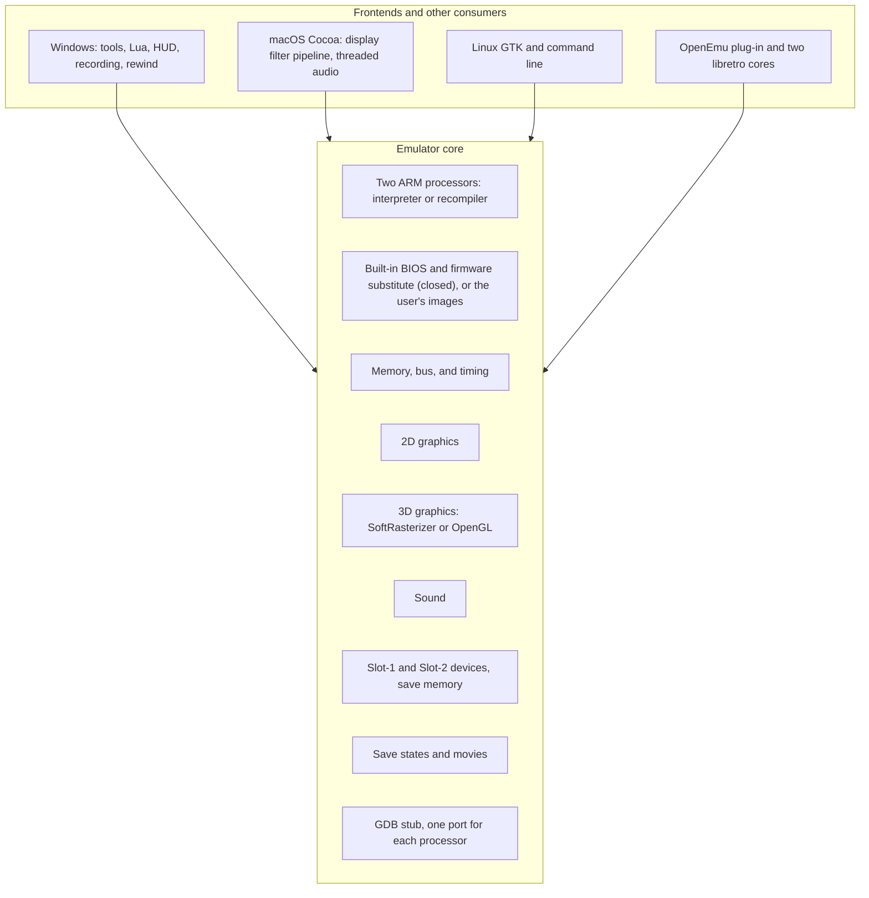

# DeSmuME

## Summary

DeSmuME is an emulator of the Nintendo DS and DS Lite that dates from before April 2006 and
that its project calls "the most seasoned open source Nintendo DS emulator"
([SourceForge metadata][sf-rest]);
it is known for its tools, for booting games with no files from the user,
and as the origin of RetroArch's and OpenEmu's DS support.
This note studies it from its prose and from published results only; no DeSmuME code was read.

Its documentation is candid that accuracy is not its strength:
the [FAQ][faq] calls the processor and bus timings incorrect, each of its two 3D renderers lacks hardware features,
and in the one published [test table][egw-tests] (lead) a development build passes 1 of 77 rasteriser subtests
and 69 of 101 timing subtests.

The lessons that matter most to Rustalgia are that accuracy offered as user options becomes a matrix
that nobody can test and a part of every movie's determinism contract,
that features written inside frontends by declared policy leave every platform with a different emulator,
and that releases with no schedule, no stable state format,
and no visible regression gate cost users their save states
and left one version number covering seven years of builds (lead).
The note recommends against a full reader session for now, and for three smaller steps; the owner decides.

## Scope

- **Version and date.**
  The stable release examined is 0.9.13, announced 2022-05-23 ([desmume.org][home]), studied on 2026-11-27.
  The `master` branch of the [repository][repo] was last pushed on 2026-11-22
  (repository metadata; observed),
  and the page of its README reported the head as commit `b549f71b83287f265b6d74b9e77ef5d98a617190` (observed).
  The commit's date was not read, because the source guard blocked the commits interface (research log).
  No code was read at that commit or at any other.
- **Kinds of source.**
  The project's site and wiki (FAQ, manuals, changelog, release pages, knowledge base, compatibility page, build pages,
  plans); the repository's README, licence file, and metadata; SourceForge's project page, metadata, news,
  and tracker text; libretro's documentation of its two DeSmuME cores; TASVideos' pages; Debian's copyright summary;
  one published test table; and, as leads, the project's forum, comments by developers,
  and two other emulator authors' blogs.
  GitHub's issue threads and release notes were blocked by the source guard and were not read
  (research log); the SourceForge tracker and the wiki's knowledge base stand in for them.
- **Licence, tier, and code.**
  The [family survey][survey-glance] records DeSmuME as GPL-2.0 with "or later" not stated, walled,
  and its [legal section][survey-legal] records the built-in BIOS and firmware replacement as closed.
  This note builds on those passages and does not repeat them.
  A walled emulator is read as prose only unless the owner starts a reader session
  ([ADR 0006][adr6]); none was started, so this note rests on prose and published behaviour alone.
- **Nothing was built or run.**
  Every test result here is a published one.
- **Deliberately not examined.**
  The replacement BIOS and firmware inside the repository, which are closed whatever the emulator's tier;
  no path is named because the tree was never listed.
  `sourceforge.net/projects/desmume/files` and `sourceforge.net/p/desmume/code`, the old downloads and code browser:
  they hold the walled code and builds that embed the closed replacement, so they are not links.
  `desmume.org/download/` and every build or attachment link, for the same reason.
  `wiki.desmume.org/index.php?title=Luigi%27s_notes_about_WiFi` beyond its first section:
  the rest analyses a commercial game's code and prints packet dumps (research log), so the page is not a link.
  The forks and mobile ports, which the [survey][survey-ports] covers.
- **How the claims were checked.**
  Four evidence gatherers, one for each of design, history, accuracy, and reception, fetched the pages with curl,
  read wikis through their raw export, and confirmed every quotation against the raw text.
  This note was written from their reports alone.
  Four independent verifiers who saw only the note then re-checked it, and a fix pass applied their findings:
  three passes in all.
  A claim with no marker rests on the original text; markers follow the [research guide][guide].
  Most option-level documentation dates from 2009 to 2015, and the text says so where it matters.

## Architecture

### What the prose can and cannot show

No design documentation was found on the pages read.
The repository's [README][readme] is 225 bytes: one sentence, a build badge, and a download link (observed).
The [Manual][manual] defers to the [FAQ][faq],
and the FAQ says of the manual that it "may not have the information that other entries in this FAQ promised
that it would" ("Where is the manual?").
No page read describes the scheduler, how the two processors are kept in step, what the timing option changes,
the save-state format, or the design of either renderer
(searched: the wiki's main page links, the FAQ, the manuals, the changelog, the build pages, and the plans).

This section therefore separates three things.
What the project's prose states is cited to the page.
What follows from that prose by reasoning is marked as an inference.
What could be learned only in a reader session is listed at the end,
under ["Not learnable from prose"](#not-learnable-from-prose).

### Parts and frontends

The prose shows an emulator core and several frontends that each embed it.
The macOS build page describes an OpenEmu plug-in built from DeSmuME's own tree,
which "contains the DeSmuME emulator backend, while OpenEmu acts as the frontend",
and says the plug-in exists "to prove
that our DeSmuME source code is modular enough to be adapted easily into other applications"
([macOS build page][build-osx], "OpenEmu Plug-in").
Two libretro cores are further consumers: "DeSmuME"
([libretro DeSmuME][lr-desmume]),
whose repository is a fork of the upstream one
([libretro fork][gh-lr], repository metadata; observed),
and "DeSmuME 2015", a "Port of Desmume to libretro based on Desmume SVN circa 2015"
([DeSmuME 2015][lr-desmume2015], "Background").
Release 0.9 brought "an almost 100% reworked 3D core, which is shared amongst all ports for the first time"
(desmume.org, [second news page][home-2], "DeSmuME 0.9 released!", 2009-01-04).

The frontends named in prose are Windows, macOS ("Cocoa"), Linux GTK2 and GTK, and a Linux command line port,
with older Glade and Wx frontends and mentions of a Qt frontend in one FAQ answer
([Manual][manual]; [Linux build page][build-linux], "Build Executables"; [Changelog][changelog], 0.9.8; [FAQ][faq],
"How do I customize the appearance of the emulated DS video output?").
The 2024 Linux build page lists only the GTK2, GTK, and command line ports, so the others are dropped
or unbuilt (inference).

Features belong to frontends by declared policy.
The Manual says the project "places responsibility on the developers of each port to expose emulation features in a way
that is tuned to the needs of that platform.
As a consequence, some ports are able to move well ahead of the others" ("DeSmuME Platform Specific Manuals").
The FAQ adds that "a developer puts a feature into whichever ports he cares about.
This policy is never going to change, although some features might migrate to other platforms over time"
("Why doesn't a menu option or tool exist in my Linux build?").
The result is the split in the table,
from the FAQ's sections "Why doesn't a menu option or tool exist in my Mac build?", "Sound", "Microphone",
"BIOS and Firmware", and "There are several different DeSmuME executables available.
Which EXE do I use?", at its 0.9.11 state.
The FAQ says only that audio is threaded on macOS, so the two "no" cells of that row are an inference.

| Feature | Windows | macOS | Linux |
|---|---|---|---|
| Lua, tools menu, RAM watch and search, HUD, AVI and WAV recording | yes | no | not stated |
| Microphone from a host device | broken | yes | broken |
| External firmware image | yes | yes | no |
| Multithreaded audio | no (inference) | yes | no (inference) |
| Official binaries | yes | yes | no; built from source |

The diagram shows the parts that the prose names and which part uses which.
It is drawn from the documentation and is not a map of the code.

### How time advances

The prose gives the history and the effects of the timing model, and nothing about its structure.
Release 0.9.5 replaced it: "0.9.5 introduces an entirely rewritten main emulation loop",
which "totally changes the timing, and totally breaks old savestates"
([Changelog][changelog], "0.9.4 -> 0.9.5"),
with rewritten cycle accounting and more detailed timing that removed "much bogus lag".
Release 0.9.8 passed DMA through the normal memory cycle accounting,
which "fixes an annoying number of games and graphical glitches" ("0.9.7 -> 0.9.8").

The project says the result is still wrong.
The [FAQ][faq] states under both "CPU" and "Memory and System Bus" that the timings are incorrect,
that most titles do not seem to be hurt,
and that an option named "Advanced Bus-Level Timing" improves them "at the cost of some emulation performance".
What the option changes is not documented; prose gives only its effect.
Turning it on "will slow down emulation, but fix some games", and turning it off "may break some games"
(FAQ, "The emulator crashes / freezes" and "DeSmuME runs too slow!").
The [Compatibility page][compat] says of timing bugs
that changing "advanced bus-level emulation" "has a slim chance of affecting the bug"
("General notes"); that this names the same option is an inference.
The libretro core enables it by default ([libretro DeSmuME][lr-desmume], "Core options").

Release 0.9.8 also added deliberate perturbation:
"jitter some related register and irq events to simulate pipeline effects
and stimulate some race conditions to other outcomes",
and a small deterministic stylus jitter because "some games were accidentally depending on this"
(Changelog, "0.9.7 -> 0.9.8").
The first is a compensation for not modelling the processor pipeline, not a model of it (inference).

On threads, the FAQ says DeSmuME "benefits more from few fast CPUs than from many slow CPUs",
that the software renderer can use up to 32 threads, and that audio is threaded on macOS only.
The two processors and the bus therefore run on one host thread, and rendering and audio are what scale (inference).

Speed control sits above this: a limiter at 60 frames a second, a speed multiplier,
and a fast-forward that turns the limiter off.
Every frame is still emulated at high speed,
and the FAQ says that "most likely" video and audio frames will then be dropped
("What is the turbo button / speed up button / magic fast-forward button?").
Frame skip is fixed or automatic and "can sometimes entirely fail in dual-screen 3d games or games that use capture"
([Windows manual][manual-win], "Config | Frame Skip"; 2009 text).

The stated priority is not speed: "DeSmuME focuses more on compatibility and features than on speed",
and "gaining extra performance will always mean that you need to give up some features
or reduce compatibility somewhere" (FAQ, "DeSmuME runs too slow!").
Among the fifteen levers that the same answer lists, those that trade against accuracy are frame skip, the recompiler,
bus-level timing off, and advanced sound logic off;
the recompiler and the timing entries are each marked "may break some games".
The Compatibility page puts some slowness down to the games' own loops:
it names two titles that hold the ARM9 at 99 per cent load, one in an idle loop and one polling for an active thread,
and one title that uploads textures constantly ("Slow games").
For the first of them it records an allegation of an emulation bug as unresolved.
No published benchmark that includes DeSmuME was found (searched: two web searches and the pages above).

### How the processors are executed

There are two engines.
"The Interpreter engine is available on all platforms.
However, Dynamic Recompiler only works on x86 or x64 systems" ([FAQ][faq], "CPU").
The recompiler arrived in 0.9.9 as an option ([Changelog][changelog], "0.9.8 -> 0.9.9"), released on 2013-04-30
([desmume.org][home], 0.9.9 post), and 0.9.10 lists "fix many basic jit cpu bugs" ([Release 0.9.10][rel-0910]).
The 0.9.11 announcement tells users to turn it on "for HUGE speedup" (desmume.org),
so the interpreter was the standalone default then (inference).
The libretro core defaults to the recompiler where the hardware allows, and says it "is not available on all hardware
(e.g. Android devices)" ([libretro DeSmuME][lr-desmume], "Core options").

The project treats the interpreter as the reference: "Interpreter has better compatibility than Dynamic Recompiler.
Some games that fail when using Dynamic Recompiler will work fine with Interpreter" (FAQ, "CPU").
The recompiler has a block size that the user can set.
The [knowledge base][kb] lists seven titles with graphical faults, freezes,
or wrong behaviour under "#JIT Runtime snags",
with the remedy "change jit/recompiler blocksize
or disable jit/recompiler". libretro exposes the size from 0 to 100 with a default of 12,
described as "1 = most accurate, 100 = fastest".
One tracker ticket reports a failure that appears only above a block size of 15 instructions
([bug 1272][sf-1272]; lead for the cause).
The page for the 2015 core lists a game that "Needs JIT Block Size 8 or smaller to get past title screen"
([DeSmuME 2015][lr-desmume2015], "Compatibility").
What a unit of block size measures is not stated in the documentation.
That larger blocks mean events and interrupts are checked less often is an inference from these effects.

Whether any build after 0.9.11 has a recompiler for ARM64 hosts is not stated in the prose read.
The 2024 [Linux build page][build-linux] offers AArch64 targets
and the [macOS build page][build-osx] Apple Silicon targets, and neither mentions the recompiler.

### How video is produced

**2D.**
"All known 2D graphics features are supported, with the exception of mosaics",
and colours may be slightly off because "the correct color bit depths are not used at all points in the pipeline"
([FAQ][faq], "2D Graphics System").
The published [plan][todo], which stops at 0.9.9, still lists 6-bit colour depth as unfinished.

**3D.**
There are two renderers: SoftRasterizer, which runs on the host processor, and OpenGL.
The FAQ says "Both renderers are provided for the purposes of working around specific 3D rendering cases"
("3D Rendering").
The table gives the FAQ's account of each, at its 0.9.11 state.

| Property | SoftRasterizer | OpenGL |
|---|---|---|
| Not emulated | wireframes, antialiasing | fog, edge marking |
| Lines | faults; "Line Hack" option | not stated |
| Texture sampling | faults; "Fragment Sampling Hack" option | not stated |
| Depth | faults; adjustable comparison threshold | faults, no workaround |
| Shadow polygons | some faults | "major issues" |

The software renderer came in 0.9.2 ("quirky, but on par with opengl"), gained multicore use in 0.9.5,
and became the Windows default in 0.9.6, "so we dont have to suggest it 1000 times a day" ([Changelog][changelog]).
Release 0.9.11 added a "TXT Hack" for text in some games and W-buffer support in OpenGL ([Release 0.9.11][rel-0911]).
An OpenGL ES renderer is a Linux build option by 2024 ([Linux build page][build-linux], "Configure Options").

**Enhancements.**
Release 0.9.13 "added support for high-resolution 3D rendering" through a scaling factor above the native 256 by 192
([desmume.org][home]).
The libretro core offers internal resolutions up to 2560 by 1920, texture smoothing, texture scaling,
and deposterisation ([libretro DeSmuME][lr-desmume], "Core options").
Whether the software renderer also renders above native resolution is not stated in the prose read.

**Hand-over to the host.**
Each frontend post-processes and presents the final image itself.
The Cocoa frontend of 0.9.11 renders through three stages, a source filter,
a pixel scaler that runs on the host processor or the GPU, and an output filter
(Release 0.9.11, "Cocoa"); Windows offers magnification filters and three display methods (FAQ; Changelog).

### How audio is produced

Sound has two independent settings, and full emulation needs both: "Advanced SPU Logic" on, and a synchronous mode
([FAQ][faq], "Sound").
Which features the advanced logic adds is not stated.
The modes are described in the [Windows manual][manual-win] ("Config | Sound Settings"; 2009 text):

| Mode | Documented behaviour | Documented cost |
|---|---|---|
| Dual sync and async | "generates more sound when the game slows down" | streamed sound sometimes garbled |
| Synchronous, method N | a fixed amount of sound, stretched to fit | not stated |
| Synchronous, method Z | stretches on slowdown, resamples on excess speed | latency; odd behaviour |
| Synchronous, method P | from another emulator's sound plug-in; stretches | latency |

Synchronous mode was added in 0.9.5 "to fix streaming sounds" ([Changelog][changelog]),
and the Cocoa frontend made method N its default in 0.9.11 "since it has much lower latency than P-sync"
([Release 0.9.11][rel-0911]).
Interpolation is post-processing, because "the DS has no interpolation method" (Windows manual).
Output goes through a host back-end chosen by the frontend; DirectSound, XAudio2,
and a null back-end are named (Changelog), and the libretro core reports 44100 Hz
([libretro DeSmuME][lr-desmume], "Geometry and timing").

The microphone takes a host device or generated samples.
Host input works only on macOS, and the white-noise source is "NONDETERMINISTIC and not tas-safe"
(FAQ, "Microphone"; Windows manual, "Config | Microphone Settings").

### How state is saved

**Save memory.**
Battery saves use DeSmuME's own format, new in 0.9.4, with import of raw, Action Replay, and no$gba files
([Windows manual][manual-win], "File | Import Backup Memory"; [Changelog][changelog], 0.9.4).
The save type is detected automatically by default, which the manual calls "not fail-safe in all cases"
(Windows manual, "Config | Save Type"); how detection works is not documented.
Two named games detect the wrong size ([FAQ][faq], "Why does this game fail to save?").
Windows gained a game database for detection in 0.9.8.
Release 0.9.10 began to run the save file directly on disk,
and 0.9.11 then had to "fix large numbers of games not being able to save anymore" ([Release 0.9.11][rel-0911]).

**Save states.**
Numbered slots and named files exist, and the project discourages relying on them.
Compatibility across versions "is preserved wherever possible, but it is not always possible"
(FAQ, "Can I use my save states across versions?"),
and the wiki's [page on the choice][savefile] says: "DO NOT USE SAVESTATES.
These are likely to break between emulator versions."
Releases 0.9, 0.9.1, 0.9.5, and 0.9.10 each invalidated them
(Changelog, "0.8 -> 0.9", "0.9 -> 0.9.1", and "0.9.4 -> 0.9.5"; [Release 0.9.10][rel-0910]).
Rewind on Windows is built on them: it works by "taking secret savestates every 0.25 seconds or so"
and "will suck up a ton of your cpu power" (Windows manual, "Config | Enable State Rewinding").
The layout of a save state is not documented.

**Movies.**
The changelog claims "Full rerecording support" from 0.9.4.
TASVideos documents the format ([DSM page][tas-dsm]; secondary, as another site's account of DeSmuME's format):
plain text, a header of key and value lines, and one line for each frame holding buttons, the stylus position and touch,
and a command field for microphone, reset, and lid.
"All movies start from power-on."
A unique identifier ties save states to their movie, and a required header key records the emulator's version.
From 0.9.6 the header records what has to match for a movie to replay:
whether external BIOS and firmware images are used, whether advanced timing is on, the firmware's profile fields,
and the clock's start time.
Microphone sample files are embedded in the movie and the chosen sample is recorded for each frame
([TASVideos DeSmuME page][tas-desmume], "DS microphone input").

### System software and devices

Nothing has to be supplied.
"DeSmuME uses its own internal BIOS and firmware, but only for the purposes of loading and executing ROMs",
and the built-ins "do not emulate all of the original NDS features" ([FAQ][faq], "BIOS and Firmware").
With the user's own two BIOS images and firmware image, "it is possible to perform a full NDS boot".
A separate switch chooses whether BIOS calls run from the supplied images or from the built-in substitute even
when images are loaded ([Manual][manual], command line options).
The [Windows manual][manual-win] says the settings for external images are of no use
unless the user holds images from a console of their own, "as desmume does not generally require them to run correctly";
it adds that a game may occasionally need them to work ("Config | Emulation Settings").
The substitute is closed for Rustalgia ([survey][survey-legal]) and was not examined.

Documented devices are retail and NAND game cards, one flash card type, and Slot-2 devices including a rumble pack,
memory expansion, a guitar grip, a piano, a paddle, and a Game Boy Advance cartridge
(FAQ, "NDS Slot (SLOT-1)" and "GBA Slot (SLOT-2)").
The cartridge is exposed to DS games only and does not run on its own
(FAQ, "Does the 'GBA slot' option let me play GBA games?").
The DSi is not supported, and the FAQ calls Wi-Fi "an experimental feature, which means it is unsupported"
("Does DeSmuME support Wi-Fi?");
on Linux it is a build-time option ([Linux build page][build-linux], "Configure Options").

### Tools

The Windows frontend carries a disassembler for both processors, a memory viewer and editor, viewers for registers,
palettes, tiles, maps, sprites, matrices, lights, and sound, layer toggles, RAM watch and search, and Lua scripting
([Windows manual][manual-win], "Tools Menu"; [Changelog][changelog], 0.9.5 to 0.9.10).
Its HUD has a frame counter, an input display,
and a lag counter that "records frames where the game does not poll input".
No documentation of the Lua interface was found: the Windows manual defers to the FAQ,
whose answer "What is this Lua stuff I see?" points to a video about another emulator,
and the wiki has no page titled "Lua", "Lua scripting", or "Lua Scripting" (observed).

The GDB stub listens on one port for each processor and implements part of the protocol: breakpoints, stepping,
and read and write watchpoints work ([FAQ][faq], "Does the GDB stub still work?").
It is absent from ordinary builds on every platform (FAQ, "How do I enable the GDB stub?").
For homebrew, the documentation lists debug messages, program arguments,
and an emulated storage device backed by a host directory or disk image
(FAQ, "Homebrew, Development, and Technical Questions").

No prose describes an automated test suite or a headless test runner
(searched: the FAQ, the manuals, the changelog, and the build pages).
The GTK frontend has an option to quit after a set number of seconds "for testing purpose" ([Manual][manual]),
and one changelog line, "bug: fix vectest" (0.9.6), shows a test program in ad hoc use.

### History and maintenance

The first author, YopYop156, "has stopped working on it on the beginning of april 2006
and passed the torch to a new team of developers" ([Welcome post][welcome], 2006-07-03).
The [FAQ][faq] says he released the source under the GPL when he stopped ("What are the origins of DeSmuME?").
The SourceForge project was registered on 2006-04-05 ([SourceForge metadata][sf-rest]; observed).
The first team's [news posts][sf-news] there are signed by an account named for the Yabause project,
and Debian's [copyright file][deb-copyright] gives an upstream contact at that project's address (observed);
that the new team came from that Saturn emulator is an inference.
The wiki's [About page][about] lists a team of eleven.
It was last edited on 2009-05-27 and omits the developer who answers in the 2022 comments,
so it is likely stale (inference).
The table gives the releases that changed the architecture, from the posts on [desmume.org][home],
its [second][home-2] and [third][home-3] pages, and the [Changelog][changelog].

| Version | Date | Change |
|---|---|---|
| 0.5.0 | 2006-12-23 | first release by the new team |
| 0.7.0 | 2007-05-11 | 3D emulation |
| 0.9 | 2009-01-04 | reworked 3D core, shared by all ports |
| 0.9.2 | 2009-04-12 | software rasteriser |
| 0.9.4 | 2009-07-08 | new save format, save detection, movie recording |
| 0.9.5 | 2009-11-27 | rewritten main loop and timing |
| 0.9.8 | 2012-04-09 | new Cocoa frontend |
| 0.9.9 | 2013-04-30 | recompiler for x86 and x64 hosts |
| 0.9.10 | 2013-11-28 | save file run on disk; save states broken |
| 0.9.11 | 2015-04-15 | repairs saving; Cocoa frontend gains a three-stage video filter pipeline |
| 0.9.13 | 2022-05-23 | high-resolution 3D |

There was no stable 0.9.12.
A developer wrote in the comments of the [0.9.13 post][post-0913]:
"We decided to jump to v0.9.13 to help differentiate the stable release from the past 7 years of v0.9.12 interim builds"
(2022-05-25; lead, as a comment).
The gap from 0.9.11 to 0.9.13 is seven years and one month, and from 0.9.13 to this note four years and six months
(calculated from the dates).
The code moved from SourceForge to GitHub in November 2016: the [repository][repo] was created on 2016-11-24 (observed),
and SourceForge's description now says the source is hosted there ([SourceForge metadata][sf-rest]; observed).
Eight months earlier two developers had dismissed a request to leave SourceForge
([forum thread][forum-25077], 2016-03-18; lead), and no post on the site announced the move (observed).
The repository is not archived and was pushed five days before this note (observed),
so development continues without releases.
Debian still packages 0.9.13 ([Debian changelog][deb-changelog], entry of 2025-03-21; observed).

The project's own text calls it "the most seasoned open source Nintendo DS emulator"
and says it is "the origin of RetroArch and OpenEmu Nintendo DS support
and is used by several mobile Nintendo DS emulators" ([SourceForge project page][sf-page], summary).
Of those copies, the libretro fork was last pushed on 2026-09-20, DeSmuME 2015 was last pushed on 2026-08-23,
and the OpenEmu core on 2021-01-26, before 0.9.13
(metadata of the [libretro fork][gh-lr], [DeSmuME 2015][gh-lr2015], and the [OpenEmu core][gh-oe]; observed).
DeSmuME 2015 remains based on code of about 2015 ([libretro DeSmuME 2015][lr-desmume2015], "Background").

### Not learnable from prose

A reader session, or the release notes that the source guard blocked
(research log), would be needed to learn each of these.

- The unit of time the core advances by, and how often the two processors and the devices are brought into step.
- What "Advanced Bus-Level Timing" changes, and what a unit of recompiler block size is.
- Which sound features "Advanced SPU Logic" adds.
- How either 3D renderer works, and whether the software renderer upscales.
- The layout and versioning of a save state, and how much of the core's state it holds.
- The shape of the interface between the core and a frontend.
- What changed between 2015 and 2022 beyond the one paragraph of the 0.9.13 announcement:
  the wiki has no page for 0.9.12 or 0.9.13 (both return HTTP 404; observed), and its changelog stops at 0.9.9.
- How the built-in BIOS and firmware substitute works; this stays closed in any session.

## What works well

- **A core that other programs can embed.**
  The backend builds without the project's own interface, which the in-tree OpenEmu plug-in exists to prove
  ([macOS build page][build-osx], "OpenEmu Plug-in"), and two libretro cores use it ([libretro DeSmuME][lr-desmume]).
  One 3D core has served every port since 0.9, so a fix to it lands once
  (desmume.org, [second news page][home-2], 0.9 post).
- **Games start with no files from the user.**
  A built-in substitute for the BIOS and firmware, limited to loading and running games, removes the set-up step,
  and real images remain an option for a full boot ([FAQ][faq], "BIOS and Firmware").
  The documentation says external images are needed only occasionally
  ([Windows manual][manual-win], "Config | Emulation Settings").
- **Movie recording designed around determinism.**
  Movies start from power-on, the header records the settings that affect replay, the clock start is in the header,
  and stylus jitter is deterministic ([DSM page][tas-dsm], secondary; [Changelog][changelog], 0.9.6 and 0.9.8).
  Microphone samples travel inside the movie
  ([TASVideos DeSmuME page][tas-desmume], "DS microphone input"),
  and the one nondeterministic input source is labelled as unsafe
  ([Windows manual][manual-win], "Config | Microphone Settings").
  The mechanism is that every input is either recorded or made repeatable.
  This is what brought the project to the speedrun community's organisation (inference from the repository's host).
- **Inspection tools inside the emulator.**
  The Windows viewers, the lag counter, Lua,
  and a debugger stub with one port for each processor let a user see hardware state without an outside tool
  ([Windows manual][manual-win], "Tools Menu"; FAQ).
- **Candid, cause-based documentation of limits.**
  The FAQ states for each subsystem what is wrong,
  and the [Compatibility page][compat] explains single failures by cause,
  such as a freeze traced to an interrupt that arrives at the wrong moment,
  with the remark "This bug will probably never get fixed."
  Users and downstream projects can decide from it.
- **Instruction behaviour holds up in the one published table.**
  A development build passes rockwrestler's condition-code test, 10 of its 11 ARMv5 tests,
  and all five division and square-root tests; it fails the load and store multiple test at subtest 4,
  where melonDS fails at 8.
  It gets further on the IPC FIFO test
  (failing at subtest 25)
  than melonDS (6) or no$gba (2), though SkyEmu passes that test ([NDS Tests][egw-tests], "Rockwrestler"; lead).
  That is consistent with the FIFO rewrite that the changelog lists for 0.9.7 (inference).
- **Audio synchronisation as a designed subsystem.**
  The synchronous modes produce a fixed amount of sound and stretch it, so streamed audio survives slowdown,
  and the macOS frontend's later default favours low latency
  (Windows manual, "Config | Sound Settings"; [Release 0.9.11][rel-0911], "Cocoa").
- **Plain public scoping.**
  Wi-Fi, the DSi, and the 3DS are refused in so many words: "When we say that Wi-Fi is unsupported, we mean it"
  (FAQ, "Does DeSmuME support Wi-Fi?").
  A small team is spared the support load (inference).

## What works poorly

- **Accuracy is a set of user switches.**
  The recompiler, its block size, bus-level timing, the renderer, three renderer hacks, the sound logic,
  the synchronisation method, and the source of BIOS calls each change behaviour for some game.
  The [FAQ][faq] gives a list of switches for crashes, and its list for speed reverses two of them,
  the recompiler and bus-level timing, marking each of those two "may break some games"
  ("The emulator crashes / freezes" and "DeSmuME runs too slow!").
  The [knowledge base][kb] sorts "known bugs" by which switch to flip,
  telling users to "work around themselves and not expect to be fixed any time soon".
  The cause is that the fast paths do not preserve behaviour, so correctness becomes configuration (inference).
  One tracker thread shows the cost: in its first ten posts, the only ones the address serves,
  users post cures for one hang across 2012 and 2013 that contradict each other ([bug 1156][sf-1156]; lead).
- **The timing model is approximate and tuned.**
  The project says so (FAQ, "CPU"), and its developers attribute several listed failures to timing.
  The [Compatibility page][compat] names timing for three of its ten titles and warns
  that "Timing bugs may not work on any particular version of desmume as timing changes are made",
  and the knowledge base calls its group of games that need saving and reloading "most likely all timing bugs".
  Errors also build up within a session; for one pair of games the FAQ's whole answer is "Emulation bugs.
  Errors accumulate.
  Stop using savestates.
  Save in-game and reset the emulator."
  The melonDS author calls the timing option "a game of whack-a-mole: it fixes some bugs and causes other bugs"
  ([melonDS blog][mb-256], 2026-04-09; lead, and a rival's view).
  In the published table a development build passes 69 of 101 timing subtests against melonDS's 88,
  and fails the tightly coupled memory test at its first subtest ([NDS Tests][egw-tests]; lead).
  The table does not say whether the timing option was on.
  The mGBA blog reports that the melonDS author's research traced an endless load and a stalled intro,
  both of which DeSmuME also shows, to cartridge transfer delays that the common hardware reference documents
  for one transfer mode only ([mGBA blog][mgba-hgb2], 2017-07-31; lead). libretro's [compatibility list][lr-compat] of
  2019 repeats the wiki's failing titles, and its core's page gives compatibility as "Same as upstream standalone"
  ([libretro DeSmuME][lr-desmume]).
- **Two 3D renderers, neither complete.**
  Each lacks hardware features the other has, and the project's answer is to switch between them (FAQ, "3D Rendering").
  The same development build passes 1 of 77 polyrastertest subtests, against 70 for melonDS and 31 for no$gba
  (NDS Tests, "Polyrastertest"; lead); the page does not say which renderer was used.
  The same wiki's [article on DeSmuME][egw-desmume] calls it "the most accurate Nintendo DS emulator" (lead),
  which its own table contradicts; the table is the measured evidence (inference).
  Features were implemented in each renderer and not driven to exactness in one (inference).
- **The recompiler is a compatibility risk, tied to x86.**
  It is less compatible than the interpreter by the project's own account,
  needs a tuning setting to keep some games working, and has no documented ARM64 form,
  so it is absent where speed is scarcest (FAQ, "CPU"; [libretro DeSmuME][lr-desmume], "Core options").
- **Features live in frontends.**
  By policy, tools, scripting, recording, microphone input, and firmware loading each exist on some platforms only
  ([Manual][manual]; FAQ).
  Even emulation behaviour differs: audio is threaded on macOS
  (FAQ, "Sound"),
  and the macOS port ran "at least 20%-40% slower than the Windows port for most games" at 0.9.7
  and 5 per cent slower at 0.9.8 ([Cocoa frontend plan][cocoa-todo], "v0.9.7" and "v0.9.8").
  Its developer wrote there that "the feature disparity between frontends is becoming greater" ("v0.9.12 (TBD)").
- **Releases broke user data and determinism.**
  Save states were invalidated four times, at 0.9, 0.9.1, 0.9.5, and 0.9.10
  ([Changelog][changelog], "0.8 -> 0.9", "0.9 -> 0.9.1", and "0.9.4 -> 0.9.5"; [Release 0.9.10][rel-0910]).
  Release 0.9.6 put save files at risk,
  and 0.9.10 shipped a save fault that led to the advice "dont use 0.9.10" until 0.9.11, about 17 months later
  ([desmume.org][home]; [Release 0.9.11][rel-0911]; the interval is calculated from the dates).
  TASVideos warns that "0.9.10 and 0.9.11 have problems with sync",
  keeps eleven old versions listed because a movie replays only on the version that made it,
  and says DeSmuME "has not been recommended for submissions since the release of the melonDS core in BizHawk 2.7,
  but is still accepted" ([TASVideos DeSmuME page][tas-desmume]).
  BizHawk 2.7 is dated 2021-11-12 ([BizHawk release history][tas-bh-prev]).
  TASVideos' tables list BizHawk as preferred for the DS and DeSmuME as accepted
  ([Emulator resources][tas-er]; [Platforms][tas-platforms]), and give no reason.
  Its general rule is that "Glitches and in-game behaviors
  that are known to be the result of emulation bugs are not allowed"
  ([Movie rules][tas-rules], "Gameplay must be accurate to hardware");
  that the preference follows from that rule is an inference.
  The cause is a state format with no stated compatibility policy and no visible regression gate (inference).
- **No release process, and no visible automated testing.**
  One version number covered seven years of interim builds ([0.9.13 post][post-0913], comments; lead).
  The FAQ names one automated build service as official, calls any third-party build "unofficial and unsupported",
  and warns that prerelease builds may lack the releases' optimisations
  ("Where do I get SVN builds?" and "DeSmuME runs too slow!").
  One downstream core is still based on code of about 2015 ([libretro DeSmuME 2015][lr-desmume2015], "Background").
  The changelog records regressions that reached stable releases, and omits most fixes by its own account:
  "we're not going to list 70% of the emulation fixes, as is traditional" ([Changelog][changelog], "0.9.8 -> 0.9.9").
  Building is heavy too: Linux has three build systems that cover different frontends,
  and the macOS release needs several compiler generations to span PowerPC to Apple Silicon
  ([Linux build page][build-linux]; [macOS build page][build-osx]).
  That this weight contributed to the gap is an inference; no project statement gives a cause.
- **Wi-Fi and local multiplayer never became usable.**
  One developer's notes on the project wiki suspect timing in both failures
  (`wiki.desmume.org/index.php?title=Luigi%27s_notes_about_WiFi`, "Current Wifi state"; not linked, as Scope explains).
  Its former author says local multiplayer never worked there and
  that the work stayed behind an experimental build switch ([melonDS blog][mb-25], 2017-06-20; lead).
  Wi-Fi fixes reached the main branch in 2018 only when an outsider re-applied the changes of a vanished fork,
  and the submitter said only access-point mode worked ([forum thread][forum-11182]; lead).
- **Documentation and infrastructure have decayed.**
  The FAQ, edited after 0.9.13, still titles itself for 0.9.11 and describes Subversion builds;
  the [Windows][manual-win] and [macOS][manual-mac] manuals were last edited in 2009;
  the wiki's [page index][allpages] is filled with spam titles (observed).
  The Mac developer wrote in 2016 that "There are MANY parts of the emulator that need bugfixes
  and heavy code refactors" ([forum thread][forum-10738]; lead).
- **The licence was left ambiguous.**
  The FAQ names the GPL and links version 2,
  and the [licence file][licence-file] is the plain text of version 2 with no grant by the project (observed);
  neither says "only" or "or later", which is what keeps the emulator walled here ([survey][survey-glance]).
  Debian's packagers read the per-file notices as GPL-2 or later
  ([Debian copyright file][deb-copyright]; secondary),
  and a gatherer recalls the standard "any later version" notice in the file headers
  (from memory); neither settles the tier under the [register][register]'s rule on packagers' summaries.
- **Faults are closed with a workaround.**
  The SourceForge tracker has a status for a known glitch, and of 1,781 tickets 19 were closed with it
  ([SourceForge metadata][sf-rest], tracker queries on 2026-11-27; observed).
  One such ticket was opened in 2013 and last changed in 2024
  (ticket metadata; observed),
  and in its first ten posts, the only ones the address serves, saving in the game, restarting,
  and reloading is the only cure that users confirm ([bug 1345][sf-1345]; lead).

## Implications for Rustalgia

Each recommendation is tied to the findings above.
The owner decides.

- **Keep one reference path for timing, rendering, and execution, and do not offer accuracy as an option.**
  DeSmuME's timing switch makes the default knowingly wrong, becomes a parameter of every movie,
  and by a rival's account moves bugs between games (lead).
  One timing model is recommended, with any faster mode as a named profile whose test results are published;
  [R2-03][roadmap] is where the model is studied.
  One reference rasteriser is recommended,
  with any GPU renderer measured against it and upscaling and texture filters as labelled enhancements outside it:
  DeSmuME, with the renderer unstated, scored 1 of 77 on the one rasteriser test ([NDS Tests][egw-tests]; lead).
  A recompiler is recommended only as an optimisation that passes the interpreter's tests,
  since a user-visible block size is evidence that the two diverged;
  [R2-01][roadmap] can ask whether the chosen timing model survives execution in blocks.
  BIOS calls served from the user's own images are recommended as the reference path for system software.
  Starting with no user files is a goal worth taking, but DeSmuME's substitute is closed material here,
  so that behaviour has to come from hardware documentation and tests ([survey][survey-legal]; [R0-05][r005-ds]).
- **Put every emulation feature and tool behind the core's interface.**
  DeSmuME's separable core, proven by a second consumer, is the part to copy; its per-port tools, scripting,
  and recording are the part to avoid.
  Proving the boundary early with a second consumer, such as a headless test runner, is recommended ([R2-10][roadmap]).
- **Adopt DeSmuME's determinism rules, and give saved state a version and a policy.**
  Movies that start from power-on, with the clock start, profile,
  and boot source in the header and no nondeterministic input source, are recommended as they stand.
  The format already records the emulator's version
  ([DSM page][tas-dsm]; secondary),
  but one version number covered years of differing builds (lead), so a version that names the commit is recommended,
  with a timing change treated as a declared compatibility break ([R2-08][roadmap]).
  A versioned save-state format with a stated compatibility policy is recommended from the first format,
  with a test that saves and save states survive an upgrade as a release gate;
  rewind built on full save states is recommended only after its cost is measured.
- **Define done by published test results.**
  No results were found on DeSmuME's site or wiki
  (searched: the site's news pages, the FAQ, the manuals, the changelog, and the build pages),
  and the only table is a user wiki's with its renderer and timing settings unrecorded.
  Running polyrastertest and recording the settings with every result is recommended from the first DS milestone,
  with tightly coupled memory and block transfers modelled early,
  since the table shows DeSmuME failing those tests at subtests 0 and 4 (lead)
  ([R2-15][roadmap]; the [survey][survey-tests] records the oracles).
  Idle loops and constant texture uploads are recommended as performance test cases,
  since those are the titles DeSmuME names as slow.
  Cartridge transfer delays are a known trap: the melonDS author, as the [mGBA blog][mgba-hgb2] reports,
  cured two faults that DeSmuME also shows by applying delays that the common reference documents
  for one transfer mode only (lead); [R2-11][roadmap] can check the hardware documentation for them.
- **Tie every build to a version that names its commit, release on a gate, and keep prose in the repository.**
  These three answer the seven-year "0.9.12" (lead), the downstream core still built on code of about 2015,
  and the decayed wiki.
  Stating the licence grant with "or later" or "only" spelled out belongs in the same list:
  twenty years of ambiguity are why this study could not read the code.
- **A full reader session is not recommended now.**
  What it would reveal is the inside of a timing model, a recompiler,
  and two renderers that the project itself calls inaccurate,
  while melonDS and DualSOUP are open tier and may be read freely ([survey][survey-glance]).
  DeSmuME's lessons are mostly about process and structure, and the prose carries them.
  Three smaller steps are recommended instead, in this order.
  First, allow the guard to pass release notes and the commits interface of a walled repository,
  which are prose and metadata; that would answer the 2015 to 2022 history.
  Second, rule on whether the per-file licence notices may be checked,
  since [Debian's summary][deb-copyright] suggests "or later",
  and under the compatibility test of [ADR 0006][adr6] that would move the emulator to the open tier.
  Third, before either a licence check or any later session, write a path closure for the replacement BIOS and firmware.
  If a session is held later, the upstream `master` branch at a dated commit is the candidate,
  because the libretro fork descends from it (repository metadata; observed).
  The IPC FIFO behaviour, where DeSmuME gets further than melonDS and no$gba in the published table
  though SkyEmu passes the test (lead), is the one technical topic that would repay it (inference).

## Open questions

- What do "Advanced Bus-Level Timing" and the recompiler block size change?
  A reader session would answer it, or a published run of the timing tests with each setting recorded.
- What changed in the interim builds and in 0.9.13, including any ARM64 recompiler and software upscaling?
  The release notes of the [repository][repo] would answer it, once the owner allows the guard to pass them.
- Do the file headers grant "or later"?
  A reader session limited to the notices, or the owner's ruling on [Debian's summary][deb-copyright], would answer it.
- Which renderer and timing setting did the published [test table][egw-tests] use?
  Neither the page nor the summaries of its four edits say; only its author,
  or a fresh published run with the settings recorded, would.
- Why does [TASVideos][tas-desmume] prefer the melonDS core, in its own words,
  and has any DS movie made in DeSmuME been verified on a console?
  No staff statement was found on the pages read,
  and the verification list at `tasvideos.org/ConsoleVerification/Movies` returned HTTP 404
  (research log); [R2-15][roadmap] can look again.
- How far has the libretro fork drifted from upstream?
  One comparison call would answer it, once the guard allows it for a walled repository.

## Sources

Every source below was read on 2026-11-27 by the evidence gatherers.
The writer opened no source beyond this repository's files;
the verifiers and the fix pass fetched the cited sources again on the same day.

Repository notes and files:

- [R1-12, "Nintendo DS and DSi: family survey"][survey]; [R0-05, "Nintendo DS, DSi, and 3DS"][r005-ds];
  [research guide][guide]; [research roadmap][roadmap]; [ADR 0006][adr6]; [source register][register].

DeSmuME's site and repository:

- [desmume.org][home], with its [second][home-2] and [third][home-3] news pages; newest post 2022-05-23.
- ["Welcome"][welcome] (2006-07-03); ["DeSmuME 0.9.13 released"][post-0913] (2022-05-23), with its comments as leads.
- [Repository][repo], metadata only (last push 2026-11-22); [README][readme] and [licence file][licence-file],
  read on `master`, whose head the README's page gave as commit `b549f71b83287f265b6d74b9e77ef5d98a617190`.
  That the licence file was read at the same commit is an inference from the push date.

DeSmuME's wiki, each fixed by its revision or date of last edit:

- [FAQ][faq] (revision 8944, 2022-06-06); [About][about] (revision 1143, 2009-05-27); [Manual][manual]
  (revision 3547, 2010-12-20);
  [DeSmuME Manual for the Windows port][manual-win]
  (revision 1860, 2009-11-22);
  [DeSmuME Manual for the Macintosh port][manual-mac] (revision 857, 2009-04-09), for its date only.
- [Changelog][changelog] (revision 8718, 2013-05-16); [Release 0.9.10][rel-0910]
  (revision 8868); [Release 0.9.11][rel-0911] (revision 8881, 2015-04-15).
- [KnowledgeBase][kb] (revision 8917, 2017-11-16); [Compatibility][compat] (2011-09-30);
  [`Savefile or savestate`][savefile] (2009-08-01).
- [Installing DeSmuME from source on Linux][build-linux]
  (revision 9152, 2024-08-12); [Installing DeSmuME from source on OS X][build-osx] (revision 8943, 2022-05-14).
- [Cocoa frontend todo][cocoa-todo] (revision 8912, 2017-09-11); [General todo][todo]
  (revision 5295, 2011-11-23); [page index][allpages].
- Not linked: `wiki.desmume.org/index.php?title=Luigi%27s_notes_about_WiFi`
  (revision 8892, 2016-02-09), first section only, because the rest of the page analyses a commercial game's code.

SourceForge, the project's first host:

- [Project page][sf-page], summary only (last update shown 2021-01-13); [metadata][sf-rest]; [news][sf-news].
- Tracker tickets, prose only, as leads: [bug 1156][sf-1156]; [bug 1272][sf-1272]; [bug 1345][sf-1345].
- Not linked, because they hold the walled code and builds:
  `sourceforge.net/projects/desmume/files` and `sourceforge.net/p/desmume/code`; neither was opened.

Downstream copies and packagers:

- libretro documentation (site stamp 2026-10-22): [DeSmuME][lr-desmume]; [DeSmuME 2015][lr-desmume2015];
  [DS compatibility list][lr-compat] (dated 2019-03-06).
- Repository metadata only: [libretro fork][gh-lr]; [DeSmuME 2015][gh-lr2015]; [OpenEmu core][gh-oe].
- Debian, for package 0.9.13: [copyright file][deb-copyright]; [changelog][deb-changelog] (0.9.13-4, 2025-03-21).

Published results and other authors:

- TASVideos: [DeSmuME][tas-desmume] (edited 2025-04-17); [DSM format][tas-dsm]
  (edited 2021-12-14);
  [Emulator resources][tas-er]; [Platforms][tas-platforms]; [BizHawk previous release history][tas-bh-prev];
  [Movie rules][tas-rules].
- Emulation General Wiki, lead: [NDS Tests][egw-tests] (revision 140213, 2026-03-15); [DeSmuME article][egw-desmume].
- melonDS blog, lead: ["The timings saga, ep 2"][mb-256] (2026-04-09); ["Opening to the outer world"][mb-25]
  (2017-06-20).
- mGBA blog, lead: ['"Holy Grail" Bugs in Emulation, Part 2'][mgba-hgb2] (2017-07-31).
- DeSmuME forum, leads: ["long time no see, I guess"][forum-10738] (2016);
  ["Desmume 0.9.12 with working WiFi"][forum-11182] (2018);
  ["Please move the project away from SourceForge"][forum-25077] (2016-03-18).

[survey]: ../topics/R1-12-nintendo-ds-family.md
[survey-glance]: ../topics/R1-12-nintendo-ds-family.md#the-emulators-at-a-glance
[survey-ports]: ../topics/R1-12-nintendo-ds-family.md#ports-cores-and-frontends
[survey-tests]: ../topics/R1-12-nintendo-ds-family.md#tests-and-published-results
[survey-legal]: ../topics/R1-12-nintendo-ds-family.md#legal-exposure
[r005-ds]: ../topics/R0-05-source-map.md#nintendo-ds-dsi-and-3ds
[guide]: ../README.md#claim-status
[roadmap]: ../../roadmap/research.md
[adr6]: ../../adr/0006-read-sources-by-tier-under-a-compatibility-test.md
[register]: ../../../.claude/hooks/source-register.txt
[home]: https://desmume.org/
[home-2]: https://desmume.org/page/2/
[home-3]: https://desmume.org/page/3/
[welcome]: https://desmume.org/2006/07/03/welcome/
[post-0913]: https://desmume.org/2022/05/23/desmume-0-9-13-released-2/
[repo]: https://github.com/TASEmulators/desmume
[readme]: https://github.com/TASEmulators/desmume/blob/b549f71b83287f265b6d74b9e77ef5d98a617190/README.md
[licence-file]: https://github.com/TASEmulators/desmume/blob/b549f71b83287f265b6d74b9e77ef5d98a617190/license.txt
[faq]: https://wiki.desmume.org/index.php?title=Faq
[about]: https://wiki.desmume.org/index.php?title=DeSmuME:About
[manual]: https://wiki.desmume.org/index.php?title=Manual
[manual-win]: https://wiki.desmume.org/index.php?title=DeSmuME_Manual_for_the_Windows_port
[manual-mac]: https://wiki.desmume.org/index.php?title=DeSmuME_Manual_for_the_Macintosh_port
[changelog]: https://wiki.desmume.org/index.php?title=Changelog
[rel-0910]: https://wiki.desmume.org/index.php?title=Release_0.9.10
[rel-0911]: https://wiki.desmume.org/index.php?title=Release_0.9.11
[kb]: https://wiki.desmume.org/index.php?title=KnowledgeBase
[compat]: https://wiki.desmume.org/index.php?title=Compatibility
[savefile]: https://wiki.desmume.org/index.php?title=Savefile_or_savestate
[build-linux]: https://wiki.desmume.org/index.php?title=Installing_DeSmuME_from_source_on_Linux
[build-osx]: https://wiki.desmume.org/index.php?title=Installing_DeSmuME_from_source_on_OS_X
[cocoa-todo]: https://wiki.desmume.org/index.php?title=Cocoa_frontend_todo
[todo]: https://wiki.desmume.org/index.php?title=General_todo
[allpages]: https://wiki.desmume.org/index.php?title=Special:AllPages
[sf-page]: https://sourceforge.net/projects/desmume/
[sf-rest]: https://sourceforge.net/rest/p/desmume
[sf-news]: https://sourceforge.net/p/desmume/news/
[sf-1156]: https://sourceforge.net/rest/p/desmume/bugs/1156
[sf-1272]: https://sourceforge.net/rest/p/desmume/bugs/1272
[sf-1345]: https://sourceforge.net/rest/p/desmume/bugs/1345
[lr-desmume]: https://docs.libretro.com/library/desmume/
[lr-desmume2015]: https://docs.libretro.com/library/desmume_2015/
[lr-compat]: https://docs.libretro.com/library/compatibility/ds/
[gh-lr]: https://github.com/libretro/desmume
[gh-lr2015]: https://github.com/libretro/desmume2015
[gh-oe]: https://github.com/OpenEmu/DeSmuME-Core
[deb-copyright]: https://metadata.ftp-master.debian.org/changelogs/main/d/desmume/unstable_copyright
[deb-changelog]: https://metadata.ftp-master.debian.org/changelogs/main/d/desmume/unstable_changelog
[tas-desmume]: https://tasvideos.org/EmulatorResources/Desmume
[tas-dsm]: https://tasvideos.org/EmulatorResources/Desmume/DSM
[tas-er]: https://tasvideos.org/EmulatorResources
[tas-platforms]: https://tasvideos.org/Platforms
[tas-bh-prev]: https://tasvideos.org/Bizhawk/PreviousReleaseHistory
[tas-rules]: https://tasvideos.org/MovieRules
[egw-tests]: https://emulation.gametechwiki.com/index.php?title=NDS_Tests&oldid=140213
[egw-desmume]: https://emulation.gametechwiki.com/index.php?title=DeSmuME
[mb-256]: https://melonds.kuribo64.net/comments.php?id=256
[mb-25]: https://melonds.kuribo64.net/comments.php?id=25
[mgba-hgb2]: https://mgba.io/2017/07/31/holy-grail-bugs-2/
[forum-10738]: https://forums.desmume.org/viewtopic.php?id=10738
[forum-11182]: https://forums.desmume.org/viewtopic.php?id=11182
[forum-25077]: https://forums.desmume.org/viewtopic.php?pid=25077
