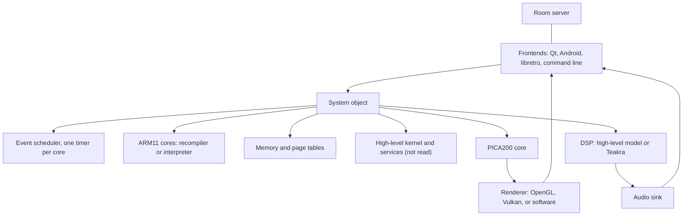

# Azahar

## Summary

Azahar is the open-tier continuation of Citra and Lime3DS: a high-level emulator of the Nintendo 3DS family for desktop,
Android, and libretro frontends, and the family's leading active emulator
([R1-13](../topics/R1-13-nintendo-3ds-family.md#summary)).
This note asks how it is built, why it works, and what Rustalgia should learn from it.

It is one system object that owns every part and runs on one emulation thread.
Time is counted in processor clock cycles by an event scheduler with one timer for each emulated core;
the cores run one after another in short common slices.
The processor runs through the [Dynarmic][dyn-readme] recompiler or one of two interpreters behind one narrow interface.
One hardware-independent PICA200 core feeds an OpenGL, a Vulkan, or a software renderer,
and a high-level audio model is the default beside a low-level DSP path.
The kernel and services are replacement system software, which this study did not read.

The lessons that matter most to Rustalgia are three.
The scheduler, the processor interface, the page table, the renderer boundary,
and the frontend contract are small interfaces that have carried four frontends and three renderers,
and are worth taking as shapes.
The costs to avoid are a process-wide system object, save states locked to one release version,
determinism that is a setting, and a test suite that does not reach the processor, the renderers, or save states,
so that regressions reach stable releases.
An Azahar developer writes, as a reading of Spanish intellectual property law,
that an emulator which decrypts is the circumventing party whoever supplies the key
(["Game Loading on Azahar"][az-loading]); only a project that never decrypts stays outside that argument (inference).
This note is not legal advice.

## Scope

- Examined on 2026-11-27: `azahar-emu/azahar` at the head of `master`,
  commit `c5177f309d4f4efac669623dddeb08e2e5262da1` of that day, slightly ahead of the latest stable release,
  2127.0.1 of 2026-11-24; the project's Dynarmic fork at commit `a46601580d5512d324104f985b5f0209dc980ddc`;
  and the [compatibility list][compat-json] at commit `6ec40d712a15a995bd9cbd36cf101e0c848feb85`.
- Sources: source files of the repository
  (a claim that cites a file was read in its source at that commit,
  and every description of a part in this note was written after reading the implementation);
  the project's documentation, meaning its [README][f-readme], release notes, blog, policy files, [wiki][az-wiki],
  and the descriptions of pull requests, never their diffs; issue threads; the archived Citra site;
  [Dynarmic's documentation][dyn-readme], with none of its code; the [libretro documentation][lr-azahar];
  and one [user wiki][egw-3ds], as a lead.
- Licence and tier: GPL-3.0-or-later from 2127.0, open tier,
  as [R1-13](../topics/R1-13-nintendo-3ds-family.md#citra-and-the-projects-that-continue-it)
  and the [register](../../../.claude/hooks/source-register.txt) record.
  The code was read outside the closed paths, and nothing was copied or ported.
  Of 30 source files sampled, 10 still name GPLv2 or later in their headers (observed).
- Not examined, because [ADR 0006](../../adr/0006-read-sources-by-tier-under-a-compatibility-test.md) closes replacement
  system software and key material: the high-level kernel, services, and applets in `src/core/hle` and their tests in
  `src/tests/core/hle`; the high-level DSP in `src/audio_core/hle` and its tests; the key folders `src/core/hw/aes` and
  `src/core/hw/rsa`, and the key, console-data, seed, ticket, certificate, and container files under `src/core/hw` and
  `src/core/file_sys`; server downloads in `src/core/nus_download`; the console link in `src/network/artic_base`,
  `src/core/loader/artic`, and its file-system parts; and `externals/open_source_archives`.
  The register lists each path.
  Also not opened: the rest of `src/core/file_sys` and `src/core/loader`, `externals`,
  the two dumping pages of the wiki, `azahar-emu/ArticSetupTool`, the code of AzaharPlus,
  and the hardware-test repository `merryhime/3ds-audio`, which is not yet evaluated and so is walled.
  None of these addresses is linked, for those reasons.
  Facts about the kernel and services come from file names and prose only.
- Published results only: nothing was built or run for this note.
- How claims were checked: four evidence gatherers each read one area as raw text or through GitHub's API,
  and confirmed each quotation against the raw text.
  The writer worked from their reports alone.
  Four independent verifiers, who saw only the note, then checked it, and a fix pass applied their findings:
  three passes in all.
- Research log.
  Three open files hold short passages about system software:
  `src/video_core/gpu.cpp` has a middle section that mirrors how the graphics service dispatches its commands,
  `src/core/core.cpp` models how the system picks a memory mode at launch and calls key initialisation,
  and one low-level DSP test carries a comment about obtaining the DSP firmware.
  None of those passages is described here.
  No key, firmware, or game bytes were met, and the source guard blocked nothing.
  The scheduler's header ([`core_timing.h`][f-timing-h]) says its processor clock rate came "from the assembly",
  with no program named, so this note records no clock or frame-period value from it.

## Architecture

### Parts

One system object owns every part: the processor cores, memory, the event scheduler, the kernel,
the service and archive managers, the DSP, the graphics core, cheats, the movie recorder, the custom-texture manager,
an optional scripting server, and helpers that the frontend registers.
It offers the frontend a small set of operations: load a program, run one pass, single-step, reset, shut down,
save or load a state, and insert or eject a cartridge ([`core.h`][f-core-h]).
It creates two cores for the original model and four for the New 3DS ([`core.cpp`][f-core-cpp]).

The source tree splits into libraries
(common, core, video, audio, network, input)
and frontends: Qt for the desktop, a command-line tool, a native bridge under the Kotlin Android app, a libretro core,
and a room server ([`src/CMakeLists.txt`][f-src-cmake]); one launcher dispatches between the command-line tool,
the room server, and the Qt program ([`main.cpp`][f-meta-main]).
Build options make most parts optional, among them each renderer, each audio back end, the debugger stub,
the scripting server, and the built-in keys ([`CMakeLists.txt`][f-cmake]).
The room server links the common and network libraries and, optionally, the web-service library,
but not the core ([`citra_room/CMakeLists.txt`][f-room-cmake]).

The operating-system layer is known here by names only (observed): a kernel folder with files named for threads,
mutexes, ports, sessions, and shared memory, some three dozen service folders, and four applets.
The system object keeps a list of system modules to run at low level ([`core.h`][f-core-h]);
[R1-13](../topics/R1-13-nintendo-3ds-family.md#what-makes-the-family-hard) records
that they come from the user's system files, and names them.
The [README][f-readme] calls the emulator "high level".

### Core and frontend

A frontend supplies a window object that is also a graphics context,
with an optional shared context for background work, a null surface for headless use, the framebuffer layout,
and touch events ([`emu_window.h`][f-window]).
It registers input device factories by name, which build buttons, sticks, motion,
and touch devices from a parameter string and which the core polls ([`input.h`][f-input]);
audio sinks with a pull callback and an optional push mode ([`sink.h`][f-sink]); and applets, an image loader,
and a video dumper on the system object ([`core.h`][f-core-h]).
The window interface states the rule of the boundary: "Generally,
decisions on anything visible to the user should be left up to the GUI."

The frontend gets back a status code from each pass
(success, shutdown, loader errors, missing system files, save-state errors including a build mismatch,
a processor exception), performance statistics, and save-state buffers ([`core.h`][f-core-h]).

Who drives the loop differs.
The Qt frontend runs an emulation thread that calls the run pass repeatedly and sleeps
while paused ([`bootmanager.cpp`][f-qt-boot]), and the Android bridge loops in the same way ([`native.cpp`][f-android]);
the libretro frontend has no thread of its own and calls the run pass on each host frame
until a frame was submitted ([`citra_libretro.cpp`][f-libretro]).
Requests from other threads (reset, shutdown, save, load) are posted as one pending signal
and applied at the start of the next pass.
A save or load waits until the kernel reports no asynchronous host operation pending, and gives up
after five seconds ([`core.cpp`][f-core-cpp]).
Debugger and scripting work runs on the emulation thread between slices and during the frame limiter's wait.

### Time

The unit is fixed by the scheduler's header:
"Time is measured in main CPU clock cycles" ([`core_timing.h`][f-timing-h]).
Its first copyright line names the Dolphin project, so the design descends from Dolphin's scheduler (inference).
An event type is registered under a unique name with a callback.
An event is scheduled with a delay in cycles, a value, and optionally a target core;
its callback is told how many cycles late it fired, and a periodic event reschedules itself less that lateness.
Names are unique because save states store events by type name
and link them again on load ([`core_timing.cpp`][f-timing-cpp]).

Each core has its own timer: an event queue, a count of executed cycles, a slice length, a countdown, an idle counter,
and a clock scale for the under- and overclock setting.
A second, thread-safe queue per timer takes events from other host threads and is merged at the next advance.
Such events are placed at least two maximum slices ahead on purpose:
the comment says they follow blocking host operations, "so there is no need to be cycle accurate".

The longest slice is the clock rate divided by 234, about 4.3 ms of emulated time
(calculated from the divisor), a value the comment ties to the shortest always-scheduled event, the input-pad update.
A slice is cut to the next event, and shortened again if an event is scheduled sooner while the core runs.
The header states the trade: "For performance bigger slice length are desired, though this will lead to cores desync".

One host thread runs the cores in turn ([`core.cpp`][f-core-cpp]):

| State at the start of a pass | What the pass does |
|---|---|
| A reset is pending | Applies it and ends |
| A shutdown is pending | Ends with a shutdown status for the frontend |
| A save or load is pending | Applies it and ends once no host operation is pending; until then runs the cores |
| A core is behind global time by more than 100 cycles | Runs the core furthest behind alone for its deficit |
| The cores are level | Fires due events, picks threads, and runs each core for one common slice |
| A core has no runnable thread | Skips its slice and counts the time as idle |

The cores never run in parallel and can stand up to one slice apart (inference).
[Citra's 2020 Q2 report][citra-2020q2], "Core timing 2.0",
records that per-core timers fixed games and prepared New 3DS support but cost speed at first,
partly because code-cache invalidation happened more often on more cores and partly
because the recompiler ran smaller slices.
The starting tick count is random, fixed by a setting, or overridden by the caller,
because some games seed randomness from it ([`core_timing.cpp`][f-timing-cpp]); a movie supplies the override
([`core.cpp`][f-core-cpp]).

Devices hang off the same scheduler.
A vertical-blank event fires once per emulated frame, raises the display interrupts, and tells the renderer to present.
Graphics commands are executed when submitted
(inference: the file creates no thread and schedules only the vertical-blank event).
The completion interrupts of DMA transfers, fills, texture copies,
and display transfers are delayed by a byte count and a table of transfer rates
that a comment says is "based on measurements taken from real hardware",
while command-list completion is signalled without delay ([`gpu.cpp`][f-gpu]);
no published test of those rates was found (searched: the release notes and the Citra archive).
The frame limiter runs at the end of each frame ([`renderer_base.cpp`][f-renderer-base])
and compares emulated with wall time ([`perf_stats.cpp`][f-perf]).

### Processor

Three back ends sit behind one interface: run until an event, step, invalidate the code cache, switch page table,
read and write registers, save and load a thread context, and stop ([`arm_interface.h`][f-arm-if]).
At start-up there are three cases ([`core.cpp`][f-core-cpp]).
With the recompiler setting on, an x86-64 or 64-bit ARM host gets the recompiler,
and any other host gets the old interpreter, DynCom, directly.
With the setting off, the new interpreter, FastInterp, runs if it is selected and built, and DynCom otherwise.
DynCom is therefore still a fallback at this commit,
although [2127.0][r-2127-0] says the new interpreter "replaces" it and the survey repeats that.

The recompiler is [Dynarmic][dyn-readme], through Azahar's fork.
Azahar gives it callbacks for code and memory reads and writes, exclusive writes, supervisor calls, exceptions, and time
(add ticks, ticks remaining),
plus the current page table's pointer array, a handler for the thread-pointer registers,
and a shared exclusive monitor ([`arm_dynarmic.cpp`][f-arm-dyn]).
Cycle cost is counted for each instruction from a table of bit patterns ([`arm_tick_counts.cpp`][f-ticks]);
this is instruction-level timing, not cycle-exact (inference).
[Citra's 2023 Q1 report][citra-2023q1] says the count was one per instruction before 2023.
One recompiler instance is kept for each address space on each core,
so compiled code survives a process switch at the cost of memory.

Dynarmic's [design document][dyn-design] describes decoding by a table, translation to a typed intermediate form,
optimisation, and emission of host code.
A block ends by linking to the next block "if we have enough cycles remaining"; otherwise it returns to the dispatcher.
The remaining-cycles value that Azahar reports is the core timer's countdown ([`arm_dynarmic.cpp`][f-arm-dyn]),
so this is how the slice countdown stops a core (inference).
Its README lists x86-64 and AArch64 hosts and states limits, the first being "Only user-mode is emulated,
there is no emulation of any other privilege levels".
That fits a high-level kernel and would not fit a low-level one (inference).

FastInterp, merged in [pull request 2376][pr-2376], decodes blocks into a cache of pre-decoded instructions,
chains them, and re-optimises hot blocks;
it states that the program counter reported at a watchpoint
or memory exception is not exact ([`fastinterp.h`][f-fastinterp]).
Its author wrote that its ideas "were adapted from other codebases, including Dolphin and Dynarmic",
and that an AI tool wrote its tests, which were not included.
It exists because iOS and tvOS forbid recompilation ([2127.0][r-2127-0]).

### Memory

Each process has a flat software page table over the 32-bit space in 4 KiB pages,
with a host pointer and an attribute for each page.
The class comment gives the cost: "In the usual case of an access to regular memory,
it only requires an indexed fetch and a check for NULL" ([`memory.h`][f-memory-h]).
Only plain memory has a pointer; unmapped pages, watched pages, and pages held by the rasteriser cache have none,
so every special case falls to a slow path chosen by the attribute.
When the rasteriser caches a region, its pages in every process's table are switched to the cached kind:
a read then flushes the surface to memory first, and a write invalidates it ([`memory.cpp`][f-memory-cpp]).

There is no host-fault fast path.
Azahar passes Dynarmic only the pointer array and allocates guest memory as plain buffers,
though [Dynarmic's README][dyn-readme] mentions a fast-memory arena in its notes on API changes
(absence observed by a search of the wrapper and the memory file).

### Video

A central part holds the PICA200 register state, decodes command lists, runs vertex and geometry shaders,
and assembles primitives.
It hands triangles to a rasteriser through a small interface whose acceleration requests
(a fill, a display transfer, a texture copy, a whole draw)
may each be declined, in which case a software path does the work ([`rasterizer_interface.h`][f-rast-if]).
The renderer is a setting with a fallback order of OpenGL, Vulkan, then software;
a comment notes that no null renderer exists ([`video_core.cpp`][f-video-core]).
Plain register writes in a command list are copied in batches
and only special registers take a slow path ([`pica_core.cpp`][f-pica-core]);
[2126.1][r-2126-1] credits this with "0.5-1ms of processing time per frame on average".

Vertex shaders have three routes: a CPU interpreter, a CPU recompiler for x86-64
and 64-bit ARM ([`shader.cpp`][f-shader]), and hardware shaders, with
which the whole draw runs on the host GPU ([`rasterizer_interface.h`][f-rast-if]).
Geometry shaders never run on the host GPU ([`pica_core.cpp`][f-pica-core]).
The console's fragment stage is fixed-function,
so the hardware renderers generate a host fragment shader for each distinct configuration
([Citra 2023 Q2][citra-2023q2]).
[Citra's 2018 article][citra-hwrender] records
that the first shader translator "proved to be slower than the software renderer" and became the main gain
once control flow was recovered, and that the console multiplies infinity by zero to give zero
where OpenGL gives not-a-number; the article's "Accurate Hardware Shader" option handled that,
and an accurate-multiplication setting, on by default, remains ([`settings.h`][f-settings]).

| Renderer | Role | Limits |
|---|---|---|
| Software | CPU rasteriser on worker threads at native resolution; the reference | Slow; no upscaling or dumping |
| OpenGL | The older hardware renderer; the only one with video dumping | Driver quality; off on Apple hosts |
| Vulkan | Added in 2023 for Android, macOS, and older cards; default on Android | No more accurate than OpenGL |

Sources for the table: [`sw_rasterizer.cpp`][f-sw-rast], [Citra 2023 Q2][citra-2023q2],
the [Vulkan announcement][citra-vulkan], [2125.1][r-2125-1], [2127.0][r-2127-0], and [`CMakeLists.txt`][f-cmake],
whose OpenGL option is off on Apple hosts.

The rasteriser cache keeps guest surfaces on the host GPU and copies them back only when the guest reads them,
which is what allows upscaling ([`rasterizer_cache_base.h`][f-rcache]; [Citra's 2016 article][citra-forwarding]).
It was rewritten in 2018 ([Citra's 2018 article][citra-hwrender]) and refactored in two parts in 2023
([Citra 2023 Q2][citra-2023q2]).

Shader caches are keyed by guest state.
OpenGL keeps a transferable file per title
and a second, disposable file of driver binaries ([`gl_shader_disk_cache.h`][f-gl-disk]),
rebuilt at boot on one thread per host core ([`gl_shader_manager.cpp`][f-gl-mgr]).
Vulkan gained a disk cache only in [2125.0.1][r-2125-0-1], with a separate driver pipeline cache
([`vk_shader_disk_cache.cpp`][f-vk-disk]).
A marker file written while a cache loads lets the next start detect a crash during loading
and warn the user ([`vk_pipeline_cache.cpp`][f-vk-pcache]).
Asynchronous compilation is off by default ([`settings.h`][f-settings]) and was found for Vulkan only: with it on,
a draw whose pipeline is not ready is skipped ([`vk_graphics_pipeline.cpp`][f-vk-pipe]),
except draws of six vertices or fewer ([`vk_rasterizer.cpp`][f-vk-rast]).
The OpenGL shader manager has no such path (observed; searched that file for an asynchronous path).

Enhancements are an integer resolution scale, multisampling, texture filters,
and custom textures matched by a hash that no longer depends on the host graphics API
([`settings.h`][f-settings]; [`custom_tex_manager.cpp`][f-custom-tex]; Citra 2023 Q2).
Stereoscopic output has side-by-side, anaglyph, and interlaced modes.
An optional heuristic, meant by [2120][r-2120] for when "3D is not being used",
skips the right eye's rendering by guessing which command list belongs to it ([`right_eye_disabler.cpp`][f-right-eye]).
The core computes the two-screen layout from the window size the frontend reports ([`framebuffer_layout.h`][f-layout]).

Finished frames reach the frontend through a mailbox between the render thread and a presentation thread.
The interface comment gives the aim: "we want to always present the latest frame that the core generates,
but also make sure that rendering happens at the pace that the frontend dictates" ([`emu_window.h`][f-window]).
The pad update timer is restarted at the end of each frame, after frame limiting;
the comment gives the trade as "HID timing accuracy for input latency" ([`renderer_base.cpp`][f-renderer-base]).

### Audio

Two DSP models sit behind one interface that also owns the sink, a sample queue,
and the time stretcher ([`dsp_interface.h`][f-dsp-if]).
The default high-level model re-creates the most common DSP program without running DSP code;
[Citra's 2018 audio article][citra-audio] says it was based on "the most common audio code that games use,
the home menu", and that "a game can upload any code it wants to the audio chip".
Its code was not read.

The low-level path runs the game's own DSP program on the Teakra emulator.
A recurring scheduler event runs the DSP for 16,384 DSP cycles and reschedules after twice as many processor cycles,
because, in the comment's words, the "DSP runs at clock rate half of the CPU rate".
In the threaded variant a second host thread runs each slice and meets the emulation thread at a barrier
once per slice ([`lle.cpp`][f-lle]).

The emulation thread pushes one frame of 160 stereo samples at the native rate of 32,728 Hz
([`audio_types.h`][f-audio-types]), and the sink's callback pulls from a queue on the host audio thread.
Sinks are libretro, Cubeb, OpenAL, SDL2, and a null sink ([`sink_details.cpp`][f-sink-details]).
No rate correction against the host clock was found (searched: the DSP interface file; the sink files were not read).
On underrun the last sample is repeated; once a second, if the queue never fell below about 20 ms in that second,
the excess above about 10 ms is dropped; and optional time stretching changes tempo
([`dsp_interface.cpp`][f-dsp-if-cpp]; [`time_stretch.cpp`][f-stretch]).
[Pull request 2700][pr-2700] turned stretching off by default because it "adds audio delay by design".

### State

Every stateful part implements one two-way routine used for both saving and loading ([`core.cpp`][f-core-cpp]).
The whole object graph is written with a binary archive and compressed, behind a 256-byte header that holds the title,
the commit hash, the build name, and the build version ([`savestate.cpp`][f-savestate]).
On load the system is shut down, created again, and filled in.
Host GPU caches are not saved: they are flushed and cleared on save and cleared on load ([`core.cpp`][f-core-cpp]).
The scale is in [Citra's 2020 Q2 report][citra-2020q2]:
"Every last operating service and every single kernel object need to be serialized in addition to the hardware state",
in over 500 files.

A state cannot be made or loaded with low-level audio ([`core.cpp`][f-core-cpp]) or the console link,
nor loaded while connected to a room ([`savestate.cpp`][f-savestate]).
Since [2126.1][r-2126-1], "Save states are now locked to the version of Azahar that they were created with".
A slot file loads on any build with the same release version, even from another commit; a state passed as a buffer,
the libretro path, loads only on the identical commit
([`savestate.cpp`][f-savestate]; [`citra_libretro.cpp`][f-libretro]).
Azahar's [blog post on save states][az-states] calls them short-term only,
because the format changes whenever the simulated operating system changes.
Movies record inputs with the clock's start and the scheduler's starting tick,
and a state loaded while recording continues the movie ([`movie.cpp`][f-movie]).
No rewind or run-ahead exists in the settings file or the listing (observed);
[libretro's documentation][lr-azahar] lists rewind as unsupported.

### Rooms

Online rooms tunnel the console's local wireless: a room server relays each member's emulated wireless frames,
so each instance stays a separate emulated console ([`room.h`][f-room-h]; [Citra's networking article][citra-network]).

### Tests and releases

One Catch2 program holds all automated tests ([`src/tests/CMakeLists.txt`][t-cmake]).
Outside the closed folders it covers utilities, the scheduler
(four cases, [`core_timing.cpp`][t-timing]),
memory mapping, the PICA float formats, shader execution, and a little audio.
The shader suite of about 22 cases runs the same expectations against both the interpreter
and the recompiler ([`shader.cpp`][t-shader]).
The one ported hardware test comes from `merryhime/3ds-audio`
([test README][t-merry]) and is, by its file name in the build file, a filter case.
There is no test of the ARM11 back ends, the rasterisers, the surface cache, save states, or movies,
and no test program, game boot, or frame comparison in the tree or the workflows
(inference from the listing and the workflow files).

The main workflow builds Linux on x86-64 and ARM64, macOS, Windows twice, Android,
and a room-server image ([`build.yml`][ci-build]).
The tests gate Linux ([`linux.sh`][ci-linux]) and the macOS slice
that matches the build machine ([`macos.sh`][ci-macos]); on Windows a failure is logged
and the job continues ([`win-msvc.sh`][ci-msvc]); the cross-built Windows and Android scripts have no test step
([`win-mxe.sh`][ci-mxe]; [`android.sh`][ci-android]),
and the libretro builds, iOS among them, turn the tests off ([`libretro-ci.yml`][ci-libretro]).
Releases pass through alphas (observed in the release list: 2127.0-alpha1 to alpha4)
and release candidates meant to last seven days ([2127.1-rc1][r-2127-1-rc1]),
and since [2125.1.2][r-2125-1-2] are immutable, with a bill of materials and a build attestation for each asset.

The [compatibility list][compat-json] held 1,214 titles at its commit, of which 663 were untested.
Of the 551 rated, 367 were rated Perfect or Great, 115 Okay, and 69 worse (calculated from the data file).
A rating needs that "at least one other user corroborates the report" ([contributing guide][compat-contrib]).
An entry holds no emulator version or test date (observed).
The [Emulation General Wiki][egw-3ds] gives "364 out of 550 reported titles" for Azahar (lead).
No published test-suite result for Azahar was found
(searched: release notes 2126.0 to 2127.1-rc1, the README, and the Citra archive).

### Content, keys, and project

[R1-13](../topics/R1-13-nintendo-3ds-family.md#legal-exposure) records Azahar's input rules and exposure;
this section adds what it does not.
The post ["Game Loading on Azahar"][az-loading], by PabloMK7,
which calls itself a reading of Spanish intellectual property law, gives the reason for building keys in:
Citra's user-supplied keys led users to download keys,
and "this does not change the fact that the circumvention is ultimately being done by the emulator,
and the user being involved in this process is irrelevant".
The project relies on interoperability, accessibility, and private copy instead; this is a project's view, untested.

The keys are a build option, on by default and in all of the project's builds ([2125.1][r-2125-1]).
The description of [pull request 2024][pr-2024] says that without them it is "impossible to use some features such
as multiplayer, amiibo or accessing the eshop to download pre-purchased games".
[2127.0][r-2127-0] added signature checks for downloaded encrypted content,
and [2120][r-2120] added an option that runs the system modules needed for online features at low level.
[2124.3][r-2124-3] reversed the ban on one file extension,
calling the original removal "an act of project philosophy rather than a technical change"
and citing fragmentation into forks, while encrypted input stayed off.
[AzaharPlus][azaharplus] restores what Azahar removed.
[2126.2][r-2126-2] fixed "an oversight
which allowed specially-crafted CIA files to execute arbitrary code in the host environment
when locally installed by a user".

The repository has about 11,300 commits, 685 of them in the last twelve months (observed, GitHub API).
The build needs 36 submodules, nine of them forks the project maintains ([`.gitmodules`][f-gitmodules]).
The [AI policy][f-ai] allows disclosed snippets of "approximately 5 lines"
and bars AI from writing a significant part of a contribution.
The [wiki][az-wiki] has seven user pages and no architecture document, and 2127.0 "Removed Doxyfile due to lack of use,
maintenance and interest".

## What works well

- **An event scheduler with named events and lateness feedback.**
  Periodic work reschedules itself less its lateness, so drift does not build up,
  and unique names let queued events survive a save state ([`core_timing.h`][f-timing-h]).
- **Per-core timers, a common slice, catch-up, and idle skipping.**
  They gave New 3DS support and fixed games on one emulation thread with no locking between cores,
  and a core with no runnable thread costs nothing ([`core.cpp`][f-core-cpp]; [Citra 2020 Q2][citra-2020q2]).
  The single thread "ensures the emulator maintains high timing accuracy with minimal desync,
  while also making execution deterministic" (["Citra: 1 Year On"][az-one-year], "Networking").
- **A narrow processor interface.**
  Memory, supervisor calls, exceptions, and time are the only coupling between the recompiler and the system,
  and the same interface serves two interpreters, which is what made hosts without recompilation possible
  ([`arm_interface.h`][f-arm-if]; [`arm_dynarmic.cpp`][f-arm-dyn]; [2127.0][r-2127-0]).
- **A page table that doubles as the graphics-cache trap.**
  The common access is one lookup and a null check,
  and the same null pointer redirects accesses to cached surfaces with no separate test
  ([`memory.h`][f-memory-h]; [`memory.cpp`][f-memory-cpp]).
- **One graphics core, three renderers, and acceleration that may decline.**
  Each hardware renderer can fall back to an exact CPU path, and the software renderer stays as the reference:
  "it has served as a measure of accuracy for the hardware renderers to match", and it located a lighting-table fault
  ([`rasterizer_interface.h`][f-rast-if]; "Citra: 1 Year On", "Graphics").
- **Surfaces kept on the host and synchronised lazily.**
  This is the source of both speed and upscaling ([Citra's 2016 article][citra-forwarding]).
- **Shader caches keyed by guest state.**
  The transferable layer survives a driver change ([`gl_shader_disk_cache.h`][f-gl-disk]),
  Vulkan cache files can be copied between a user's devices ([2125.0.1][r-2125-0-1]),
  and a crash during cache loading is detected at the next start,
  when the user is prompted to reset the Vulkan cache ([2127.0][r-2127-0]).
- **Two shader engines under one test suite.**
  A recompiler change that diverges from the interpreter fails the build where tests gate ([`shader.cpp`][t-shader]).
- **A core and frontend split into small registered interfaces.**
  It is proven by four frontends, among them a pull-driven libretro core built in the same CI
  ([`emu_window.h`][f-window]; [`citra_libretro.cpp`][f-libretro]).
- **Accuracy that costs speed is an option with its cost stated.**
  GPU timing, exact multiplication, low-level audio, and low-level modules are switches;
  [2126.0][r-2126-0] says of GPU timing that games with a dynamic frame rate
  which miss 60 frames a second on hardware will miss it with the option on.
- **Rooms that relay emulated radio frames.**
  No lockstep or state synchronisation is needed ([Citra's networking article][citra-network]).
- **Release discipline.**
  Candidates, immutable releases, and attestations make a tampered binary detectable ([2125.1.2][r-2125-1-2]).

## What works poorly

- **A process-wide system object, global settings, and static registries.**
  Save-state loading finds its scheduler and memory through the global object, so two consoles cannot run in one process
  (inference from [`core.h`][f-core-h] and [`core_timing.h`][f-timing-h]).
  [Citra's 2019 Q1 report][citra-2019q1] says a developer "was working on cleaning up the core emulator code,
  trying to remove any global state"; seven years on,
  the libretro frontend still reaches the system through the static accessor ([`citra_libretro.cpp`][f-libretro]).
- **Save states are locked to one release version and fragile.**
  The archive mirrors the in-memory layout, and the only version in the file is the emulator's build version and commit,
  with no format version of its own (observed; [`savestate.cpp`][f-savestate]; [2126.1][r-2126-1]).
  Crashes on load recur with custom textures, low-level audio, low-level modules, and launch from a third-party frontend
  ([issue 761][i-761]; [issue 2778][i-2778]; [2127.0][r-2127-0]; [issue 2393][i-2393]).
- **Determinism is a setting.**
  A maintainer answered a movie-desync report: "you need to use the 'force deterministic async operations' option,
  otherwise host timings leak into the guest application"
  ([issue 2587][i-2587]); the reporter had the option on, and 2127.0 fixed host timings in file operations under it.
  Saves wait for host operations and can time out ([`core.cpp`][f-core-cpp]).
- **Coarse timing between cores and devices.**
  Cores run in sequence up to a slice apart, instruction costs come from a table,
  graphics commands finish at once with an estimated interrupt delay for transfers and none for command lists,
  and the slice length is a constant tied to one service's polling period
  ([`core_timing.h`][f-timing-h]; [`gpu.cpp`][f-gpu]).
  A blocking host operation done for a guest thread hangs the whole emulator
  unless it is moved off the emulation thread, as the project did for sockets
  (["Citra: 1 Year On"][az-one-year], "Networking").
- **The tests are thin where the risk is, and do not gate every host.**
  There is no processor, renderer, cache, save-state, or boot test, and Windows failures are tolerated
  ([`win-msvc.sh`][ci-msvc]; inference from the listing).
  Regressions reach stable releases: a surface-recycling slowdown shipped in 2126.1 on 2026-09-09
  and was fixed in a candidate eleven weeks later ([2127.1-rc1][r-2127-1-rc1]).
  Citra's last report, dated 2024-02-20, put the software renderer at one to two frames a second
  ("Citra: 1 Year On"); no automated comparison against it is in the test listing (inference).
- **Hardware-test knowledge is not reproducible.**
  The console tests behind many fixes were never published
  ([R1-13](../topics/R1-13-nintendo-3ds-family.md#tests-oracles-and-published-results)), and only one of them has been
  ported into the tree ([test README][t-merry]).
- **Shader stutter is only partly solved, and the renderers differ.**
  Asynchronous compilation was found for Vulkan only, is off by default, and drops draws
  ([`settings.h`][f-settings]; [`vk_graphics_pipeline.cpp`][f-vk-pipe]);
  2127.0 invalidated the existing shader caches ([2127.0][r-2127-0]); video dumping works only on OpenGL
  ([issue 182][i-182]);
  a fix made in one renderer reaches the other later, and surfaces could be deleted while in use,
  "especially at larger internal resolution settings" ([2126.1][r-2126-1]).
- **Heuristics stand in for hardware behaviour.**
  Right-eye skipping guesses from the shape of a command list and is force-disabled
  for one title "due to causing rapidly flashing rendering issues" (2127.0).
- **High-level audio is open-ended work, and the accurate path is slow.**
  Titles whose DSP program differs break; a missing echo effect was added only in 2127.0.
  Low-level audio ran "every game ... at around 5FPS or less" in 2018
  ([Citra's audio article][citra-audio]),
  is not offered on Android, where a maintainer said in 2025 that it was too slow to help
  ([issue 1453][i-1453]),
  cannot be saved in a state ([`core.cpp`][f-core-cpp]), and has no published current speed
  (searched: release notes 2126.0 to 2127.1-rc1, the README, and the Citra archive).
- **Latency was spread over the whole presentation path.**
  Through 2126 a user measured two frames more input lag than a console, and a collaborator reported no single cause.
  After 2127.0 removed one to two frames,
  the reporter measured parity with a console in the standalone build and one to two frames more in the libretro core
  ([issue 1615][i-1615], closed 2026-11-08; [2127.0][r-2127-0]).
  One user measured about 135 ms of audio latency with time stretching always on and about 70 ms without;
  the fix was reverted, and 2127.0 turned stretching off by default ([issue 2433][i-2433]).
- **Three processor back ends, no fast memory, and a user-mode recompiler.**
  FastInterp reports an inexact program counter at a watchpoint or memory exception,
  every special page costs a callback, and Dynarmic's user-mode limit ties the design to a high-level kernel
  ([`fastinterp.h`][f-fastinterp]; [Dynarmic README][dyn-readme]; inference).
- **The legal design rests on shipping keys and on downloads from the maker's servers.**
  The project's own text calls this circumvention justified by exceptions,
  and a fork under the same licence undid its restrictions ([game-loading post][az-loading]; [AzaharPlus][azaharplus]).
- **Heavy build and no developer documentation.**
  Release notes record repeated toolchain breakage, a distribution build failure open since 2024
  ([issue 328][i-328]),
  and Windows on ARM blocked by the toolchain
  ([issue 2201][i-2201]);
  knowledge lives in pull-request descriptions ([2127.0][r-2127-0]) and a chat server ([README][f-readme]).

## Implications for Rustalgia

These are recommendations for the owner, who decides.

- **Scheduling.**
  Take the scheduler's shape: cycle-unit time, named event types, lateness passed to callbacks,
  a thread-safe inbox merged at slice boundaries, and slices cut to the next event.
  Make the longest slice a declared property of each machine, not a constant borrowed from one device.
  For systems with several application cores, start with sequential slices on one host thread,
  with catch-up and idle skipping, and state the accuracy bound of one slice;
  the project credits its single thread with timing accuracy and determinism,
  though in practice determinism depends on a setting.
  This agrees with [R1-13's recommendation](../topics/R1-13-nintendo-3ds-family.md#recommendation)
  and feeds [R2-03](../../roadmap/research.md#phase-2-cross-cutting-engineering).
- **No global state.**
  Pass the system and its configuration explicitly, with no process-wide object, settings, or registries,
  so that several instances can run in one process for netplay, run-ahead, and tests.
  Azahar shows that removing globals later is not finished after seven years.
- **Processor and memory.**
  Take the narrow processor interface and callback set,
  so that an interpreter and a recompiler are interchangeable and hosts that forbid recompilation still work.
  Take the page table with attributes and the null pointer as the trap; consider a host-fault fast path later,
  which Azahar does without.
- **Save states and determinism.**
  Design a versioned state format for each part, separate from the in-memory layout,
  with every subsystem in or explicitly out, and decide the compatibility promise up front.
  Keep host caches out of the state.
  Keep host input and output behind deterministic completion events, so that no save has to wait for host work,
  and make determinism structural, with a replay test in CI.
  If rewind or run-ahead are wanted, they need a cheap in-memory snapshot distinct from the file format.
  These feed [R2-08](../../roadmap/research.md#phase-2-cross-cutting-engineering).
- **Testing.**
  Run one suite against every pair of engines that implement one behaviour, the processor included;
  make tests gate every first-tier host;
  use recorded inputs with frame or state hashes on freely redistributable test programs;
  keep a reference renderer fast enough to compare automatically;
  and publish hardware tests with their results in the repository.
  Azahar has the pieces but no harness, and pays in shipped regressions.
- **Video.**
  Take the renderer boundary: one hardware-independent graphics core,
  a small rasteriser interface whose acceleration may decline, a software reference,
  and the null renderer that Azahar lacks.
  Prefer one modern graphics abstraction to two hand-written hardware renderers.
  Key shader caches by guest state with driver binaries as a disposable layer and a load marker,
  and plan asynchronous compilation and its draw-skipping policy for every hardware renderer from the start.
  Keep per-game overrides as data with a stated reason.
- **Audio and presentation.**
  Use a pull-based sink with a bounded queue, backlog trimming, and hold-last-sample;
  treat time stretching as opt-in and consider drift-correcting resampling, which was not found in Azahar.
  Use a latest-frame mailbox, sample input as late as possible,
  and measure latency with a published method from the start.
  For a system with a DSP, keep a fast model and a slice-synchronised low-level path,
  and make the low-level path serialisable.
- **System layer.**
  If Rustalgia has a high-level system layer, keep it behind an interface so that low-level execution can replace it,
  and do not let the core include its types.
  A high-level DSP and operating system turn every divergent title into reverse-engineering work,
  and the high-level audio model that Azahar inherited was, by [Citra's own account][citra-audio],
  reverse-engineered from the home menu's audio code.
- **Content and law.**
  Keep decrypted input only, with no keys and no network services, as R1-13 recommends.
  [Azahar's post][az-loading] says user-supplied keys do not change who circumvents,
  and its keys serve features Rustalgia can omit; the cost of a build without keys, by the project's account,
  is multiplayer, amiibo, and eShop downloads.
  Decide input rules on substance and avoid symbolic restrictions, which Azahar chose to reverse.
  Treat every container parser as hostile input: bounds-checked and fuzzed.
- **Project practice.**
  Keep dependencies few and avoid maintaining forks of them;
  test the embedding path with the same tests as the standalone build; write developer documentation with each change;
  adopt release attestation early; and record the version and date for each entry of any compatibility list.

## Open questions

- The origin of the processor clock rate
  that the scheduler ([`core_timing.h`][f-timing-h]) says came "from the assembly": a published hardware measurement,
  in a 3DS counterpart of [R5-12](../../roadmap/research.md#phase-5-hands-on-spikes).
- How the kernel chooses threads for each core: the code is closed, and the prose read says no more;
  hardware tests under [R2-12](../../roadmap/research.md#phase-2-cross-cutting-engineering) would answer it.
- The present speed of low-level audio,
  and the cost of the missing fast-memory path and of one recompiler instance per process: no figure is published
  (searched as for the body's statement on audio speed); a measurement in a spike, or a statement from the project.
- Why the licence changed to GPL-3.0-or-later: [pull request 2626][pr-2626] says only that it was discussed externally;
  a statement from the project.

## Sources

Every source below was read on 2026-11-27.
Addresses in code spans are closed or unevaluated and are not linked.

- Azahar source files, all at commit `c5177f309d4f4efac669623dddeb08e2e5262da1`.
  System and build: [`core.h`][f-core-h], [`core.cpp`][f-core-cpp], [`src/CMakeLists.txt`][f-src-cmake],
  [`CMakeLists.txt`][f-cmake], [`.gitmodules`][f-gitmodules], [`settings.h`][f-settings], [`perf_stats.cpp`][f-perf].
  Frontend: [`emu_window.h`][f-window], [`input.h`][f-input], [`framebuffer_layout.h`][f-layout],
  [`bootmanager.cpp`][f-qt-boot], [`citra_libretro.cpp`][f-libretro], [`native.cpp`][f-android],
  [`main.cpp`][f-meta-main].
  Time, processor, memory: [`core_timing.h`][f-timing-h], [`core_timing.cpp`][f-timing-cpp],
  [`arm_interface.h`][f-arm-if], [`arm_dynarmic.cpp`][f-arm-dyn], [`arm_tick_counts.cpp`][f-ticks],
  [`fastinterp.h`][f-fastinterp], [`memory.h`][f-memory-h], [`memory.cpp`][f-memory-cpp].
  Video: [`gpu.cpp`][f-gpu], [`renderer_base.cpp`][f-renderer-base], [`rasterizer_interface.h`][f-rast-if],
  [`video_core.cpp`][f-video-core], [`pica_core.cpp`][f-pica-core], [`shader.cpp`][f-shader],
  [`sw_rasterizer.cpp`][f-sw-rast], [`rasterizer_cache_base.h`][f-rcache], [`gl_shader_disk_cache.h`][f-gl-disk],
  [`vk_shader_disk_cache.cpp`][f-vk-disk], [`vk_pipeline_cache.cpp`][f-vk-pcache],
  [`vk_graphics_pipeline.cpp`][f-vk-pipe], [`vk_rasterizer.cpp`][f-vk-rast], [`gl_shader_manager.cpp`][f-gl-mgr],
  [`custom_tex_manager.cpp`][f-custom-tex], [`right_eye_disabler.cpp`][f-right-eye].
  Audio: [`dsp_interface.h`][f-dsp-if], [`dsp_interface.cpp`][f-dsp-if-cpp], [`lle.cpp`][f-lle], [`sink.h`][f-sink],
  [`sink_details.cpp`][f-sink-details], [`audio_types.h`][f-audio-types], [`time_stretch.cpp`][f-stretch].
  State and rooms: [`savestate.cpp`][f-savestate], [`movie.cpp`][f-movie], [`citra_room/CMakeLists.txt`][f-room-cmake],
  [`room.h`][f-room-h].
  Tests and CI: [`src/tests/CMakeLists.txt`][t-cmake], [scheduler tests][t-timing], [shader tests][t-shader],
  [ported audio test README][t-merry], [`build.yml`][ci-build], [`linux.sh`][ci-linux], [`macos.sh`][ci-macos],
  [`win-msvc.sh`][ci-msvc], [`win-mxe.sh`][ci-mxe], [`android.sh`][ci-android], [`libretro-ci.yml`][ci-libretro].
- Azahar documentation: [README][f-readme] and [AI policy][f-ai] at the same commit; [wiki page list][az-wiki]
  (home page last edited 2025-02-27).
- Azahar release notes, each fixed by its tag: [2120][r-2120], [2124.3][r-2124-3], [2125.0.1][r-2125-0-1],
  [2125.1][r-2125-1], [2125.1.2][r-2125-1-2], [2126.0][r-2126-0], [2126.1][r-2126-1], [2126.2][r-2126-2],
  [2127.0][r-2127-0], [2127.1-rc1][r-2127-1-rc1]; and the list of release tags.
- Azahar pull-request descriptions: [2024][pr-2024], [2376][pr-2376]
  (merged 2026-09-16), [2626][pr-2626], [2700][pr-2700].
  Issue threads: [182][i-182], [328][i-328], [761][i-761], [1453][i-1453], [1615][i-1615], [2201][i-2201],
  [2393][i-2393], [2433][i-2433], [2587][i-2587], [2778][i-2778].
- Azahar blog: ["Game Loading on Azahar: What's Changing"][az-loading] (2024-12-12);
  ["Understanding Savestates"][az-states] (2025-03-28); ["Citra: 1 Year On"][az-one-year] (2025-03-04).
- Azahar's Dynarmic fork at commit `a46601580d5512d324104f985b5f0209dc980ddc`: [README][dyn-readme];
  ["Dynarmic Design Documentation"][dyn-design].
- Azahar compatibility list at commit `6ec40d712a15a995bd9cbd36cf101e0c848feb85`: [data file][compat-json];
  [contributing guide][compat-contrib].
- Citra site archive, whose banner dates it 4 March 2024: ["Citra Progress Report - 2018 Q4~2019 Q1"][citra-2019q1]
  (2019-04-02); ["Citra Mega Progress Report 2019 Q1~2020 Q2"][citra-2020q2] (2020-07-15);
  ["Citra Mega Progress Report 2020 Q2~2023 Q1"][citra-2023q1] (2023-03-28);
  ["Citra Progress Report 2023 Q2"][citra-2023q2] (2023-07-18);
  ["Texture Forwarding brings HD output to Citra"][citra-forwarding] (2016-05-01);
  ["Announcing Networking Support"][citra-network] (2017-11-04); ["Hardware Renderer Updates"][citra-hwrender]
  (2018-03-10); ["Accurate Audio Emulation Has Arrived"][citra-audio] (2018-12-07);
  ["The Vulkan-o erupts - Citra Vulkan is here!"][citra-vulkan] (2023-09-15).
- [AzaharPlus README][azaharplus] (release 2126.2-A).
- libretro documentation, ["Nintendo - 3DS (Azahar)"][lr-azahar].
- Emulation General Wiki, ["Nintendo 3DS emulators"][egw-3ds] (last edited 2026-11-21; lead).
- Not linked, for the reasons Scope gives: the closed paths, `merryhime/3ds-audio`, `azahar-emu/ArticSetupTool`,
  and the dumping pages of Azahar's wiki.

[az-loading]: https://azahar-emu.org/blog/game-loading-changes
[az-one-year]: https://azahar-emu.org/blog/one-year-citra-takedown
[az-states]: https://azahar-emu.org/blog/understanding-save-states
[az-wiki]: https://github.com/azahar-emu/azahar/wiki
[azaharplus]: https://github.com/AzaharPlus/AzaharPlus
[ci-android]: https://github.com/azahar-emu/azahar/blob/c5177f309d4f4efac669623dddeb08e2e5262da1/.ci/android.sh
[ci-build]: https://github.com/azahar-emu/azahar/blob/c5177f309d4f4efac669623dddeb08e2e5262da1/.github/workflows/build.yml
[ci-libretro]: https://github.com/azahar-emu/azahar/blob/c5177f309d4f4efac669623dddeb08e2e5262da1/.ci/libretro-ci.yml
[ci-linux]: https://github.com/azahar-emu/azahar/blob/c5177f309d4f4efac669623dddeb08e2e5262da1/.ci/linux.sh
[ci-macos]: https://github.com/azahar-emu/azahar/blob/c5177f309d4f4efac669623dddeb08e2e5262da1/.ci/macos.sh
[ci-msvc]: https://github.com/azahar-emu/azahar/blob/c5177f309d4f4efac669623dddeb08e2e5262da1/.ci/win-msvc.sh
[ci-mxe]: https://github.com/azahar-emu/azahar/blob/c5177f309d4f4efac669623dddeb08e2e5262da1/.ci/win-mxe.sh
[citra-2019q1]: https://citra.azahar-emu.org/entry/citra-progress-report-2019-q1/
[citra-2020q2]: https://citra.azahar-emu.org/entry/citra-progress-report-2020-q2/
[citra-2023q1]: https://citra.azahar-emu.org/entry/citra-progress-report-2023-q1/
[citra-2023q2]: https://citra.azahar-emu.org/entry/citra-progress-report-2023-q2/
[citra-audio]: https://citra.azahar-emu.org/entry/accurate-audio-emulation/
[citra-forwarding]: https://citra.azahar-emu.org/entry/texture-forwarding-brings-hd-output-to-citra/
[citra-hwrender]: https://citra.azahar-emu.org/entry/improvements-to-hardware-renderer/
[citra-network]: https://citra.azahar-emu.org/entry/announcing-networking-support/
[citra-vulkan]: https://citra.azahar-emu.org/entry/citra-vulkan-announcement/
[compat-contrib]: https://github.com/azahar-emu/compatibility-list/blob/6ec40d712a15a995bd9cbd36cf101e0c848feb85/CONTRIBUTING.md
[compat-json]: https://github.com/azahar-emu/compatibility-list/blob/6ec40d712a15a995bd9cbd36cf101e0c848feb85/compatibility_list.json
[dyn-design]: https://github.com/azahar-emu/dynarmic/blob/a46601580d5512d324104f985b5f0209dc980ddc/docs/Design.md
[dyn-readme]: https://github.com/azahar-emu/dynarmic/blob/a46601580d5512d324104f985b5f0209dc980ddc/README.md
[egw-3ds]: https://emulation.gametechwiki.com/index.php/Nintendo_3DS_emulators
[f-ai]: https://github.com/azahar-emu/azahar/blob/c5177f309d4f4efac669623dddeb08e2e5262da1/AI-POLICY.md
[f-android]: https://github.com/azahar-emu/azahar/blob/c5177f309d4f4efac669623dddeb08e2e5262da1/src/android/app/src/main/jni/native.cpp
[f-arm-dyn]: https://github.com/azahar-emu/azahar/blob/c5177f309d4f4efac669623dddeb08e2e5262da1/src/core/arm/dynarmic/arm_dynarmic.cpp
[f-arm-if]: https://github.com/azahar-emu/azahar/blob/c5177f309d4f4efac669623dddeb08e2e5262da1/src/core/arm/arm_interface.h
[f-audio-types]: https://github.com/azahar-emu/azahar/blob/c5177f309d4f4efac669623dddeb08e2e5262da1/src/audio_core/audio_types.h
[f-cmake]: https://github.com/azahar-emu/azahar/blob/c5177f309d4f4efac669623dddeb08e2e5262da1/CMakeLists.txt
[f-core-cpp]: https://github.com/azahar-emu/azahar/blob/c5177f309d4f4efac669623dddeb08e2e5262da1/src/core/core.cpp
[f-core-h]: https://github.com/azahar-emu/azahar/blob/c5177f309d4f4efac669623dddeb08e2e5262da1/src/core/core.h
[f-custom-tex]: https://github.com/azahar-emu/azahar/blob/c5177f309d4f4efac669623dddeb08e2e5262da1/src/video_core/custom_textures/custom_tex_manager.cpp
[f-dsp-if]: https://github.com/azahar-emu/azahar/blob/c5177f309d4f4efac669623dddeb08e2e5262da1/src/audio_core/dsp_interface.h
[f-dsp-if-cpp]: https://github.com/azahar-emu/azahar/blob/c5177f309d4f4efac669623dddeb08e2e5262da1/src/audio_core/dsp_interface.cpp
[f-fastinterp]: https://github.com/azahar-emu/azahar/blob/c5177f309d4f4efac669623dddeb08e2e5262da1/src/core/arm/fastinterp/fastinterp.h
[f-gitmodules]: https://github.com/azahar-emu/azahar/blob/c5177f309d4f4efac669623dddeb08e2e5262da1/.gitmodules
[f-gl-disk]: https://github.com/azahar-emu/azahar/blob/c5177f309d4f4efac669623dddeb08e2e5262da1/src/video_core/renderer_opengl/gl_shader_disk_cache.h
[f-gl-mgr]: https://github.com/azahar-emu/azahar/blob/c5177f309d4f4efac669623dddeb08e2e5262da1/src/video_core/renderer_opengl/gl_shader_manager.cpp
[f-gpu]: https://github.com/azahar-emu/azahar/blob/c5177f309d4f4efac669623dddeb08e2e5262da1/src/video_core/gpu.cpp
[f-input]: https://github.com/azahar-emu/azahar/blob/c5177f309d4f4efac669623dddeb08e2e5262da1/src/core/frontend/input.h
[f-layout]: https://github.com/azahar-emu/azahar/blob/c5177f309d4f4efac669623dddeb08e2e5262da1/src/core/frontend/framebuffer_layout.h
[f-libretro]: https://github.com/azahar-emu/azahar/blob/c5177f309d4f4efac669623dddeb08e2e5262da1/src/citra_libretro/citra_libretro.cpp
[f-lle]: https://github.com/azahar-emu/azahar/blob/c5177f309d4f4efac669623dddeb08e2e5262da1/src/audio_core/lle/lle.cpp
[f-memory-cpp]: https://github.com/azahar-emu/azahar/blob/c5177f309d4f4efac669623dddeb08e2e5262da1/src/core/memory.cpp
[f-memory-h]: https://github.com/azahar-emu/azahar/blob/c5177f309d4f4efac669623dddeb08e2e5262da1/src/core/memory.h
[f-meta-main]: https://github.com/azahar-emu/azahar/blob/c5177f309d4f4efac669623dddeb08e2e5262da1/src/citra_meta/main.cpp
[f-movie]: https://github.com/azahar-emu/azahar/blob/c5177f309d4f4efac669623dddeb08e2e5262da1/src/core/movie.cpp
[f-perf]: https://github.com/azahar-emu/azahar/blob/c5177f309d4f4efac669623dddeb08e2e5262da1/src/core/perf_stats.cpp
[f-pica-core]: https://github.com/azahar-emu/azahar/blob/c5177f309d4f4efac669623dddeb08e2e5262da1/src/video_core/pica/pica_core.cpp
[f-qt-boot]: https://github.com/azahar-emu/azahar/blob/c5177f309d4f4efac669623dddeb08e2e5262da1/src/citra_qt/bootmanager.cpp
[f-rast-if]: https://github.com/azahar-emu/azahar/blob/c5177f309d4f4efac669623dddeb08e2e5262da1/src/video_core/rasterizer_interface.h
[f-rcache]: https://github.com/azahar-emu/azahar/blob/c5177f309d4f4efac669623dddeb08e2e5262da1/src/video_core/rasterizer_cache/rasterizer_cache_base.h
[f-readme]: https://github.com/azahar-emu/azahar/blob/c5177f309d4f4efac669623dddeb08e2e5262da1/README.md
[f-renderer-base]: https://github.com/azahar-emu/azahar/blob/c5177f309d4f4efac669623dddeb08e2e5262da1/src/video_core/renderer_base.cpp
[f-right-eye]: https://github.com/azahar-emu/azahar/blob/c5177f309d4f4efac669623dddeb08e2e5262da1/src/video_core/right_eye_disabler.cpp
[f-room-cmake]: https://github.com/azahar-emu/azahar/blob/c5177f309d4f4efac669623dddeb08e2e5262da1/src/citra_room/CMakeLists.txt
[f-room-h]: https://github.com/azahar-emu/azahar/blob/c5177f309d4f4efac669623dddeb08e2e5262da1/src/network/room.h
[f-savestate]: https://github.com/azahar-emu/azahar/blob/c5177f309d4f4efac669623dddeb08e2e5262da1/src/core/savestate.cpp
[f-settings]: https://github.com/azahar-emu/azahar/blob/c5177f309d4f4efac669623dddeb08e2e5262da1/src/common/settings.h
[f-shader]: https://github.com/azahar-emu/azahar/blob/c5177f309d4f4efac669623dddeb08e2e5262da1/src/video_core/shader/shader.cpp
[f-sink]: https://github.com/azahar-emu/azahar/blob/c5177f309d4f4efac669623dddeb08e2e5262da1/src/audio_core/sink.h
[f-sink-details]: https://github.com/azahar-emu/azahar/blob/c5177f309d4f4efac669623dddeb08e2e5262da1/src/audio_core/sink_details.cpp
[f-src-cmake]: https://github.com/azahar-emu/azahar/blob/c5177f309d4f4efac669623dddeb08e2e5262da1/src/CMakeLists.txt
[f-stretch]: https://github.com/azahar-emu/azahar/blob/c5177f309d4f4efac669623dddeb08e2e5262da1/src/audio_core/time_stretch.cpp
[f-sw-rast]: https://github.com/azahar-emu/azahar/blob/c5177f309d4f4efac669623dddeb08e2e5262da1/src/video_core/renderer_software/sw_rasterizer.cpp
[f-ticks]: https://github.com/azahar-emu/azahar/blob/c5177f309d4f4efac669623dddeb08e2e5262da1/src/core/arm/dynarmic/arm_tick_counts.cpp
[f-timing-cpp]: https://github.com/azahar-emu/azahar/blob/c5177f309d4f4efac669623dddeb08e2e5262da1/src/core/core_timing.cpp
[f-timing-h]: https://github.com/azahar-emu/azahar/blob/c5177f309d4f4efac669623dddeb08e2e5262da1/src/core/core_timing.h
[f-video-core]: https://github.com/azahar-emu/azahar/blob/c5177f309d4f4efac669623dddeb08e2e5262da1/src/video_core/video_core.cpp
[f-vk-disk]: https://github.com/azahar-emu/azahar/blob/c5177f309d4f4efac669623dddeb08e2e5262da1/src/video_core/renderer_vulkan/vk_shader_disk_cache.cpp
[f-vk-pcache]: https://github.com/azahar-emu/azahar/blob/c5177f309d4f4efac669623dddeb08e2e5262da1/src/video_core/renderer_vulkan/vk_pipeline_cache.cpp
[f-vk-pipe]: https://github.com/azahar-emu/azahar/blob/c5177f309d4f4efac669623dddeb08e2e5262da1/src/video_core/renderer_vulkan/vk_graphics_pipeline.cpp
[f-vk-rast]: https://github.com/azahar-emu/azahar/blob/c5177f309d4f4efac669623dddeb08e2e5262da1/src/video_core/renderer_vulkan/vk_rasterizer.cpp
[f-window]: https://github.com/azahar-emu/azahar/blob/c5177f309d4f4efac669623dddeb08e2e5262da1/src/core/frontend/emu_window.h
[i-1453]: https://github.com/azahar-emu/azahar/issues/1453
[i-1615]: https://github.com/azahar-emu/azahar/issues/1615
[i-182]: https://github.com/azahar-emu/azahar/issues/182
[i-2201]: https://github.com/azahar-emu/azahar/issues/2201
[i-2393]: https://github.com/azahar-emu/azahar/issues/2393
[i-2433]: https://github.com/azahar-emu/azahar/issues/2433
[i-2587]: https://github.com/azahar-emu/azahar/issues/2587
[i-2778]: https://github.com/azahar-emu/azahar/issues/2778
[i-328]: https://github.com/azahar-emu/azahar/issues/328
[i-761]: https://github.com/azahar-emu/azahar/issues/761
[lr-azahar]: https://docs.libretro.com/library/azahar/
[pr-2024]: https://github.com/azahar-emu/azahar/pull/2024
[pr-2376]: https://github.com/azahar-emu/azahar/pull/2376
[pr-2626]: https://github.com/azahar-emu/azahar/pull/2626
[pr-2700]: https://github.com/azahar-emu/azahar/pull/2700
[r-2120]: https://github.com/azahar-emu/azahar/releases/tag/2120
[r-2124-3]: https://github.com/azahar-emu/azahar/releases/tag/2124.3
[r-2125-0-1]: https://github.com/azahar-emu/azahar/releases/tag/2125.0.1
[r-2125-1]: https://github.com/azahar-emu/azahar/releases/tag/2125.1
[r-2125-1-2]: https://github.com/azahar-emu/azahar/releases/tag/2125.1.2
[r-2126-0]: https://github.com/azahar-emu/azahar/releases/tag/2126.0
[r-2126-1]: https://github.com/azahar-emu/azahar/releases/tag/2126.1
[r-2126-2]: https://github.com/azahar-emu/azahar/releases/tag/2126.2
[r-2127-0]: https://github.com/azahar-emu/azahar/releases/tag/2127.0
[r-2127-1-rc1]: https://github.com/azahar-emu/azahar/releases/tag/2127.1-rc1
[t-cmake]: https://github.com/azahar-emu/azahar/blob/c5177f309d4f4efac669623dddeb08e2e5262da1/src/tests/CMakeLists.txt
[t-merry]: https://github.com/azahar-emu/azahar/blob/c5177f309d4f4efac669623dddeb08e2e5262da1/src/tests/audio_core/merryhime_3ds_audio/README.md
[t-shader]: https://github.com/azahar-emu/azahar/blob/c5177f309d4f4efac669623dddeb08e2e5262da1/src/tests/video_core/shader.cpp
[t-timing]: https://github.com/azahar-emu/azahar/blob/c5177f309d4f4efac669623dddeb08e2e5262da1/src/tests/core/core_timing.cpp
