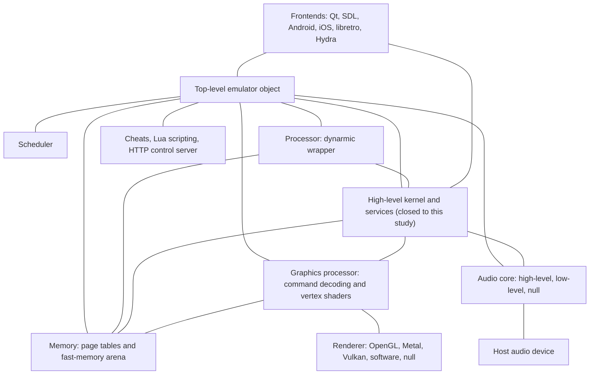

# Panda3DS

## Summary

[Panda3DS][p-repo] is a high-level emulator of the Nintendo 3DS, written in C++ and mostly by one person.
It reimplements the console's kernel and services, runs the ARM11 through the dynarmic recompiler,
and draws through OpenGL.
It runs on many hosts and carries built-in tools; its [README][p-readme] says it "can sort of play games".

Its core is a library with one synchronous "run one frame" call, and emulation runs on the caller's thread.
That shape let six frontends and bridges be written cheaply:
the bridge files run from 39 lines for iOS to 417 for libretro.
The boundary was never written down as an interface, though: every frontend that takes input, five of the six,
reaches into an emulated system service to deliver it, and the core has no save states, no interpreter,
and process-wide state.

Three lessons matter most to Rustalgia.
The first is to keep the frame-stepped library core and its small scheduler,
and to define the frontend interface explicitly from the start.
The second is that accelerated paths work when each can refuse and fall back, as its vertex shaders do,
but only when a reference path exists and tests run on every change (inference);
Panda3DS has a reference path only for vertex shaders and runs no test automatically.
The third comes from the comparison with [Tanuki3DS][t-repo]:
one author wrote a working ARM recompiler with two back ends in about 6,600 lines, plus about 3,300 for its assembler,
so owning the recompiler is a real option beside wrapping a library.

## Scope

- Examined on 2026-11-27: Panda3DS at commit `b18e6586a56b4d35ac0953be6359beed93586dfe` of branch master
  (committed 2026-11-09); the latest tagged release is [v0.9][p-v09] of 2024-12-25.
  For the comparison: Tanuki3DS at commit `879a1e788ab90f449ac539f72e69ca6f3ba376d9` of branch master
  (committed 2026-06-28); its latest release is v0.5.1 of 2026-04-13.
- Kinds of source: source code and its comments; the README, the project's site and FAQ, release notes,
  and one technical document; pull request and issue titles and descriptions, with no diff opened;
  the developers' FOSDEM 2024 slides and abstract; the libretro documentation page; one user wiki, as a lead;
  and GitHub metadata.
  Published test results only: nothing was built or run.
- Licence and tier: both emulators are GPL-3.0 and open tier,
  as the [family survey](../topics/R1-13-nintendo-3ds-family.md#the-emulators-at-a-glance) records.
  Their code was read, apart from the closed paths below, and none was copied or ported.
  Every description of either emulator's internals in this note was written after reading the implementation.
- Not examined, because [ADR 0006](../../adr/0006-read-sources-by-tier-under-a-compatibility-test.md#closed-tier) closes
  replacement system software and the [register](../../../.claude/hooks/source-register.txt) closes key handling and the
  high-level DSP models as a precaution.
  In Panda3DS: `src/core/kernel`, `include/kernel`, `src/core/services`, `include/services`, `src/core/applets`,
  `include/applets`, `src/core/crypto`, `include/crypto`, the files `hle_*` under `src/core/audio` and `include/audio`,
  and, by the study's brief, the two cartridge-format loaders, the file-system folder, and all of `third_party/`.
  In Tanuki3DS: `src/kernel`, `src/services`, the files `dsp*` under `src/audio`, `sys_files`, and `tools`.
  These paths are code spans, not links, because a reader bound by ADR 0006 must not open them.
  The operating-system layer is described from prose and file names only.
- Six files that were read mix machine parts with operating-system behaviour,
  and the evidence gatherers propose that the owner consider closing them: [`include/memory.hpp`][p-mem-h],
  [`src/core/memory.cpp`][p-mem], [`src/core/audio/null_core.cpp`][p-null],
  [`src/core/audio/teakra_core.cpp`][p-teakra], [`src/lua.cpp`][p-lua], and Tanuki3DS's [`src/3ds.c`][t-3ds-c].
  This note describes only their machine-facing parts.
- How the claims were checked: five evidence gatherers each read a share, fetching files as raw text.
  The writer wrote from their reports alone.
  Four independent verifiers, who saw only the note, then checked it, and a fix pass applied their findings.
- Reading the markers: a claim that cites a linked file, with no marker, was read in that file at the commit above,
  and one that cites a README, FAQ, release note, slide, issue, or pull request was read in that text.
  Other claims carry the markers of the [research guide](../README.md#claim-status).
  Sizes use binary prefixes on the reading that the sources' sizes are multiples of 1024 bytes (inference).

## Architecture

### Parts and ownership

One top-level object owns every part by value: configuration, memory, the processor, the graphics processor,
the high-level kernel, the audio core, the scheduler, the key engine, the host audio device, cheats, and a Lua manager,
with an optional HTTP server ([`include/emulator.hpp`][p-emu-h], [`src/emulator.cpp`][p-emu]).
Only the audio core sits behind a pointer, because its type is chosen at run time.
Parts receive references to one another at construction and call each other directly;
there is no bus or message layer between them.
Reset runs in a fixed order, with the kernel last because, in the source's words, "it depends on CPU/Memory state"
([`emulator.cpp`][p-emu]).

The operating system is high-level and lives in the same object graph.
The [README][p-readme] calls the project "an HLE, red-panda-themed Nintendo 3DS emulator",
and the developers' [FOSDEM 2024 slides][fosdem-slides]
(slide "High & Low-Level Emulation")
describe the choice as reimplementing the kernel, the services,
and the system process named Process9 in the emulator's own code.
File names show a kernel folder, a services folder with about thirty services and a service manager, an applets folder,
and a file-system folder of archive back ends (observed in the repository listing; no file in them was opened).
From the readable side, the wiring is: the processor wrapper forwards every supervisor call to the kernel;
two scheduler events call the kernel; and the kernel owns the service manager,
from which the top-level object fetches the DSP service and frontends fetch the input service
([`include/cpu_dynarmic.hpp`][p-cpu-h], [`emulator.cpp`][p-emu]).

Memory is fused with the operating system.
Beside page tables and fast memory, the memory part's header declares the kernel's memory-state bookkeeping,
shared-memory blocks for services, the loaders' entry points, and console settings ([`include/memory.hpp`][p-mem-h]).
A comment there says a reference to the kernel's physical-memory manager is to be removed
when the page-table code "is moved to a better home".

### Core and frontends

The build makes one static core library and then one of three products: an executable with the Qt or the SDL frontend,
a shared library for the Hydra multi-system frontend, or a shared libretro core ([`CMakeLists.txt`][p-cmake]).
The Android app loads a shared library through a bridge file, and the iOS app calls a small bridge from Swift
([`src/jni_driver.cpp`][p-jni], [`src/ios_driver.mm`][p-ios]).
Every frontend drives the core the same way: create the object, pass in a graphics context, load a game,
then call "run one frame" in a loop and present
([`src/libretro_core.cpp`][p-lr], [`src/panda_sdl/frontend_sdl.cpp`][p-sdl], [`src/hydra_core.cpp`][p-hydra]).
The iOS bridge is 39 lines with four entry points; the Android bridge is 163 lines, the Hydra core 167,
and the libretro core 417, and the Qt frontend is larger (observed line counts).

The control surface is small: construct, reset, run one frame, pause, resume, load a game, load an amiibo,
pass a graphics context, set the output size, and reload settings ([`emulator.hpp`][p-emu-h]).
The same object also hands out direct references to nearly every part it owns.
Frontends use them: the Qt, SDL, libretro, Hydra,
and Android frontends each deliver input by fetching the input service of the emulated operating system
and setting keys, circle pad, and touch on it, while the iOS bridge delivers no input; and the Android, libretro,
and Hydra bridges cast the renderer to its OpenGL type
(the files cited above and [`src/panda_qt/main_window.cpp`][p-qt]; only the frontends' calls were read,
since the service is closed).

Threading belongs to the frontend.
The core's frame call is synchronous and the graphics part starts no threads
(a search of the top-level object's two files, [`include/PICA/gpu.hpp`][p-gpu-h],
and [`src/core/PICA/gpu.cpp`][p-gpu] found no host thread, mutex, or atomic, only mentions of emulated threads).
The Qt frontend runs the core on its own thread and passes user actions through a mutex-guarded queue drained
once per frame; the SDL frontend is single-threaded; the optional HTTP server queues its actions the same way
([`main_window.cpp`][p-qt], [`src/http_server.cpp`][p-http]).
The host audio library calls back on its own thread
and pulls from a ring buffer ([`src/core/audio/miniaudio_device.cpp`][p-ma]).

### Time

The scheduler counts ARM11 cycles at 268,111,856 cycles per second in an unsigned 64-bit timestamp
([`include/scheduler.hpp`][p-sched]).
Neither Panda3DS nor Tanuki3DS cites a hardware measurement for that rate:
Tanuki3DS's source calls it the "exact number from citra" ([`src/3ds.h`][t-3ds-h]), so it is a lead for Rustalgia.
Events are a closed list of seven kinds, with at most one pending of each,
in a small sorted container of fixed capacity: end of frame, thread wake-up, run the DSP, update kernel timers,
a video-conversion finish, an infrared-device update,
and a sentinel at the maximum time that keeps the list from being empty.
An event is only a kind and a time; it has no payload and no callback.
The scheduler arrived late, in [pull request 373][p-pr373], merged 2024-01-22.

A frame is a loop: set the cycle budget to the distance from now to the next event, run the recompiler,
then service every event that has come due,
until the end-of-frame event fires ([`src/core/CPU/cpu_dynarmic.cpp`][p-cpu]).
Events are dispatched from one place in the top-level object ([`emulator.cpp`][p-emu]).
The end-of-frame event raises both vertical-blank interrupts and schedules its successor 4,468,530 cycles later
(the clock rate divided by 60, calculated), counted from the event's own due time, so the frame period does not drift.

Time is approximate by construction.
The recompiler asks the wrapper for the cost of each instruction,
and the wrapper adds the cycles the recompiler reports to the scheduler's clock ([`cpu_dynarmic.hpp`][p-cpu-h]).
Time therefore advances in whole translated blocks
(inference from the callbacks; that dynarmic reports cycles per block is from memory).
The cost table is marked as Citra code, "slightly adjusted": ARM instructions cost by class,
every Thumb instruction costs 1, and a supervisor call costs 8, except the system-tick call,
which is charged 152 because, a comment says, some games spin on it ([`src/core/CPU/dynarmic_cycles.cpp`][p-cycles]).
An event scheduled during a slice for a time before the slice's end does not shorten that slice
(inference: the budget is set only at the top of the loop, and nothing in the three readable files reduces it;
whether the kernel stops the recompiler in that case sits in closed files).

Graphics has no place in the timing model.
No scheduler event belongs to the graphics processor, so command lists, transfers,
and fills run at once when the operating system submits them and take no emulated time
(inference from the event list; the submitting service is closed).
Audio is driven by a scheduler event that reschedules itself.
An audio frame is 160 stereo samples and 1,310,720 ARM11 cycles;
the low-level core instead runs the DSP for 16,384 DSP cycles every 32,768 ARM11 cycles
([`include/audio/dsp_core.hpp`][p-dsp-h], [`include/audio/teakra_core.hpp`][p-teakra-h]).
Those constants give about 32,728 samples per second of emulated time,
while the host device is opened at 32,768 Hz ([`miniaudio_device.cpp`][p-ma]), a mismatch of about 0.12%
(calculated from the constants).

The core has no frame limiter.
A search of the top-level object and the SDL, Qt, and libretro frontends for limit, throttle, and sleep found none;
the frontends set the swap interval from a vertical-sync setting, on by default
([`frontend_sdl.cpp`][p-sdl], [`main_window.cpp`][p-qt], [`include/config.hpp`][p-cfg-h]).
The other brake is audio back-pressure: in the low-level core,
when the ring buffer is full at the end of an audio frame,
the emulation thread sleeps a millisecond at a time
until the host device has drained some of it ([`src/core/audio/teakra_core.cpp`][p-teakra]).

### Processor and memory

The processor is dynarmic and nothing else.
The header that selects the processor core names virtualisation as a second option
that stops the build ([`include/cpu.hpp`][p-cpu-sel]),
and the build fails on any host that is neither x86-64 nor ARM64 ([`CMakeLists.txt`][p-cmake]).
There is no interpreter: the wrapper's interpreter-fallback callback ends the program ([`cpu_dynarmic.hpp`][p-cpu-h]).
The recompiler comes as a submodule from the Azahar project's fork ([`.gitmodules`][p-gitmodules]).
The wrapper, about 250 lines across two files, supplies memory access, supervisor calls forwarded to the kernel,
exclusive writes as compare-then-write, and cycle accounting;
it configures an ARMv6K core and installs a system-control coprocessor on which the thread-storage pointer is set
([`cpu_dynarmic.hpp`][p-cpu-h], [`cpu_dynarmic.cpp`][p-cpu]).
One recompiler instance models one ARM11 core in user mode.
The kernel switches emulated threads by rewriting that instance's registers (inference from the wrapper's interface).
The second ARM11 core, the ARM9, and privileged modes are not modelled
(inference: [`emulator.hpp`][p-emu-h] holds one processor,
and the wrapper builds one recompiler instance with a one-core exclusive monitor and resets it into user mode).

Memory has two layers.
Three flat tables hold one entry for each 4 KiB page of the 32-bit address space: a host pointer for reads,
one for writes, and a guest-physical address ([`memory.hpp`][p-mem-h], [`src/core/memory.cpp`][p-mem]).
An access with a pointer goes straight to host memory; one without takes a slow path for special addresses,
or is a fatal error.
The optional second layer is fast memory: a 4 GiB host virtual arena laid out like the guest address space,
backed by one shared block that holds main memory (128 MiB) and DSP memory (512 KiB).
The recompiler is given the arena's base and reads guest memory directly.
The header explains the fallback: "Regions that are not mapped or can't be accelerated this way will segfault,
and the caller (eg dynarmic), will handle this segfault and call the Slower memory read/write functions".
Fast memory is a build option and a run-time setting, both on by default,
and the tables are used alone if the arena cannot be reserved ([`config.hpp`][p-cfg-h]).
Video memory (6 MiB) belongs to the graphics processor and is outside the arena,
so guest access to it always takes the slow path ([`gpu.cpp`][p-gpu]).
The pull request list shows fast memory took three attempts: an early pull request closed unmerged,
merges in December 2024, and further changes in 2025 (observed in titles and dates, [pull request list][p-pulls]).

### Video

Command lists are decoded on the processor into a register file, and writes to certain registers act at once:
draw triggers, attribute setup, table uploads, and shader uploads ([`src/core/PICA/regs.cpp`][p-regs]).
Buffer clears, display transfers, and texture copies are not modelled as hardware registers;
they are forwarded straight to the renderer, with a note
that the transfer engine is still to be emulated ([`gpu.hpp`][p-gpu-h]).
Geometry shaders are not emulated ([`gpu.cpp`][p-gpu]).

A guest vertex shader can run three ways, chosen for each draw ([`gpu.cpp`][p-gpu]).

| Path | When it is used | Source |
|---|---|---|
| Translation to a host shader on the host GPU | The renderer accepts the draw | [`shader_decompiler.cpp`][p-dec] |
| Recompiler to x86-64 or ARM64 machine code | Otherwise, where available and enabled | [`shader_rec.cpp`][p-shrec] |
| Interpreter | Otherwise, and always for immediate-mode vertices | [`gpu.cpp`][p-gpu] |

The translator analyses control flow first and classifies each guest function by how it exits.
A function it cannot classify, or an instruction it cannot express, yields an empty result;
the draw then falls back to the processor paths, and the refusal is remembered for that shader configuration
([`src/core/PICA/shader_decompiler.cpp`][p-dec], [`src/core/renderer_gl/renderer_gl.cpp`][p-gl]).
The machine-code recompiler caches each compiled shader program by a hash of its code and operand descriptors.
It has an optional mode for the console's rule that zero times infinity is zero, off by default
([`src/core/PICA/dynapica/shader_rec.cpp`][p-shrec], [`config.hpp`][p-cfg-h]).
Host vertex shaders are used only together with generated fragment shaders ([`renderer_gl.cpp`][p-gl]).

Fragments have two strategies.
The general shader, which the project calls an ubershader,
is one fixed host shader that receives much of the guest register file and interprets the six combiner stages,
alpha test, lighting, and fog for each pixel,
so it never compiles during play ([`src/host_shaders/opengl_fragment_shader.frag`][p-uber]).
The specialised path generates one fragment shader for each distinct pipeline configuration.
Its cache key leaves out values that change often, such as combiner constants and light parameters,
which travel in a uniform block instead
([`include/PICA/pica_frag_config.hpp`][p-fragcfg], [`src/core/PICA/shader_gen_glsl.cpp`][p-gen]).
The general shader is the default on desktop and the specialised path on macOS and Android.
A further default diverts any draw with lighting on to a specialised shader
([`config.hpp`][p-cfg-h], [`renderer_gl.cpp`][p-gl]).
A comment gives the reason: driver faults with the general shader on Apple's M1, and weak mobile GPUs.
Generated shaders compile synchronously on first use and are cached in memory only
(no on-disk cache: inference from the absence of any such file or setting).

Renderers sit behind one small interface: reset, display, context setup, clear, display transfer, texture copy,
draw a batch of shaded vertices, screenshot,
and an optional hook through which a back end can claim a draw for host shaders ([`include/renderer.hpp`][p-rend-h]).
The back end is picked once, from configuration; OpenGL is the default everywhere except iOS.

| Back end | State at the commit examined | Source |
|---|---|---|
| OpenGL 4.1 core, or ES 3 | Complete: both fragment paths and host vertex shaders | [`renderer_gl.cpp`][p-gl] |
| Metal | Working, with two precompiled shader libraries; no host vertex shaders | [`renderer_mtl.cpp`][p-mtl] |
| Vulkan | Skeleton: a draw opens and closes a render pass without drawing | [`renderer_vk.cpp`][p-vk] |
| Software | Stub: every operation reports that it is unimplemented | [`renderer_sw.cpp`][p-sw] |
| Null | Every operation does nothing | [`renderer_null.cpp`][p-rnull] |

The OpenGL renderer keeps three caches of fixed capacity, indexed by guest address: 16 colour buffers, 16 depth buffers,
and 256 textures, each evicting its oldest entry
(`renderer_gl.hpp` and `surface_cache.hpp` in [`include/renderer_gl`][p-gl-h]).
Surfaces are host textures at the guest's size; no setting raises the internal resolution
(inference from the settings list in [`src/config.cpp`][p-cfg]).
A texture matches on address, format, size, and an optional hash of the guest bytes,
which is off by default except in the libretro core (`textures.hpp` in the same folder, [`config.hpp`][p-cfg-h]).
Rendered surfaces live only on the host:
comments mark as still to do both loading framebuffer contents from guest memory and writing colour
and depth buffers back ([`renderer_gl.cpp`][p-gl]).
At the end of a frame the renderer composes the surfaces named by the two screens' framebuffer registers into one 400 by
480 image and, except in Hydra builds, blits it into the context's default framebuffer; the frontend swaps buffers
([`renderer_gl.cpp`][p-gl], [`frontend_sdl.cpp`][p-sdl]).

### Audio

The audio core is an interface with three implementations: high-level (the default), low-level, and null
([`dsp_core.hpp`][p-dsp-h], [`config.hpp`][p-cfg-h]).
The interface is shaped by the operating system, not by hardware: it carries reset, "run one audio frame",
DSP memory access, and the operations the DSP service needs
(pipes, a semaphore, loading and unloading the DSP program),
and the core holds a reference to that service to raise its events.
The low-level core wraps the Teakra DSP emulator and runs the DSP program that each application supplies;
its header says the integration is based on Citra's ([`teakra_core.hpp`][p-teakra-h]).
The null core makes no sound but answers enough of the protocol
for games to proceed ([`src/core/audio/null_core.cpp`][p-null]).
The high-level core is closed and was not read.

Every core pushes stereo 16-bit samples into one ring buffer of 8,192 frames.
The host device is opened at 32,768 Hz and pulls from the buffer on the audio thread, applies volume,
and repeats the last sample on underrun ([`miniaudio_device.cpp`][p-ma]).
Conversion to the host's rate is left to the audio library (inference).
There is no dynamic rate control (inference from the device and interface files).
The top-level object refuses to enable audio when no host device started,
because nothing would drain the buffer ([`emulator.cpp`][p-emu]).

### State, saves, and tools

Save states do not exist.
No file is named for save states, serialisation, or rewind
(observed in the listing),
and the libretro core reports a state size of zero and refuses both save and load ([`libretro_core.cpp`][p-lr]).
Game saves are ordinary host files in a folder for each game under the user's data folder ([`emulator.cpp`][p-emu]).

Tools are parts of the core.
Cheats are a small virtual machine for Action Replay codes, run once per frame
after display ([`src/core/cheats.cpp`][p-cheats]).
Lua scripts can read and write memory, read input, pause, reset, load a game, and intercept service calls by name;
the only event is the end of a frame ([`src/lua.cpp`][p-lua]).
The HTTP server, a build option, listens on the local machine and can take a screenshot, set buttons,
step a given count of frames, load a game, pause, and reset; each request is queued
and applied between frames ([`http_server.cpp`][p-http]).

### Project, build, and tests

The founder wrote 2,064 of 2,529 commits on master, about 82% (calculated from the contributors and commits data).
Commits by year were 183 in 2022, 1,502 in 2023, 652 in 2024, 179 in 2025, and 13 in 2026 to date (observed).
No release has followed [v0.9][p-v09] in 23 months,
while the [download page][p-dl] still describes stable builds "which are updated manually once every few weeks".
The [README][p-readme] ("Why?") gives the long-term aims as virtualisation on low-end ARM hardware,
tools for debugging and modding, unusual features, and fun, with compatibility as the present focus.
The one trace of the virtualisation aim is a draft, [pull request 341][p-pr341], open since 2023-11-18 (observed).
No page read states a goal of clean or readable code
(searched: README, site, FAQ, [FOSDEM abstract][fosdem-event], release notes).

The build is CMake and C++20 with 27 submodules and 14 vendored folders
([`CMakeLists.txt`][p-cmake], [`.gitmodules`][p-gitmodules]).
Ten continuous-integration workflows build every frontend on every push to master and every pull request;
none runs a test (a search of all ten workflow files for the test option and a test runner found nothing).
The tests are one file of 13 unit cases for vertex-shader arithmetic,
run against both the interpreter and the recompiler ([`tests/shader.cpp`][p-tests]), and six small homebrew programs.
The [workflow that builds those programs][p-testwf] compiles and uploads them and runs nothing;
a person presumably judges them by eye (inference: the listing shows no runner and no expected output but one picture).

### Comparison with Tanuki3DS

[Tanuki3DS][t-repo] is a second independent high-level 3DS emulator, by one author,
which its [README][t-readme] says "aims to be simple, fast, and compatible".
It is not a clean second opinion: the README names Panda3DS, Citra, and 3dmoo as references,
so agreement between the two emulators is weaker evidence than agreement between unrelated ones (inference).
The Panda3DS column of the table repeats findings from the sections above.

| Aspect | Panda3DS | Tanuki3DS |
|---|---|---|
| Processor | Wrapper of about 250 lines around dynarmic | Own recompiler, about 6,600 lines, and own assembler |
| Scheduler event | One of seven fixed kinds, one pending of each | A time, a handler, and an argument; up to 256 |
| Fast memory | Chosen at run time | Chosen at build time, by the build machine's page size |
| Renderers | Five behind an interface, two of them working | One OpenGL 3.3 renderer, no interface |
| Vertex shaders | Host shader, recompiler, interpreter | The same three; geometry shaders on the processor |
| Frontends | Six over a library core | One, SDL3 with Dear ImGui, over a global object |
| Game input | Decrypted, or encrypted with the user's keys | Decrypted only |
| Automated tests | 13 unit cases, not run in CI | None |

Sources for the Tanuki3DS column: [README][t-readme], [`src/scheduler.h`][t-sched-h],
the [recompiler folder `src/arm/jit`][t-jit], [`src/video/renderer_gl.c`][t-gl], [`src/main.c`][t-main],
and the [`Makefile`][t-make].
The recompiler folder's 15 files total 6,624 lines and the [assembler folder's][t-ras] nine total 3,311
(observed line counts); the absence of tests is observed in the listing.
Neither emulator has save states (observed for Tanuki3DS in the files read).
Tanuki3DS builds from one Makefile of 98 lines, and its README ("Building") lists five dependencies.

The frame loop has the same shape as Panda3DS's: run the processor until the earliest event,
advance the clock by the cycles consumed, then run due events;
when no thread is ready it skips from event to event ([`src/3ds.c`][t-3ds-c]).
The scheduler stores handler addresses, so its queue would need a handler table before it could be saved
(inference from [`scheduler.h`][t-sched-h]).

The recompiler is the main difference.
Its parts are a translator from ARM and Thumb instructions to an intermediate form, an optimiser, a register allocator,
back ends for x86-64 and ARM64, and an interpreter of the intermediate form
(this paragraph rests on the files of the [recompiler folder][t-jit], except where another file is cited).
It compiles one straight run of guest instructions at a time and caches blocks by processor mode and address.
The intermediate form is a flat list in which each entry has an operation, up to two operands, and at most one result,
and each entry carries the cumulative guest cycle count.
Floating-point instructions are not lowered into it: each back end emits host code for them directly.
The optimiser's passes are local to a block: removal of redundant guest-register loads and stores, constant folding,
folding of literal-pool loads, merging of consecutive tests of one condition, dead-code removal, and block linking.
The register allocator makes one forward pass over a block.
At a block's end the generated code subtracts the block's cycles from the remaining budget,
and a linked exit jumps straight to the next block only while budget remains.
The back end is chosen at compile time, and a host with neither back end fails to build,
although an option runs blocks through the intermediate-form interpreter ([`src/config.inc`][t-config]).
The back ends and the shader recompilers use a run-time assembler kept in the repository's own source tree
([assembler folder `src/ras`][t-ras]).

Elsewhere the two designs converge.
Tanuki3DS has the same three vertex-shader paths and the same two fragment strategies
([`renderer_gl.c`][t-gl], [`config.inc`][t-config]).
Its shader recompiler keeps the console's rule
that zero times anything is zero ([`src/video/shaderjit/shaderjit_x86.c`][t-shjit]).
Emulation, rendering, and the interface run on one thread,
and pacing waits on the audio queue's length when audio sync is on ([`main.c`][t-main]);
a setting counts worker threads for vertex shading ([`config.inc`][t-config]).
It accepts decrypted games only; the README says "All games must be decrypted."
Its [to-do file][t-todo] lists the Home Menu, New 3DS support, and networking among the gaps,
and no commit followed 2026-06-28 (observed).

## What works well

- **One synchronous frame call serves six hosts.**
  The core owns no window or loop and emulates on the caller's thread, so a host needs a graphics context, a loop,
  and an audio sink.
  The Hydra core arrived as 155 added lines in [pull request 319][p-pr319],
  and it and the libretro core in [pull request 529][p-pr529] each merged the day they were opened
  (observed in pull request metadata).
- **A small scheduler fits a high-level emulator.**
  Fixed kinds, one pending event of each, no callbacks, no allocation, a cached next-event time,
  and a sentinel are enough for six things to time, seven kinds with the sentinel ([`scheduler.hpp`][p-sched]).
  Because an event is a kind and a time, the queue could be saved as plain data (inference).
  Rescheduling the frame end from its due time keeps the frame period from drifting ([`emulator.cpp`][p-emu]).
- **Fast memory is an optional mirror of tables that are always present.**
  The software tables stay authoritative,
  so a failed reservation or a faulting page degrades to the slow path instead of failing
  ([`memory.hpp`][p-mem-h], [`memory.cpp`][p-mem]).
- **Each accelerated vertex path can refuse.**
  The translator returns nothing for a shader it cannot handle, the refusal is cached,
  and the draw falls to the recompiler or the interpreter, so the translator could ship while incomplete
  ([`shader_decompiler.cpp`][p-dec], [`renderer_gl.cpp`][p-gl]).
  The [v0.9 notes][p-v09] credit it with making the emulator "orders of magnitude faster on phones
  and lower end laptops/PCs"; no measurement accompanies the claim.
- **Two fragment strategies sit behind one switch, with a hybrid.**
  The general shader removes compile stutter, generated shaders remove per-pixel interpretation,
  and sending lit draws to generated shaders removes the general shader's worst case ([`renderer_gl.cpp`][p-gl]).
  Cache keys that leave out fast-changing values keep the number of generated shaders small
  ([`pica_frag_config.hpp`][p-fragcfg]).
- **Renderer and audio core are run-time choices with null implementations.**
  The renderer interface is narrow enough that a back end, such as Metal, need not touch command decoding (inference),
  and the null back ends make headless runs possible ([`renderer.hpp`][p-rend-h]).
- **Tools run at one defined point on the emulation thread.**
  Cheats, the Lua frame event, and queued HTTP actions all land on a frame boundary,
  so remote control cannot race the core ([`http_server.cpp`][p-http]).
  Its load, set buttons, step, and screenshot actions are the shape of a headless test driver,
  though the project uses them for a Discord bot ([`CMakeLists.txt`][p-cmake]).
- **The project states its limits plainly.**
  The [README][p-readme] ("Compatibility") says: "Panda3DS is still in the early stages of development.
  Many games boot, many don't."
  Its "How to use" section asks only for a game dump and, for an encrypted one, the user's key file,
  and the founder refuses downloads of official data:
  "any download of anything official is going to be avoided for legal reasons" ([issue 106][p-i106]).
- **Tanuki3DS: a small recompiler that its author owns.**
  Straight-line blocks, a flat intermediate form,
  and block-local passes kept an ARMv6K recompiler with two back ends to about 6,600 lines by one author,
  with about 3,300 more for the assembler ([recompiler folder][t-jit], [assembler folder][t-ras]).
  The interpreter of the intermediate form separates translator faults from back-end faults,
  and checking the cycle budget at block ends keeps timing exact to the block without a dispatcher round trip
  (inference).

## What works poorly

- **The frontend boundary leaks the emulated operating system.**
  Input goes straight into a system-service object, three bridges cast the renderer to its OpenGL type,
  and the libretro core replaces the core's routines for locating its files at link time,
  so a change to the service or the renderer touches nearly every frontend
  ([`libretro_core.cpp`][p-lr], [`jni_driver.cpp`][p-jni], [`hydra_core.cpp`][p-hydra]).
  Defaults in the core's configuration vary by host ([`config.hpp`][p-cfg-h]).
  The OpenGL ES form of the two hand-written host shaders exists only as a patch applied in the Android builds,
  so no desktop build compiles it ([Android workflow][p-androidwf]; one libretro job for Android applies it too);
  generated shaders handle OpenGL ES in shared code ([`shader_gen_glsl.cpp`][p-gen]).
- **Nothing is verified automatically.**
  The unit tests are off by default and absent from continuous integration.
  [Pull request 457][p-pr457], which added them, says:
  "This is intended for regression-testing for developers at the moment
  and should not block any of the current GitHub workflows."
  It adds that many of the shader unit tests failed at the time.
  They run the recompiler in its accurate-multiplication mode, which users have off by default,
  so the tested configuration is not the shipped one ([`tests/shader.cpp`][p-tests]).
  The symptom is [issue 78][p-i78], open since 2023-07-07,
  in which the founder lists games that the shader interpreter and recompiler render differently.
- **Timing is approximate, and graphics takes no time.**
  Static instruction costs borrowed from Citra, a hand-tuned cost on one supervisor call,
  and delivery of events at block boundaries follow from the design described under "Time"
  ([`dynarmic_cycles.cpp`][p-cycles]).
  Anything that depends on how long drawing takes cannot be reproduced (inference).
- **Pacing depends on the host, and audio blocks the emulation thread.**
  Speed is held by display sync and, in the low-level core, by millisecond sleeps
  while the ring buffer is full ([`teakra_core.cpp`][p-teakra]).
  The [FAQ][p-faq] ("Is there audio support?") tells users to turn vertical sync off when enabling audio,
  and [pull request 602][p-pr602], "LLE DSP: Handle cycle drifting", has been open since 2024-10-04.
- **Rendered surfaces never return to guest memory.**
  Read-back effects and render-to-texture cannot work
  (inference from the notes in [`renderer_gl.cpp`][p-gl]),
  and the project's own [lighting document][p-light] says of shadows: "Shadow attenuation samples a texture unit,
  and that likely needs render to texture for most games so that they can construct their shadow map."
  Texture-cache correctness is opt-in: without hashing, a texture rewritten in place is missed (inference),
  and there is no write tracking.
- **There is no reference implementation to test against.**
  The software renderer is a stub and Vulkan draws nothing,
  so OpenGL has no ground truth and no fallback where drivers misbehave ([`renderer_sw.cpp`][p-sw]).
  The processor has no interpreter, so the recompiler has no oracle and only two host architectures build.
- **Command decoding trusts the guest.**
  Comments mark the command pointer and index-buffer reads as unchecked, and several malformed states abort the emulator
  ([`regs.cpp`][p-regs], [`gpu.cpp`][p-gpu]).
  Generated shaders also compile synchronously with no persistent cache, and the fix, [pull request 574][p-pr574],
  has been open since 2024-08-08.
- **No save states, and process-wide state.**
  Nothing in the design prepares for serialisation.
  The Lua manager keeps a static pointer to the emulator, the data folder is a static,
  and every bridge holds one file-level emulator pointer, so two instances in one process would collide
  (inference; no published test found) ([`lua.cpp`][p-lua], [`libretro_core.cpp`][p-lr]).
  Published descriptions drift from the code:
  the core's [libretro information file][p-lrinfo]
  and the [libretro documentation][lr-panda] ("Features") both list save states as supported (observed).
- **The high-level design sets a ceiling, and the project has slowed.**
  The founder says New 3DS hardware is not emulated:
  "The system will always report as O3DS and the extra arm11 cores/fcram aren't emulated,
  nor are most N3DS-only services", though he adds that some games do not mind ([issue 437][p-i437]).
  On 2023-07-11 the founder called booting the Home Menu "an eventual goal", and the request is still open
  ([issue 106][p-i106]);
  installable packages do not load ([README][p-readme]), and software that bypasses the operating system cannot run
  (inference from the [slides][fosdem-slides], slide "As an Emudev What parts to LLE, what to HLE?").
  With one dominant author and no architecture document or contribution guide
  (observed in the listing), these gaps have stayed open as the pace fell.
- **Dependencies carry licence risks that the project does not record.**
  There is no third-party notices file (observed in the listing).
  The core links the Fraunhofer FDK AAC library ([`CMakeLists.txt`][p-cmake]),
  and [FFmpeg's documentation][ffmpeg-general]
  ("OpenCORE, VisualOn, and Fraunhofer libraries")
  says: "The license of the Fraunhofer AAC library is incompatible with the GPL."
  That Panda3DS's GPL-3.0 binaries therefore combine incompatible terms is an inference;
  the fork's licence text was not read.
  The desktop build also compiles files from `third_party/duckstation`,
  a folder that was not opened and that the register holds as walled, with its licence unread;
  DuckStation itself is now under CC BY-NC-ND 4.0 by the register.
- **Published results are thin.**
  The [Emulation General Wiki][egw-3ds]
  (PC table, row "Panda3DS")
  counts 56 of 139 reported titles as compatible, against a base of 550, with the note "(Most might need
  retesting/remarking)" (lead).
  The project's own list is a separate repository of user reports, [Panda3DS-Games-List][p-games], which was not read:
  its licence is not established, so it is walled.
  Performance claims in the [v0.9 notes][p-v09] name no device, title, or method.
- **Tanuki3DS: portability and correctness rest on hand-written back ends and game reports.**
  With no back end there is no build, fast memory is fixed at build time by page size ([`Makefile`][t-make]),
  and floating point bypasses the intermediate form, so the work is repeated for each host ([recompiler folder][t-jit]).
  It has no tests; the [v0.4.1 release][t-rel] instead gave users switches to turn block linking off
  and to ignore memory errors ([`config.inc`][t-config]).
  Its single renderer and global emulator object hold it to one graphics interface and one frontend (inference).

## Implications for Rustalgia

These are recommendations for the owner, who decides.
Roadmap items are those of the [research roadmap](../../roadmap/research.md#phase-2-cross-cutting-engineering).

- **Core and frontend (R2-10).**
  Recommended: a library core with a synchronous "run until the frame ends" call on the caller's thread,
  because that shape made six hosts cheap for Panda3DS.
  Unlike Panda3DS, define the interface for input, video, audio, and storage explicitly from the start,
  with an injectable audio sink and host-supplied defaults; Panda3DS shows the cost of leaving it out:
  input wired into a system service, renderer casts, and a build-time patch for one platform.
- **Scheduling (R2-03).**
  Recommended: a scheduler in base-clock cycles with a cached next-event time,
  events identified by a stable kind and a small argument, never by a handler address,
  and rescheduling from an event's due time.
  That joins Panda3DS's saveable form to Tanuki3DS's generality.
  Scheduling an earlier event should cut the running slice short.
  Whether graphics work consumes emulated time should be chosen deliberately; Panda3DS chose by omission.
- **Processor (R2-01, R4-08).**
  Recommended: an interpreter on every target as the baseline and the test oracle,
  because Panda3DS has none and cannot check its recompiler or build on a third architecture.
  Tanuki3DS shows that an owned recompiler is about 10,000 lines with its assembler when its scope is kept small,
  and Panda3DS that wrapping a library is cheaper but ties host support to it.
  Between the two, an owned recompiler is recommended for R4-08 to test,
  because host support and behaviour then stay in the project's hands (inference),
  with an interpreter of the same intermediate form, cycle counts carried in that form, floating point lowered into it,
  and instruction costs kept behind the processor interface so they can be replaced.
- **Memory (R2-02).**
  Recommended: software page tables as the source of truth,
  with fast memory as an optional mirror chosen at run time for the host's page size, planned early,
  since it took Panda3DS three attempts.
  Keep the bus and page tables apart from what the emulated operating system mapped; Panda3DS fused them.
- **Video (R2-05).**
  Recommended: the shader fallback ladder, with refusal designed into every accelerated path,
  and both fragment strategies with the cache planned from the start:
  keyed on configuration without fast-changing values, compiled off the render thread, and kept across runs.
  Also recommended, each from a gap under "What works poorly": a working software rasteriser as the reference back end,
  transfer hardware modelled as registers, a path for surfaces to return to guest memory with write tracking,
  and bounds checks on guest command data.
- **Audio, pacing, and state (R2-06, R2-07, R2-08).**
  Recommended: an audio-core interface that hides the high-level or low-level choice behind one sample sink,
  rate control at the output instead of blocking the emulation thread, save states designed in from the first component,
  and no process-wide state.
  Neither emulator has save states, and adding them late across a high-level kernel is the hard case (inference).
- **Verification (R2-14, R2-15, R4-10).**
  Recommended: one test corpus run against every implementation of a component,
  in continuous integration from the start and in the default configuration,
  with failing tests kept in the suite as expected failures; test programs that report pass or fail themselves;
  and a headless control surface like Panda3DS's HTTP actions, extended with touch, analogue input, memory reads,
  and a frame hash.
  Capability tables should be generated from the code or tested, so that a stub cannot be advertised,
  and per-frame hooks for cheats, scripts, and remote control should run at one defined point.
- **Dependencies (R4-13).**
  Recommended: a machine-checked inventory of third-party licences from the first dependency,
  and a GPL-compatible AAC decoder.
  The FDK AAC and DuckStation findings are recorded as legal risks not to repeat.
- **Content and scope (R2-12, R6-01).**
  Tanuki3DS shows that decrypted-only input is workable, and such input needs no key handling (inference),
  which supports the [survey's recommendation](../topics/R1-13-nintendo-3ds-family.md#recommendation).
  The high-level approach sets a ceiling that only more service work raises, and both emulators accept it;
  that is evidence for the scope decision, not a recommendation.
- **Evidence.**
  Tanuki3DS attributes the ARM11 clock rate that both emulators share to Citra, Panda3DS attributes it to nothing,
  and neither cites a measurement, so neither it nor any behaviour on
  which the two agree should be adopted without a hardware source.

## Open questions

- Whether Panda3DS's kernel stops the recompiler when it schedules an event before the end of the running slice,
  how its high-level audio core paces itself, and when its graphics service runs command lists:
  the answers sit in closed paths, so only a statement from the project or a published timing test would answer them;
  [R2-03](../../roadmap/research.md#phase-2-cross-cutting-engineering) can design without them.
- Whether the shader unit tests pass today, and what frame rates either emulator reaches: building and running them,
  which this study does not do; no result is published.
- The per-status counts of the project's compatibility list:
  an evaluation of [Panda3DS-Games-List][p-games] for the register, whose licence was not established
  (research log: one fetch was blocked by the source guard and a second was refused by the session's permissions).
- Which licence text the project's FDK AAC fork carries,
  and whether the vendored DuckStation files predate that project's change of licence: reading those folders,
  which needs the owner to open `third_party/` and a register evaluation of the walled folder.
- A hardware source for the ARM11 clock rate and the screen refresh rate: a console measurement,
  in a 3DS counterpart of [R5-12](../../roadmap/research.md#phase-5-hands-on-spikes),
  or a hardware-tested reference found by [R2-03](../../roadmap/research.md#phase-2-cross-cutting-engineering).

## Sources

Every source below was read on 2026-11-27, as raw text or through GitHub's API.
Files of Panda3DS are fixed by commit `b18e6586a56b4d35ac0953be6359beed93586dfe`,
and files of Tanuki3DS by commit `879a1e788ab90f449ac539f72e69ca6f3ba376d9`; issues, pull requests,
and web pages are as they stood on the day read.
The closed paths named in Scope are not sources and are not listed.

Panda3DS repository, [wheremyfoodat/Panda3DS][p-repo]:

- Documents: [README][p-readme]; ["Info on the lighting implementation"][p-light]; [v0.9 release notes][p-v09]
  (release of 2024-12-25); [libretro information file][p-lrinfo].
- Top level and frontends: [`include/emulator.hpp`][p-emu-h]; [`src/emulator.cpp`][p-emu];
  [`src/panda_sdl/frontend_sdl.cpp`][p-sdl]; [`src/panda_qt/main_window.cpp`][p-qt]; [`src/libretro_core.cpp`][p-lr];
  [`src/jni_driver.cpp`][p-jni]; [`src/hydra_core.cpp`][p-hydra]; [`src/ios_driver.mm`][p-ios];
  [`src/http_server.cpp`][p-http]; [`src/lua.cpp`][p-lua]; [`src/core/cheats.cpp`][p-cheats];
  [`include/config.hpp`][p-cfg-h]; [`src/config.cpp`][p-cfg].
- Time, processor, and memory: [`include/scheduler.hpp`][p-sched]; [`include/cpu.hpp`][p-cpu-sel];
  [`include/cpu_dynarmic.hpp`][p-cpu-h]; [`src/core/CPU/cpu_dynarmic.cpp`][p-cpu];
  [`src/core/CPU/dynarmic_cycles.cpp`][p-cycles]; [`include/memory.hpp`][p-mem-h]; [`src/core/memory.cpp`][p-mem].
- Video: [`include/PICA/gpu.hpp`][p-gpu-h]; [`src/core/PICA/gpu.cpp`][p-gpu]; [`src/core/PICA/regs.cpp`][p-regs];
  [`src/core/PICA/dynapica/shader_rec.cpp`][p-shrec]; [`src/core/PICA/shader_decompiler.cpp`][p-dec];
  [`src/core/PICA/shader_gen_glsl.cpp`][p-gen]; [`include/PICA/pica_frag_config.hpp`][p-fragcfg];
  [`src/host_shaders/opengl_fragment_shader.frag`][p-uber]; [`include/renderer.hpp`][p-rend-h];
  [`src/core/renderer_gl/renderer_gl.cpp`][p-gl]; three headers of [`include/renderer_gl`][p-gl-h]
  (`renderer_gl.hpp`, `surface_cache.hpp`, `textures.hpp`);
  [`src/core/renderer_mtl/renderer_mtl.cpp`][p-mtl]; [`src/core/renderer_vk/renderer_vk.cpp`][p-vk];
  [`src/core/renderer_sw/renderer_sw.cpp`][p-sw]; [`src/core/renderer_null/renderer_null.cpp`][p-rnull].
- Audio: [`include/audio/dsp_core.hpp`][p-dsp-h]; [`include/audio/teakra_core.hpp`][p-teakra-h];
  [`src/core/audio/teakra_core.cpp`][p-teakra]; [`src/core/audio/null_core.cpp`][p-null];
  [`src/core/audio/miniaudio_device.cpp`][p-ma].
- Build and tests: [`CMakeLists.txt`][p-cmake]; [`.gitmodules`][p-gitmodules]; [`tests/shader.cpp`][p-tests];
  [`.github/workflows/Test_Build.yml`][p-testwf]; [`.github/workflows/Android_Build.yml`][p-androidwf];
  the eight other workflow files and the OpenGL ES patch, searched only.
- Pull requests, by title and description only: the [list][p-pulls]; [319][p-pr319]; [341][p-pr341]; [373][p-pr373];
  [457][p-pr457]; [529][p-pr529]; [574][p-pr574]; [602][p-pr602].
- Issues: [78][p-i78]; [106][p-i106]; [437][p-i437].

Panda3DS elsewhere:

- [FAQ][p-faq] and [download page][p-dl] of the project's site.
- ["Panda3DS: Climbing the tree of 3DS emulation"][fosdem-slides], slides, FOSDEM 2024,
  and the [event page][fosdem-event] with its abstract.
- ["Nintendo - 3DS (Panda3DS)"][lr-panda], libretro documentation, page dated 2026-10-22.
- ["Nintendo 3DS emulators"][egw-3ds], Emulation General Wiki, revision of 2026-11-21 (lead).
- ["General Documentation"][ffmpeg-general], FFmpeg, section "OpenCORE, VisualOn, and Fraunhofer libraries".
- Named but not read: [Panda3DS-Games-List][p-games], walled because its licence is not established.

Tanuki3DS repository, [burhanr13/Tanuki3DS][t-repo]:

- Documents: [README][t-readme]; [`TODO.txt`][t-todo]; [releases][t-rel] (v0.2.2 to v0.5.1).
- Source: [`Makefile`][t-make]; [`src/3ds.h`][t-3ds-h]; [`src/3ds.c`][t-3ds-c]; [`src/scheduler.h`][t-sched-h];
  the [recompiler folder `src/arm/jit`][t-jit]
  (translator, intermediate form, optimiser, register allocator, driver, and x86-64 back end;
  the ARM64 back end by its head only; every file counted); the [assembler folder `src/ras`][t-ras]
  (one header read; every file counted);
  [`src/config.inc`][t-config]; [`src/video/renderer_gl.c`][t-gl]; [`src/video/shaderjit/shaderjit_x86.c`][t-shjit]
  (searched only); [`src/main.c`][t-main].

Project documents:

- The [family survey R1-13](../topics/R1-13-nintendo-3ds-family.md);
  [ADR 0006](../../adr/0006-read-sources-by-tier-under-a-compatibility-test.md); the [research guide](../README.md);
  the [research roadmap](../../roadmap/research.md); the [source register](../../../.claude/hooks/source-register.txt).

[egw-3ds]: https://emulation.gametechwiki.com/index.php/Nintendo_3DS_emulators
[ffmpeg-general]: https://ffmpeg.org/general.html
[fosdem-event]: https://archive.fosdem.org/2024/schedule/event/fosdem-2024-1726-panda3ds-climbing-the-tree-of-3ds-emulation/
[fosdem-slides]: https://archive.fosdem.org/2024/events/attachments/fosdem-2024-1726-panda3ds-climbing-the-tree-of-3ds-emulation/slides/22561/Panda3DS_FOSDEM_o9U1196.pdf
[lr-panda]: https://docs.libretro.com/library/panda3ds/
[p-androidwf]: https://github.com/wheremyfoodat/Panda3DS/blob/b18e6586a56b4d35ac0953be6359beed93586dfe/.github/workflows/Android_Build.yml
[p-cfg-h]: https://github.com/wheremyfoodat/Panda3DS/blob/b18e6586a56b4d35ac0953be6359beed93586dfe/include/config.hpp
[p-cfg]: https://github.com/wheremyfoodat/Panda3DS/blob/b18e6586a56b4d35ac0953be6359beed93586dfe/src/config.cpp
[p-cheats]: https://github.com/wheremyfoodat/Panda3DS/blob/b18e6586a56b4d35ac0953be6359beed93586dfe/src/core/cheats.cpp
[p-cmake]: https://github.com/wheremyfoodat/Panda3DS/blob/b18e6586a56b4d35ac0953be6359beed93586dfe/CMakeLists.txt
[p-cpu-h]: https://github.com/wheremyfoodat/Panda3DS/blob/b18e6586a56b4d35ac0953be6359beed93586dfe/include/cpu_dynarmic.hpp
[p-cpu-sel]: https://github.com/wheremyfoodat/Panda3DS/blob/b18e6586a56b4d35ac0953be6359beed93586dfe/include/cpu.hpp
[p-cpu]: https://github.com/wheremyfoodat/Panda3DS/blob/b18e6586a56b4d35ac0953be6359beed93586dfe/src/core/CPU/cpu_dynarmic.cpp
[p-cycles]: https://github.com/wheremyfoodat/Panda3DS/blob/b18e6586a56b4d35ac0953be6359beed93586dfe/src/core/CPU/dynarmic_cycles.cpp
[p-dec]: https://github.com/wheremyfoodat/Panda3DS/blob/b18e6586a56b4d35ac0953be6359beed93586dfe/src/core/PICA/shader_decompiler.cpp
[p-dl]: https://panda3ds.com/download
[p-dsp-h]: https://github.com/wheremyfoodat/Panda3DS/blob/b18e6586a56b4d35ac0953be6359beed93586dfe/include/audio/dsp_core.hpp
[p-emu-h]: https://github.com/wheremyfoodat/Panda3DS/blob/b18e6586a56b4d35ac0953be6359beed93586dfe/include/emulator.hpp
[p-emu]: https://github.com/wheremyfoodat/Panda3DS/blob/b18e6586a56b4d35ac0953be6359beed93586dfe/src/emulator.cpp
[p-faq]: https://panda3ds.com/faq
[p-games]: https://github.com/Panda3DS-emu/Panda3DS-Games-List
[p-fragcfg]: https://github.com/wheremyfoodat/Panda3DS/blob/b18e6586a56b4d35ac0953be6359beed93586dfe/include/PICA/pica_frag_config.hpp
[p-gen]: https://github.com/wheremyfoodat/Panda3DS/blob/b18e6586a56b4d35ac0953be6359beed93586dfe/src/core/PICA/shader_gen_glsl.cpp
[p-gitmodules]: https://github.com/wheremyfoodat/Panda3DS/blob/b18e6586a56b4d35ac0953be6359beed93586dfe/.gitmodules
[p-gl-h]: https://github.com/wheremyfoodat/Panda3DS/tree/b18e6586a56b4d35ac0953be6359beed93586dfe/include/renderer_gl
[p-gl]: https://github.com/wheremyfoodat/Panda3DS/blob/b18e6586a56b4d35ac0953be6359beed93586dfe/src/core/renderer_gl/renderer_gl.cpp
[p-gpu-h]: https://github.com/wheremyfoodat/Panda3DS/blob/b18e6586a56b4d35ac0953be6359beed93586dfe/include/PICA/gpu.hpp
[p-gpu]: https://github.com/wheremyfoodat/Panda3DS/blob/b18e6586a56b4d35ac0953be6359beed93586dfe/src/core/PICA/gpu.cpp
[p-http]: https://github.com/wheremyfoodat/Panda3DS/blob/b18e6586a56b4d35ac0953be6359beed93586dfe/src/http_server.cpp
[p-hydra]: https://github.com/wheremyfoodat/Panda3DS/blob/b18e6586a56b4d35ac0953be6359beed93586dfe/src/hydra_core.cpp
[p-i106]: https://github.com/wheremyfoodat/Panda3DS/issues/106
[p-i437]: https://github.com/wheremyfoodat/Panda3DS/issues/437
[p-i78]: https://github.com/wheremyfoodat/Panda3DS/issues/78
[p-ios]: https://github.com/wheremyfoodat/Panda3DS/blob/b18e6586a56b4d35ac0953be6359beed93586dfe/src/ios_driver.mm
[p-jni]: https://github.com/wheremyfoodat/Panda3DS/blob/b18e6586a56b4d35ac0953be6359beed93586dfe/src/jni_driver.cpp
[p-light]: https://github.com/wheremyfoodat/Panda3DS/blob/b18e6586a56b4d35ac0953be6359beed93586dfe/docs/3ds/lighting.md
[p-lr]: https://github.com/wheremyfoodat/Panda3DS/blob/b18e6586a56b4d35ac0953be6359beed93586dfe/src/libretro_core.cpp
[p-lrinfo]: https://github.com/wheremyfoodat/Panda3DS/blob/b18e6586a56b4d35ac0953be6359beed93586dfe/docs/libretro/panda3ds_libretro.info
[p-lua]: https://github.com/wheremyfoodat/Panda3DS/blob/b18e6586a56b4d35ac0953be6359beed93586dfe/src/lua.cpp
[p-ma]: https://github.com/wheremyfoodat/Panda3DS/blob/b18e6586a56b4d35ac0953be6359beed93586dfe/src/core/audio/miniaudio_device.cpp
[p-mem-h]: https://github.com/wheremyfoodat/Panda3DS/blob/b18e6586a56b4d35ac0953be6359beed93586dfe/include/memory.hpp
[p-mem]: https://github.com/wheremyfoodat/Panda3DS/blob/b18e6586a56b4d35ac0953be6359beed93586dfe/src/core/memory.cpp
[p-mtl]: https://github.com/wheremyfoodat/Panda3DS/blob/b18e6586a56b4d35ac0953be6359beed93586dfe/src/core/renderer_mtl/renderer_mtl.cpp
[p-null]: https://github.com/wheremyfoodat/Panda3DS/blob/b18e6586a56b4d35ac0953be6359beed93586dfe/src/core/audio/null_core.cpp
[p-pr319]: https://github.com/wheremyfoodat/Panda3DS/pull/319
[p-pr341]: https://github.com/wheremyfoodat/Panda3DS/pull/341
[p-pr373]: https://github.com/wheremyfoodat/Panda3DS/pull/373
[p-pr457]: https://github.com/wheremyfoodat/Panda3DS/pull/457
[p-pr529]: https://github.com/wheremyfoodat/Panda3DS/pull/529
[p-pr574]: https://github.com/wheremyfoodat/Panda3DS/pull/574
[p-pr602]: https://github.com/wheremyfoodat/Panda3DS/pull/602
[p-pulls]: https://github.com/wheremyfoodat/Panda3DS/pulls
[p-qt]: https://github.com/wheremyfoodat/Panda3DS/blob/b18e6586a56b4d35ac0953be6359beed93586dfe/src/panda_qt/main_window.cpp
[p-readme]: https://github.com/wheremyfoodat/Panda3DS/blob/b18e6586a56b4d35ac0953be6359beed93586dfe/readme.md
[p-regs]: https://github.com/wheremyfoodat/Panda3DS/blob/b18e6586a56b4d35ac0953be6359beed93586dfe/src/core/PICA/regs.cpp
[p-rend-h]: https://github.com/wheremyfoodat/Panda3DS/blob/b18e6586a56b4d35ac0953be6359beed93586dfe/include/renderer.hpp
[p-repo]: https://github.com/wheremyfoodat/Panda3DS
[p-rnull]: https://github.com/wheremyfoodat/Panda3DS/blob/b18e6586a56b4d35ac0953be6359beed93586dfe/src/core/renderer_null/renderer_null.cpp
[p-sched]: https://github.com/wheremyfoodat/Panda3DS/blob/b18e6586a56b4d35ac0953be6359beed93586dfe/include/scheduler.hpp
[p-sdl]: https://github.com/wheremyfoodat/Panda3DS/blob/b18e6586a56b4d35ac0953be6359beed93586dfe/src/panda_sdl/frontend_sdl.cpp
[p-shrec]: https://github.com/wheremyfoodat/Panda3DS/blob/b18e6586a56b4d35ac0953be6359beed93586dfe/src/core/PICA/dynapica/shader_rec.cpp
[p-sw]: https://github.com/wheremyfoodat/Panda3DS/blob/b18e6586a56b4d35ac0953be6359beed93586dfe/src/core/renderer_sw/renderer_sw.cpp
[p-teakra-h]: https://github.com/wheremyfoodat/Panda3DS/blob/b18e6586a56b4d35ac0953be6359beed93586dfe/include/audio/teakra_core.hpp
[p-teakra]: https://github.com/wheremyfoodat/Panda3DS/blob/b18e6586a56b4d35ac0953be6359beed93586dfe/src/core/audio/teakra_core.cpp
[p-tests]: https://github.com/wheremyfoodat/Panda3DS/blob/b18e6586a56b4d35ac0953be6359beed93586dfe/tests/shader.cpp
[p-testwf]: https://github.com/wheremyfoodat/Panda3DS/blob/b18e6586a56b4d35ac0953be6359beed93586dfe/.github/workflows/Test_Build.yml
[p-uber]: https://github.com/wheremyfoodat/Panda3DS/blob/b18e6586a56b4d35ac0953be6359beed93586dfe/src/host_shaders/opengl_fragment_shader.frag
[p-v09]: https://github.com/wheremyfoodat/Panda3DS/releases/tag/v0.9
[p-vk]: https://github.com/wheremyfoodat/Panda3DS/blob/b18e6586a56b4d35ac0953be6359beed93586dfe/src/core/renderer_vk/renderer_vk.cpp
[t-3ds-c]: https://github.com/burhanr13/Tanuki3DS/blob/879a1e788ab90f449ac539f72e69ca6f3ba376d9/src/3ds.c
[t-3ds-h]: https://github.com/burhanr13/Tanuki3DS/blob/879a1e788ab90f449ac539f72e69ca6f3ba376d9/src/3ds.h
[t-config]: https://github.com/burhanr13/Tanuki3DS/blob/879a1e788ab90f449ac539f72e69ca6f3ba376d9/src/config.inc
[t-gl]: https://github.com/burhanr13/Tanuki3DS/blob/879a1e788ab90f449ac539f72e69ca6f3ba376d9/src/video/renderer_gl.c
[t-jit]: https://github.com/burhanr13/Tanuki3DS/tree/879a1e788ab90f449ac539f72e69ca6f3ba376d9/src/arm/jit
[t-main]: https://github.com/burhanr13/Tanuki3DS/blob/879a1e788ab90f449ac539f72e69ca6f3ba376d9/src/main.c
[t-make]: https://github.com/burhanr13/Tanuki3DS/blob/879a1e788ab90f449ac539f72e69ca6f3ba376d9/Makefile
[t-ras]: https://github.com/burhanr13/Tanuki3DS/tree/879a1e788ab90f449ac539f72e69ca6f3ba376d9/src/ras
[t-readme]: https://github.com/burhanr13/Tanuki3DS/blob/879a1e788ab90f449ac539f72e69ca6f3ba376d9/README.md
[t-rel]: https://github.com/burhanr13/Tanuki3DS/releases
[t-repo]: https://github.com/burhanr13/Tanuki3DS
[t-sched-h]: https://github.com/burhanr13/Tanuki3DS/blob/879a1e788ab90f449ac539f72e69ca6f3ba376d9/src/scheduler.h
[t-shjit]: https://github.com/burhanr13/Tanuki3DS/blob/879a1e788ab90f449ac539f72e69ca6f3ba376d9/src/video/shaderjit/shaderjit_x86.c
[t-todo]: https://github.com/burhanr13/Tanuki3DS/blob/879a1e788ab90f449ac539f72e69ca6f3ba376d9/TODO.txt
