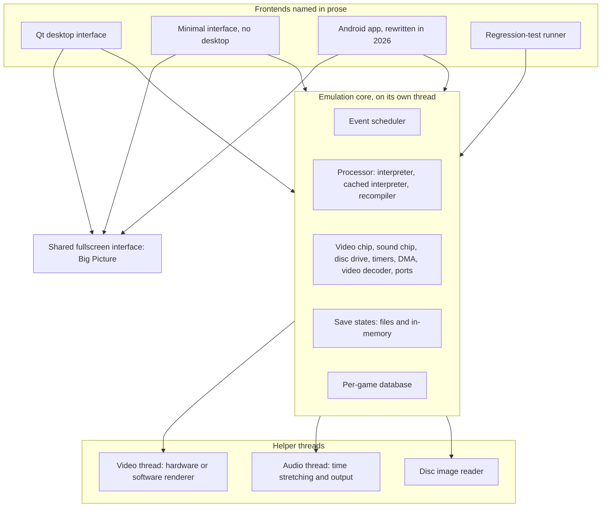

# DuckStation

## Summary

DuckStation is an emulator of the PlayStation 1 for Windows, Linux, macOS, and Android,
written since September 2019 almost entirely by one author, and the most used emulator of its family
([family survey][survey-play]).
It is known for speed on weak devices, for enhancements such as upscaling and PGXP,
and for the stated aim that its default configuration should support all playable games.
Its licence has forbidden adaptation since September 2024,
so this note studies it from prose and published results only: no code of DuckStation was read.

The question is how DuckStation is built and why it works, as far as prose can show.
The project publishes no design document; its README lists features, and its release notes are lists of commit titles,
which state that a change was made and not how.
Those titles state that an event scheduler replaced lock-step components in January 2020,
that the recompiler was replaced between 2023 and 2024,
and that a pass in late 2026 retuned timing to hardware measurements and deleted per-game overrides.
[SwanStation][ss-readme], an open fork cut in January 2022, shows the older structure in code;
it is evidence of the design of that date, not of DuckStation today.

No accuracy or compatibility result is published by the project.
The one table that includes it is a user wiki's, where an old build scores 237 of 291 points (lead).

The lessons that matter most to Rustalgia are a single event scheduler with components caught up on demand,
per-game overrides kept as visible debt beside one baseline with every enhancement off,
test evidence published with its oracle named, and a save-state format with a stated policy from the first version.
The project's history adds a warning about a single author, an unstable licence, and no public bug record.
The recommendations are in ["Implications for Rustalgia"](#implications-for-rustalgia); the owner decides.

## Scope

- **Version and date.**
  The head of `master` was commit `030a61799fdd2236254bffed232b60620ae91954`, dated 2026-11-26
  (commit list; observed),
  the stable release was `latest` of 2026-11-26, and the newest numbered release was `v0.1-12777` of 2026-11-19.
  Everything was read on 2026-11-27.
  No code of DuckStation was read at that commit or at any other.
- **Licence and tier.**
  The [survey][survey-play] records DuckStation as CC BY-NC-ND 4.0 and closed,
  and its [legal section][survey-legal] records the hazards; this note builds on those passages.
  A closed emulator is read as prose only ([ADR 0006][adr6]).
  Because the licence forbids adaptation,
  DuckStation's prose is quoted word for word or stated as facts in this note's own words and structure.
- **Kinds of source, and how they are cited.**
  "README" is the repository's README at the head commit, cited by line;
  the contributing guide and the licence file were read at the same commit.
  "Release notes of `tag`" are the bodies of the 27 releases on the main releases page, all of 2026.
  "Commit list" means titles, authors, and dates in the list of commits, cited by date;
  all 13,369 titles of the default branch were read.
  The lists of tags and branches and the repository's metadata were read too.
  The gatherers also read the older release notes kept in a second repository, `duckstation/old-releases`.
  The guard blocked that repository for the verifiers and the fix pass, as it was not yet in the register
  (research log),
  so each claim first drawn from those notes is cited here to the commit list, where the same title was confirmed.
  Beyond the repository: the [project site][site], its [Android beta page][beta], the [Google Play listing][play],
  press reports, Flathub's and Arch's catalogues, one published test table, the ps1-tests README, and libretro's post.
  None of the repository's addresses is a link, because the repository is closed.
- **SwanStation.**
  [SwanStation][ss-readme] is open tier
  (GPL-3.0; [register][register])
  and was read as code, one file at a time, at commit `631f0fb31b809e0f889d7c551fe695788e39c1d3` of 2026-10-24.
  The [comparison](#comparison-swanstation-the-older-structure) was written after reading an implementation.
  Its closed parts were not opened: `dep/openbios`, `src/core/bios.cpp`, `src/core/bios.h`,
  `src/core/libcrypt_game_codes.cpp`, and `src/core/libcrypt_game_codes.h`.
  Three ranges of open files were skipped under the hazard rule, with only heading lines seen:
  `src/core/system.cpp` lines 571 to 718
  (the boot routine, expected to hold fast-boot and BIOS-patch decisions)
  and lines 1238 to 1372 (direct loading of an executable, with a BIOS-patch flag),
  and `src/core/cdrom.cpp` lines 1395 to 1469
  (a drive test command that reports the controller firmware's version and region).
  Left unopened as a precaution: `tests/guest/`, `src/core/cheats.cpp`, `src/core/psf_loader.cpp`, their headers,
  and `src/libretro/libretro_game_settings.cpp`.
- **Deliberately not examined.**
  In `github.com/stenzek/duckstation`: every source, build, data, and script file, including the game database;
  every single commit, comparison, issue, pull request, and release download; its wiki; and its workflow pages.
  No section of a DuckStation file was skipped under the hazard rule, since none was opened.
  README line 11, which names a BIOS dumping tool, and lines 173 to 185, on LibCrypt and SBI files, were read as prose;
  no link in them was followed.
  Of `duckstation/chtdb` (cheat and patch tables) and `duckstation/dependencies`
  (build scripts and archives),
  only the licence file, the README, and the metadata were read; both are closed by their licences.
  `duckstation/old-releases` is a copy of the closed repository with its old builds, so none of the three is a link.
  The copies of DuckStation code inside other emulators are walled and were not opened.
  The tainted PlayStation references were opened in no form, and no fact known only from them is used.
  Nothing was built or run; every test result here is a published one.
- **How the claims were checked.**
  Five evidence gatherers fetched the pages and lists and confirmed each quotation against the raw text.
  This note was written from their reports alone; the writer fetched nothing.
  Four independent verifiers who saw only the note then re-checked it.
  A fix pass fetched each disputed source again as raw text, applied the findings,
  and read the whole commit list for its titles.
  A claim with no marker rests on the original text; markers follow the [research guide][guide].
  The guard blocked the contributors interface, and the old releases list for one gatherer, the verifiers,
  and the fix pass (research log).

## Architecture

### What the prose can and cannot show

No design documentation was found.
The README is 299 lines of features, downloads, and build steps (observed).
The [site][site]'s page source holds a menu link to a wiki, commented out (observed); its address returned HTTP 404
(research log).
Each release note is a heading and a list of one-line commit titles, with no narrative (observed),
and the only hand-written changelog is the [Android beta page][beta].
The 27 release notes of 2026 hold 2,459 titles (counted).

A commit title is its author's one-line statement that a change was made to a named part.
It does not say how the part works, and it does not prove that the change works.
This section therefore keeps three things apart.
What the README, a page, or a title states is cited to it.
What follows by reasoning is marked as an inference; every structural reading built on titles is one.
What SwanStation's code shows is confined to its own sub-section and is never a statement about DuckStation today.

Titles name hardware registers and commands without citing a source,
so where their hardware detail comes from cannot be checked.
The note uses titles as evidence of what the project worked on and how it says it checked the work.
It takes no hardware value from them.

### Parts and frontends

The README states two desktop interfaces: "DuckStation features a fully-featured frontend built using Qt,
as well as a fullscreen/TV UI based on Dear ImGui" (line 15), the second being its "Big Picture" mode (line 54).
Titles add a third, minimal interface built on the fullscreen one
(commit list, 2021-01-31; release notes of `v0.1-10861`),
which the README does not mention; that it serves devices without a desktop is an inference.
One title shows the Qt program starting without its window, straight into Big Picture
(commit list, 2025-06-17),
and the [beta page][beta] says of the Android app that "Big Picture Mode is added, mainly for TVs."
So Big Picture is shared interface code hosted by whichever frontend is running, not a program of its own (inference).

Android is a separate application around the same core.
The beta page says "The Android app has been completely rewritten in Jetpack Compose
and updated to match the desktop versions", and four of its update entries contain "Update core".
That the app embeds the desktop core and takes it as a unit, some days behind, is an inference.
A regression-test runner, headless by inference, is a further frontend
(["Tests and published results"](#tests-and-published-results)).

The seam between core and frontends dates from 2020.
In January an SDL frontend and a Qt frontend shared settings through a common host layer (commit list, 2020-01-24).
In June, display code moved into a layer common to all frontends, in the week libretro support arrived
(commit list, 2020-06-29 to 2020-07-04).
Serving three frontends at once shaped the seam (inference).

Titles name a core thread for emulation, an interface thread, a video thread, and an audio thread,
and give the disc reader a persistent thread of its own (release notes of `v0.1-12777`, `v0.1-12640`, `v0.1-12083`).
The video thread can be switched off (`v0.1-11609`, `v0.1-11515`).
That emulation runs on one thread, with rendering, audio stretching, and disc reads pushed to helpers through queues,
is an inference.

Hosts are Windows 10 and 11 on x64 and ARM64, Linux on x64 and 32-bit and 64-bit ARM, and macOS 13.3 or later,
all built automatically on every push (README, lines 5, 82, 100, and 145).
RISC-V hosts are supported with no prebuilt download (line 77).

The diagram shows the parts that the prose names.
It is drawn from the README and from titles, and is not a map of the code.

### How time advances

One title states the timing architecture: "Implement event-based scheduler instead of lock-step components"
(commit list, 2020-01-24).
That was four months after the first commit, and no later title reverses it
(searched all 13,369 titles for "scheduler", "lock-step", and the titles that name timing events).
Later titles show a set of events kept in sorted order with a countdown that the processor runs against,
counters widened to 64 bits, and the removal of a value that told an event how late it ran
(commit list, 2020-08-31, 2023-10-17, and 2024-08-13; release notes of `v0.1-11295`).
That the unit is a tick of the console's system clock, that the processor runs until the nearest event is due,
and that each component is caught up only when its event fires or its registers are touched, are inferences.
Titles of `v0.1-12442` support the last one: the video chip is synchronised before a timer gated on it is read,
and the sound chip predicts the next sample that can raise an interrupt and no longer runs sample by sample.

Until 2026 the timing constants were tuned by how games behaved (inference).
A change that relaxed memory timing was made and reverted within a day (commit list, 2019-11-16 and 2019-11-17).

The wording changed in 2026.
The release notes of `v0.1-12777` say that the disc drive's speed-change times were retuned "to hardware measurements",
that the video chip uses measured costs for polygons, rectangles, lines, fills,
and copies on the chip revision the project calls v2, that command time is counted in system-clock cycles,
that a size hack gave way to the hardware's command queue, and that scanline lengths follow "documented" values.
No title names the document, the person who measured, the console, or the tool, and no data is published.
The notes of `v0.1-12442` carry 16 timer titles and a model of the sound chip's start-up delay (counted).
Titles whose prefix names the processor, a chip, the drive, the timers, DMA, the video decoder,
or the bus number 149 in the release of 2026-10-25 and at most 58 in any other
(counted, sub-prefixes included), so the accuracy work came in bursts (inference).

As the model improved, per-game timing overrides were deleted.
The release notes of `v0.1-12777` remove transfer-timing overrides for a named game,
remove those "matching the new default", and stop saving two kinds of timing tweak.
Six titles of the year remove per-game settings, against about thirty that add or tune one
(counted; approximate, with titles on metadata, hashes, and names left out).

The drive is timed as a mechanism, with pause timing, a backwards jump after a seek,
a stop time that depends on rotation speed, and randomness in repeated seeks
(commit list, 2024-11-12 and 2025-02-17; release notes of `v0.1-12640` and `v0.1-12777`).
How that randomness is reconciled with replay is not stated;
one title fixes a "determinism loss" in the sound chip on loading a state (commit list, 2024-12-23).

Two user features cut across the model.
The first is "Emulated CPU overclocking with idle timeout scaling to keep games synchronized to vertical blank"
(README, line 60); titles of `v0.1-12442` fix timer and sound scheduling under overclock.
That overclock changes the ratio of processor cycles to system-clock ticks,
so that every part converting between them needs the ratio and its remainder, is an inference.
The second is a speed-up of the disc drive, known from titles only.
Read and seek speed-ups have had separate limits since 2025-03-30,
when the game database also gained a cap for each game (commit list).
The read speed-up is not applied while audio tracks play
(release notes of `latest`) and can be switched off during video sequences (commit list, 2025-07-22; [beta page][beta]).
Five titles in four releases of 2026 set the cap for named games
(`v0.1-10655`; `v0.1-10819`; `v0.1-11108`; `v0.1-11391`).
No page or release note gives a multiplier
(searched: the README, the 27 release notes, and the beta page);
one commit title removes speed-ups above six times (commit list, 2025-10-20).

A "safe mode" turns every enhancement off at once, and also runahead, rewind, and the fast-forward of idle loops
(commit list, 2024-09-26 and 2024-12-07; release notes of `latest`).
It gives a known baseline for judging a fault (inference).

### How the processor is executed

Titles name three modes, an interpreter, a cached interpreter, and a recompiler, and a setting that selects one
(commit list, 2019-11-23, 2020-08-22, and 2024-12-12).
The README names only the last: "CPU Recompiler/JIT (x86-64, armv7/AArch32, AArch64, RISC-V/RV64)" (line 24).

The first recompiler was begun for x64 on 2019-11-19, ten weeks after the repository was created,
and linked blocks within five days (commit list, 2019-11-19 and 2019-11-23).
It became the default mode on 2020-06-23 and had 64-bit and 32-bit ARM back ends by January 2021
(commit list, 2020-06-23, 2020-10-11, and 2021-01-21).
A second recompiler was added as "experimental" on 2023-10-17,
and on the same day the block cache was rewritten around its block management (commit list).
The two coexisted for thirteen months, until the old one was removed on 2024-11-23 (commit list).
No prose read gives the reason (searched: the README, the contributing guide, the site, and the beta page).
That the cached interpreter and the recompiler share one block cache,
which is what let an engine be replaced beside the running one, is an inference.

A recompiler back end for each host is a standing cost.
The release of 2026-10-25 alone has 26 recompiler titles (counted).
A back end for LoongArch64 arrived in `v0.1-10975` and was dropped in `latest`, with no reason in a title.

Accuracy that costs speed is selective.
The processor's instruction cache is optional in the recompiler and is forced on for named games by the database
(commit list, 2020-08-29 and 2024-12-01; release notes of `latest` and `v0.1-10975`).
Finer timing is named for the interpreter and came late: a stall after multiply and divide in March 2025,
and a one-instruction delay of interrupts in November 2026 (commit list, 2025-03-21; release notes of `v0.1-12777`).
Stalls for the geometry coprocessor date from July 2021, and one was still being adjusted in October 2026
(commit list, 2021-07-16; `v0.1-12442`).
That the interpreter is the reference and the recompiler approximates it block by block is an inference.
A CPU mode of PGXP is switched on for named games by the database and is an override, not a default
(release notes of `v0.1-12442`, `v0.1-12777`, and `preview`).

Fast memory entered the recompiler on 2020-10-18 (commit list).
Titles name two modes, one built on host memory mapping and one on a lookup table,
and show the mapped mode catching host faults and patching the access that faulted
(commit list, 2020-11-24, 2023-09-23, and 2024-12-22; release notes of `v0.1-12442`).
Fast memory is tied to the recompiler, and a change of mode discards compiled code (commit list, 2024-12-03).
The README, the site, and the beta page do not mention fast memory (searched).

### How video is produced

**Renderers.**
The README lists a "Hardware renderer supporting D3D11, D3D12, OpenGL,
Vulkan and Metal APIs" and a "Vectorized and multi-threaded software renderer" ("Features").
The [Play listing][play] names only OpenGL, Vulkan, and software for Android.
If a hardware back end fails, the emulator falls back to the software renderer (release notes of `v0.1-12083`).
Rendering runs on the video thread, and the split can be changed while running (`v0.1-12777`).
What crosses the thread boundary is not stated; titles that mention a command queue suggest a queue (inference).
That game rendering is written once against an internal device layer is likewise an inference,
from features arriving on each back end in turn.

**Enhancements.**
The hardware renderer offers "Upscaling, true colour (24-bit), and texture filters", "PGXP for geometry precision,
texture correction, and depth buffer emulation", texture replacement, and an adaptive downsampling filter
(README, "Features").
The PGXP depth buffer was reworked in October 2026, and one game received its own depth threshold
(`v0.1-12442`; `v0.1-12777`), so it is a heuristic tuned for each game (inference).
The texture cache adds to save states (`v0.1-11826`).

**Display and pacing.**
Pacing is a set of separate, named mechanisms.
Speed can follow the display, "including integer multiples such as 120 Hz for 60 Hz games" (README, line 38).
Input latency is cut "by starting each frame closer to when it is displayed" (line 39).
With blocking vertical sync, the speed limiter is phase-locked to the display's blank,
and a frame that missed it is dropped (`v0.1-12442`).
An option named optimal frame pacing has been the default since February 2026 (`v0.1-10819`);
no prose says what it does.
No page or release note mentions variable refresh rate (searched for "VRR", "G-Sync", "FreeSync").

### How audio is produced

The README's one statement is "Time stretched audio when running outside of 100% speed" (line 49).
Release notes name three output back ends, cubeb, SDL, and XAudio2 (`v0.1-11295`).

Time stretching moved from the core thread to the audio thread in November 2026
(`v0.1-12640`; [beta page][beta], 2026/11/08).
The same release fades around underruns, raises the buffer target after repeated short underruns,
keeps the tempo across an underrun, and adds a test that simulates playback.
Those titles are the project's own list of what goes wrong with a stretched stream (inference).
No latency figure is published.

### How state is saved

**Save states.**
The README has one line: "Save state support, with runahead and rewind" (line 37).
No statement of the format and no promise of compatibility between versions was found
(searched: the README, the beta page, the Play listing, the contributing guide, and the 27 release notes, for "version",
"compatib", "bump", and "format" beside "state").
XZ compression of states is offered among several modes
(commit list, 2024-08-06 and 2025-08-24; [beta page][beta], of the Android app),
and a state carries a preview image ([Play listing][play]).
The size of a state depends on the configured machine (`latest`).

Loading was hardened in August 2026 with limits on string and array sizes and checks for overflow (`v0.1-11752`).
Omissions were found after the fact: a line-drawing buffer, two fields of the texture cache,
and a flip setting in the in-memory states (`v0.1-11752`; `v0.1-11826`; `v0.1-12777`).
The state is therefore written field by field by hand, with nothing that checks it is complete (inference).

**Rewind and runahead.**
Both arrived on 2021-01-24 with memory-only save states, and a change of the same day stops them being used together
(commit list).
The in-memory kind holds the console's video memory as a texture on the graphics card
(inference from the titles that follow),
and its cost is what the titles keep returning to: reuse of textures and buffers, a texture in place of render targets,
a mode for hosts with little video memory, and a smaller state in July 2026
(commit list, 2021-01-24, 2024-08-09, and 2025-11-20; release notes of `v0.1-11609`).
That the two exclude each other because they share one pool of states is an inference.

**Memory cards.**
Cards can switch automatically for each game, and the discs of one game share a card (README, "Features").
Loading an old state over a newer card seems to be treated as a hazard (inference):
a title of January 2026 adds a "taint for memory card time travelling" (`v0.1-10655`).
What the mark then does is not stated.

**Disc images.**
Some PAL games need subchannel data.
The README gives three routes: an SBI file beside the image, a CHD image that carries the data, and,
for a physical disc, an SBI file in a folder of the user's directory
(lines 173 to 185); it links no source of such files (observed).
The [survey][survey-sub] records two routes; the third is an addition.
A game that needs the data is stopped at start-up when it is missing (`v0.1-10495`),
so the emulator knows which games need it (inference); the list it knows this from was not read.
A BIOS image from a PlayStation 1 or 2 is required and none is shipped (README, line 11).

### Tests and published results

**What the project claims.**
The README puts accuracy second: the project is "focusing on playability, speed, and long-term maintainability.
The goal is to be as accurate as possible while maintaining performance suitable for low-end devices" (line 9).
It adds the default-configuration promise: "'Hack' options are discouraged,
the default configuration should support all playable games with only some of the enhancements having compatibility
issues" (line 9).
The [site][site], kept by another person by its footer, leads with accuracy:
"DuckStation is a PS1 Emulator aiming for the best accuracy and game support."
Neither gives a number, and none of the pages read names a test suite that the emulator passes
(searched: the README, the contributing guide, the site, and the beta page).
The claim about AmiDog's tests that [SwanStation's README][ss-readme] carries is not in DuckStation's README today.

**Its own tests.**
Titles show unit tests, built on GoogleTest (`v0.1-12083`), for the geometry coprocessor, the video decoder,
the software renderer, register writes, and PGXP, most of them added in October 2026 (`v0.1-12442`).
Of 28 test titles in the year, 20 fall in the releases of 2026-10-25 and 2026-11-19 (counted; approximate).
A regression-test runner, headless by inference,
replays recorded dumps of graphics commands and hashes the resulting video memory, takes queued controller input,
and has a save-state option (`v0.1-12777`; `v0.1-12640`; `v0.1-12442`).
Its oracle is therefore the emulator's own earlier output, not a console (inference).

Several titles repair the test programs' own builds, and one disables new tests soon after adding them
(`v0.1-11752`; `v0.1-11826`; `v0.1-12442`; `v0.1-12777`).
None of the 31 titles about continuous integration says that it runs the tests (observed),
so the tests are not a gate on every push (inference).
No third-party test program is named in any title or page
(searched 2,459 titles and the newest 100 commits for eleven names, among them "amidog" and "ps1-tests").

**Compatibility data.**
No list is published (searched: the README, the site, and the beta page),
and the README's link to one was removed on 2025-11-24 (commit list for the README).
The knowledge lives in the program's per-game database, which 52 titles of 2026 edit (counted; approximate).
Titles show that it also verifies disc images by hash
(`v0.1-11580`; `v0.1-11826`), which separates a bad dump from an emulator fault (inference).

**Published results.**
The only comparison found is the [Emulation General wiki's table][egw-tests] of AmiDog's tests (lead),
which its own banner tags as out of date.
It scores DuckStation 0.1.9429 as follows, with the processor columns labelled as the interpreter;
the reference is a console booted from a cartridge.

| Test group | DuckStation 0.1.9429 | Console |
|---|---|---|
| CPU | 101 | 101 |
| CPX | 4 | 6 |
| GPU | 32 | 71 |
| GTE | 100 | 109 |
| Misc | 0 | 4 |
| Total | 237 | 291 |

The page says the tests "lack SPU (sound) or CD-ROM tests" (lead).
It does not give DuckStation's renderer or settings.
The build predates every release note read, and so all the timing work of 2026
(inference from the numbering).
[ps1-tests][ps1tests] publishes no table of emulator results and does not mention DuckStation (README; observed).

### History and maintenance

**One author.**
The default branch holds 13,369 commits (counted from the full list).
Of the newest 100, made in under eight days, 98 are by the author and 2 by translators;
of the 100 that end on 2021-01-26, 87 are his (commit list; counted).
The issue tracker and discussions are switched off (metadata; observed), and support goes to a chat server (README).
So there is no public, searchable record of faults (inference).
"Pull requests are restricted to prior contributors", and others send patches by e-mail or chat (contributing guide).
The guide, one week old when read, gives low-quality machine-written submissions as the reason.

**Licence.**
[GamingOnLinux][gol] reports that the project was under the GPL until 1 September 2024,
then the PolyForm Strict licence, then CC BY-NC-ND from 13 September (secondary).
It quotes the author: "I have the approval of prior contributors, and if I did somehow miss you,
then please advise me so I can rewrite that code" (secondary).
He gave the stripping of his attribution by others as the reason, and wrote
that he has no contributor agreement (secondary).
The listed history of the licence file shows only the first commit and one of 2024-09-01
(commit list; observed);
that does not match the two-step account, and the cause was not found, since a single commit may not be opened.
The README now says that "pre-configured settings and packages are considered modifications"
(line 84), and the contributing guide that "You are not permitted to publish modified versions of this repository."
That reading of the licence is the author's, stated in a README and not in the licence text;
a downstream that relies on the text alone is exposed to a dispute with the rights holder (inference; a legal risk).

**Packaging.**
Flatpak was an official channel and was withdrawn during 2025 (commit list for the README).
[Flathub's packaging repository][flathub-repo] was changed by a third party to wrap the official AppImage,
in a change written on 2026-11-13 and merged on 2026-11-18
(its commit list):
"To comply with the CC-BY-NC-ND-4.0 license of the project, the AppImage is used instead of compiling the project."
[Flathub's statistics][flathub-stats] count 4,234,314 installs (observed).
That is a package of the kind the README calls a modification; no statement by the author about it was found.
By 1 August 2025 the author had removed his Arch build recipe, writing: "I specifically forbid packages for DuckStation
(see README.md),
and there's no way to request removal of these packages without handing my details over to a distribution I want nothing
to do with" ([GamingOnLinux][gol-2025]; secondary).
The same note threatened to end Linux support; Linux builds are still published (release list; observed).
The [Arch user catalogue][aur] lists a package for the GPL version pinned at 0.1.7465
and a third-party libretro core described as based on build 12442 (observed).
A derivative of a build after 2024 is outside the licence as the project reads it (inference; a legal risk).

**Android.**
In March 2026 the author said the Android version would get no more updates:
"I don't have the time nor energy to do something I'll mostly get negativity for"
([Android Authority][aa-mar], quoting a chat exchange; lead for his words).
The rewritten app's first alpha is dated 2026/10/11 on the [beta page][beta];
the [survey][survey-play] dates the return to November from press reports.
The README says that no support is provided for the Android app (line 166).
A title of 2021-06-08 removes the Android app from the repository,
and later Android titles concern build fixes and translation strings
(commit list; observed), so the app's code has been outside the public history since then (inference).

**The libretro core.**
The libretro project announced the core on 16 July 2020, and the post now carries SwanStation's name
([libretro blog][lr-blog]).
A title of 2021-01-07 removes the core from DuckStation's repository, saying it "will now be maintained by libretro";
one of 2021-05-20 adds it again, and the last title to name it, of 2021-06-04, removes its build scripts
(commit list; all titles searched for "libretro" and "retroarch").
No title dates its second removal.

**Releases.**
There are two channels, a stable one that follows the `latest` tag and a preview built on every push
(README, lines 92 to 94).
The year had 25 numbered stable releases, about 13 days apart (calculated from the dates).
The version never left 0.1: tags are `v0.1-` and a count (tag list; observed).

### Comparison: SwanStation, the older structure

[SwanStation][ss-readme] calls itself "a hard fork and open-source Libretro core implementation of DuckStation"
(README, line 4).
Its commit list holds 6,201 commits; the last by DuckStation's author is dated 2022-01-10,
and the next is the last merge from upstream (commit list; observed).
The fork point is therefore DuckStation's main branch of 2022-01-10 (inference),
two years and eight months before the licence change.

**How far it has drifted.**
DuckStation's branch held 13,369 commits when read, 8,006 of them dated after the fork point,
so about 60 per cent of its history is newer (counted from the lists).
In SwanStation's list, 724 commits follow the last one by DuckStation's author (counted);
one of them is the merge from upstream, and a few of the fork's own commits sit before that point.
By their titles, the fork's commits removed the desktop interface layer, file-based state loading, the audio resampler,
and rewind, and added a Direct3D 12 renderer, a bundled replacement BIOS
(closed, not opened), validation of save states, and regression tests.
Its last back-port from upstream is dated 2024-07-22.
The table sets what its code shows against what DuckStation's prose says today.

| Aspect | SwanStation at its tip (code; observed) | DuckStation today (prose) |
|---|---|---|
| Scheduler | one, in master-clock ticks | event-based since 2020; unit not stated |
| Processor modes | interpreter, cached interpreter, recompiler | the same three; recompiler replaced 2023-24 |
| Recompiler hosts | x86-64, 32-bit and 64-bit ARM | those and RISC-V |
| Fast memory | mapped form and table form | two modes named in titles |
| Render threading | software renderer only | a video thread, not only for software (inference) |
| Graphics interfaces | four, one class for each | five; a shared device layer (inference) |
| Audio | no stretching; the frontend paces | stretching on the audio thread |
| State format | one version number, 57; oldest loadable 42 | no statement found |

**Time.**
One scheduler owns emulated time, in ticks of the processor's master clock.
Components register events, and the active ones are kept in order of their countdowns.
The processor counts the ticks it executes and runs until the count reaches the nearest event;
the scheduler then gives each due event the ticks elapsed since it last ran
([`timing_event.cpp`][ss-timing], lines 1 to 292; [`cpu_core.cpp`][ss-cpu], lines 1467 to 1515).
Components are kept in step lazily: the video and sound parts are brought up to date early when a register
that depends on their state is touched ([`gpu.cpp`][ss-gpu], lines 387 to 401; [`spu.cpp`][ss-spu], lines 274 to 430).
Overclocking is a ratio on the tick rate, and four parts recompute their rates when it changes
([`system.cpp`][ss-system], lines 145 to 153).
This matches the inferences drawn from DuckStation's titles under ["How time advances"](#how-time-advances);
that DuckStation still works this way is an inference.

**Processor.**
The cached interpreter and the recompiler share one block cache, blocks are linked to their successors,
and a write to a page that holds code marks its blocks for a re-check before reuse
([`cpu_code_cache.cpp`][ss-cache], lines 277 to 362 and 510 to 579).
A block recompiled 20 times within 100 frames falls back to the interpreter (same file, lines 20 to 23 and 538 to 548).
The recompiler is one generator with an emitter for each of three hosts
(file listing; observed),
and falls back to the interpreter for an instruction it does not compile
([`cpu_recompiler_code_generator.h`][ss-gen], lines 17 to 288).
Fast memory has a mapped form and a table form; in both, an access that cannot be served faults,
and a host fault handler rewrites that one access to the slow path
([`bus.cpp`][ss-bus], lines 96 to 117; [`cpu_code_cache.cpp`][ss-cache], lines 946 to 1089).
This is the first recompiler's design; DuckStation removed that recompiler in 2024,
so nothing here describes its present one (inference).

**Video and audio.**
Only the software renderer is threaded:
the emulation thread turns each drawing command into a self-contained record in a ring, a worker rasterises,
and without the thread the same records run at once ([`gpu_backend.cpp`][ss-backend], lines 135 to 362).
Hardware renderers issue their calls on the emulation thread
(inference from the graphics interface's state being restored and reset around the processor's run;
[`system.cpp`][ss-system], lines 1185 to 1222).
DuckStation's titles of 2026 name a video thread that serves more than the software renderer,
so it has moved away from this (inference).
The audio stream in SwanStation has no resampler and no stretching ([`libretro_audio_stream.cpp`][ss-audio]);
the fork removed its resampling library in 2022 (commit list), so it says nothing about DuckStation's audio.

**Save states.**
One routine both saves and loads: each part has a single routine run in write mode or read mode,
so the two orders cannot drift apart
([`system.cpp`][ss-system], lines 848 to 927; [`state_wrapper.h`][ss-wrap], lines 15 to 90).
A state has a header with a format identifier and a version,
and a field added later is read with a default for older states
([`save_state_version.h`][ss-ver]; [`state_wrapper.h`][ss-wrap], lines 185 to 195).
Scheduler events are saved and matched by name
([`timing_event.cpp`][ss-timing], lines 294 to 330), so a renamed event would lose its timing on load (inference).
A second, in-memory kind of state serves run-ahead; loading one invalidates the code cache's blocks,
where loading a file flushes the cache ([`system.cpp`][ss-system], lines 848 to 927 and 1788 to 1845).
DuckStation's fixes of 2026 for fields left out of states fit a hand-written routine of this kind;
whether it keeps the version scheme is not known.

**Tests.**
The fork's tests are its own, added on 2026-10-08.
They run the core headless under each processor mode and under sanitisers,
with fuzzers for registers and for corrupted states
([`run_tests.sh`][ss-tests], lines 4 to 37; [`tests.yml`][ss-wf], lines 7 to 104).
The script records one gap: "the recompiler does not yet replay a frame identically after a state load" (line 248).

**What it is evidence of.**
The scheduler, the block cache, fast memory, the software renderer's ring,
and the single state routine sit in files that the fork's titles do not show as rewritten,
so they are usable as evidence of DuckStation in January 2022 (inference).
Only titles were read, never a single commit, so a quiet change inside a large clean-up cannot be ruled out.
The boundary between core and host, the audio stream, shader handling, state validation,
and the tests are the fork's own work.

### Not learnable from prose

Reading DuckStation's code would answer each of these, and no session may do that while the licence stands.

- The scheduler's unit of time, and how often each component is brought into step.
- How the second recompiler differs from the first, and why it replaced it.
- What crosses from the core thread to the video thread, and how the device layer is shaped.
- The layout and versioning of a save state, and whether a state survives an update.
- What the in-memory states leave out, and how random drive timing coexists with runahead.
- Who measured the timings adopted in 2026, on which console revisions, and with what tool.
- What the unit tests assert, and what the regression runner compares.
- What the per-game database holds, how its entries are decided, and how many there are.
- What "optimal frame pacing" and the mark on memory cards do.

The commit list, read in full for its titles, dated three events that sampling had left open.
The removals of the libretro core and of the Android app are under
["History and maintenance"](#history-and-maintenance).
RISC-V is first named on 2023-08-15 and its recompiler back end by 2023-12-20; no title announces the back end.

## What works well

- **An event scheduler adopted early and kept.**
  Lock-step components gave way to scheduled events four months into the project
  (commit list, 2020-01-24); titles through 2026 keep working on it, and none in the full list reverses it.
  The mechanism, seen in [SwanStation's code][ss-timing] and inferred for DuckStation,
  is that the processor runs undisturbed to the nearest event and a component is caught up only when needed.
- **Execution engines that can be swapped.**
  Titles name three modes and a setting that selects one,
  and a second recompiler was developed beside the first for thirteen months and then swapped in
  (commit list, 2019-11-23, 2023-10-17, and 2024-11-23).
  A shared cache and timing contract make one engine a stand-in for another (inference).
- **A stated rule against hacks, visibly applied.**
  The README discourages hack options (line 9), most overrides sit in a per-game database
  (titles on it in 17 of the 27 release notes; counted),
  and the release that retuned timing deleted the overrides it made needless (`v0.1-12777`).
  A safe mode exists (release notes of `latest`) and gives every report a baseline (inference).
  The mechanism is that a workaround is named and countable, so it can be removed (inference).
- **One primitive behind rewind and runahead (inference).**
  Memory-only save states arrived with both features on one day
  (commit list, 2021-01-24),
  and later titles keep returning to their cost (commit list, 2024-08-09 and 2025-11-20; release notes of `v0.1-11609`).
- **Pacing and audio stretching treated as designed subsystems.**
  Phase lock to the display's blank, late frame start, sync to refresh multiples,
  and an underrun policy with a simulation test are separate named mechanisms
  (README, lines 38 and 39; `v0.1-12442`; `v0.1-12640`).
- **Fast delivery with a risk channel.**
  Every push is built for the three desktop platforms, a preview channel takes the risk,
  and a stable release follows about every 13 days (README, lines 82 and 92 to 94; calculated from the dates).
  One owner decides without negotiation, which is also the weakness below (inference).

## What works poorly

- **No published evidence of accuracy.**
  There is no pass table, test log, or compatibility list, and the site's wiki address is dead
  (searched: the README, the site, the beta page, and the release notes).
  The site's aim, "aiming for the best accuracy and game support", cannot be checked from outside.
  The data lives in the program and a closed repository (inference).
  The timing retuned "to hardware measurements" comes with no method, console model, or data (`v0.1-12777`),
  so no other project can check or reuse it.
- **Accuracy and enhancements still lean on a per-game database.**
  The recompiler's instruction cache, drive speed-up limits, and PGXP modes need entries for named games,
  and one game has its own depth threshold (`latest`; `v0.1-10975`; `v0.1-11391`; `v0.1-12777`).
  Only the instruction cache entries, and a few on timing and the sound chip, concern default settings
  (`v0.1-10819`; `v0.1-12640`); the rest tune optional enhancements, which the README's aim excepts (line 9).
  Additions outnumber removals about five to one in 2026 (counted; approximate).
  The cause is defaults chosen for speed and heuristics that are not general (inference).
- **Enhancements cut across the timing model.**
  Overclock and drive speed-up change ratios that timers and sound depend on (inference),
  and fixes for them were still landing in October and November 2026 (`v0.1-12442`; release notes of `latest`).
- **Save states have no stated contract and a hand-written routine.**
  No format or compatibility statement was found, and three fixes for four omitted fields landed in under four months
  (`v0.1-11752`; `v0.1-11826`; `v0.1-12777`).
  The hand-written routine is an inference from those fixes.
- **Tests arrived late and do not gate.**
  Most unit tests date from October 2026, their builds break between releases,
  and the regression runner's oracle is the emulator's earlier output (inference from the titles above).
- **A bus factor of one, with platform support that follows the author's patience.**
  The author writes 98 of the newest 100 commits, takes pull requests only from prior contributors and translators,
  dropped and then rewrote the Android app within eight months, threatened Linux support,
  and took in and then dropped a host architecture within nine months
  (commit list; contributing guide; release notes of `v0.1-10975` and `latest`; [beta page][beta];
  [Android Authority][aa-mar], lead; [GamingOnLinux][gol-2025], secondary).
  The README gives the cause for one refusal: "a project which brings in zero revenue" (line 158).
  Issues are off, release notes are title lists, and seven years of versions are 0.1 with a count
  (metadata; tag list; observed), so a user cannot tell what regressed (inference).
- **An unstable licence and a standing conflict with distributors.**
  Three licences in two weeks ended in one that forbids adaptation
  ([GamingOnLinux][gol]; secondary),
  and packages the README calls modifications are still distributed ([Flathub][flathub-api]; observed).
  The cost fell on packagers, forks, and anyone who had built on the GPL version (inference).

## Implications for Rustalgia

Each recommendation is tied to the findings above.
The owner decides.

- **Adopt one tick-based event scheduler, with components caught up on demand.**
  DuckStation replaced lock-step four months in, and no title in its commit list reverses it;
  [SwanStation][ss-readme]'s code shows the shape: one unit of time, the processor run to the nearest event,
  and an explicit operation that brings a part up to date before its registers are read.
  This is recommended as the starting point for [R2-03][roadmap].
  If overclocking is ever wanted, the ratio of processor cycles to system ticks should be one explicit quantity,
  since DuckStation's timers and sound chip both needed fixes for it in 2026.
- **Keep the interpreter as the reference, and price each recompiler back end.**
  Putting every engine behind one block cache and one timing contract is recommended for [R2-01][roadmap],
  so that the same tests run under each engine, as SwanStation's do.
  DuckStation's finer timing is named for its interpreter in the titles,
  and its recompiler drew 26 titles in one release.
  A back end is a standing cost for each host, so each should be justified by users;
  the [survey][survey-rec] notes that iOS App Store builds cannot use one.
- **Treat per-game overrides as counted debt, and test one baseline.**
  A single visible database, with the reason for each entry, is recommended,
  together with one switch that turns every enhancement off.
  Overrides are recommended for enhancements only: an override needed at default settings is an open accuracy bug.
  DuckStation shows both the method working and its cost.
- **Publish test evidence with the oracle named.**
  A results table for each suite and commit is what DuckStation lacks.
  A replay-and-hash runner, with recorded command streams and scripted input, is recommended early and as a gate,
  through [R5-05][roadmap].
  A hash catches change and not error,
  so it should be paired with the console-derived oracles that the [survey][survey-tests] lists,
  as [R2-15][roadmap] can settle.
  Checking disc images by hash before accepting a report belongs with it.
  Every timing constant should carry its origin and the console revision, and none should come from DuckStation:
  its titles assert measurements without saying who measured, on what, or how.
  Rustalgia's values come from its cleared sources ([R1-02][r102]) and from [R5-12][roadmap].
- **Give saved state a contract from the first format.**
  Recommended for [R2-08][roadmap]: a version number with a stated compatibility policy;
  serialisation that is generated or checked, so that a field cannot be left out;
  a state file treated as untrusted input, with every length bounded; the machine's configuration recorded in the state;
  stable identifiers for scheduled events, not display names; and two kinds of state,
  a durable file and a fast in-memory one that the renderer can also snapshot.
  A guard against an old state overwriting a newer memory card is worth copying.
  Any randomness in drive timing should be decided together with replay, since DuckStation's prose leaves it open.
- **Put a command boundary between the emulated video chip and the renderer.**
  SwanStation's record ring makes threaded and unthreaded rendering one code path,
  and DuckStation's later video thread extends the idea to hardware renderers (inference).
  A software renderer as reference and fallback, with hardware back ends behind one layer,
  is recommended for [R2-05][roadmap]; pacing and underrun policy belong to [R2-07][roadmap] as designed parts.
- **Settle the project's own terms early, and write the design down.**
  The licence is fixed already ([ADR 0002][adr2]); the remaining calls are the owner's.
  A GPL-3.0 project cannot forbid packaging
  (inference from the licence's grant to convey copies),
  so the lever is a naming and support policy stated in the README.
  A public issue tracker, release notes that name user-visible changes, and an architecture document are recommended:
  their absence is what made DuckStation hard to judge and to study.
- **No further study of DuckStation is recommended.**
  Its code cannot be read in any session.
  Its prose has been read as far as it goes: the README, the project's pages, the 27 release notes,
  and every title of the commit list.
  If more of the older design is wanted, SwanStation is open and can be read further at no legal cost,
  with its fork point and its own changes kept in view.
  Register lines for `duckstation/old-releases`, `duckstation/chtdb`,
  and `duckstation/dependencies` go into the register in the same change as this note, all three as closed:
  the first is a copy of the closed emulator, and the others carry licences that are not open.

## Open questions

- How does a current DuckStation build score on [ps1-tests][ps1tests], at default settings and in safe mode?
  Running the suite against its binary through [R5-05][roadmap]'s runner would answer it;
  nothing is built or run before phase 5.
- Does a save state survive an update, and does a replay stay in step with random drive timing?
  No prose says; observing two builds in phase 5, with [R5-06][roadmap], would answer both.
- Who measured the timings adopted in 2026, and on which console revisions?
  Only the author can say; [R5-12][roadmap] measures the same behaviour independently.

## Sources

Every source below was read on 2026-11-27 by the evidence gatherers.
The writer opened no source beyond this repository's files; the fix pass fetched the disputed passages again.

Repository notes and files:

- [R1-18, "PlayStation 1: family survey"][survey]; [R1-02][r102]; [research guide][guide]; [research roadmap][roadmap];
  [ADR 0006][adr6]; [ADR 0002][adr2]; [source register][register].

DuckStation's repository, closed, so no address is a link:

- README, `github.com/stenzek/duckstation/blob/030a61799fdd2236254bffed232b60620ae91954/README.md`
  (blob `2f72de90`, 299 lines); `CONTRIBUTING.md` (blob `f6264352`) and `LICENSE` (blob `cfe676c5`) at the same commit.
- Releases list and release notes, `github.com/stenzek/duckstation/releases`: 27 releases,
  `preview` and `latest` of 2026-11-26 and `v0.1-10495` to `v0.1-12777`; bodies only, no download.
- Commit list, `github.com/stenzek/duckstation/commits/master`, titles, authors, and dates only:
  all 13,369 entries back from the head commit, and the lists filtered to the README, the licence file,
  and the contributing guide.
- Lists of tags and branches, and repository metadata (last push 2026-11-27).
- `duckstation/old-releases`, a copy of the repository under the same licence by its README: metadata, README, and,
  by the gatherers only, the releases list with its notes, tags `v0.1-5494` to `v0.1-10413`.
  No claim is cited to those notes.
- `duckstation/chtdb` and `duckstation/dependencies`: licence file, README, and metadata only.

DuckStation's pages:

- [duckstation.org][site], home page; no version, footer dated 2022.
- [DuckStation Android beta][beta]; newest entry 2026/11/22.
- [Google Play listing][play]; "Updated on Oct 24, 2026".

SwanStation, open tier, at commit `631f0fb31b809e0f889d7c551fe695788e39c1d3` (2026-10-24):

- [README][ss-readme] (blob `27aeebde`); its commit list (6,201 entries, titles and dates) and metadata.
- Core files, in the ranges cited: [`timing_event.cpp`][ss-timing]; [`system.cpp`][ss-system]; [`cpu_core.cpp`][ss-cpu];
  [`cpu_code_cache.cpp`][ss-cache]; [`cpu_recompiler_code_generator.h`][ss-gen]; [`bus.cpp`][ss-bus];
  [`gpu.cpp`][ss-gpu]; [`gpu_backend.cpp`][ss-backend]; [`spu.cpp`][ss-spu]; [`save_state_version.h`][ss-ver];
  [`state_wrapper.h`][ss-wrap].
- Other files: [`libretro_audio_stream.cpp`][ss-audio]; [`tests/run_tests.sh`][ss-tests];
  [`.github/workflows/tests.yml`][ss-wf].

Press, catalogues, and published results:

- GamingOnLinux: ["PlayStation 1 emulator DuckStation changes license"][gol]
  (16 September 2024);
  ["Developer of PlayStation 1 emulator DuckStation threatens 'removing Linux support entirely'"][gol-2025]
  (1 August 2025).
- Android Authority: ["One of the best PS1 emulators on Android is losing support"][aa-mar] (11 March 2026).
- [Flathub packaging repository][flathub-repo]
  (README at commit `699d259e`, and the commit list; last push 2026-11-23);
  [Flathub listing data][flathub-api]; [Flathub statistics][flathub-stats].
- [Arch user repository search][aur] for "duckstation" (seven results).
- Emulation General Wiki, lead: ["PS1 Tests"][egw-tests] (revision 139373).
- [ps1-tests README][ps1tests], at commit `f727802f` of 2023-03-05.
- libretro: ["New PlayStation1 core SwanStation now available for RetroArch!"][lr-blog]
  (16 July 2020; the page carries a second date, 2022-03-29).

[survey]: ../topics/R1-18-playstation-1-family.md
[survey-play]: ../topics/R1-18-playstation-1-family.md#emulators-that-put-playability-first
[survey-legal]: ../topics/R1-18-playstation-1-family.md#legal-exposure
[survey-tests]: ../topics/R1-18-playstation-1-family.md#tests-and-published-results
[survey-sub]: ../topics/R1-18-playstation-1-family.md#subchannel-data-on-protected-pal-discs
[survey-rec]: ../topics/R1-18-playstation-1-family.md#implications-for-rustalgia
[r102]: ../topics/R1-02-primer-32-and-64-bit.md
[guide]: ../README.md#claim-status
[roadmap]: ../../roadmap/research.md
[adr6]: ../../adr/0006-read-sources-by-tier-under-a-compatibility-test.md
[adr2]: ../../adr/0002-license-under-gpl-3-0-or-later.md
[register]: ../../../.claude/hooks/source-register.txt
[site]: https://www.duckstation.org/
[beta]: https://downloads.duckstation.org/android-testing/
[play]: https://play.google.com/store/apps/details?id=com.github.stenzek.duckstation
[gol]: https://www.gamingonlinux.com/2024/09/playstation-1-emulator-duckstation-changes-license-for-no-commercial-use-and-no-derivatives/
[gol-2025]: https://www.gamingonlinux.com/2025/08/developer-of-playstation-1-emulator-duckstation-threatens-removing-linux-support-entirely-but-not-yet/
[aa-mar]: https://www.androidauthority.com/duckstation-ends-android-support-3648430/
[flathub-repo]: https://github.com/flathub/org.duckstation.DuckStation/blob/699d259eb8d4d6a15bb3cbd6db1895119613b2ae/README.md
[flathub-api]: https://flathub.org/api/v2/appstream/org.duckstation.DuckStation
[flathub-stats]: https://flathub.org/api/v2/stats/org.duckstation.DuckStation
[aur]: https://aur.archlinux.org/rpc/v5/search/duckstation
[egw-tests]: https://emulation.gametechwiki.com/index.php?title=PS1_Tests&oldid=139373
[ps1tests]: https://github.com/JaCzekanski/ps1-tests/blob/f727802fead11f1daa7549285548392ef87749cb/README.md
[lr-blog]: https://www.libretro.com/index.php/new-playstation1-core-duckstation-now-available-for-retroarch/
[ss-readme]: https://github.com/libretro/swanstation/blob/631f0fb31b809e0f889d7c551fe695788e39c1d3/README.md
[ss-timing]: https://github.com/libretro/swanstation/blob/631f0fb31b809e0f889d7c551fe695788e39c1d3/src/core/timing_event.cpp
[ss-system]: https://github.com/libretro/swanstation/blob/631f0fb31b809e0f889d7c551fe695788e39c1d3/src/core/system.cpp
[ss-cpu]: https://github.com/libretro/swanstation/blob/631f0fb31b809e0f889d7c551fe695788e39c1d3/src/core/cpu_core.cpp
[ss-cache]: https://github.com/libretro/swanstation/blob/631f0fb31b809e0f889d7c551fe695788e39c1d3/src/core/cpu_code_cache.cpp
[ss-gen]: https://github.com/libretro/swanstation/blob/631f0fb31b809e0f889d7c551fe695788e39c1d3/src/core/cpu_recompiler_code_generator.h
[ss-bus]: https://github.com/libretro/swanstation/blob/631f0fb31b809e0f889d7c551fe695788e39c1d3/src/core/bus.cpp
[ss-gpu]: https://github.com/libretro/swanstation/blob/631f0fb31b809e0f889d7c551fe695788e39c1d3/src/core/gpu.cpp
[ss-backend]: https://github.com/libretro/swanstation/blob/631f0fb31b809e0f889d7c551fe695788e39c1d3/src/core/gpu_backend.cpp
[ss-spu]: https://github.com/libretro/swanstation/blob/631f0fb31b809e0f889d7c551fe695788e39c1d3/src/core/spu.cpp
[ss-ver]: https://github.com/libretro/swanstation/blob/631f0fb31b809e0f889d7c551fe695788e39c1d3/src/core/save_state_version.h
[ss-wrap]: https://github.com/libretro/swanstation/blob/631f0fb31b809e0f889d7c551fe695788e39c1d3/src/common/state_wrapper.h
[ss-audio]: https://github.com/libretro/swanstation/blob/631f0fb31b809e0f889d7c551fe695788e39c1d3/src/libretro/libretro_audio_stream.cpp
[ss-tests]: https://github.com/libretro/swanstation/blob/631f0fb31b809e0f889d7c551fe695788e39c1d3/tests/run_tests.sh
[ss-wf]: https://github.com/libretro/swanstation/blob/631f0fb31b809e0f889d7c551fe695788e39c1d3/.github/workflows/tests.yml
