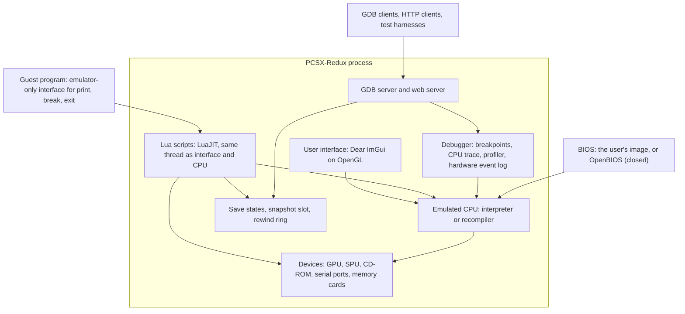

# PCSX-Redux

## Summary

PCSX-Redux is a fork of the PlayStation 1 emulator PCSX, begun in December 2018,
whose stated aim is "to be a useful development, debugging,
and reverse engineering tool" ([CONTRIBUTING][contributing]).
It is known for its debugger, its Lua scripting, its GDB server, and as the home of OpenBIOS.
This note asks what its design teaches Rustalgia, and studies it from prose and commit titles only;
no code of PCSX-Redux was read.

The prose documents what the tools do in depth and says almost nothing about how the core is built.
No page read describes the event mechanism, the cost of an instruction in cycles, disc timing,
the structure of either renderer, or the audio path.
The project makes no accuracy claim and has no releases or tags,
and no test results or compatibility list were found in its prose.

The lessons that matter most to Rustalgia are three.
One cycle counter stamps the CPU trace and every record of the hardware event log,
scripted sessions are keyed to emulated frames, and the GPU's input can be recorded and replayed without the game:
together these turn a bug sighting into a test.
Most CPU debugging works only under the interpreter: the recompilers do not check breakpoints,
cannot be stopped at an arbitrary address, and update the program counter and cycle count only at block boundaries,
so debugging and speed exclude each other.
Scripts run on the emulation thread with raw pointers, the web server listens on every network interface,
no licence grant is stated in the prose read, and a closed BIOS reimplementation sits inside the tree.

The note recommends a narrow reader session,
limited to host-side structure and held after a check of the licence notices; the owner decides.

## Scope

- **Version and date.**
  PCSX-Redux has no releases and no tags
  (the releases and tags lists of the [repository][repo] were both empty; observed),
  so the study is fixed by a commit and a date: the head of `main` on 2026-11-27,
  commit `31cdf7efffb898b2434d4382c8d11cea47eb1cfe`.
  The [documentation site][docs] shows no version or revision;
  its home page carried a `last-modified` header of 2026-11-27, 09:46 GMT (observed).
- **Kinds of source.**
  The repository's [README][readme], [licence file][licence-file], and [CONTRIBUTING][contributing] at that commit;
  repository and organisation metadata; the lists of commits, branches, tags, and releases, of which only titles, dates,
  and author names were read; 39 of the documentation site's 40 pages, as prose;
  the README of the closed `pcsx-redux/nugget`; the READMEs of three other projects; one Wikipedia article (secondary);
  and two pages of a user wiki (leads).
  No issue, pull request, discussion, single commit, comparison, or download was opened.
- **Licence, tier, and code.**
  The [family survey][survey-compared] records PCSX-Redux as walled under GPL-2.0,
  [R0-01][r001-licences] records that neither "only" nor "or later" is stated,
  and the survey's [section on debugging emulators][survey-debug] records OpenBIOS and its origin.
  This note builds on those passages and does not repeat them.
  A walled emulator is read as prose only unless the owner starts a reader session
  ([ADR 0006][adr6]); none was started, so no source, build, script, test, or data file of PCSX-Redux was read.
  The survey [recommended][survey-impl] a reader session for this study; this batch does not hold one.
- **Nothing was built or run.**
  Every result here is a published one.
  The project's browser build at `tools.psx.dev/redux` was not opened, because opening it runs the emulator.
- **Deliberately not examined.**
  `pcsx-redux/nugget` beyond its README: it holds OpenBIOS, a kit, and the guest tests,
  and the [register][register] closes it.
  `src/mips` in the emulator's tree, where the README says that repository is mounted.
  Nugget's tests folder and its OpenBIOS compatibility document; no path is named because no tree was listed.
  `distrib.app/pub/org/pcsx-redux`, which serves the emulator's builds, and `static.grumpycoder.net`,
  which serves a GDB build for Windows; they are downloads, so they are not links.
  `psx-spx.consoledev.net` and every other address of the tainted references;
  links to them in the pages read were not followed.
  The repository's `TODO.md`, to which the README points for unfinished work: the source guard blocked the fetch
  (research log), as it blocked the contributors and community-profile endpoints.
  `AUTHORS`, the repository wiki, and tracker item 2012, which a documentation page cites, were not attempted.
- **Sections skipped under the hazard rule.**
  No repository code file was opened, so no file and line range applies;
  the skipped material is all on the documentation site.
  `pcsx-redux.consoledev.net/mips_api/`: the two listings under "Description",
  which the page attributes to the closed nugget
  (a header fragment and a start-up fragment),
  the sentence between them, which supports a layout by a psx-spx link only,
  and the kernel addresses under "Kernel Checker".
  One gatherer saw the listings once in fetch output before its helper was changed to drop code blocks;
  nothing was recorded and the saved copy was deleted (research log).
  The fix pass read the page through a filter that drops code blocks and saved no raw copy (research log).
  The page is not a link here because it embeds that closed material; only its prose on what the features do is used.
  The [OpenBIOS page][d-openbios], sections "Technicalities" and "Commentary":
  a checksum of a retail image and BIOS-internal remarks (a function address, a table name), not recorded.
  Two statements of "Technicalities" are used, on how OpenBIOS was written and where its disassembly database is kept;
  neither is BIOS-internal.
  The [bug playbook][pb-bugs], section "What is it asking the BIOS?", and the [SIO1 page][d-sio1], section "Example":
  details whose stated support is a psx-spx link, not recorded.
  The [ISO builder page][l-iso], "Writing the license sectors": unsourced statements about console region checks,
  not recorded.
  `pcsx-redux.consoledev.net/Lua/case-studies/`, the whole page:
  cheat-device codes and memory addresses of commercial games
  (research log),
  not recorded, and for that reason not a link; it is the one page of the 40 that this note's searches do not cover.
  Every Lua example block on the site was dropped by the fetch helper and is not described.
- **How the claims were checked.**
  The process is reported by those who ran it and no source shows it (research log).
  Four evidence gatherers, one for each of structure and timing, video and audio and state, accuracy and tests,
  and project and weaknesses, fetched the pages one at a time and confirmed every quotation against the raw text.
  This note was written from their reports alone, by a writer who fetched no source.
  Four independent verifiers who saw only the note then re-checked it,
  and a fix pass fetched each disputed source again and applied their findings: three passes in all.
  The fix pass also fetched the eight Lua pages that the gatherers had not read, to run the note's searches on them;
  only the page on expansion cartridges is cited.
  A statement that no page says something therefore covers 39 pages, read with their code blocks dropped.
  A claim with no marker rests on the original text; markers follow the [research guide][guide].
  A commit title says what a change was called, not what it does,
  so every claim from the commit list is marked as observed.

## Architecture

### What the prose can and cannot show

The documentation is a user's and a scripter's manual.
It is thorough on the debugger, the Lua interface, the web server, and the command line,
and it holds no design document: no page read describes how the core is divided, how time advances,
or how either renderer works (searched: the README, CONTRIBUTING, and the 39 documentation pages, for "design",
"architecture", "scheduler", "timing", "seek", and "delay").
There are no release notes, because there are no releases, and no changelog was found:
the README and the site name none, and the repository has no `CHANGELOG.md` at the commit (observed).
A changelog under another name is not excluded, because no file listing of a walled repository was read.

Three kinds of statement are therefore kept apart below.
What the project's prose states is cited to the page.
What a commit title shows is marked as observed, and what follows by reasoning is marked as an inference.
What only a reader session could show is gathered at the end,
under ["Not learnable from prose"](#not-learnable-from-prose).

Documentation pages are cited by the short names that Sources lists.
The site and the README disagree in places: the site still gives the repository's old owner in its clone commands,
and recommends toolchain packages that the README says "do not give a working toolchain"
([Compiling][d-compiling]; [README][readme], "How?"; observed).

### Parts and ancestry

The [README][readme] calls the project a collection of tools, research, hardware designs,
and libraries for PlayStation 1 development and reverse engineering, whose core product is a fork of PCSX ("What?").
It lists five goals: newer code standards, no plug-ins, everything on OpenGL 3 and Dear ImGui, better debugging,
and better rendering.
Accuracy is not among the five (observed).

The README names "PCSX" as the parent and does not name PCSX-Reloaded
(searched: README, CONTRIBUTING, and the documentation pages for "Reloaded" and "PCSXR").
[Wikipedia][wp-pcsxr] says the fork is of PCSX-Reloaded (secondary; its only support is a link to the repository).
The commit list starts with a code drop and carries no upstream history,
so the revision forked from cannot be read off it (commit list; observed).

The prose names these parts.

- **The emulator**, one program in C++20 ([CONTRIBUTING][contributing]), with the user interface drawn through OpenGL.
  "PCSX-Redux is entirely running as an OpenGL3 application" ([Lua rendering][l-render]).
- **OpenBIOS and the guest-side kit**, in the closed `pcsx-redux/nugget`, mounted inside the emulator's tree.
  "The PlayStation side of the code, which includes OpenBIOS, PSYQo, and the MIPS tests, lives in its own repository"
  ([Compiling][d-compiling], "Getting the sources").
  OpenBIOS is built separately with a MIPS toolchain and is not part of the default emulator build
  ([OpenBIOS page][d-openbios], "Building").
- **A `tools` directory, a wiki of research notes, and a `hardware` directory** (README, "What?").
  None was opened, and no documentation page lists the tools.

One thread carries the interface, the scripts, and the processor: "The Lua VM runs on the main thread,
the same one as the UI and the emulated MIPS CPU" ([Lua introduction][l-intro]).
A stalled script therefore freezes the interface (same page).
Whether the core can be built or driven without the interface is not stated.
The headless modes of the [command line][d-cli] replace the window with a text interface,
but the [session playbook][pb-session] shows a scripted run under a virtual display on a machine with none,
and the [web server][d-web] says "The save state endpoints are unavailable
when running without the graphical user interface."
That the core still leans on the interface and on a graphics context is an inference from those two.

The diagram shows the parts that the prose names.
It is drawn from the documentation and is not a map of the code.

Hosts are 64-bit only: Windows on x86-64, Linux on x86-64 and 64-bit ARM, macOS on ARM,
and an experimental browser build that "runs the CPU interpreter only and boots OpenBIOS" (README, "Where?").
Native builds need at least an OpenGL 3.0 context.
No mobile or console host is mentioned (searched: the README and the documentation's home page).

### How time advances

The prose gives one time base and one hint about the event mechanism.

The time base is a count of emulated CPU cycles.
Lua can read a 64-bit count of elapsed cycles and a clock-speed constant that converts it to emulated time
([Redux basic API][l-basics], "Miscellaneous"); the page does not give the constant's value.
The CPU trace and the hardware event log both carry that count:
events are "stamped with the same cycle counter as the CPU trace, so the two can be lined up"
(same page, "Hardware events").

The hint is one phrase.
A rewind snapshot asked for from inside emulation is taken "at the end of the current CPU branch test",
so that restoring it skips none of that step's work (same page, "In-memory snapshots and rewind").
That device events are checked against the cycle counter at a recurring point in CPU execution,
and not driven from a separate queue, is an inference from the phrase; no page states the event model.
The word "scheduler" appears on no page read (searched: the 39 documentation pages).

State changes are applied at a safe point.
A load, a snapshot restore, or a rewind requested from inside emulation is queued,
and the main loop applies it after the CPU loop returns and before another instruction runs
(Redux basic API, "Execution flow").

The frame clock that users see is the emulated vertical blank.
An event fires once for each one ([Events][l-events]), 50
or 60 to the emulated second by video setting ([Menus][d-menus]),
and the Lua draw hook runs once for each real interface frame ([Redux basic API][l-basics], "ImGui interaction").
Output is drawn when the interface redraws, "which may or may not be at the same time as the emulated vsync"
([Lua rendering][l-render]).
Work deferred from a callback to the main loop may wait up to 20 ms, because that loop runs at the interface's speed
(Redux basic API, "Events Engine interaction").
How the loop paces emulated time against the host, and its policy for audio and video sync, are not described.

On determinism the project makes one scoped claim.
With input scheduled by counting emulated vertical blanks, "the same build,
BIOS and command line give the same frames on every run:
two runs of a script like this one produce byte-identical RAM dumps at frame 3600"
([session playbook][pb-session], "Running it").
The claim is the project's, shown for one game, and is worded for the same build, BIOS, and command line only.
The page says a count of vertical blanks "means the same thing on every machine",
and does not say whether the dumps match across hosts or CPU cores.

Device timing is hardly documented.

- **Disc.** Nothing quantitative is stated.
  The event log's fields show a controller modelled with commands, queued responses,
  a flag for whether each response raised the interrupt, and sectors that may be withheld from the host program,
  and Lua can schedule a lid close one emulated second ahead (Redux basic API, "Hardware events" and "Disc and lid").
  Seek times, read speed, and response delays appear nowhere
  (searched: the 39 pages for "seek", "timing", and "delay"; the one match on drive behaviour,
  in the [ISO builder][l-iso] page, is about a console and not the emulator).
- **Serial.**
  "The emulator relays the bytes regardless of the configured baud rate,
  which only affects the timing of the SIO1 interrupts" ([SIO1 page][d-sio1]).
  Timing of the controller and memory card port is not stated.
- **Timers, the GPU's clocks, DMA, and the video decoder.** Not described on any page read.

### How the processor is executed

There are two cores, an interpreter and a dynamic recompiler, chosen by a setting or a flag ([command line][d-cli]).
Changing core needs a restart of the emulator ([Redux basic API][l-basics], "Settings").
The [README][readme] gives the recompiler's hosts as x86-64 with "experimental arm64 support",
and lists a "more generic dynarec" as work still to do ("Status?").
The documentation speaks of "the dynarecs" in the plural, which is consistent with one back end
for each host (inference).

The two cores differ in what an observer can see.
Of the program counter and cycle stamps on hardware events, the documentation says:
"Both are exact under the interpreter.
The dynarecs only update them at block boundaries, so an event raised by an instruction in the middle of a block,
like a DMA start, carries the start of that block" (Redux basic API, "Hardware events").
The recompiler does not check CPU breakpoints
([bug playbook][pb-bugs]),
and a guest call "needs the interpreter, since the recompilers can't be stopped on an arbitrary address"
([guest calls][l-guest]).
CPU breakpoints, the CPU trace, the profiler, the kernel checker,
and guest calls are each stated to need the interpreter
(bug playbook; Redux basic API, "CPU trace" and "Profiler"; `mips_api`, not linked, as Scope explains; guest calls).
The GPU tools work under the recompiler
([Debugging introduction][g-intro]), as does the event log, with its coarser stamps.

The interpreter is "a lot slower than the dynarec" (bug playbook, "Turning the debugger on").
No figure is given on any page read (searched for "fps", "speed", and "slow").
Whether the two cores give the same guest-visible results is not stated anywhere.
The one data point is a worked case in which a rendering fault looked the same under both, "which ruled the CPU out"
(bug playbook, "A worked example").

Three further details show through the scripting interface.

- Lua's register setter also cancels a delayed load pending for that register,
  and assigning the program counter cancels a branch pending in a delay slot ([Memory and registers][l-mem]).
  That the interpreter holds both delays as explicit pending state is an inference.
- An instruction cache is emulated in some form: scripts that write code into memory are warned about it,
  the web server can flush it, and a guest call reports stores dropped while the caches are isolated
  (Memory and registers; [web server][d-web]; guest calls).
  Whether it is modelled line by line is not stated.
- Memory is reached through read and write lookup tables that can be rebuilt, with an event when they are,
  and a fallback for unmapped addresses that Lua can handle (Memory and registers; [Events][l-events]).
  The emulator has one built-in parallel-port cartridge,
  and a script can use the tables and the fallback to emulate any other ([Expansion carts][l-carts]).

### How video is produced

There are two renderers, chosen by flag or setting ([command line][d-cli]).
The [README][readme] lists a software GPU without comment and an "OpenGL GPU
(highly experimental, still in active development)" ("Status?").
Its list of work to do includes "fix remaining OpenGL renderer bugs
(No mask bit emulation, missing commands, etc) and add more graphics enhancements".
That the software renderer is the reference is an inference; no page says so.

Enhancements are few: filtering on both renderers, and true colour, multisample antialiasing,
and wireframe drawing on the OpenGL one; upscaling is named as hoped for, not present (README, "Status?").

Output takes two passes ([Lua rendering][l-render], "Emulated GPU rendering pipeline").
The first runs at each emulated vertical blank and copies a portion of the video memory texture to an offscreen texture.
The second runs whenever the interface redraws.
Each pass has its own shader, and an editor in the program compiles shaders live (same page, "Shader editor").
That the software renderer uploads its video memory into the same texture is an inference.

Two tools sit on the GPU's input.
The GPU logger lists every command received since the last vertical blank, with its parameters, the path the data took,
and the video memory each command read and wrote, and can redraw a paused frame with chosen commands left out
([GPU logger][g-gpulog]).
The page says it "may significantly slow down the emulation".
GPU dumps are covered under ["Tests and published results"](#tests-and-published-results).

Frame pacing, interlace, the 24-bit display mode, and which renderer each tool supports are not described.

### How audio is produced

The prose says little about sound generation and much about sound tools.
The [README][readme] lists a sound debugger as working and "proper SPU multithreaded code" as work to do ("Status?").

The menu bar shows the audio buffer's size in milliseconds and frames ([Menus][d-menus]).
The back end, the thread model, resampling, reverberation, and how samples are paced against video are not stated.

The tools are these.

- A logger records sound register writes
  ([Redux basic API][l-basics], "SPU logger"),
  and a sample window lists each sample heard and exports them as a SoundFont file ([SPU samples][g-spu]).
- Replacement samples are matched by content signature when a voice is keyed.
  "Only the sound changes.
  The original sample keeps being decoded underneath", so envelope, volume,
  and reverberation still apply and side effects stay the same (same page).
  The file format follows a separate standard in `ps1dev/standards`, which was not opened;
  the register holds it as walled, not evaluated.

The only prose on the video decoder is a Lua tool that converts single compressed frames,
which "knows nothing about sectors, chunk headers or XA audio" ([Lua MDEC][l-mdec]).
The emulated decoder, disc audio, and their mixing are not described
(searched: the pages under Sources for "MDEC", "XA", "CD audio", and "CDDA").

### How state is saved

Save states are serialised with protocol buffers, and the schema is published by the program.
A flag prints "the protobuf schemas" and exits
([command line][d-cli]),
the File menu has an entry for the same ([Menus][d-menus]), and Lua can fetch the schema text
([Redux basic API][l-basics], "Execution flow").
A protocol-buffer library ships with the emulator
([Lua libraries][l-libs], "Lua-Protobuf"),
so a script can decode a state and read a saved field by name
(inference; the page's own example of what is possible is a code block, which was not read).
The schema itself is not in the prose of the documentation; printing it means running the program,
which this study does not do.
States saved from the interface are compressed with gzip, and those made through Lua are not (same section).

Three mechanisms exist beside files: one in-memory snapshot slot for harnesses,
a rewind ring filled every set number of frames or on request, and serialised states.
The reason given is cost: serialising a state is slow when it has to be done thousands of times
(Redux basic API, "In-memory snapshots and rewind").
The first commits removed an in-memory state and rewind system that came with the fork
(commit title of 2018-12-13; observed), so today's was rebuilt later (inference).
A state that cannot be parsed is refused and the machine keeps running (Redux basic API; [Events][l-events]).

No page states a version field or a compatibility policy (searched: the pages under Sources for "version").
Commit titles of November 2026 mention "a v4 state" and tests of what a restored state holds (commit list; observed).
That states carry a version and that old ones are tested is an inference from those titles.

### Discs, memory cards, and system software

**Discs.**
The flags name ISO and BIN with CUE images ([command line][d-cli]); no page lists another format or subchannel files
(searched: the 39 pages).
The loaded image is writable in memory only.
"Patches are a side effect of writing to the disc": each write is kept as a difference,
and the differences are saved as a PPF patch, with the image on disk never changed ([Lua PPF][l-ppf]).
A patch file beside an image is applied on every sector read, and its verification blocks are skipped,
so "PCSX-Redux will happily apply a patch to an image it was not built for" (same page).
The [ISO builder][l-iso] page records a gap: "PCSX-Redux reads a truncated tail perfectly happily,
so an image missing its padding passes every test you can run without a burner."

**Memory cards.**
The README lists cards and a card manager as working, two flags name the files for the two slots,
and missing files are created on demand (README, "Status?"; command line).
Beyond where the files are kept (command line,
"Where your data lives") and a menu entry for the manager ([Menus][d-menus]), nothing else was found
(searched: the 39 pages for "memory card" and "memcard").

**System software.**
The emulator uses the user's BIOS image, and falls back to OpenBIOS when the configured image cannot be opened
([OpenBIOS page][d-openbios], "Building");
"A missing -bios file is an error: the OpenBIOS fallback only applies to a BIOS set in the configuration"
(command line, "Missing files").
The OpenBIOS page gives three purposes, education, ease of distribution, and automated testing, and says of its state:
"This subproject is fairly functional and usable.
OpenBIOS does almost all the same things as the retail BIOS does when booting, and implements most of its features."
Whether the development builds bundle an OpenBIOS image is not stated (searched: the README and those two pages).
OpenBIOS is closed for Rustalgia ([survey][survey-debug]) and was not examined.

### Debugger, scripting, and remote control

**One switch, three doors.**
The debugger is a global setting: "Breakpoints, whether set from the UI, Lua or GDB, only trigger while it is active"
([command line][d-cli]).
CPU debugging also needs the interpreter:
"Most of the CPU debugging features will require switching the Dynarec off from the Emulation configuration menu,
as the Dynarec is not compatible with the debugging features" ([Debugging introduction][g-intro]).

**Breakpoints.**
A breakpoint is on execution, read, or write, over a range of bytes,
with a label and an optional Lua callback that decides whether to keep it and whether to pause;
a Lua error in the callback removes the breakpoint ([Breakpoints][l-bp]).
A range over all of memory gives a hook on every instruction ([bug playbook][pb-bugs]).
"Mapping" breakpoints record which memory has been executed, read, or written,
then stop on the first access outside that map, which finds the code for one action ([Misc features][g-misc]).
No page describes stepping (searched for "step over", "step into", and "single step").

**Recorders.**
The CPU trace holds fixed 32-byte records with operands as they were before each instruction,
is recorded by the interpreter alone, and stops at 32 million records ([Redux basic API][l-basics], "CPU trace").
The hardware event log covers interrupt lines, DMA start and end, disc commands, responses, and sectors,
GPU command and control writes, and sound register writes; nothing is recorded until a source is armed,
and it stops at 8 million events (same page, "Hardware events").
The profiler counts every interpreted instruction by call path and exports two standard profile formats
(same page, "Profiler").

**Lua.**
The engine is LuaJIT, and the bindings use its foreign-function interface,
so scripts hold direct pointers to main memory, the BIOS area, the scratchpad, and the register set
([Lua introduction][l-intro]; [Memory and registers][l-mem]).
A slower, bounds-checked file view of the address space exists beside the pointers.
Scripts can pause, reset, save and load states, override pad buttons, swap discs, take screenshots,
and draw interface windows, with bundled libraries for networking and a database
(Redux basic API; [Lua libraries][l-libs]).
Every setting is readable and writable, and the page declines to list them because they change often
(Redux basic API, "Settings").

**Guest calls.**
Lua can run one function of the emulated program with arguments and a cycle budget, at one of three isolation levels
(none, main memory only, or the whole machine through a save state),
and gets back the results, the cycles spent, the 64 KiB pages changed, and a count of bus accesses outside main memory
([guest calls][l-guest]).
The page says it "is meant for harnesses".

**Guest interface.**
A program running inside the emulator can print, pause the emulator, call a Lua function, show a message,
and exit with a code, through a special interface that only the emulator provides
(`mips_api`; not linked, as Scope explains).
A kernel-access checker and a memory sanitiser find faults in the guest program;
the page says the checker has false positives.

**Servers.**
A GDB server accepts standard clients and refuses breakpoint and watchpoint requests unless the debugger is on
([GDB server][g-gdb]).
The [web server][d-web] speaks HTTP 1.1 without encryption on port 8080, "on all network interfaces".
Its endpoints read and write main and video memory, control execution, patch the loaded disc image, manage save states,
and take symbol maps, and Lua can add endpoints ([Lua web server][l-web]).
No authentication is described (searched the page for "auth", "password", and "token").

### Tests and published results

**What the project states.**
"The project heavily relies on unit tests", and a contributor who cannot fix a fault is asked for a test
that shows it ([CONTRIBUTING][contributing]).
The tests of the emulated machine are PlayStation programs kept with OpenBIOS in the closed nugget
([Compiling][d-compiling]).
A test mode makes the guest's exit request close the emulator, resets the configuration to defaults,
and fails when no BIOS loads; its entry ends "Use only when doing unit testing" ([command line][d-cli]).
The guest's code becomes the emulator's exit code (`mips_api`; not linked, as Scope explains).
That a test is a guest program that checks itself
and reports through the process exit code is an inference from those statements;
no page describes the runner end to end.

**Scripted sessions.**
The [session playbook][pb-session] describes a script that counts emulated vertical blanks, presses buttons,
and takes screenshots and memory dumps at fixed frames, and calls that "a good regression test".
Whether the project's own CI runs such sessions is not stated.

**GPU dumps.**
A dump "records everything the GPU receives, starting from a snapshot of its state,
so the same frames can later be replayed without the game, the CPU or the rest of the machine"
([bug playbook][pb-bugs]).
A separate player with its own GPU replays it.
The page gives the rule: a fault that survives replay lies in the GPU, and one that does not lies in the CPU or timing.
It reports one case in which the method found a fault in command parsing.

**What commit titles show (observed).**
Host-side unit tests and Lua tests whose results CI publishes;
checks that fail CI when a test file exists that a build does not list,
added after eleven tests were found that one platform's build had never compiled
(title of 2026-11-07);
guest tests arriving by moving the pin on nugget; and repairs to tests that depended on host timing.
One title of 2026-11-24 names a "hwfarm" skip.
That some guest tests also run on consoles is an inference from that title and from [eNGE's README][enge],
which calls the tests it ported from nugget "hardware tests";
no prose read says which expectations were verified on hardware, or how.

**Published results.** None was found for PCSX-Redux.
The README, CONTRIBUTING, and the documentation pages state no pass count, no accuracy claim, and no compatibility list
(searched the 39 pages for such statements by the words "accura", "cycle", "compatib", "hardware", and "console").
The [ps1-tests README][ps1tests] (blob `c92fabaf`) has no table of emulator results.
The user wiki's [table of AmiDog's tests][egw-tests] has columns for PCSX-Reloaded and PCSX ReARMed and none
for PCSX-Redux (lead), and its [list of emulators][egw-ps1] gives PCSX-Redux's compatibility as "?" (lead).
No web search was run.

**Use by others.**
[PSoXide's README][psoxide] (blob `e5372b35`) says "PCSX-Redux (GPL-2.0-or-later) was the parity oracle early in the
project", and that its CPU, bus, GPU, and hardware renderer "keep a short list of behaviours matched to Redux traces".
That is a statement about PSoXide, which does not say which of PCSX-Redux's trace tools it used.
The file it names for the list was blocked by the source guard (research log). [eNGE's README][enge]
(blob `5026b79c`) says its devices are "checked by a new suite of hardware tests ported from nugget and ps1-tests".

### History and maintenance

The repository was created on 2018-12-12, and its first commit, titled "Initial code drop.", has the same date
(repository metadata; commit list; observed).
The founder writes in the [README][readme] that he began the fork because the only debugging tool then left
for the console was a telnet debugger he had once written for PCSX ("Who?" and "Why?").
The commit list attributes the first commits to the login nicolasnoble; that he is the README's "I" is an inference.

The `main` branch holds 9,953 commits (calculated from the list's pagination).
The table samples who wrote them, by counting logins on single pages of 100 commits (commit list; observed).

| Dates of the page        | Largest authors on the page        |
| ------------------------ | ---------------------------------- |
| 2019-05-20 to 2019-06-13 | nicolasnoble 91                    |
| 2021-06-08 to 2021-07-29 | nicolasnoble 51, wheremyfoodat 47  |
| 2025-01-12 to 2025-02-22 | nicolasnoble 47, NotExactlySiev 36 |
| 2026-07-28 to 2026-08-07 | nicolasnoble 100                   |
| 2026-08-09 to 2026-09-03 | nicolasnoble 77, rixnobis 21       |
| 2026-09-03 to 2026-09-22 | rixnobis 60, nicolasnoble 38       |
| 2026-11-22 to 2026-11-27 | rixnobis 100                       |

The last login is an AI agent, by the project's own statement:
"this repository has an AI agent working on it" under an account marked as such
([CONTRIBUTING][contributing], "Agentic AI").
Its first commit in the list is dated 2026-09-02.
The 2,000 newest commits, by every author, cover the 67 days to 2026-11-27, about 30 a day
(calculated from page dates);
on each of those 20 pages the agent's login has between 81 and 100 of the 100, and of the 700 newest, 651 carry it
(calculated from the list's author field).
The merge titles on the newest page show the agent's own pull requests being merged (observed);
whether a person reviews each one cannot be seen without opening pull requests.

There are no releases and no tags.
The README says "there is still ways to go for reaching the first stable release" ("Status?").
Distribution is by development builds for each platform, linked from the README's table
("Where?"; observed); the README says only of the browser build that it is redeployed from each push to `main`.
A flag prints version information ([command line][d-cli]); the page does not say what the version is made of.

### Licence and provenance

The [licence file][licence-file] is the text of GPL version 2 and nothing else, and no line of it names PCSX-Redux,
an author, or a year (observed; searched for "pcsx", which is absent;
"any later version" occurs only in the standard text of clause 9 and in the appendix's sample notice).
The README does not mention a licence
(searched for "licen", "GPL", and "copyright"),
and [CONTRIBUTING][contributing] licenses contributions under "the project's license" without naming it.

Clause 9 of the licence bears on the question: "If the Program does not specify a version number of this License,
you may choose any version ever published by the Free Software Foundation."
Whether the program specifies one is decided by the notices in its source files, which this study may not open,
so the question cannot be closed from prose (inference).
PSoXide's "GPL-2.0-or-later" is a third party's claim, as the [survey][survey-chose] notes.

Two provenance findings follow.

- **OpenBIOS.**
  Nugget's README calls it "a from-scratch reimplementation of Sony's BIOS" under the MIT licence
  (`pcsx-redux/nugget`, README only, blob `c3da654b`; not a link because the repository is closed).
  The documentation says it was rewritten from reverse engineering of a retail dump,
  as the [survey][survey-debug] quotes, and adds that the disassembly database is hosted on a server,
  with access by asking one of the authors ([OpenBIOS page][d-openbios], "Technicalities").
  The two descriptions differ.
  The same people held the disassembly and wrote the replacement, so this was not a two-team clean room (inference).
  Eight of the 100 newest commits bump or pin nugget
  (commit list; counted by title), so the emulator, its tests, and the closed material move together.
- **The tainted reference.**
  The documentation is served from a sibling address of psx-spx's on the same parent domain
  (observed from the addresses; [register][register]).
  Three of the 39 documentation pages read link psx-spx for hardware or BIOS detail
  (`mips_api`, the bug playbook, and the SIO1 page; observed; links not followed),
  and the README read today does not mention it (searched for "spx").
  No page read says where the emulator's hardware behaviour was learned.
  Commit titles point to measurement as one method, with captures and "golden" files in the sound tests (observed).
  The code's dependence on the tainted reference is therefore not established either way.

### Not learnable from prose

A reader session would be needed for each of these, unless noted.

- The event mechanism: countdowns for each device or one sorted queue, its granularity under each core,
  and how late an interrupt can arrive under the recompiler.
- What an instruction costs in cycles, and whether memory access or the cache adds to it.
- How blocks are formed and invalidated in the recompilers, and whether the two cores are checked against each other.
- Where debugger checks sit in the interpreter, what they cost when the debugger is on and idle,
  and why the recompilers were not given stopping points.
- Whether the core is separable from the interface, and what a headless run still needs from OpenGL.
- The state schema, its version rule, and what the in-memory snapshot copies.
- The boundary at which GPU dumps record, whether the two renderers share command decoding, and the dump's file format.
- The audio path: back end, threads, pacing, and resampling.
- How CI runs the guest tests: which BIOS, which core, and whether results from the two cores are compared.
- Which PCSX tree and revision the fork began from, and what the per-file licence notices say.
- Every disc and controller-port delay, and where each hardware fact was learned.
  A reader could not clear such facts of the tainted reference, so these stay out of reach in practice.
- Which guest tests exist and which were verified on a console.
  They sit in the closed nugget, so no session can read them.

## What works well

- **One clock stamps every record.**
  The CPU trace and the hardware event log carry the same cycle counter, so records from different subsystems line up
  ([Redux basic API][l-basics], "Hardware events").
  The stamps on events are exact only under the interpreter (same section).
  A third party says it keeps behaviours "matched to Redux traces"
  ([PSoXide's README][psoxide]); it does not say which of the trace tools it used.
- **Scripted sessions are tests.**
  Time is counted in emulated vertical blanks, test mode resets the configuration to defaults,
  and a guest or a script ends the run with an exit code
  ([session playbook][pb-session]; [command line][d-cli]; Redux basic API, "Miscellaneous"; `mips_api`, not linked,
  as Scope explains).
  The mechanism is that nothing in the schedule reads host time (inference).
  The project states byte-identical memory dumps across two runs of the same build, BIOS, and command line.
- **The GPU's input is data.**
  A snapshot and the command stream after it replay a frame on a separate GPU instance,
  which assigns a fault to one side of the boundary and lets a fix be checked without the game
  ([bug playbook][pb-bugs]).
  The logger applies the same idea inside one frame ([GPU logger][g-gpulog]).
- **Save states describe themselves.**
  The program emits its schema, and a protocol-buffer library is bundled
  (Redux basic API, "Execution flow"; [Lua libraries][l-libs]),
  so a script can decode a state and a test can inspect machine state and not only compare images (inference).
  State comes at three costs, a file, a memory slot, and a rewind ring, and loads are deferred to a safe point.
- **Guest programs can talk to the emulator.**
  Print, pause, exit with a code, and two checkers make on-system unit tests cheap
  (`mips_api`; not linked, as Scope explains),
  and guest calls with rollback and a cycle budget let a harness time or fuzz one routine ([guest calls][l-guest]).
- **Edits that leave the original alone.**
  Disc writes become a patch file, and replacement samples play over the original's decoding,
  so the image on disk is never changed, and the sample's side effects in the emulated machine stay as they were
  ([Lua PPF][l-ppf]; [SPU samples][g-spu]).

## What works poorly

- **Debugging and speed exclude each other.**
  Breakpoints, the trace, the profiler, the kernel checker, and guest calls need the interpreter
  ([bug playbook][pb-bugs]; [Redux basic API][l-basics], "CPU trace" and "Profiler"; `mips_api`, not linked,
  as Scope explains; [guest calls][l-guest]).
  The reason given for guest calls is that the recompilers cannot be stopped at an arbitrary address;
  that the same limit, and the program counter kept only at block boundaries, explain the others is an inference.
  Switching core needs a restart.
  Traces taken for comparison therefore describe the interpreter (inference),
  and the equivalence of the two cores is unstated.
- **Scripting trades safety for reach.**
  Scripts share the thread of the interface and the CPU and hold raw pointers:
  "there is little protection against dramatic crashes the LuaJIT FFI engine can cause into the emulator's process"
  ([Lua introduction][l-intro]).
  A script that crashes the emulator is reloaded by the editor at the next start
  (same page),
  and a listener or breakpoint vanishes when the script drops its handle ([Events][l-events]; [Breakpoints][l-bp]).
- **Remote control is open to the network.**
  The web server listens on every interface without encryption or any described authentication,
  and can write memory and patch the disc image ([web server][d-web]).
  The documentation warns of it; the default is the cause.
- **The core is not shown to stand without the interface.**
  Save-state endpoints fail in headless mode, the documentation's scripted run on a build server uses a virtual display,
  and everything is drawn through OpenGL (web server; [session playbook][pb-session]; [Lua rendering][l-render]).
  That the cause is a core that reaches into interface state is an inference.
- **Unfinished and unreleased, with no published result and no stated oracle.**
  By the [README][readme]'s account the OpenGL renderer lacks mask-bit emulation and some commands,
  sound threading is still to do, and the program is "still fairly experimental, and lots of things can break"
  ("Status?" and "How?").
  There is no release, tag, or documented version scheme, and no changelog, pass count,
  or compatibility list was found in the prose read, so a result can be pinned only to a commit.
  The guest tests' expectations are not said to come from a console,
  and a test that only encodes the emulator's present behaviour cannot be told from one verified on hardware
  (inference).
  The stated aim is a debugging tool first ([CONTRIBUTING][contributing]); that this explains the gaps is an inference.
- **The code cannot be read cleanly by a third party.**
  No prose read carries a licence grant:
  the [licence file][licence-file] is the bare text of GPL version 2 with no notice naming the program,
  and the [README][readme] names no licence, so neither "only" nor "or later" is stated.
  A closed BIOS reimplementation and the guest tests are mounted inside the tree,
  and the documentation sends readers to a tainted reference for hardware detail.
  Each is a choice of the project's: the first walls the emulator for Rustalgia ([register][register]),
  and the other two would limit a reading even if it were open.
- **One person, then one agent.**
  The founder's login wrote most commits on four of the five pages tabled up to 2026-09-03,
  and one AI agent account has written more than four in five on every page since 2026-09-22,
  when the whole list ran at about 30 commits a day (commit list; observed).
  The effect of that pace on quality cannot be judged from prose; the site and the README already disagree (observed).

## Implications for Rustalgia

Each recommendation is tied to the findings above.
The owner decides.

- **Stamp every trace and device event from one named clock, and keep debug hooks in every execution core.**
  PCSX-Redux's shared cycle counter is the part to take; its interpreter-only debugger is the part to avoid.
  The recommended option is to define breakpoints, tracing,
  and exact program counter and cycle at any observable event as part of the core's contract,
  so that a recompiler has to fall back to the interpreter for the blocks a hook touches.
  The other option, a second set of tools for the fast core, doubles the work and still leaves stamps that differ.
  [R2-01][roadmap] and [R2-14][roadmap] can weigh the cost, and [R5-07][roadmap] can measure it.
- **Make a deterministic scripted run a first-class test mode.**
  Recommended: input and capture keyed to emulated frames or cycles and never to host time,
  a mode that ignores user settings, a way for a test program to end the run with a verdict,
  and a headless build that needs no graphics context and still offers save states.
  The determinism guarantee should be written down with its conditions, as PCSX-Redux's is.
  For the PlayStation 1, the boot path of such tests has to work without a copyrighted BIOS and without OpenBIOS,
  which is closed here: tests that load an executable directly, or Rustalgia's own services
  ([survey][survey-rec]; [R2-12][roadmap]; [R2-15][roadmap]; [R5-05][roadmap]).
- **Treat device input and machine state as data: record and replay at device boundaries, starting with the GPU.**
  A snapshot and an input stream that replay on a stand-alone instance make renderer regression tests
  and separate renderer faults from timing faults ([R2-05][roadmap]; R2-14).
  A recording made from a commercial game is derived from it and cannot be stored in the repository (inference);
  recordings from Rustalgia's own test programs can.
  For state, a schema-described format, a published schema, and a written version rule are recommended:
  PCSX-Redux shows the gain of the first two and leaves the third unstated.
  A cheap in-memory snapshot beside the serialised form is recommended from the start,
  because rewind and test harnesses need it ([R2-08][roadmap]).
- **Give scripts a bounded interface, and bind control ports to the local machine.**
  Recommended: no raw pointers by default, scripts kept off the emulation thread or bounded in time,
  and any remote-control server on the loopback interface with a token before it may write memory (R2-14).
  PCSX-Redux documents the cost of each of the opposite choices.
- **Keep the tree readable by others.**
  Recommended: tagged releases; a licence grant with "or later" or "only" spelled out in the README and in each file;
  one source of documentation; replacement firmware and any guest kit outside the emulator's tree and licence; and,
  for each hardware behaviour and each test expectation, a record of where it was learned: a console model and date,
  a document, or only the emulator.
  PCSX-Redux has no tagged release, states no grant in its README, keeps two documentation sources that disagree,
  mounts its replacement BIOS inside its tree, and records no origin for hardware facts in the prose read;
  the unstated grant is why this study could not read its code.
- **A narrow reader session is recommended, after a licence check.**
  First, the owner rules on whether the per-file licence notices may be checked.
  Under clause 9 and the compatibility test of [ADR 0006][adr6],
  an "or later" notice would move the emulator to the open tier, and only the two hazards would remain.
  Second, the owner allows the guard to pass the prose files in the repository's root, `TODO.md` and `AUTHORS`,
  which may answer the ancestry and the list of intended changes without a session.
  Third, if the tier stays walled, a reader session is worth holding for host-side structure only:
  how debugger checks sit in the interpreter, the event mechanism and cycle accounting,
  the split between core and interface, the state schema and its version rule,
  and the boundary at which GPU dumps record.
  These are the debugger and structure the [survey][survey-impl] asked for,
  they are this emulator's distinguishing design, and they do not depend on PlayStation hardware facts (inference).
  The session would leave the nugget submodule unpopulated, skip the kernel checker, and write no hardware behaviour,
  because a reader cannot tell which facts came from the tainted reference.
  The commit examined here, `31cdf7ef`, is the recommended pin, so that the description matches the documentation read;
  the cost is that most commits since September 2026 carry the agent's login, so much of
  that code may be the agent's (inference),
  and a pin before 2026-09-02 would show the founder's design but may lack the features documented today.
  Hardware timing is better taken from open-tier emulators and from [R5-12][roadmap]'s measurements.

## Open questions

- How does PCSX-Redux advance time, and what does an instruction cost in cycles?
  The reader session recommended above would answer it; no prose does.
- Do the source files grant "or later", and which PCSX tree did the fork begin from?
  A check of the per-file notices, once the owner allows it, would answer the first;
  the notices or `AUTHORS` may answer the second, and otherwise the reader session.
- What is the save-state schema, and is there a version rule?
  The program prints the schema, so a run in phase 5 would answer the first part, and the reader session the second.
- Do the interpreter and the recompiler give the same guest-visible results,
  and does the determinism claim hold across hosts?
  A run of published tests under both cores through [R5-05][roadmap]'s headless runner would answer it.
- Which guest tests were verified on a console, and what is the "hwfarm"?
  The tests sit in the closed nugget, so only the project's own future prose would answer it.

## Sources

Every source below was read on 2026-11-27 by the evidence gatherers.
The writer fetched no source and worked from their reports and saved copies;
the verifiers fetched the cited sources again on the same day, and the fix pass the disputed ones (research log).

Repository notes and files:

- [R1-18, "PlayStation 1: family survey"][survey]; [R0-01, "Clean-room policy"][r001-licences]; [research guide][guide];
  [research roadmap][roadmap]; [ADR 0006][adr6]; [source register][register].

PCSX-Redux's repository, at commit `31cdf7efffb898b2434d4382c8d11cea47eb1cfe`:

- [README][readme] (blob `ed581875`, the blob the survey read); [licence file][licence-file]
  (blob `d159169d`); [CONTRIBUTING][contributing].
- [Repository][repo] and organisation metadata; the lists of branches, tags, and releases, the last two empty.
- [Commit list][commits] of `main`: titles, dates, and author names of the 700 newest commits;
  dates and logins of the 2,400 newest, read again by the fix pass; and older pages of 100 sampled by the gatherers,
  of which the table shows three (research log).
- Not linked: `pcsx-redux/nugget`, README only (blob `c3da654b`), because the repository is closed.

PCSX-Redux's documentation site, which shows no version and is fixed by the date read; short names as cited:

- [Home][docs]; [Compiling][d-compiling]; [Menus][d-menus]; [command line][d-cli]; [web server][d-web];
  [SIO1 page][d-sio1]; [OpenBIOS page][d-openbios], as prose, with two sections not recorded.
- Debugging pages: [Debugging introduction][g-intro]; [GDB server][g-gdb]; [Ghidra][g-ghidra]; [GPU logger][g-gpulog];
  [VRAM viewer][g-vram]; [SPU samples][g-spu]; [Misc features][g-misc]; [Dalos][g-dalos].
- Lua pages: [Lua introduction][l-intro]; [Lua libraries][l-libs]; [Redux basic API][l-basics];
  [Memory and registers][l-mem]; [Breakpoints][l-bp]; [Events][l-events]; [guest calls][l-guest];
  [Lua web server][l-web]; [Lua rendering][l-render]; [Lua file API][l-file], one section; [ISO builder][l-iso];
  [Lua PPF][l-ppf]; [Lua MDEC][l-mdec]; [session playbook][pb-session]; [bug playbook][pb-bugs];
  [Expansion carts][l-carts].
- Fetched by the fix pass and searched only, not cited: the Lua pages on the assembler, binary files, compression, HTML,
  plots, the database, and text tables, which the site's menu lists.
- Not linked: `pcsx-redux.consoledev.net/mips_api/`, read as prose, because it embeds listings from the closed nugget;
  `pcsx-redux.consoledev.net/Lua/case-studies/`, searched and not used,
  because it holds cheat codes and addresses from commercial games.

Other projects and secondary sources:

- [PSoXide README][psoxide] (blob `e5372b35`); [eNGE README][enge] (blob `5026b79c`); [ps1-tests README][ps1tests]
  (blob `c92fabaf`).
  Each link is pinned to the head of the repository's commit list on the day read; no single commit was opened.
- Wikipedia, ["PCSX-Reloaded"][wp-pcsxr], revision 1365273645 of 2026-07-21, raw wikitext; secondary.
- Emulation General Wiki, leads: ["PS1 Tests"][egw-tests] (revision 139373); ["PlayStation emulators"][egw-ps1]
  (revision 152329).

[survey]: ../topics/R1-18-playstation-1-family.md
[survey-compared]: ../topics/R1-18-playstation-1-family.md#the-emulators-compared
[survey-chose]: ../topics/R1-18-playstation-1-family.md#how-the-survey-chose-and-checked-emulators
[survey-debug]: ../topics/R1-18-playstation-1-family.md#emulators-for-debugging-and-development

[survey-rec]: ../topics/R1-18-playstation-1-family.md#recommendation
[survey-impl]: ../topics/R1-18-playstation-1-family.md#implications-for-rustalgia
[r001-licences]: ../topics/R0-01-clean-room-policy.md#licences-of-the-emulators-on-the-roadmap
[guide]: ../README.md#claim-status
[roadmap]: ../../roadmap/research.md
[adr6]: ../../adr/0006-read-sources-by-tier-under-a-compatibility-test.md
[register]: ../../../.claude/hooks/source-register.txt
[repo]: https://github.com/pcsx-redux/pcsx-redux
[commits]: https://github.com/pcsx-redux/pcsx-redux/commits/main
[readme]: https://github.com/pcsx-redux/pcsx-redux/blob/31cdf7efffb898b2434d4382c8d11cea47eb1cfe/README.md
[licence-file]: https://github.com/pcsx-redux/pcsx-redux/blob/31cdf7efffb898b2434d4382c8d11cea47eb1cfe/LICENSE
[contributing]: https://github.com/pcsx-redux/pcsx-redux/blob/31cdf7efffb898b2434d4382c8d11cea47eb1cfe/CONTRIBUTING.md
[docs]: https://pcsx-redux.consoledev.net/
[d-compiling]: https://pcsx-redux.consoledev.net/compiling/
[d-menus]: https://pcsx-redux.consoledev.net/menus/
[d-cli]: https://pcsx-redux.consoledev.net/cli_flags/
[d-web]: https://pcsx-redux.consoledev.net/web_server/
[d-sio1]: https://pcsx-redux.consoledev.net/sio1_networking/
[d-openbios]: https://pcsx-redux.consoledev.net/openbios/
[g-intro]: https://pcsx-redux.consoledev.net/Debugging/introduction/
[g-gdb]: https://pcsx-redux.consoledev.net/Debugging/gdb-server/
[g-ghidra]: https://pcsx-redux.consoledev.net/Debugging/ghidra/
[g-gpulog]: https://pcsx-redux.consoledev.net/Debugging/gpu-logger/
[g-vram]: https://pcsx-redux.consoledev.net/Debugging/vram-viewer/
[g-spu]: https://pcsx-redux.consoledev.net/Debugging/spu-samples/
[g-misc]: https://pcsx-redux.consoledev.net/Debugging/misc-features/
[g-dalos]: https://pcsx-redux.consoledev.net/Debugging/dalos/
[l-intro]: https://pcsx-redux.consoledev.net/Lua/introduction/
[l-libs]: https://pcsx-redux.consoledev.net/Lua/libraries/
[l-basics]: https://pcsx-redux.consoledev.net/Lua/redux-basics/
[l-mem]: https://pcsx-redux.consoledev.net/Lua/memory-and-registers/
[l-bp]: https://pcsx-redux.consoledev.net/Lua/breakpoints/
[l-events]: https://pcsx-redux.consoledev.net/Lua/events/
[l-guest]: https://pcsx-redux.consoledev.net/Lua/guest-calls/
[l-web]: https://pcsx-redux.consoledev.net/Lua/web-server/
[l-render]: https://pcsx-redux.consoledev.net/Lua/rendering/
[l-file]: https://pcsx-redux.consoledev.net/Lua/file-api/
[l-iso]: https://pcsx-redux.consoledev.net/Lua/iso-builder/
[l-ppf]: https://pcsx-redux.consoledev.net/Lua/ppf/
[l-mdec]: https://pcsx-redux.consoledev.net/Lua/mdec/
[l-carts]: https://pcsx-redux.consoledev.net/Lua/expansion-carts/
[pb-session]: https://pcsx-redux.consoledev.net/Lua/playbook-scripted-session/
[pb-bugs]: https://pcsx-redux.consoledev.net/Lua/playbook-localizing-bugs/
[psoxide]: https://github.com/EBonura/PSoXide-emulator/blob/03b8a0a0c5d4bd8cb8244f2a1047a14cbe0f274c/README.md
[enge]: https://github.com/kootstra-rene/enge-js/blob/816bdc5df265b5cbb6d298186259faf989fcc8ae/readme.md
[ps1tests]: https://github.com/JaCzekanski/ps1-tests/blob/f727802fead11f1daa7549285548392ef87749cb/README.md
[wp-pcsxr]: https://en.wikipedia.org/wiki/PCSX-Reloaded
[egw-tests]: https://emulation.gametechwiki.com/index.php?title=PS1_Tests&oldid=139373
[egw-ps1]: https://emulation.gametechwiki.com/index.php?title=PlayStation_emulators&oldid=152329
