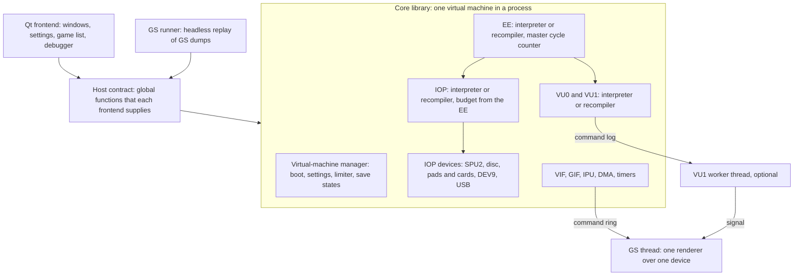

# PCSX2

## Summary

PCSX2 is the dominant PlayStation 2 emulator and the base of most widely used ones (family survey, [Summary][s-sum]).
Its README claims compatibility, not accuracy: newer versions "can run most games at full speed" ([README][p-readme]).
This note asks how it reaches that on a console of several processors, what the method costs,
and what Rustalgia should take from it.
It also compares the ARM64 recompilers that two forks, [ARMSX2][a-readme] and [LRPS2][l-readme],
add where upstream has none.

The answer is one clock and a few threads.
PCSX2 times every unit from a count of Emotion Engine (EE) cycles, tests for events only at branches,
and puts the Graphics Synthesizer (GS), and optionally the second vector unit, on threads behind command queues.
That makes it fast and approximate: floating point is host arithmetic with clamping,
and the hardware renderer rebuilds textures and render targets by heuristics (inference).
The gaps are closed game by game: 4,849 of the 12,916 entries in its game database carry at least one fix (counted).

Three points matter most to Rustalgia.

First, the timing model is fixed by the EE recompiler's design, by the description of [issue 4439][i-4439],
and exact floating point exists only as a [draft][pr-12001], two years old, for the interpreters.
A PCSX2 member wrote in 2022 that the timing between the EE and its vector coprocessor could not be handled then.

Second, the best test idea is the GS dump: a recording of the GS's input, replayed without a game or a BIOS.
Its oracle is the previous build, though, and no automated test of any processor runs.
The one suite that would test them was kept off the build bot because, a contributor wrote in 2016, it needs a BIOS
([issue 1130][i-1130]).

Third, upstream's ARM64 recompilers were held back because they duplicated the x86 ones
([pull request 11364][pr-11364]),
and LRPS2 says the x86 vector-unit headers mix host-neutral structures with x86 types;
that the two are one cause is an inference.
ARMSX2 answered with a port whose files largely mirror the x86 ones by name (inference),
and LRPS2 with a recompiler that falls back to the interpreter block by block and is checked against it.

## Scope

- Examined on 2026-11-27: PCSX2 at commit `c8e5f56927539da604448e300e6f8ccba30c7514` of that day,
  ARMSX2 at `2232a8133a5ccaab539110205b2a15fe902ce220`, and LRPS2 at `34e06fccbda3c601ee71dc131050807545855821`.
- Sources: PCSX2's source code, build files, CI workflows, in-tree documents, issues, and pull requests;
  its blog and documentation on pcsx2.net; GitHub metadata; and the [ps2autotests README][ps2at].
  Large files were read as an outline of comments and definitions plus chosen ranges,
  so a claim cited to a file rests on the lines named, not on a full reading.
  The game database was counted by pattern only; no patch was read or recorded.
  Nothing was built or run, and only published results are used.
- Licence and tier: the [family survey][s-pcsx2] and the [register][register] record them.
  All three projects are open tier, so code was read.
  Nothing is copied or ported, and every description here was written after reading the implementation.
  In the forks only these parts were opened: the folder `pcsx2/arm64`
  (opening comments and comment lines, not the bodies),
  the top-level README and build files, LRPS2's document on its build gate, and the names in a saved file listing.
- Not examined in PCSX2, because the register closes them, and described here only from prose and names:
  `pcsx2/IopBios.cpp` and `.h`, `pcsx2/IopModuleNames.cpp`, `pcsx2/ps2/Iop/PsxBios.cpp`,
  `pcsx2/ps2/BiosTools.cpp` and `.h`, `pcsx2/DebugTools/BiosDebugData.cpp` and `.h`, `pcsx2/RDebug`,
  `pcsx2/CDVD/CDVD.cpp`, `pcsx2/CDVD/CDVD_internal.h`, `pcsx2/SIO/Memcard/MemoryCardProtocol.cpp` and `.h`,
  and `pcsx2/Docs/Configuration_Guide`.
  They hold high-level BIOS and module code, a kit's debug protocol, and disc and memory card authentication.
  The same paths are closed in the forks, with ARMSX2's arcade paths
  (`pcsx2/Arcade`, `pcsx2/ImGui/FullscreenUI_Arcade*`, `pcsx2-qt/Arcade*`, `common/ARCADE.h`,
  and the arcade resource folders) and, in LRPS2, `pcsx2/CDVD/CDVD.c`, `MgDes.*`, `CDVDnvram.*`,
  `pcsx2/MemoryCardProtocol.*`, `tests/mg`, `tests/nvram`, `tests/mcdid`, and `tests/biosver`.
  Also unopened: `pcsx2.net/docs/setup/gather` and `pcsx2.net/docs/setup/bios`, which concern BIOS dumping;
  `pcsx2/pcsx2_patches`, a separate repository of patches that the build workflows download; and the wiki,
  which refuses scripts.
  None of these is a link, because a reader of this note must not open them.
- Skipped inside open files, because the section stands in for system software or holds device bytes
  ([ADR 0006][adr6]; research log):
  - [`R5900.cpp`][p-r5900], lines 46 to 57 and 559 to 772; [`Interpreter.cpp`][p-interp], lines 600 to 660;
    and the [EE recompiler][p-rec-ee], lines 780 to 797, 2122 to 2150, and 2200 to 2260: boot arguments,
    hooks on the BIOS's program loader, fast boot, the system-call entry, and a check for a video-library routine.
  - The [IOP recompiler][p-rec-iop], lines 715 to 757, 765, 1293, 1620 to 1650, and near 1685;
    and [`R3000A.cpp`][p-r3000], lines 52 to 53: high-level handling of module imports, the system-call entry,
    detection of a module reset, and calls into the closed files.
  - [`VMManager.cpp`][p-vmm]: lines 1364 to 1692 were read through a filter that dropped BIOS, fast-boot,
    and program-loading lines; lines 2856 to 2950 were not read; outside the ranges cited here it was only searched.
  - [`SaveState.cpp`][p-ss], lines 142 to 171, 192, and 276 to 286
    (a BIOS comparison and the saved state of high-level services);
    [`spu2.cpp`][p-spu2], lines 228 to 251
    (reset values a comment attributes to BIOS analysis);
    `pcsx2/DEV9/DEV9.cpp`, lines 60 to 72 (a byte table for the network adapter's EEPROM).
  - [`vtlb.cpp`][p-vtlb], lines 445 to 515 (one game's addresses); [`MemoryCardFolder.h`][p-mcfolder], lines 15 to 37
    (the card's file-system layout, not reproduced);
    and the [FAQ][p-faq], lines 183 to 199 (links to BIOS dumping guides, not followed).
  - LRPS2: the bodies of its [EE][l-rec-ee] and [IOP][l-rec-iop] recompilers, from lines 71 and 46 on,
    which a keyword scan shows to hold system-call and import-stub handling; the README's mentions of such hooks,
    at lines 97 to 101, were not used, though line 97 is cited for another point.
    ARMSX2: `iR5900-arm64.cpp` and `iR3000A-arm64.cpp` in `pcsx2/arm64` were not opened.
  - A few lines of these ranges surfaced in the searches that located them; nothing from them is recorded.
- How claims were checked: five evidence gatherers each read one area and confirmed each quotation against raw text.
  This note was written from their reports alone.
  Four independent verifiers who saw only the note then re-checked it,
  and a fix pass fetched each disputed source again and applied their findings.
  A claim with no marker rests on the file or page named beside it; markers follow the [research guide][guide].
  Counts from GitHub are its API's figures on that day, and a developer's comment is that person's statement,
  not project policy.

## Architecture

### Parts and the boundary

The top-level build makes a shared utility library, the core, an optional Qt frontend, optional unit tests,
and a headless program that replays GS dumps ([`CMakeLists.txt`][p-cmake], lines 43 to 70).
The core is one library that holds every emulated device.
Video, sound, pads, the disc drive, the expansion bay, and USB were separate plug-ins in older versions,
and are now folders of the core ([core build file][p-core-cmake]; [FAQ][p-faq], lines 161 to 170).

The virtual-machine manager owns the machine's state, the boot order, the layered settings, the frame limiter,
and the entry points for save states.
Each processor has an interpreter and a recompiler; when the setting changes,
the manager swaps them before execution resumes and clears every translation cache
([`VMManager.cpp`][p-vmm], lines 2747 to 2807).

The core calls the frontend through free functions that every frontend implements.
[`Host.h`][p-host] declares those for messages and error reports,
for running a function on the emulation thread or the GS thread, and for settings access under a lock.
Others, declared elsewhere, acquire the window and carry lifecycle notices
(seen as the [runner][p-runner]'s implementations, lines 228 to 270).
The functions are global and so is the core's state, so a process holds one machine and one frontend (inference).
A comment in the boot code says game-list scanning has to be cancelled before boot, because the disc code uses globals
(`VMManager.cpp`, lines 1373 to 1375).
The GS runner meets the same contract mostly with empty bodies, keeps settings in memory, and disables input, audio,
and memory cards (runner, lines 88 to 400 and 813 to 836).

### Time and synchronisation

The EE's cycle counter is the master clock.
The interpreter and translated blocks add a block's cycles to a 64-bit count at each branch,
and enter the event test when the count passes a next-event target
([`R5900.cpp`][p-r5900], lines 192 to 236; [EE recompiler][p-rec-ee], lines 1370 to 1418).
Events are tested only at branches, with a target at most 3072 EE cycles ahead; the IOP's ceiling is 384 IOP cycles
(`R5900.cpp`, lines 44 and 361 to 365; [`R3000A.cpp`][p-r3000], line 31).

The event test is one routine shared by the interpreter and the recompiler.
One pass covers pending EE interrupts, the IOP's slice, the EE timers and video counters, due DMA and interface events,
and both vector units, and it sets the next target (`R5900.cpp`, lines 361 to 457).

There is no general event queue.
Up to 32 scheduled events are bits in a mask, each with a start cycle and a length,
and the test polls a fixed list of them (lines 238 to 316 and 521 to 557).
Events due together therefore fire in list order, not in time order (inference).
A comment records that interrupts are raised a few cycles late on purpose,
because one named game spins on a vertical-sync value (lines 366 to 369).

Costs are estimates.
The interpreter adds a cost for each opcode from a table ([`Interpreter.cpp`][p-interp], line 217).
The recompiler models no cache: the settings page labels the EE cache "Interpreter only, provided for diagnostics"
([advanced settings][p-adv], line 85).
No model of bus waits was found either
(searched `R5900.cpp` and the EE recompiler, outside the skipped ranges, for "bus" and "wait state").

**The IOP.**
The IOP runs only inside the EE's event test.
The EE keeps a signed balance of the EE cycles elapsed;
when it is positive the IOP runs for that budget and returns the unused or overdrawn part
(`R5900.cpp`, lines 374 to 399; [IOP recompiler][p-rec-iop], lines 1060 to 1090).
In PS2 mode each IOP cycle costs 8 EE cycles of the budget (lines 1196 to 1218).

An EE event due within 28 cycles cancels the IOP's remaining budget (`R5900.cpp`, lines 438 to 452 and 545 to 556).
The SPU2 is advanced lazily to the IOP's cycle count on every register write and DMA transfer
([`spu2.cpp`][p-spu2], lines 51 to 101 and 440 to 446).

**The vector units.**
A running vector unit is caught up at each event test for the EE cycles elapsed, with a floor of 16 cycles
([`VUmicro.cpp`][p-vumicro], lines 12 to 60).
The code therefore advances a vector unit one cycle for each EE cycle (inference),
which bears on the clock dispute that the [survey][s-hard] records: this code does not halve it.
VU0 is also run up to the EE's current cycle when a coprocessor instruction is flagged as interlocked,
and a per-game fix forces that on every coprocessor instruction
(lines 62 to 80; [database guide][p-gamedb-doc], "Game Fixes Options").

### The GS and VU1 on their own threads

The GS always runs on its own thread.
The emulation thread copies GIF data and commands into a ring of 128-bit words with one producer and one consumer;
each side writes only its own position, an atomic value on its own cache line
([`MTGS.cpp`][p-mtgs], lines 60 to 70 and 314 to 360).

The EE waits for the GS at three points: when the ring is full; at vertical sync,
when more frames are queued than the user allows, because queued frames become input lag;
and for read-backs and save states, until the ring is empty (lines 239 to 275, 613 to 650, and 705 to 760).
The GS status that the EE reads is produced on the EE's side, when packets are parsed for their length and cost,
so the EE does not wait for drawing ([`Gif_Unit.h`][p-gif], lines 336 to 440).

With the threading option on, the EE thread does not run VU1.
It writes a log of commands into a ring, and a worker thread replays them
([`MTVU.cpp`][p-mtvu], lines 20 to 33 and 128 to 200).
The worker's output goes straight to the GS thread,
where a placeholder in the GS queue keeps the order between the three GIF paths
(`MTVU.cpp`, line 155; `MTGS.cpp`, lines 460 to 475).
A few atomically exchanged flags flow back, and the EE polls them at each event test.

The price is that any EE read of VU1 state needs a full wait (inference).
The [database guide][p-gamedb-doc] says "T-bit games dislike MTVU, and some games are incompatible with MTVU",
and that some games need VU1 kept in step
("Options for SpeedHacks"); 67 entries switch the option for one game (counted).
A comment records an unresolved fault in the ring's pointer handling that corrupts one game's intro,
worked round with a fixed margin (`MTVU.cpp`, lines 218 to 223).

### Processor execution

**Interpreters.**
All four processors have one, and an ARM64 build has nothing else for the EE, the IOP, and the vector units;
the build warns that games will run slowly ([`CMakeLists.txt`][p-cmake], lines 87 to 89).

**EE and IOP recompilers.** They exist for x86-64 only.
Block lookup uses a two-level table with no hashing: 65,536 entries, indexed by the top 16 bits of the program counter,
point to arrays that hold one host pointer for every 4-byte address in RAM and the ROM areas.
Every slot starts as a pointer to a stub that compiles that address,
so dispatch is one indirect jump and compilation is lazy
([EE recompiler][p-rec-ee], lines 52 to 55, 409 to 448, and 561 to 623).
Blocks never cross a 4 KiB guest page, so protection works page by page.

**Self-modifying code.** Detection has two stages.
When code is first compiled, the host page of guest RAM that holds it is write-protected.
A write faults, and the handler unprotects the page and switches the block to manual checking,
in which the block compares its guest code with a saved copy each time it runs.
The comment gives the reason: many games keep code and data in one 4 KiB page
([`vtlb.cpp`][p-vtlb], lines 1391 to 1405).
A comment admits that the method forces many recompilations (EE recompiler, lines 2020 to 2100).

**Fast memory.**
A virtual TLB maps each 4 KiB page of the EE's address space to host memory or to a handler.
The guest address space is also mapped as a host virtual region backed by the same memory,
so a load or store is one host instruction; an access that faults is found by its host code address and back-patched,
and its block is queued for recompilation
(`vtlb.cpp`, lines 3 to 16 and 868 to 1146); the patching routine itself was not read.
One gap is stated: a comment says exception handling in mid-block is not yet reliable,
because memory operations do not store the program counter before they call a handler (lines 441 to 442).

**Vector-unit recompiler.**
A vector unit's micro memory can be rewritten at any time, so the recompiler caches whole programs.
A write only marks the current program as unknown;
at the next run a cached program whose compiled ranges still match the micro memory is reused.
A block is keyed by its address and by the pipeline state on entry, so one address can have several versions,
and the status, MAC, and clip flags are kept as four instances each,
which reproduces the pipeline delay without computing flags that are never read
([`microVU.h`][p-mvu-h], lines 46 to 245; [`microVU.cpp`][p-mvu], lines 102 to 296).

**Floating point.**
The host's IEEE arithmetic is used and corrected, not replaced.
Four host control values are configured, for the EE's FPU, its division, VU0, and VU1; the defaults round towards zero,
except EE division, which rounds to nearest ([`Pcsx2Config.cpp`][p-config-cpp], lines 32 to 41 and 595 to 606).
Clamping has four levels for each unit, the second of which clamps results only
([database guide][p-gamedb-doc], "Clamping Modes").

A second FPU recompiler emulates the full exponent range and the overflow and underflow flags,
converting values to double precision ([`iFPUd.cpp`][p-fpud], comments at lines 9 and 124 to 156).
That it is what the EE's top clamping level selects, "Full Clamping for FPU" in the guide,
is an inference from the names.
Its header records what is still wrong: "Mul (incl. multiplication stage of MADD/MSUB) - incorrect.
PS2's result mantissa is sometimes smaller by 0x1 than IEEE's result (with round to zero)." (lines 14 to 21).
A draft [pull request, 12001][pr-12001], open since 2024-11-12 and updated on 2026-10-21,
implements the arithmetic in software for the interpreters only.

**Speed options.**
The EE cycle rate scales what a block is charged, and the scale is fixed into each translated block
(EE recompiler, lines 1288 to 1312).
Named switches for single games include an instant DMA, FIFO and stall fixes for the VIF and GIF,
and a general EE timing fix, which forces the scheduled DMA and interface events, though not the vector-unit ones,
to a delay of 8 cycles ([`Config.h`][p-config], lines 1095 to 1117; `R5900.cpp`, lines 534 to 538).

### Video

One renderer object is chosen at start: null, software, or the one hardware renderer.
The hardware renderer is a single implementation, and the host API is a separate device beneath it: Direct3D 11 or 12,
OpenGL, Vulkan, or Metal ([`GS.cpp`][p-gs], lines 204 to 230; [`Config.h`][p-config], lines 271 to 281).

**The device.**
A draw reaches the device as one record of targets, textures, vertices, shader selectors, and blend state.
Each device reports about twenty capability flags, and the shared renderer picks a path from them: texture barriers,
a copy-based substitute for barriers, framebuffer fetch, depth feedback, and rasteriser-ordered views
([`GSDevice.h`][p-device], lines 682 to 1431).
Blending is the main dial between accuracy and cost, with six user levels (`Config.h`, lines 330 to 339).
The accurate levels move blending into shaders, which needs many slow barriers ([2.8 post][b-28]).

**The texture cache.**
The cache holds two kinds of surface, each tied to a range of GS memory: targets, which the game renders to,
and sources, which it samples.
A source can be made from a target, and a second cache keyed by hash holds texture contents, replacements among them
([`GSTextureCache.h`][p-tc], lines 102 to 375; observed in an outline, not read line by line).

Game-specific code sits in the hardware renderer.
Its header declares 20 draw-skipping routines, 6 routines run before a draw, and 2 move handlers
(counted by pattern), which the database selects by name ([`GSHwHack.h`][p-hwhack], lines 1 to 50).

**Upscaling.**
Upscaling multiplies the size of hardware render targets, up to the host's largest texture divided by 1280
(`GS.cpp`, lines 675 to 679).
The software renderer never upscales, and the database guide documents ten fixes for upscaling alone (lines 191 to 202).

**The software renderer.**
It splits work across worker threads and generates code at run time:
a routine specialised for a draw state is made on first use, for primitive set-up and for drawing a scanline,
on x86-64 and on ARM64 ([`GSFunctionMap.h`][p-fnmap], lines 137 to 209; [core build file][p-core-cmake],
lines 490 to 493).
Its comments record tests on a console ([`GSRendererSW.cpp`][p-sw], lines 960 to 962).

**GS dumps.**
A dump records everything the GS received: a header, the GS state, the privileged registers,
and then packets of four kinds, a transfer, a vertical sync, a FIFO read, and a register block
([`GSDump.h`][p-dump], lines 10 to 27).
The header carries the save-state version first, then the game's serial, a checksum, and a screenshot (lines 30 to 42).
The GS state is the data a save state stores for the GS, so a dump is tied to the save-state version (inference).
Replay swaps the processors for a stand-in that feeds the recorded packets to the GS thread, so it needs no game, BIOS,
or processor emulation ([`GSDumpReplayer.cpp`][p-replay]; [`VMManager.cpp`][p-vmm], lines 2749 to 2756).

### Audio and frame pacing

A comment explains why the SPU2 follows the IOP's cycle count so closely: reverb and effects need precise update timing,
or pitches and loop lengths go wrong ([`spu2.cpp`][p-spu2], lines 442 to 444).
The back ends are Cubeb, SDL, and a null stream ([`AudioStreamTypes.h`][p-audio-types], lines 12 to 18).
Cubeb is the default, and synchronisation is either off or, by default, time stretching
([`Config.h`][p-config], lines 972 to 983).

The frame limiter runs on the emulation thread: it sleeps, then spins until the frame's end,
and moves its schedule forward after an overrun of a frame or more ([`VMManager.cpp`][p-vmm], lines 2313 to 2356).
Nothing named run-ahead or rewind was found (searched `VMManager.cpp` and `Config.h` for those words).

### Save states, memory cards, and input recording

**Save states.**
A save state is a zip archive with a version file, a screenshot, one file of internal structures,
and one file for each large component, such as EE memory, IOP memory, SPU2, and the GS
([`SaveState.cpp`][p-ss], lines 523 to 661).
The internal structures are raw, in a fixed order, with text tags between blocks;
a tag that does not match on load is reported as corruption (lines 120 to 138 and 173 to 275, less line 192).
The version file is stored uncompressed so that any build can read it (lines 927 to 999).

One 32-bit number is the version: a high half that classes the build, `0x9A5D` at this commit,
and a low half that counts format changes ([`SaveState.h`][p-ss-h], lines 24 to 30 and 92 to 98).
A state is refused if it is newer than the build or its high half differs,
and the message tells the user to fetch the matching release and save to a memory card
(`SaveState.cpp`, lines 1101 to 1118).
A commit that changes the version has to carry a tag in its message,
which "informs the auto updater that the users savestates will be invalidated" (`SaveState.h`, lines 26 to 28).
So old states are discarded, not migrated (inference).

The vector-unit recompiler's pipeline state is part of a state,
and a comment says the record exchanged with sub-modules is not necessarily portable between systems (lines 32 to 37).
The ARM64 build writes placeholders of the same size; its stub file says "recompiler state is stubbed in arm64!"
([`RecStubs.cpp`][p-stubs], line 21).

**Memory cards.**
There are two kinds, a file card and a folder card, which adds to the [survey][s-pcsx2]'s account of plain files
([`Config.h`][p-config], lines 244 to 261).
A folder card builds the card's file system in memory from host files and flushes some frames after the last write
([`MemoryCardFolder.h`][p-mcfolder], lines 222 to 302).
The card's authentication protocol is in the closed files.

**Input recording.**
A recording has a small header, a frame count, an undo count, a flag for a start from a save state,
and then a fixed 18 bytes for each controller in each frame, for two ports
([`InputRecordingFile.h`][p-rec-h], lines 18 to 26 and 76 to 88).
A recording that starts from a state is tied to the builds that can load that state (inference).
No statement that a replay is deterministic was found
(searched: the two recording files, the save-state files, and the [site map][d-sitemap] of pcsx2.net).

### The game database

An entry is keyed by disc serial.
It can hold a name and region, a compatibility grade, rounding and clamping modes, game fixes,
overrides of speed options, fixes for the hardware renderer, memory card filters,
and patches keyed by the checksum of the executable ([database guide][p-gamedb-doc], lines 15 to 59).
A JSON schema is published, and a workflow checks the file's syntax, schema, and format on every change
([workflows][p-workflows], the database lint).

The counts below were made by pattern over [the database][p-gamedb] at the commit (counted; 77,453 lines).

| Entries | Count | Share |
|---|---|---|
| All | 12,916 | |
| With at least one fix of any kind | 4,849 | 37.5 % |
| With fixes for the hardware renderer | 3,960 | 30.7 % |
| With a core fix: clamping, rounding, a game fix, or a speed-option override | 2,155 | 16.7 % |
| With clamping overrides | 800 | 6.2 % |
| With rounding overrides | 434 | 3.4 % |
| With a compatibility grade | 2,967 | 23.0 % |

Renderer fixes come in 38 kinds.
The two most used correct upscaling: a half-pixel offset, in 2,677 entries, and native scaling of post-processing,
in 1,750; 218 entries select a draw-skipping routine by name.
Game fixes come in 18 kinds: the general EE timing fix leads with 289 entries,
and software rendering of video has 195 and an instant DMA 137.

Of the graded entries, 2,847 are "playable" and 2 are "perfect".
The [FAQ][p-faq] says fixes are applied automatically by default
(lines 149 to 154), so "playable" describes play with the fixes on, not conformance to hardware (inference).

### Tests and published results

**Unit tests.**
Two test programs are built on GoogleTest ([`tests/ctest`][p-tests]).
They check that the x86-64 code emitter produces expected bytes
(11 cases holding 693 checks),
the GS's block reads and writes against a plain reference (22 cases), the patch applier on mocked memory
(60 cases), and utilities (counted).
Nothing there exercises a processor, a vector unit, a timer, DMA, SPU2, or the IOP (observed in the file listing).

**Continuous integration.**
The build workflows for Linux, macOS, and Windows run the unit tests after the build,
except in the four Windows jobs that use MSBuild and in the Flatpak job,
where no test step was found ([workflows][p-workflows]).
No workflow runs a GS dump, ps2autotests, or a game:
eleven of the seventeen workflow files were read or searched for a test step, and the other six,
four scheduled jobs and two builds of Windows dependencies, are judged by their names (inference).
Every merge to the main branch becomes a tagged, published build,
and the guide tells reporters to bisect by build number ([reporting guide][d-identify]).

**GS dump runs.**
Two scripts make the runner a regression tool.
The first replays every dump in a folder through one build, on a chosen renderer and in parallel if asked,
and saves frames and a log ([run script][p-run-py]).
The second compares two result folders: frames by the hash of the image file, with no tolerance,
and the renderer statistics that the run's log records.
It writes a page of before and after images and fails if any dump changed ([check script][p-check-py], lines 49 to 195).

The oracle is the previous build, so a person judges whether a change is right
(inference; the [survey][s-tests] agrees).
No dump corpus is in the repository (the listing was searched for the dump extensions),
and no table of results was found (searched: the [documentation page][d-gsrunner], the workflows,
and the release posts for [2.0][b-20], [2.2 and 2.4][b-24], [2.6][b-26], and [2.8][b-28]).

**ps2autotests.**
The tree holds a [Perl runner][p-perl] for [ps2autotests][ps2at], whose results come from a console.
Its list of known failures names 13 tests: one for the EE core, six for the EE's FPU, one for an IOP load delay,
four for the IOP kernel, and one for a vector unit (lines 152 to 171).
It uses configuration files and options of the application before 2.0, so it looks stale (lines 336 to 376; not run).

The tracking [issue, 1130][i-1130], opened on 2016-01-18 and still open, strikes out running the suite on the build bot.
Its author wrote four days later: "we can't run it on a bot because we need the bios...".

Contributors still use the suite by hand.
[Pull request 15213][pr-15213], merged on 2026-11-26,
gives its reason as "Found a couple of mismatches with hardware while running ps2autotests."
and ends "Both now match hardware."; whether the commit examined holds it was not checked.
[Issue 15185][i-15185] reports a vector-unit test whose flag line differs under the VU0 recompiler,
while "The interpreters match the recorded PS2 console output."; no maintainer has replied.
So the survey's "none found" for results on this suite is corrected in part: results for single tests exist,
and no table for the whole suite does
(searched: the tracker for the suite's name, 10 items; issue 1130's comments; the runner; the release posts).

### Project history and governance

**History.**
Release 2.0, of 2024-07-13, was the first stable release without plug-ins.
Its announcement says the plug-ins' limitations and old code had shown their age ([2.0 post][b-20]).

**Licence.**
This answers the gap the [survey][s-pcsx2] left.
A commit of 2009-09-08 is titled "Upgraded PCSX2 core and utilities to GPLv3." (commit search; title only).
[Pull request 12613][pr-12613], merged on 2025-05-04,
corrects a file that "was falsely implying PCSX2 was still licensed under the LGPL."
A member wrote on 2025-10-10: "At the time, our project was 'LGPL', by mistake (should have been GPL)."
([issue 13375][i-13375]).
The legal risk is recorded as a finding:
a derivative that relied on the LGPL label before 2025 had a documented basis for doing so (inference).

**People.**
In the six months to 2026-11-27, 617 commits were by people, and the five busiest wrote 57.7 % of them (calculated).
The developer who opened the ARM64 pull request, 11364, no longer contributes, by a contributor's comment of 2024-08-29
([issue 10235][i-10235]); the [2.0 post][b-20] credits the same person with introducing fast memory.

**Rules on AI.**
The contributing page has a policy on language models with six rules: contributors declare any use,
new contributors may not submit generated content, nobody may generate whole changes,
and long-time contributors may use completion and boilerplate ([contributing][d-contrib]).
The tree's [guidance file for agents][p-agents], read here as data, repeats them.
It forbids agents to open or update pull requests, issues, or comments.

**Hosts and legal posture.**
Published builds are for x86-64 only, and M-series Macs run them through Rosetta 2 ([System Requirements][d-req]).
Upstream does compile a macOS ARM64 build in CI and publishes no artefact from it ([workflows][p-workflows]).
A member confirmed on 2025-06-28: "We do have a working native arm64 version of PCSX2."
([issue 10042][i-10042]); it has no recompilers except the one for VIF unpacking, and has to be compiled by the user.
So the survey's unconfirmed remark is settled: upstream builds for ARM64 and does not ship it.

### Comparison: the ARM64 recompilers of ARMSX2 and LRPS2

| Part on ARM64 | PCSX2 | ARMSX2 | LRPS2 |
|---|---|---|---|
| EE and IOP | interpreters | recompilers, ported from the x86 ones | new recompilers with interpreter fallback |
| VU0 and VU1 | interpreters | a port, plus a second tier | the port from ARMSX2 |
| Assembler | VIXL | VIXL | its own emitter in C |
| Fast memory | not implemented | 4 GiB mirror, fault and patch | 4 GiB mirror, fault and patch |
| Recompiler tests | none found | 218 test files, by the listing | differential runs against the interpreter |
| Use of AI | restricted by policy | stated in the README | not stated |

**Upstream.**
The folder `pcsx2/arm64` holds six files: assembler helpers, a recompiler for VIF unpacking, and a stub file,
which says the back-patching of fast memory is not implemented ([`RecStubs.cpp`][p-stubs], lines 11 to 30).
This code and the software renderer's ARM64 generators emit through the VIXL library
([core build file][p-core-cmake], lines 490 to 493 and 1052 to 1081).

The pull request that added it, [11364][pr-11364], merged on 2024-06-14, states its limits:
"Apple CPUs will be the only supported architecture." and "There are no EE/VU/IOP recompilers yet."
It says the author's private recompilers duplicate a great deal of code, which has to move to common code first.
The developer who wrote those private recompilers had said
that his attempt of 2021 gave "around a 1.5-3x performance boost depending on the game",
and that "Maintainability is more important than anything else going forward" ([issue 10042][i-10042], 2023-09-28).
The author then left ([issue 10235][i-10235], a contributor's comment of 2024-08-29),
and the later ARM64 work found is maintenance (a title search for "arm64", 9 results).

[Pull request 15007][pr-15007], of 2026-09-26, offered ARM64 recompilers in 84,693 lines with AI use declared.
It was closed unmerged the same day, with a member's reply: "We don't accept unmaintainable slop".

**ARMSX2.**
Its README says the "EE, VU (COP2, mVU, VU1), IOP jits fully complete with extensive unit test framework"
([ARMSX2 README][a-readme], line 21).
Its `pcsx2/arm64` folder has 83 files, and for the EE, the IOP,
and the vector units most of their names mirror upstream's x86 files (observed in the listings).
The register allocator's header says it "Mirrors the x86 allocator in x86/iCore.h but adapted
for ARM64 register conventions." ([`iCore-arm64.h`][a-icore], lines 9 to 10).
So the recompilers look like a port of the x86 ones, written against an ARM64 assembler,
and not a new design (inference).

Fast memory is a 4 GiB mirror of guest memory with one-instruction access,
and a fault makes the signal handler patch the instruction into a branch to a slow path
([`recVTLB-arm64.cpp`][a-recvtlb], lines 4 to 14 and 207 to 240).

ARMSX2 adds a second path for vector-unit programs, which its header calls a live tier
(a folder of 20 files in the listing; no other file of it was read).
A background thread builds its regions into a private buffer and the VU thread copies them in,
because the code cache has one writer and on Apple hosts is never writable and executable at once
([`VuAotBackground.h`][a-vuaot], lines 6 to 18).

The listing shows 218 test source files for the recompilers; none was opened.
No results are published, and nothing readable here supports the README's claims of hardware accuracy (lines 22 to 24).
It says: "However, we still use AI for development." (line 30).
At the commits examined ARMSX2 is 5,447 commits ahead of upstream and 220 behind, with a merge base of 2026-09-27
(GitHub comparison).

**LRPS2.**
Its README estimates progress, weighted by remaining work, at about 89 % for the EE, 98 % for the IOP, and 70 % for VU1
([LRPS2 README][l-readme], lines 86 to 113).
The EE and IOP recompilers are new designs (inference from their opening comments).
Each began by translating the leading run of simple instructions in a block and handing the rest to the interpreter,
and grew one instruction class at a time; what cannot be translated still ends a block and falls back
([EE file][l-rec-ee], lines 4 to 16; [IOP file][l-rec-iop], lines 4 to 18).

The vector-unit and VIF code is transplanted from ARMSX2 (README, lines 105 and 113).
A header gives the reason: upstream's x86 headers mix host-neutral structures with x86 emitter types
and the x86 allocator, so they cannot be compiled on ARM64 ([`aVU.h`][l-avu], lines 15 to 27).
The two forks are therefore independent for the EE and the IOP only (inference).
LRPS2 also wrote its own AArch64 emitter in C
(README, lines 342 to 343),
and tests hold its output, by hash, to the instruction words that VIXL produced ([`a64emit.h`][l-emit], lines 5 to 8).

The README describes how the recompilers are checked.

- Whole-system comparison: "headless libretro harness runs are compared
  for byte-identical framebuffer output against the interpreter" (lines 132 to 136).
- Lockstep traces and bisection: hashes of memory for each frame and of the registers for each instruction,
  and a switch that sends each class of instruction to the interpreter (lines 284 to 323).
- Shadow execution: recompiled VU1 runs beside the interpreter and is compared register by register;
  nine programs are known to differ in the last bit of a float (lines 105 and 323).

The method has stated limits.
It was applied on one device with two reference games
(lines 11 to 13),
and two instructions that neither game executes are kept on the interpreter, because a native path could not be verified
(line 97).
The oracle for floats is a software model, not a console, as the [survey][s-forks] records.

LRPS2's [gate document][l-gate] is not about ARM64:
it is a release checklist for an x86 build that carries the GS code at three instruction-set levels.

## What works well

- **One clock and few synchronisation points.**
  Every unit is timed from the EE's cycle count and synchronised mainly at event tests,
  scheduled at most 3072 EE cycles apart, which is what lets a console of several processors run at speed
  (read in [`R5900.cpp`][p-r5900] and the [IOP recompiler][p-rec-iop]).
- **The GS sits behind a command ring.**
  One producer, one consumer, and status computed on the producer's side mean the EE rarely waits for drawing
  (read in [`MTGS.cpp`][p-mtgs] and [`Gif_Unit.h`][p-gif]).
- **The recompilers use cheap, proven techniques.**
  A pointer for every entry address gives constant-time dispatch and lazy compilation;
  fast memory makes an access one instruction until it faults; page protection finds self-modifying code,
  with comparison on entry only for pages that mix code and data; and the vector-unit cache is keyed by program content
  (read in the [EE recompiler][p-rec-ee], [`vtlb.cpp`][p-vtlb], and [`microVU.h`][p-mvu-h]).
- **One hardware renderer serves five graphics APIs.**
  Accuracy features degrade by capability flag, not by a renderer for each API (read in [`GSDevice.h`][p-device]).
- **GS dumps isolate the hardest component.**
  Replay needs no game, BIOS, or processor core, so a change is tried on many recorded frames, in parallel,
  on any renderer, and the same run yields statistics that guard cost
  (read in [`GSDumpReplayer.cpp`][p-replay], the [run script][p-run-py], and the [check script][p-check-py];
  [GS dump runner][d-gsrunner]).
- **Fixes are data, and every merge is a build.**
  One documented, schema-checked, linted database holds the per-game settings and fixes,
  and game fixes are applied automatically by default, so the project's inaccuracy can be counted
  (read in the [database guide][p-gamedb-doc], the [FAQ][p-faq], and the [workflows][p-workflows]).
  Every merge is a numbered build that users can bisect ([reporting guide][d-identify]).

## What works poorly

- **Timing is approximate by construction.**
  Events land only at block ends, costs are estimates, and interrupts are raised a few cycles late on purpose,
  for a named game (read in [`R5900.cpp`][p-r5900]).
  The recompiler has no cache model, by the label in the [advanced settings][p-adv], and no bus timing was found
  (searched as Architecture says).
  A meta [issue, 4439][i-4439], open since 2021,
  lists over thirty games that need tighter timing between the EE and its vector coprocessor.
  A member wrote there in 2022: "Their timing can't be handled right now,
  but if by some chance we decide to do it in the future, we have a list of games we can test with."
  The general EE timing fix is the most used game fix, in 289 entries,
  and threaded VU1 adds a class of incompatible games and an acknowledged fault (read in [`MTVU.cpp`][p-mtvu]).
- **Floating point is corrected host arithmetic.**
  The fuller FPU recompiler's own header lists multiplication as incorrect
  (read in [`iFPUd.cpp`][p-fpud]), and 800 entries override clamping and 434 rounding (counted).
  The exact model has been a draft, for the interpreters only, since 2024 ([pull request 12001][pr-12001]).
- **The hardware renderer needs data for each game, and code for some.**
  30.7 % of entries carry a renderer fix, the two most used being for upscaling,
  and 28 routines for particular games are compiled in (read in [`GSHwHack.h`][p-hwhack]; counted).
  The cause is that targets and textures are rebuilt from raw GS memory use by heuristics
  (inference from [`GSTextureCache.h`][p-tc] and the [2.8 post][b-28]).
- **No automated test covers emulation.**
  CI runs only the unit tests, and not on every Windows job (read in the [workflows][p-workflows]).
  The dump comparison's oracle is the previous build, and no corpus is in the repository.
  The [ps2autotests runner][p-perl] never reached CI; a contributor's reason in 2016 was that it needs a BIOS
  ([issue 1130][i-1130]),
  and nothing compares recompiler with interpreter, though [issue 15185][i-15185] reports them disagreeing.
- **The recompilers are bound to one host.**
  They exist for x86-64 only, the save-state format has a section sized for one recompiler's state,
  and the ARM64 build fills it with placeholders (read in [`RecStubs.cpp`][p-stubs]).
  The port stalled when its one author left ([pull request 11364][pr-11364]; [issue 10235][i-10235]).
- **State is global, and the formats built on it are brittle.**
  A process holds one machine (inference), the frontend contract is global functions
  (read in [`Host.h`][p-host]),
  and system-software shortcuts sit inside both processor cores, which is why parts of open files were skipped here
  (research log).
  Save states are raw structures under one version number, so a change of version discards them all, with no migration;
  GS dumps and recordings that start from a state inherit that
  (read in [`SaveState.h`][p-ss-h] and [`GSDump.h`][p-dump]; inference).
- **Knowledge is concentrated and thinly written down.**
  Five people wrote 57.7 % of six months' commits (calculated),
  and no design note for the scheduler or the threads was found in the tree
  (searched: the listing under `pcsx2/Docs` and `pcsx2/GS/docs`).

## Implications for Rustalgia

These are recommendations; the owner decides, and they feed the [phase 2][phase2] notes.

- **Settle the time base and coprocessor timing before any recompiler.**
  PCSX2 shows that a master cycle counter with slaved units runs most PS2 games,
  and that what it leaves out waits on an overhaul of the EE recompiler ([issue 4439][i-4439]).
  Recommended for [R2-03][phase2] and [R2-01][phase2]: keep the master clock and budgets for slaved processors,
  replace the polled mask with an event queue ordered by time with stated tie-breaks,
  and design blocks so that an instruction can stop for another unit in mid-block.
  Treat a threaded vector unit as an optional mode that is shown to be equivalent, or left off.
- **Make exact floating point the reference path.**
  PCSX2 chose host arithmetic first, and 800 entries now override clamping and 434 rounding.
  Recommended: a software model of the console's arithmetic in the interpreter from the first day,
  with any faster path tested equal to it.
  The survey's [open question][s-open] on VU1 rounding bounds how exact it can be.
- **Put the GS behind a recordable command stream from the first renderer.**
  The queue forces status onto the producer's side, and the recording is the cheapest regression tool found.
  Recommended for [R2-05][phase2] and [R2-15][phase2]: a dump format with its own version;
  reference images from a software renderer or a console, not only from the last build;
  a public corpus made from homebrew and test programs, since a commercial game's dump holds its graphics;
  and native resolution as the default, with upscaling marked approximate.
- **Plan tests that need no BIOS.**
  PCSX2's CI runs no test of emulation.
  Recommended for [R2-15][phase2] and [R5-05][phase5]: start EE test programs directly,
  list the kernel-dependent tests left out, compare interpreter with recompiler on the same programs,
  and publish a results table for each commit.
  How a test program is started without firmware belongs to the firmware policy of [R2-12][phase2].
- **Keep recompiler back ends replaceable.**
  LRPS2 names the mixing of host-neutral structures with x86 types as the cost,
  upstream names duplicated code that has to move to common code first,
  and ARMSX2's mirrored files show the same cost (inference).
  Recommended for [R2-01][phase2] and [R2-02][phase2]: keep block discovery, analysis, cycle accounting,
  and allocation policy out of host code; make fallback to the interpreter, block by block, a permanent feature;
  and treat fast memory, page size, and code-cache permissions as a host layer with its own tests.
  LRPS2's switches and lockstep traces are a model for the harness, which should exist before a second back end.
- **Own the core's state, and keep firmware shortcuts out of the processors.**
  Recommended for [R2-10][phase2], [R2-08][phase2], and [R2-12][phase2]: the machine as an owned value;
  fast boot and high-level services behind one interface;
  save states in named sections with their own versions and no translated-code state;
  and recordings that store settings and the identity of their starting state.
- **Treat per-game data as a defect count, and note upstream's rules.**
  If such data is ever allowed, keep it to facts about the game, schema-checked and counted.
  PCSX2's policy means Rustalgia cannot send it machine-written patches,
  and its licence history argues for one licence statement, checked by tooling, from the first commit.

## Open questions

- How does PCSX2 score on the whole of ps2autotests, in each processor mode?
  No table is published; running the suite would answer it, in [R2-15][phase2] and the runner of [R5-05][phase5].
- Does an input recording replay to the same frames across hosts, renderers, and settings?
  Nothing read says so; a replay run would answer it, as [R5-06][phase5] plans for Rustalgia's own core.
- How fast and how exact are the ARM64 recompilers of ARMSX2 and LRPS2 on phones?
  ARMSX2 publishes no results, and LRPS2 gives figures for one device and two games,
  measured against its own interpreter and model, not a console;
  running them on devices in [phase 3][phase3] or a spike would answer it.

## Sources

Every source was read on 2026-11-27.
Files of PCSX2, ARMSX2, and LRPS2 are pinned to the commits that Scope gives.

Repository notes and files:

- [R1-19, "PlayStation 2: family survey"][s-pcsx2]; [research guide][guide]; [ADR 0006][adr6];
  [research roadmap][phase2]; [source register][register].

PCSX2, project documents, build, and tests:

- [README][p-readme]; [`AGENTS.md`][p-agents]; [`CMakeLists.txt`][p-cmake]; [`pcsx2/CMakeLists.txt`][p-core-cmake];
  [CI workflows][p-workflows]; [`pcsx2/Docs/PCSX2_FAQ.md`][p-faq]; [`pcsx2/Docs/GameIndex.md`][p-gamedb-doc];
  [`bin/resources/GameIndex.yaml`][p-gamedb] (counted only).
- [`tests/ctest`][p-tests]; [`tests/run_test.pl`][p-perl]; [`pcsx2-gsrunner/test_run_dumps.py`][p-run-py];
  [`pcsx2-gsrunner/test_check_dumps.py`][p-check-py].

PCSX2, source files under `pcsx2/` unless a folder is given:

- Machine and host: [`VMManager.cpp`][p-vmm]; [`Host.h`][p-host]; [`Config.h`][p-config];
  [`Pcsx2Config.cpp`][p-config-cpp]; [`pcsx2-gsrunner/Main.cpp`][p-runner];
  [`pcsx2-qt/Settings/AdvancedSettingsWidget.cpp`][p-adv].
- Processors and timing: [`R5900.cpp`][p-r5900]; [`Interpreter.cpp`][p-interp]; [`x86/ix86-32/iR5900.cpp`][p-rec-ee];
  [`R3000A.cpp`][p-r3000]; [`x86/iR3000A.cpp`][p-rec-iop]; [`vtlb.cpp`][p-vtlb]; [`VUmicro.cpp`][p-vumicro];
  [`MTVU.cpp`][p-mtvu]; [`x86/microVU.h`][p-mvu-h]; [`x86/microVU.cpp`][p-mvu]; [`x86/iFPUd.cpp`][p-fpud];
  [`arm64/RecStubs.cpp`][p-stubs].
- Video: [`MTGS.cpp`][p-mtgs]; [`Gif_Unit.h`][p-gif]; [`GS/GS.cpp`][p-gs]; [`GS/Renderers/Common/GSDevice.h`][p-device];
  [`GS/Renderers/Common/GSFunctionMap.h`][p-fnmap]; [`GS/Renderers/HW/GSTextureCache.h`][p-tc];
  [`GS/Renderers/HW/GSHwHack.h`][p-hwhack]; [`GS/Renderers/SW/GSRendererSW.cpp`][p-sw]; [`GS/GSDump.h`][p-dump];
  [`GSDumpReplayer.cpp`][p-replay].
- Audio and state: [`SPU2/spu2.cpp`][p-spu2]; [`Host/AudioStreamTypes.h`][p-audio-types]; [`SaveState.h`][p-ss-h];
  [`SaveState.cpp`][p-ss]; [`SIO/Memcard/MemoryCardFolder.h`][p-mcfolder]; [`Recording/InputRecordingFile.h`][p-rec-h].

PCSX2, tracker (descriptions and comments, through the GitHub API):

- Issues [1130][i-1130], [4439][i-4439], [10042][i-10042], [10235][i-10235], [13375][i-13375], and [15185][i-15185].
- Pull requests [11364][pr-11364], [12001][pr-12001], [12613][pr-12613], [15007][pr-15007], and [15213][pr-15213].
- Repository metadata: contributors, commits, releases, labels, and search counts.

pcsx2.net, each fixed by its date where it shows one:

- Blog: [Introducing PCSX2 2.0!][b-20] (2024-07-12); [Welcoming PCSX2 2.2.0 and 2.4.0!][b-24] (2025-07-01);
  [PCSX2 2.6.0 is now out!][b-26] (2026-01-04); [PCSX2 2.8.0 is now out!][b-28] (2026-08-28).
- Documentation, no version shown: [GS Dump Runner][d-gsrunner]; [Diagnosing & Reporting][d-identify];
  [Contributing to PCSX2][d-contrib]; [System Requirements][d-req]; and the [site map][d-sitemap].

Tests and forks:

- [ps2autotests README][ps2at] (commit `97469ffbed8631277b94e28d01dabd702aa97ef3`, 2019-11-16).
- ARMSX2: [README][a-readme]; and in `pcsx2/arm64`, comments only: [`iCore-arm64.h`][a-icore];
  [`recVTLB-arm64.cpp`][a-recvtlb]; [`vuaot/VuAotBackground.h`][a-vuaot];
  and GitHub's comparison of the fork with upstream at the two commits.
- LRPS2: [README][l-readme]; [`docs/multi-isa-verification-gate.md`][l-gate]; and in `pcsx2/arm64`,
  opening comments only: [`recR5900_arm64.c`][l-rec-ee]; [`recR3000A_arm64.c`][l-rec-iop]; [`aVU.h`][l-avu];
  [`a64emit.h`][l-emit].
- Saved file listings of the three repositories at their commits (names only).

[guide]: ../README.md#claim-status
[register]: ../../../.claude/hooks/source-register.txt
[adr6]: ../../adr/0006-read-sources-by-tier-under-a-compatibility-test.md
[phase2]: ../../roadmap/research.md#phase-2-cross-cutting-engineering
[phase3]: ../../roadmap/research.md#phase-3-host-platforms
[phase5]: ../../roadmap/research.md#phase-5-hands-on-spikes
[s-sum]: ../topics/R1-19-playstation-2-family.md#summary
[s-pcsx2]: ../topics/R1-19-playstation-2-family.md#pcsx2
[s-forks]: ../topics/R1-19-playstation-2-family.md#other-pcsx2-lineages
[s-hard]: ../topics/R1-19-playstation-2-family.md#how-hard-the-family-is-to-emulate
[s-tests]: ../topics/R1-19-playstation-2-family.md#tests-and-published-results
[s-open]: ../topics/R1-19-playstation-2-family.md#open-questions
[p-readme]: https://github.com/PCSX2/pcsx2/blob/c8e5f56927539da604448e300e6f8ccba30c7514/README.md
[p-agents]: https://github.com/PCSX2/pcsx2/blob/c8e5f56927539da604448e300e6f8ccba30c7514/AGENTS.md
[p-cmake]: https://github.com/PCSX2/pcsx2/blob/c8e5f56927539da604448e300e6f8ccba30c7514/CMakeLists.txt
[p-core-cmake]: https://github.com/PCSX2/pcsx2/blob/c8e5f56927539da604448e300e6f8ccba30c7514/pcsx2/CMakeLists.txt
[p-faq]: https://github.com/PCSX2/pcsx2/blob/c8e5f56927539da604448e300e6f8ccba30c7514/pcsx2/Docs/PCSX2_FAQ.md
[p-gamedb-doc]: https://github.com/PCSX2/pcsx2/blob/c8e5f56927539da604448e300e6f8ccba30c7514/pcsx2/Docs/GameIndex.md
[p-gamedb]: https://github.com/PCSX2/pcsx2/blob/c8e5f56927539da604448e300e6f8ccba30c7514/bin/resources/GameIndex.yaml
[p-perl]: https://github.com/PCSX2/pcsx2/blob/c8e5f56927539da604448e300e6f8ccba30c7514/tests/run_test.pl
[p-check-py]: https://github.com/PCSX2/pcsx2/blob/c8e5f56927539da604448e300e6f8ccba30c7514/pcsx2-gsrunner/test_check_dumps.py
[p-run-py]: https://github.com/PCSX2/pcsx2/blob/c8e5f56927539da604448e300e6f8ccba30c7514/pcsx2-gsrunner/test_run_dumps.py
[p-vmm]: https://github.com/PCSX2/pcsx2/blob/c8e5f56927539da604448e300e6f8ccba30c7514/pcsx2/VMManager.cpp
[p-host]: https://github.com/PCSX2/pcsx2/blob/c8e5f56927539da604448e300e6f8ccba30c7514/pcsx2/Host.h
[p-config]: https://github.com/PCSX2/pcsx2/blob/c8e5f56927539da604448e300e6f8ccba30c7514/pcsx2/Config.h
[p-config-cpp]: https://github.com/PCSX2/pcsx2/blob/c8e5f56927539da604448e300e6f8ccba30c7514/pcsx2/Pcsx2Config.cpp
[p-runner]: https://github.com/PCSX2/pcsx2/blob/c8e5f56927539da604448e300e6f8ccba30c7514/pcsx2-gsrunner/Main.cpp
[p-adv]: https://github.com/PCSX2/pcsx2/blob/c8e5f56927539da604448e300e6f8ccba30c7514/pcsx2-qt/Settings/AdvancedSettingsWidget.cpp
[p-r5900]: https://github.com/PCSX2/pcsx2/blob/c8e5f56927539da604448e300e6f8ccba30c7514/pcsx2/R5900.cpp
[p-interp]: https://github.com/PCSX2/pcsx2/blob/c8e5f56927539da604448e300e6f8ccba30c7514/pcsx2/Interpreter.cpp
[p-rec-ee]: https://github.com/PCSX2/pcsx2/blob/c8e5f56927539da604448e300e6f8ccba30c7514/pcsx2/x86/ix86-32/iR5900.cpp
[p-r3000]: https://github.com/PCSX2/pcsx2/blob/c8e5f56927539da604448e300e6f8ccba30c7514/pcsx2/R3000A.cpp
[p-rec-iop]: https://github.com/PCSX2/pcsx2/blob/c8e5f56927539da604448e300e6f8ccba30c7514/pcsx2/x86/iR3000A.cpp
[p-vtlb]: https://github.com/PCSX2/pcsx2/blob/c8e5f56927539da604448e300e6f8ccba30c7514/pcsx2/vtlb.cpp
[p-vumicro]: https://github.com/PCSX2/pcsx2/blob/c8e5f56927539da604448e300e6f8ccba30c7514/pcsx2/VUmicro.cpp
[p-mtvu]: https://github.com/PCSX2/pcsx2/blob/c8e5f56927539da604448e300e6f8ccba30c7514/pcsx2/MTVU.cpp
[p-mvu-h]: https://github.com/PCSX2/pcsx2/blob/c8e5f56927539da604448e300e6f8ccba30c7514/pcsx2/x86/microVU.h
[p-mvu]: https://github.com/PCSX2/pcsx2/blob/c8e5f56927539da604448e300e6f8ccba30c7514/pcsx2/x86/microVU.cpp
[p-fpud]: https://github.com/PCSX2/pcsx2/blob/c8e5f56927539da604448e300e6f8ccba30c7514/pcsx2/x86/iFPUd.cpp
[p-stubs]: https://github.com/PCSX2/pcsx2/blob/c8e5f56927539da604448e300e6f8ccba30c7514/pcsx2/arm64/RecStubs.cpp
[p-mtgs]: https://github.com/PCSX2/pcsx2/blob/c8e5f56927539da604448e300e6f8ccba30c7514/pcsx2/MTGS.cpp
[p-gif]: https://github.com/PCSX2/pcsx2/blob/c8e5f56927539da604448e300e6f8ccba30c7514/pcsx2/Gif_Unit.h
[p-gs]: https://github.com/PCSX2/pcsx2/blob/c8e5f56927539da604448e300e6f8ccba30c7514/pcsx2/GS/GS.cpp
[p-device]: https://github.com/PCSX2/pcsx2/blob/c8e5f56927539da604448e300e6f8ccba30c7514/pcsx2/GS/Renderers/Common/GSDevice.h
[p-fnmap]: https://github.com/PCSX2/pcsx2/blob/c8e5f56927539da604448e300e6f8ccba30c7514/pcsx2/GS/Renderers/Common/GSFunctionMap.h
[p-tc]: https://github.com/PCSX2/pcsx2/blob/c8e5f56927539da604448e300e6f8ccba30c7514/pcsx2/GS/Renderers/HW/GSTextureCache.h
[p-hwhack]: https://github.com/PCSX2/pcsx2/blob/c8e5f56927539da604448e300e6f8ccba30c7514/pcsx2/GS/Renderers/HW/GSHwHack.h
[p-sw]: https://github.com/PCSX2/pcsx2/blob/c8e5f56927539da604448e300e6f8ccba30c7514/pcsx2/GS/Renderers/SW/GSRendererSW.cpp
[p-dump]: https://github.com/PCSX2/pcsx2/blob/c8e5f56927539da604448e300e6f8ccba30c7514/pcsx2/GS/GSDump.h
[p-replay]: https://github.com/PCSX2/pcsx2/blob/c8e5f56927539da604448e300e6f8ccba30c7514/pcsx2/GSDumpReplayer.cpp
[p-spu2]: https://github.com/PCSX2/pcsx2/blob/c8e5f56927539da604448e300e6f8ccba30c7514/pcsx2/SPU2/spu2.cpp
[p-audio-types]: https://github.com/PCSX2/pcsx2/blob/c8e5f56927539da604448e300e6f8ccba30c7514/pcsx2/Host/AudioStreamTypes.h
[p-ss-h]: https://github.com/PCSX2/pcsx2/blob/c8e5f56927539da604448e300e6f8ccba30c7514/pcsx2/SaveState.h
[p-ss]: https://github.com/PCSX2/pcsx2/blob/c8e5f56927539da604448e300e6f8ccba30c7514/pcsx2/SaveState.cpp
[p-mcfolder]: https://github.com/PCSX2/pcsx2/blob/c8e5f56927539da604448e300e6f8ccba30c7514/pcsx2/SIO/Memcard/MemoryCardFolder.h
[p-rec-h]: https://github.com/PCSX2/pcsx2/blob/c8e5f56927539da604448e300e6f8ccba30c7514/pcsx2/Recording/InputRecordingFile.h
[p-workflows]: https://github.com/PCSX2/pcsx2/tree/c8e5f56927539da604448e300e6f8ccba30c7514/.github/workflows
[p-tests]: https://github.com/PCSX2/pcsx2/tree/c8e5f56927539da604448e300e6f8ccba30c7514/tests/ctest
[i-1130]: https://github.com/PCSX2/pcsx2/issues/1130
[i-4439]: https://github.com/PCSX2/pcsx2/issues/4439
[i-10042]: https://github.com/PCSX2/pcsx2/issues/10042
[i-10235]: https://github.com/PCSX2/pcsx2/issues/10235
[i-13375]: https://github.com/PCSX2/pcsx2/issues/13375
[i-15185]: https://github.com/PCSX2/pcsx2/issues/15185
[pr-11364]: https://github.com/PCSX2/pcsx2/pull/11364
[pr-12001]: https://github.com/PCSX2/pcsx2/pull/12001
[pr-12613]: https://github.com/PCSX2/pcsx2/pull/12613
[pr-15007]: https://github.com/PCSX2/pcsx2/pull/15007
[pr-15213]: https://github.com/PCSX2/pcsx2/pull/15213
[b-20]: https://pcsx2.net/blog/2024/pcsx2-2-release
[b-24]: https://pcsx2.net/blog/2025/pcsx2-2.4_2.2
[b-26]: https://pcsx2.net/blog/2025/pcsx2-2.6
[b-28]: https://pcsx2.net/blog/2026/pcsx2-2.8
[d-sitemap]: https://pcsx2.net/sitemap.xml
[d-gsrunner]: https://pcsx2.net/docs/advanced/gsdumprunner
[d-identify]: https://pcsx2.net/docs/troubleshooting/identify
[d-contrib]: https://pcsx2.net/docs/contributing/
[d-req]: https://pcsx2.net/docs/setup/requirements
[ps2at]: https://github.com/unknownbrackets/ps2autotests/blob/97469ffbed8631277b94e28d01dabd702aa97ef3/README.md
[a-readme]: https://github.com/ARMSX2/ARMSX2/blob/2232a8133a5ccaab539110205b2a15fe902ce220/README.md
[a-icore]: https://github.com/ARMSX2/ARMSX2/blob/2232a8133a5ccaab539110205b2a15fe902ce220/pcsx2/arm64/iCore-arm64.h
[a-recvtlb]: https://github.com/ARMSX2/ARMSX2/blob/2232a8133a5ccaab539110205b2a15fe902ce220/pcsx2/arm64/recVTLB-arm64.cpp
[a-vuaot]: https://github.com/ARMSX2/ARMSX2/blob/2232a8133a5ccaab539110205b2a15fe902ce220/pcsx2/arm64/vuaot/VuAotBackground.h
[l-readme]: https://github.com/libretro/parallel-ps2/blob/34e06fccbda3c601ee71dc131050807545855821/README.md
[l-gate]: https://github.com/libretro/parallel-ps2/blob/34e06fccbda3c601ee71dc131050807545855821/docs/multi-isa-verification-gate.md
[l-rec-ee]: https://github.com/libretro/parallel-ps2/blob/34e06fccbda3c601ee71dc131050807545855821/pcsx2/arm64/recR5900_arm64.c
[l-rec-iop]: https://github.com/libretro/parallel-ps2/blob/34e06fccbda3c601ee71dc131050807545855821/pcsx2/arm64/recR3000A_arm64.c
[l-avu]: https://github.com/libretro/parallel-ps2/blob/34e06fccbda3c601ee71dc131050807545855821/pcsx2/arm64/aVU.h
[l-emit]: https://github.com/libretro/parallel-ps2/blob/34e06fccbda3c601ee71dc131050807545855821/pcsx2/arm64/a64emit.h
