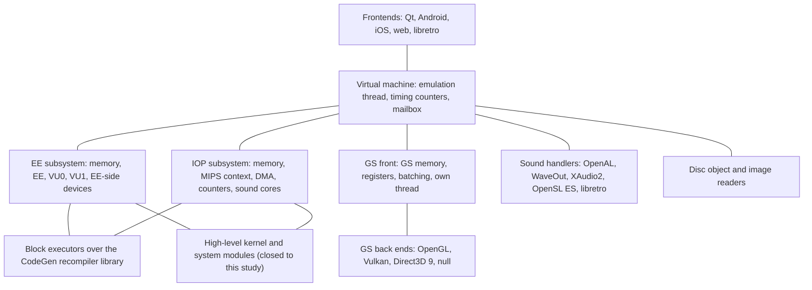

# Play

## Summary

[Play!][play] is a high-level emulator of the PlayStation 2, written in C++, in development since about 2005,
and mostly by one person.
This note asks how it is built outside its replacement system software, why that works, and what Rustalgia should learn.
The [family survey](../topics/R1-19-playstation-2-family.md#play) records its licence, tier, closed parts, and hazards.

It needs no BIOS file, because its own code stands in for the console's kernel and system modules,
and it runs on Windows, macOS, Linux, Android, iOS, and the web from one code base.
One recompiler library of the author's own serves the main processor, the I/O processor, and both vector units,
with back ends for five host targets, WebAssembly among them; there is no interpreter.
Time is a count of executed instructions handed out in fixed quanta.
The price shows in its own tracker, where about half of the games reported are playable.

Three points matter most to Rustalgia.
The first is that a high-level kernel buys an easy start and costs a long tail of faults found one game at a time.
The author credits hardware tests for what improved it,
yet the runner he wrote for them is outside continuous integration and no result is published.
The second is the recompiler's shape:
an intermediate form whose operands are offsets into a state block lets one library serve three guest processors
and five hosts, and the lack of an interpreter stops it on hosts that forbid generated code.
The third is the Vulkan renderer: keeping Graphics Synthesizer memory as the source of truth makes read-back
and memory reinterpretation work, at the cost of upscaling and of a host extension.

## Scope

- Examined on 2026-11-27: `jpd002/Play-` at commit `1f27232772e484bfb79364b751b84f41f4c87481`, the head of `master`,
  committed 2026-10-24; its recompiler library [Play--CodeGen][codegen] at commit
  `a5009f7dca062695b8e5aebbd71e67b4ddfa9251`; its support library [Play--Framework][framework] at commit
  `3368a5a7d9cb18af4591e51f37fe9505496f70c2`; its shader generator [Nuanceur][nuanceur] at commit
  `d96578b5a18edc67a268ed4811f0a035c56de7a0`; and the compatibility tracker [Play-Compatibility][compat] at commit
  `1c4fa50eaddc18dff43990ce8d561bfec6c15105`.
- Kinds of source: source code and its comments; the README and other repository documents;
  the project's site and development log; issue threads, commit titles, and GitHub metadata; the tracker's README,
  issue template, labels, and counts; and the README of [ps2autotests][ps2at].
  Published results only: nothing was built or run.
- Licence and tier: BSD-2-Clause and open tier,
  as the [survey](../topics/R1-19-playstation-2-family.md#the-emulators-compared)
  and the [register](../../../.claude/hooks/source-register.txt) record.
  The code was read outside the closed paths, nothing is copied or ported,
  and every description of the emulator's internals in this note was written after reading the implementation.
- Not examined, because [ADR 0006](../../adr/0006-read-sources-by-tier-under-a-compatibility-test.md#closed-tier) closes
  replacement system software and the register closes arcade key and dongle material: the folder `Source/iop` except its
  hardware models (the files `Iop_Dmac.*`, `Iop_DmacChannel.*`, `Iop_Intc.*`, `Iop_RootCounters.*`, `Iop_Spu*.*`, and
  `Iop_SubSystem.*`, which are open); `Source/ee/PS2OS.*`; `Source/ee/Ee_LibMc2.*`; `Source/ee/SIF.cpp` and `SIF.h`;
  `Source/Sif*.h`; `Source/psx`; `Source/BiosDebugInfoProvider.h`; `Source/OsStruct*.h`; `Source/OsVariableWrapper.h`;
  `Source/ui_shared/arcadedrivers`; `arcadedefs`; `tools/NamcoSys147NANDTools`; `tools/PsfPlayer`; and
  `tools/McServTest`.
  These paths are code spans, not links, because a reader bound by ADR 0006 must not open them.
  The high-level layer is described from prose and from file and folder names only.
- Skipped or limited inside open files, because a section stands in for system software, patches a game,
  or may hold game-derived data:
  - `GameConfig.xml`, lines 1 to 163, the whole file of per-game patches and hints:
    element names were counted by script and no entry was read; the path is a code span for that reason.
  - [`Source/ee/Ee_SubSystem.cpp`][p-ee]: lines 832 to 866, two routines named for loading a BIOS and filling
    stand-in memory, were not read; of lines 370 to 770 only the state code at 370 to 417 was read,
    and its calls into closed parts at lines 384 and 390 are recorded as facts only.
  - [`Source/PS2VM.cpp`][p-vm], lines 812 to 895: wiring into the high-level layer, seen as headings only.
  - [`Source/iop/Iop_SubSystem.cpp`][p-iop], lines 128, 141, and 173: calls into the closed BIOS object,
    recorded as facts only.
  - [`Source/ee/Ee_IdleEvaluator.cpp`][p-idle], lines 26 to 150: described only as three patterns with thresholds,
    since its callers are closed.
  - [`Source/ee/VuExecutor.cpp`][p-vuexec], lines 6 to 12: one built-in hint keyed by a hash of a named studio's code;
    the hash is not recorded.
  - [`Source/Ps2Const.h`][p-const], line 42:
    a PlayStation 1 video clock constant whose comment credits the Nocash PlayStation documentation,
    a tainted reference; the value is not recorded or used.
  - [`tools/AutoTest/Main.cpp`][p-autotest], lines 114 to 190, and [`Source/ui_js/Ps2VmJs.cpp`][p-js], lines 47 to 83:
    they drive closed objects, and only the calling side is described, from outside.
  - [README][p-readme], lines 57 to 131, the arcade sections: read as prose;
    only the existence of arcade support and of user-supplied dongle and disc images is recorded.
  - Read in part: [`Source/ui_libretro/main_libretro.cpp`][p-lr], by keyword scan;
    [`Source/iop/Iop_SpuBase.cpp`][p-spu], without its constant tables at lines 76 to 152.
  - Not opened: `tools/VuTest/TriAceTest.cpp` and its header, which may hold a game-derived sequence;
    lines 81 to 201 of the transfer test under `tools/GsAreaTest`; and the function-pattern files.
  - Two issue comments held pasted code, one from another console emulator's BIOS hooks
    ([issue 775][i775]) and one of disassembly from a game ([issue 36][i36]); neither is recorded or relied on.
- How the claims were checked: four evidence gatherers each read a share, fetching files one at a time as raw text.
  The writer wrote from their reports alone and fetched nothing.
  Four independent verifiers, who saw only the note, then checked it, and a fix pass applied their findings.
- Reading the markers: a claim with no marker was read in the file, folder, page, issue, or commit title it cites,
  at the commit above for repository files.
  Other claims carry the markers of the [research guide](../README.md#claim-status).
  "Listing" means the saved file listing of the repository at that commit, names only.

## Architecture

### Parts and ownership

One virtual-machine object owns the emulation thread, the two processor subsystems, the pad and sound handlers,
the frame limiter, the audio mix buffer, the disc object, and every master timing counter.
It creates and destroys the video handler, which the EE subsystem holds
([`Source/PS2VM.h`][p-vm-h], [`Source/PS2VM.cpp`][p-vm]).

The Emotion Engine (EE) subsystem owns main memory, the scratchpad, both vector units' memories,
and three processor contexts: the EE and the two vector units, VU0 and VU1.
It also owns the EE-side devices: the DMA and interrupt controllers, timers,
the interfaces to the Graphics Synthesizer (GS) and the vector units, the image processing unit,
the link to the I/O processor, and the high-level operating-system object ([`Ee_SubSystem.cpp`][p-ee]).
The I/O processor (IOP) subsystem owns its memory, sound memory, one 32-bit MIPS context, and hardware models for DMA,
interrupts, root counters, and two sound cores; it holds the high-level BIOS object ([`Iop_SubSystem.cpp`][p-iop]).

The top-level build file selects one frontend: Qt on Windows, macOS, and Unix, or the iOS, Android, or web one;
a libretro core is a further option ([`CMakeLists.txt`][p-cmake]).

[`Settings.md`][p-settings] lists five settings, two of them marked for Android and iOS only, and states the aim:
"The goal of this document is to have settings that are consistent on all supported platforms."

The three libraries are the author's own, and none has a README that describes its design.
CodeGen has none, Framework's covers dependencies and building only, and Nuanceur has only `DesignNotes.md`,
a short usage note (observed in their root listings and those two files).

### The high-level layer, from prose and names

The [README][p-readme] says: "Play!
uses a built-in high-level emulation BIOS.
Using an external BIOS file is not necessary or possible."
Nothing in this section rests on the closed code.

By the listing, `Source/iop` holds 57 `.cpp` files directly in the folder
(122 files with headers),
9 of them the open hardware models, and three sub-folders: one for file I/O with 16 files
(7 `.cpp`) and two for Namco arcade boards with 18 between them (9 `.cpp`).
The names of most of the other 48 show replacements for, among others, the module loader,
two generations of I/O manager, file I/O services, the disc drive manager, a memory-card server,
pad and multitap managers, a sound library, thread primitives, memory and heap managers, interrupt, DMA, timer,
and vertical-blank managers, the inter-processor command layer, USB, and power-off (names only; nothing was opened).
The EE side has one kernel replacement and one system-library replacement, each a pair of files.
`Source/psx` holds a two-file PlayStation 1 replacement (names only).

The open side shows what the design leaves out.
The region where a BIOS image would sit is filled with zeros at reset ([`Ee_SubSystem.cpp`][p-ee]).
System calls, address-translation faults, interrupt checks, and returns from exceptions end the run of generated code,
and the subsystem hands each to the operating-system object instead of vectoring into guest kernel code
([`Ee_SubSystem.cpp`][p-ee], [`Iop_SubSystem.cpp`][p-iop]).
The link between the two processors is short-circuited: its objects hold direct pointers to both memories,
and the EE sees a 4 KiB stand-in for IOP memory ([`PS2VM.cpp`][p-vm], [`Ee_SubSystem.cpp`][p-ee]).

The emulator also runs three Namco arcade boards built on the console: System 246, System 256, and System 147.
The [development log][purei] calls the first two "Preliminary" in the posts that introduce them,
0.61 of 2023-06-27 and 0.62 of 2023-08-11, and the [README][p-readme] says the user supplies dongle and disc images.

### Time

The unit of time is one executed EE instruction.
Each compiled block subtracts its instruction count from a running budget when it ends,
and nothing in the files read models a pipeline, a cache miss, or a cost per instruction
([`Source/BasicBlock.cpp`][p-block]; the absence is an inference).
The EE clock constant is `0x11940000`, which is 294,912,000 Hz ([`Ps2Const.h`][p-const]; decimal calculated).

Each pass of the main loop grants the EE 4,800 ticks and the IOP one eighth of that, 600,
scaled by a frequency ratio that defaults to one ([`PS2VM.h`][p-vm-h], [`PS2VM.cpp`][p-vm]).
A quantum is thus about 16.3 microseconds of EE time, and a frame at 60 Hz is 4,915,200 ticks or 1,024 quanta
(calculated from the constants).
Within a pass the loop drains its mailbox, runs a sound update, a horizontal blank,
or a vertical-blank change when each is due, then runs the EE until its budget is spent, and
after it the IOP ([`PS2VM.cpp`][p-vm]).
The two processors therefore never interleave inside a quantum (inference).
A block always finishes, so a slice can overrun; the excess is carried as a negative budget into the next slice.

The vector units follow the EE: after each EE slice both run for the ticks the EE used,
and the EE-side devices advance by the same count ([`PS2VM.cpp`][p-vm], [`Ee_SubSystem.cpp`][p-ee]).
On the IOP side, root counters advance by each slice, sound DMA resumes every 10,000 IOP ticks,
and the sound interrupt line is re-evaluated every 1,000 ([`Iop_SubSystem.cpp`][p-iop]).

Frame events come from countdowns in the same unit ([`PS2VM.cpp`][p-vm]).
A frame is the EE clock divided by the display mode's frame rate.
Nine tenths of it count as visible and one tenth as vertical blank, a fixed fraction and not a count of scanlines
(the last point is an inference).
At blank start the machine raises the interrupt on both subsystems, tells the GS to finish and flip, polls the pad,
and signals a new frame; at blank end it raises the end interrupt and runs the frame limiter.
A second, independent countdown from the mode's line frequency sets the horizontal-blank flag.

Sound time derives from EE time: a fixed-point countdown triggers a sound update every 45 output samples at 44,100 Hz,
980 times a second.
No page read claims cycle accuracy (searched: README, the About page, `Settings.md`, the development-log pages fetched,
and an issue search for "timing accuracy cycle").

### Idle detection

When a processor reports itself idle after a slice, the rest of its budget counts as spent,
so emulated time jumps to the next event ([`PS2VM.cpp`][p-vm]).
The IOP relies on its BIOS object for that report.
The EE has three sources ([`Ee_SubSystem.cpp`][p-ee]).

| Source | How it decides | File |
|---|---|---|
| Block shape | A short loop to the block's own start, of listed instructions only | [`EeBasicBlock.cpp`][p-eeblock] |
| Per-game list | The block is marked by address, optionally with a hash | [`EeExecutor.cpp`][p-eeexec] |
| Kernel events | Repeated waits, queue rotations, or mutual yields | [`Ee_IdleEvaluator.cpp`][p-idle] |

The thresholds of the third source are 100, 500, and 1,000 repetitions; its callers are closed,
so what feeds it is read from the open file alone.
The per-game list has 31 entries (counted by element name in `GameConfig.xml`).
With no kernel code running, idle time has to be inferred, and a module call takes as long
as its replacement chooses (inference).

### Threads and control

Control passes through a mailbox: a queue of deferred calls guarded by a mutex and a condition variable,
in which a sender may ask to block until its call has run ([`Source/MailBox.cpp`][p-mailbox]).
Most frontend requests that touch emulation state, such as creating a handler, pausing, resuming,
or saving and loading a state, are posted and run on the emulation thread at the top of the next loop pass.
A reset is not posted: it runs on the caller's thread while the machine is paused ([`PS2VM.cpp`][p-vm]).
A posted call waits at most one quantum while running, but up to 100 ms while paused,
because the paused loop sleeps instead of waiting on the mailbox (inference on the latency).

The GS front uses the same mechanism and can run its back end on a third thread ([`Source/gs/GSHandler.cpp`][p-gs]).
Register writes are appended to a per-frame buffer and handed over in ranges,
when 256 are pending or when a transfer or a frame end forces it; the front inspects at once only three kinds of write:
the two that raise GS events and the one that sets the label identifier.
At most two frames may be in flight,
and a read back from GS memory blocks the emulation thread until the back end answers
([`Source/gs/GSHandler.h`][p-gs-h], [`GSHandler.cpp`][p-gs]).
With the thread switched off, the host pumps one frame of queued calls itself; the libretro core works that way,
while the machine still runs on its own thread ([`main_libretro.cpp`][p-lr]).

The emulation thread sets the host's floating-point rounding to toward zero, and a denormal mode,
once at start ([`PS2VM.cpp`][p-vm]).
The web build cannot; the [README][p-readme]
("Browser environment caveats")
says: "No control over floating point environment, default rounding mode is used, which can cause issues in some games."

### Processor execution

There is no interpreter.
Each processor context has one executor that runs only compiled blocks;
an address with no block maps to a shared empty block whose code compiles the real one
and runs it ([`Source/GenericMipsExecutor.h`][p-exec]).
The [README][p-readme] ("Running on iOS") says that without JIT enabled a game crashes at launch.

One generic executor serves three kinds of processor: the IOP directly, the EE through a variant,
and the vector units through a variant that steps eight bytes at a time
([`Iop_SubSystem.cpp`][p-iop], [`EeExecutor.cpp`][p-eeexec], [`VuExecutor.cpp`][p-vuexec]).
Each instruction set implements one small interface: disassemble, classify a branch, compute its target,
and emit one instruction into the recompiler
(`MIPSArchitecture.h` and its base, `MIPSInstructionFactory.h`, in the [`Source`][p-src] folder).
A vector unit is given the same context type, memory map, and executor as a MIPS processor, so lookup, linking,
and caching are shared ([`Ee_SubSystem.cpp`][p-ee]).

The mechanics of dispatch are these ([`GenericMipsExecutor.h`][p-exec], [`BasicBlock.cpp`][p-block]).

- **Lookup.**
  The IOP and the vector units use a flat table with one slot for each instruction address;
  the EE uses a two-level table whose sub-tables each cover 64 KiB of guest addresses and are made on demand.
  Empty slots point at the shared empty block, so the flat table needs no test for absence;
  the two-level one tests only for a missing sub-table
  (`BlockLookupOneWay.h` and `BlockLookupTwoWay.h` in the [`Source`][p-src] folder).
- **Blocks.**
  A block runs from its entry to the first branch and its delay slot, capped at `0x1000` bytes of guest code.
- **Linking.**
  Each block has two exits, each a patchable jump that is rewritten to its target once that exists.
  A block that branches to its own start loops inside the generated code.
  Linking is compiled out of the web and ahead-of-time builds.
- **Budget.**
  Every block ends by decrementing the budget, and a linked jump is taken only while no status is pending,
  so a chain returns to the dispatcher at the first block boundary after the budget runs out.
- **Content-addressed cache.**
  EE and vector-unit blocks are keyed by a 128-bit hash of their instructions,
  so code reloaded at the same or another address reuses the generated code ([`EeExecutor.cpp`][p-eeexec]).
  An EE block recreated at the same address 16 times is no longer linked.

Self-modifying code on the EE is caught by the host.
Pages of EE memory that hold compiled code are made read-only; a write faults, the handler drops that page's blocks,
and the write is retried ([`EeExecutor.cpp`][p-eeexec]).
The protection is absent from the web build and switched off on two Apple targets.
The [README][p-readme] says of the web: "Write protection on memory pages is not supported, thus,
games loading modules on the EE might not work properly since JIT cache can't be invalidated."

A block can be compiled with a hint: another rounding mode, slower exact addition, an idle mark, or, on a vector unit,
no clamping.
EE hints are chosen by address, the idle mark optionally with a content hash, and vector-unit hints by content hash,
from the per-game file; hinted EE blocks bypass the shared cache
([`EeExecutor.cpp`][p-eeexec], [`VuExecutor.cpp`][p-vuexec]).
The file holds 47 game entries with 31 idle marks, 19 rounding-mode overrides, 4 exact-addition switches,
5 vector-unit hints, and 7 memory patches (counted by element name; no entry was read).

### The recompiler library

[CodeGen][codegen] has three layers ([`src`][c-src] folder, files `Jitter.cpp` and `Jitter_Optimize.cpp`).
A front end with a stack-machine interface, in which the caller pushes operands, applies an operation,
and pulls the result, builds three-address statements.
An optimiser rewrites them, and a back end for each host emits machine code.

A statement is one operation, a destination, up to three sources, and a jump condition
(`Jitter_Statement.h` in the [`include`][c-include] folder).
There are 135 operations (counted): 32-bit and 64-bit integer work, loads and stores through pointers,
128-bit vector integer and single-precision operations with saturation and clamping, a rounding-mode switch, calls,
and jumps.
Several exist only because of the PlayStation 2,
such as masked vector moves and two that build vector-unit status and clip flags (inference on their purpose).
Operands come in 19 kinds, and the central one is a field at an offset in the processor state (`Jitter_Symbol.h`).
Guest registers are thus offsets into a state block, which is what makes the library neutral between guests (inference).

Optimisation works on one guest block at a time (`Jitter_Optimize.cpp`).
Six passes repeat until nothing changes: constant propagation, constant folding, reordering of chained additions,
copy propagation, dead-code removal, and common-subexpression removal.
Registers are allocated for each range between calls, so that called host functions see state in memory:
values are loaded at the start of a range and spilled at its end (`Jitter_RegAlloc.cpp`).
No register state crosses a block boundary (inference).

A back end reports its register counts, pointer size, and a few capabilities,
and selects code by matching each statement's operation
and operand kinds against a table of emitters (`Jitter_CodeGen.h`).
Back ends exist for 32-bit and 64-bit x86, with separate SSE and AVX paths, 32-bit and 64-bit ARM, and WebAssembly,
over three assemblers (x86, 32-bit ARM, 64-bit ARM) and a WebAssembly module builder
(file names in the [`src`][c-src] listing).
The back end is fixed at build time (`Jitter_CodeGenFactory.cpp`).

Each compiled block gets its own executable allocation, made in the way its host requires (`MemoryFunction.cpp`).
On the web each block is emitted as a whole WebAssembly module,
instantiated against the emulator's linear memory and a table of imported host functions,
and added to the function table so that it is called like a native block (the same file).

### Video

The GS is split into a shared front and replaceable back ends.
The front owns the chip's state: a 4 MiB local memory image, the register files, the colour look-up table,
and transfer bookkeeping.
A back end supplies four transfer operations, handles register writes, from which it draws,
and flips ([`GSHandler.h`][p-gs-h]).

| Back end | Design | Limits found |
|---|---|---|
| OpenGL | GS buffers mapped to host framebuffers, with a texture cache | Read-back in one case; inexact alpha tests |
| Vulkan | All GS memory in one GPU buffer; tests and blending in the shader | No upscaling; needs a host extension |
| Direct3D 9 | Older renderer, still in the tree | One transfer empty, one a stub, read-back in one case; not in Qt |
| Null | Draws nothing | Used by the test-suite runner |

The Direct3D 9 row rests on `GSH_Direct3D9.cpp` in its [folder][p-d3d9-dir] and on the Qt build file,
`ui_qt/CMakeLists.txt` under [`Source`][p-src], which names only the OpenGL and Vulkan back ends.

The OpenGL back end is a conventional hardware renderer ([`GSH_OpenGL.cpp`][p-gl]).
It finds host framebuffers by base address and width and builds each shader program, as text,
the first time its set of capabilities is met.
Upscaling exists only here, as an integer factor on framebuffer, viewport, and scissor sizes.
Reading pixels back to the game is restricted to one case,
with the comment "This is constrained to work only with ps2autotest, will be unconstrained later".
Some alpha-test failure modes cannot be done exactly without host extensions that fetch the destination pixel,
and comments in the shader generator say that depth is then written where it should not be
(`GSH_OpenGL_Shader.cpp`, beside it).

The Vulkan back end does not map GS buffers to host render targets ([`GSH_Vulkan.cpp`][p-vk]).
It holds the whole 4 MiB of GS memory as one GPU storage buffer, and draws, uploads,
and local copies all read and write that buffer.
Two draw strategies are chosen at build time (the two draw files in the [Vulkan folder][p-vk-dir]).
On desktop the fragment shader loads the destination colour and depth from the buffer,
performs the chip's tests and blending, and stores the result inside a pixel-interlock critical section,
so that overlapping primitives are processed in order.
On Android a render pass of three stages copies the needed memory into attachments, draws, and writes the result back,
which avoids the extension (inference).
The [development log][purei-10] records two consequences:
part of the draw shader moved to integer operations "for more accuracy" (0.44),
and reads of GS memory by the game became a setting, "Effective only when using Vulkan" (0.50).

Vulkan shaders are built with [Nuanceur][nuanceur].
The emulator composes a shader as a graph of typed values and a generator emits SPIR-V directly,
so no external shader compiler is needed.
The folder also holds GLSL and HLSL generators
(file names in the [generators folder][n-gen]),
and the Direct3D 9 back end uses the HLSL one (`GSH_Direct3D9_Shader.cpp` in its [folder][p-d3d9-dir]).
A fragment shader is generated for each combination of pipeline capabilities and cached.

A frame dump is a zip archive that holds the initial GS memory and registers and then, for each packet of the frame,
its register writes or image data ([`Source/FrameDump.cpp`][p-dump]).
The Qt frame debugger replays a dump up to a chosen packet into a private back end, steps between draws,
and replays through either OpenGL or Vulkan ([`QtFramedebugger.cpp`][p-fdbg]).

### Audio

One sound-core model is shared by the PlayStation 1 sound chip and by each of the two cores of the PlayStation 2 chip,
with thin register front ends for each (listing, names; [`Iop_SpuBase.cpp`][p-spu]).
A core has 24 voices.
For each output sample it advances and mixes the voices,
models core 0 writing its output into sound memory so that address-match interrupts can fire, and runs the reverb.
Voices are resampled by linear interpolation between two decoded samples
(a text search of the file for "gauss" found nothing).

The machine renders both cores on the emulation thread at 44,100 Hz in blocks of 45 stereo pairs.
It batches them, 100 blocks by default and at most 400, before one call to the sound handler ([`PS2VM.cpp`][p-vm]).
A default batch is about 0.1 s of audio (calculated).
The handler interface has four operations,
of which one writes interleaved 16-bit samples and one asks whether free buffers exist
(`SoundHandler.h` in the [sound folder][p-sound]).
The OpenAL handler queues each write as one buffer and restarts the source if it ran dry.
If no buffer is free the write is dropped, and nothing resamples or stretches to follow emulation speed
(`SH_OpenAL/SH_OpenAL.cpp`, same folder).
Audio is therefore paced by emulated time and not by the device (inference).
No handler file for iOS or the web was found in the listing outside the closed music player
(searched for "audio", "sound", and the handler prefix); where those hosts get sound was not established.

### State, saves, and media

A save state is one zip archive of named parts, written by asking each subsystem in turn ([`PS2VM.cpp`][p-vm]).
Memory parts are raw images: EE memory, the vector units' memories, IOP memory, sound memory, GS memory,
and the four processor register structures (EE, both vector units, and IOP) as they sit in host memory.
Register parts are small XML documents of named values: GS privileged registers, each sound core, IOP timing,
and machine timing ([`Ee_SubSystem.cpp`][p-ee], [`Iop_SubSystem.cpp`][p-iop], [`GSHandler.cpp`][p-gs],
and the [state files][p-states]).
Five timing values are saved; the horizontal-blank countdown is not among them (observed).

No version field was found (a text search for "version" in the machine, IOP, GS, sound, and state files),
and a failed read of any part is fatal to the load.
Because processor state is a raw structure image,
a state written by one build can be misread by another whose structures differ (inference).

Before saving, the GS front asks the back end to copy GPU-held memory back to the host image.
Only the Vulkan back end implements that, so only its states carry the true GS memory ([`GSH_Vulkan.cpp`][p-vk]);
under OpenGL the rendered pixels stay in host framebuffers and are not saved (inference).

A memory card is a host directory, and each sub-folder with an icon description file is one save
(the [saves folder][p-saves]).

Disc images are accepted as ISO, MDS, ISZ, CSO, CUE, and CHD files ([`Source/DiskUtils.cpp`][p-disk]).
A dual-layer DVD is detected by a heuristic that its comments call imperfect
(`OpticalMedia.cpp` in the [`Source`][p-src] folder).

### Tests and continuous integration

Nine workflows exist: builds for Android, iOS, the web, Linux, Linux on 32-bit and 64-bit ARM, macOS, and Windows,
and a format check (file names in the [workflows folder][p-wf]).
The Linux, Windows, and macOS workflows run on every push and pull request and run the registered tests after the build;
the two ARM Linux workflows and the Android one were not opened.

| Tool | What it checks | Runs in CI |
|---|---|---|
| Vector-unit tests | 21 cases: stalls, flags, branches with integer delay, minimum and maximum | Yes |
| Sound-core tests | 6 cases: key on and off, interrupts, repeat address, volume sweep | Yes |
| GS area tests | 3 groups on which memory ranges a transfer or a cached texture touches | Yes |
| Support-library tests | 7 groups of general utilities | Yes |
| Recompiler-library tests | 55 test files: integer, vector, floating point, memory, control flow | Web build only |
| Test-suite runner | Programs for the whole machine, compared with expected output | No |

Sources: the test tools in the [tools folder][p-tools], the [recompiler's test folder][c-tests]
(names only), and the web workflow.

The vector-unit tests run on a small test machine that holds only a vector-unit state, its two memories,
and the block executor the emulator uses.
Each case assembles a short program with a built-in assembler, sets inputs, runs to the end marker,
and checks outputs against fixed values.
The expected values come from analysis of games: the case read is annotated as inspired by a named game,
and commit titles name the games behind others (`VuTest/StallTest.cpp`).
No file read states that a console confirmed them (inference that they record the author's understanding).
A failed check stops the program by a deliberate crash, so the runner learns that a case failed and not
which check (`VuTest/Test.h`).

The test-suite runner walks a folder,
boots each EE program and each IOP module on a fresh machine with the null back end, captures standard output,
compares it line by line with an expected file beside the test,
and can write a JUnit report ([`tools/AutoTest/Main.cpp`][p-autotest]).
That is the contract of [ps2autotests][ps2at], whose README says its expected files come from a console.
The runner has no test registration, so no workflow runs it (`AutoTest/CMakeLists.txt`),
and the suite is not among the repository's submodules (listing).
Because there is no console BIOS, each such test runs on the replacement kernel and services,
so a failure does not say whether a hardware model or the replacement is wrong (inference).

The recompiler's own tests run in the web workflow, under Node on the WebAssembly build.
Of the two libraries' tests, the top-level build file adds only the support library's,
so the three native workflows read do not run the recompiler's ([`CMakeLists.txt`][p-cmake]).
No test of rendered output was found: the listing has no folder of frame dumps or reference images.

### Published results

No table of the emulator's results on ps2autotests is published
(searched: an issue search for the suite's name, the README, the workflows read, and the site pages read).
This qualifies the [survey](../topics/R1-19-playstation-2-family.md#tests-and-published-results),
which found no emulator's results.
The project has had a runner for the suite since 2015, and the suite began in its own [issue 36][i36],
"Maintain a set of hardware tests", opened by the developer who then created the suite.
The issue's opening sentence is: "I've found hardware tests to be the most efficient
and effective method of improving compatibility."
The only result found is informal and in that thread.
The author wrote on 2015-04-08: "I gave a shot at that first test
and the emulator did fail at handling the writes to R0 properly", and the same comment reports it fixed;
later comments report one more fault fixed and another to be fixed (observed).

The [compatibility tracker][compat] is a repository whose issues are the data, one for each game release.
It has no licence (metadata), so this note uses counts and label names and copies no report.
Five state labels form the scale, and invalid or unverified reports get no state label
([tracker README][compat-readme]), so a labelled issue is a checked one (inference).
The [issue template][compat-template] asks for the date and commit tested, known issues, related reports,
and screenshots, and has no field for host or hardware (observed).
The README is strict about the top state: "if you need a save to bypass an issue, the game isn't playable".
The oracle is players' reports, and the README assumes one result for all hosts:
"The compatibility should be more or less the same for every supported platform."

| State label | Open issues | Share of the 2,652 with a state |
|---|---|---|
| playable | 1,309 | 49.4% |
| ingame | 992 | 37.4% |
| intro | 297 | 11.2% |
| loadable | 52 | 2.0% |
| nothing | 2 | 0.1% |

Counts are GitHub's totals of open issues by label, read through its API on 2026-11-27;
its issue search gave 1,305 playable the same day.
Shares are calculated.
The denominator is games reported, not the console's library,
so the share is not comparable with the 98.36% that the survey records for PCSX2 (inference).

Thirteen cause labels tie reports to a named gap.
The largest are idle detection with 240 open issues, memory cards with 82, and mipmapping with 28.
Smaller ones name vector-unit stalls, sound-chip interrupts, and EE cache emulation
(label list and counts through the API).
Idle detection is a speed problem, not a correctness one (inference).
A script in continuous integration reads the open issues and builds a database of each game's labels that the Linux,
Windows, and macOS builds ship ([`build_compatibility_db.py`][p-compatdb]; the three workflows).
The site's home page shows totals loaded from a data host that the register holds as walled, not evaluated;
one gatherer read that file before its tier was settled (research log), and its figures are not used here.

### Project history and practice

The first entry of the [development log][purei-430] is dated 2005-08-19 and already speaks of earlier work,
so work began by mid 2005 (inference).
The licence file's copyright line starts at 2006 ([`License.txt`][p-licence]), which is the source of the survey's date.
The log stops at version 0.68 of 2024-12-03.
The repository is 88% C++ by bytes (languages endpoint; calculated).

The author's account has 6,217 of 7,569 contributions, 82.1%, and the top two accounts hold 93.3%
(contributors endpoint; calculated).
The ten latest commits by the outside contributor most active in 2026 add idle-skip patches for named games
(commit titles).

Three records of the latest version disagree: tags reach 0.77, of 2026-06-13,
the site's [stable index][purei-stable] stops at 0.72, and the log's last post is 0.68 (observed).

The [About page][purei-about] states the goal:
"The focus of the project is on making PlayStation2 emulation easy and accessible."
It adds: "Easy configuration.
No custom settings to fix specific games."
The [contributing guide][p-contrib] is a style guide that asks for no tests.

## What works well

- **No BIOS file, and a short settings document that aims to be the same on every host.**
  Replacement system software removes the user's hardest step,
  and a rule against per-game user settings keeps the interface small
  ([README][p-readme], [`Settings.md`][p-settings], [About page][purei-about]).
  The project therefore distributes no Sony BIOS and needs none from the user (inference).
- **One recompiler serves three guest processors and five host targets.**
  Guest registers are offsets into a state block, and a back end is a table of emitters behind a small contract,
  so the EE, the IOP, and the vector units share one executor and every back end,
  and the EE and the vector units also share a content-addressed block cache design
  ([`include`][c-include] folder, [`GenericMipsExecutor.h`][p-exec]).
  The empty-block sentinel, direct tables, patchable links, and self-loops keep the dispatcher out of the common path,
  and hashing blocks by content lets code loaded again reuse generated code
  ([`BasicBlock.cpp`][p-block], [`EeExecutor.cpp`][p-eeexec]).
  The author put the gain from that work, the block-linking improvements and blocks that start at any address,
  at "maybe in the 10~15% range" ([issue 775][i775], 2019).
- **Control and timing are small.**
  Most state changes are deferred calls run on the emulation thread,
  and a reset is applied directly but only while paused, so the frontends need little locking
  (inference on the locking; [`MailBox.cpp`][p-mailbox], [`PS2VM.cpp`][p-vm]).
  A handful of countdowns in one unit drive frames, lines, and sound,
  and five saved values restore all of them but the line countdown ([`PS2VM.cpp`][p-vm]).
- **The Vulkan back end keeps GS memory true to the console.**
  All drawing reads and writes one GPU buffer that mirrors the chip's memory, so a frame buffer reused as a texture,
  as depth, or as a look-up table needs no special case, and read-back to the game works
  ([`GSH_Vulkan.cpp`][p-vk]; the generality is an inference).
- **A narrow back-end contract, with dumps that replay through the real back ends.**
  The front keeps state, batching, threading, state saving, and capture,
  so a back end implements a short list of operations ([`GSHandler.h`][p-gs-h]).
  Frame dumps reuse that boundary, and the debugger steps a recorded frame draw by draw through either renderer
  ([`QtFramedebugger.cpp`][p-fdbg]).
- **Hardware models are tested alone, and game faults become unit tests.**
  A test machine can be built from one processor model and its memories, so the vector-unit, sound,
  and GS area cases run on every change on three desktop systems ([tools folder][p-tools]).
- **Compatibility reports are defined, labelled by cause, and shipped.**
  The scale is written down, "playable" is strict, the cause labels amount to a public list of known inaccuracies,
  and a script carries the labels into the Linux, Windows, and macOS builds
  ([tracker README][compat-readme], [`build_compatibility_db.py`][p-compatdb]).

## What works poorly

- **The high-level kernel sets a ceiling and fails one game at a time.**
  About half of reported games are playable (the table under "Published results").
  The author concedes the cost in [issue 410][i410]: "I agree that the HLE kernel brings its share of problems,
  but it has improved a lot this past year (big thanks to hardware tests) and it's getting less and less in the way."
  Asked in 2016 for a mode that runs the real BIOS,
  the author answered that it "would require improvements to emulation of some of the hardware though
  (SIF comes to mind) because I don't think the BIOS could run in the emulator in its current state".
  Hardware the replacement does not use is thus thinly modelled (inference from that answer).
  He closed the request in 2017, saying that such a mode "is not in the plans for now",
  so the one path has no second path to check it (inference).
- **Time is coarse, idle time is guessed, and the fixes are per game.**
  Instruction counts stand for time, the IOP runs after the EE in each quantum,
  the vector units run after each EE slice, blank is a fixed tenth of the frame,
  and the IOP's sound DMA and sound interrupt are serviced only every 10,000 and 1,000 ticks
  ([`PS2VM.cpp`][p-vm], [`Iop_SubSystem.cpp`][p-iop]).
  With no kernel idle loop to observe, three heuristics guess, and the author wrote in [issue 775][i775], still open,
  on 2021-12-09: "it seems the main thing that makes lots
  (like 75% from my tests) of games run slowly is that we don't have proper idle loop skipping."
  The gap is closed by hand: 31 per-game marks, and 240 open reports under that label.
  Per-game fixes ship in a file, although the site promises "No custom settings to fix specific games"
  ([About page][purei-about]):
  the 47 entries include rounding-mode overrides and exact-addition switches for single blocks,
  so an inexact default for floating point is hidden instead of measured (inference).
  The memory patches are game-specific data, recorded here as a legal risk and not read.
- **No interpreter, and correctness leans on the host.**
  Hosts that forbid generated code cannot run it: on stock iOS a game crashes when it is launched,
  the author rules out an App Store release while JIT is not allowed there
  ([issue 1371][i1371]),
  and [issue 1490][i1490], on games no longer starting under iOS 26, had been open for a year when read.
  Invalidation depends on page protection and floating-point results on the host's rounding mode,
  and the web build has neither ([README][p-readme]).
- **Two and a half renderers, each with a gap the other fills.**
  OpenGL cannot read back in general or do some alpha-test modes,
  because host framebuffers hide the destination pixel and GS memory ([`GSH_OpenGL.cpp`][p-gl]).
  Vulkan cannot upscale, because the frame lives in GS memory at native size
  (inference; [issue 1442][i1442] is a user's report of it).
  It also needs an optional extension on desktop and a second strategy on Android.
  The two use different shader pipelines, and a third, incomplete Direct3D 9 renderer remains in the tree.
- **State formats are unversioned, and audio ignores the device.**
  Save states store host structure images and have no version.
  The log records a fix to state corruption
  ([development log][purei], 0.51 of 2022-04-12)
  and a frame-dump change that broke old dumps ([older page][purei-30], post of 2016-05-29).
  Sound goes out in fixed blocks, which the OpenAL handler drops when no buffer is free, with linear interpolation only.
- **The strongest oracle is not used automatically.**
  The runner for the console-made suite is outside continuous integration, no result is published,
  unit-test expectations rest on the author's analysis, the recompiler's tests run for one back end of five,
  and nothing tests rendered output or timing.
  Regressions therefore reach releases (inference): the log's notes for 0.47, 0.48, and 0.68 each fix one
  ([development log][purei], 0.68; [older page][purei-10], 0.47 and 0.48).
- **One person carries it.**
  With 82% of commits from the author, upkeep slips first
  (inference on the cause):
  release notes stopped two years ago while versions continued, and a platform break stayed open for a year,
  with an outside fix proposed on 2026-09-07 ([issue 1490][i1490]).
  How the replacement system software was written is not documented in the prose read
  (searched: README, About page, contributing guide, [issue 410][i410]); that absence is recorded as a legal risk.

## Implications for Rustalgia

These are recommendations for the owner, who decides.
Roadmap items are those of the [research roadmap](../../roadmap/research.md#phase-2-cross-cutting-engineering).

- **Firmware (R2-12).**
  Recommended: model the hardware well enough to boot the user's own BIOS, and treat any high-level kernel as a later,
  second path, checked against the first and against the kernel results of ps2autotests.
  This emulator shows the other order: a high-level kernel alone, hardware that, by the author's 2016 remark,
  was not modelled well enough to boot the BIOS
  (inference for today), and half of reported games playable after about twenty years.
  This supports the [survey's recommendation](../topics/R1-19-playstation-2-family.md#recommendation).
- **Verification (R2-15, R4-10).**
  Recommended: run ps2autotests in continuous integration from the first PlayStation 2 core and publish the table
  for each change, since owning a runner is not enough when nothing calls it.
  Keep the unit-test shape, a model built alone with its memories and a small assembler, and add what is missing here:
  a recorded origin for each expected value, a named failing check, the code generator's tests on every back end,
  and stored reference images replayed from GS dumps.
- **Processor (R2-01, R4-08).**
  Recommended: an intermediate form whose operands are offsets into a state block, shared by the EE, the IOP,
  and the vector units, with an interpreter of that form on every target as the baseline and the test oracle.
  CodeGen shows that the first half works across five hosts,
  and the missing interpreter is why the emulator cannot run on stock iOS.
  Guest-specific operations leaked into the neutral set, so the form needs a planned place for them (inference).
- **Hosts without page protection or generated code (R3-01, R5-07).**
  The web build shows that a recompiler can target WebAssembly with one module for each block,
  but it loses block linking, invalidation, and rounding control.
  Recommended: invalidate through checks on the store path where page protection is missing,
  and do floating point in software or under explicit, tested control of the host mode,
  with the same vectors run on every host.
- **Timing (R2-03).**
  One unit, the base clock, in which a handful of countdowns drive frame, line, and sound events,
  is simple and easy to save; that part is recommended, with every countdown saved.
  A fixed quantum with the processors run in sequence is not.
  Recommended instead: a scheduler that cuts a slice at the next event,
  with skipping to the next event designed in from the start.
  With the real kernel running, idle time shows as the kernel's own idle state instead of a guess (inference).
- **Graphics (R2-05).**
  The two renderers are evidence for the survey's two-path recommendation.
  Recommended: the reference path keeps GS memory as the source of truth, as the Vulkan back end does,
  and upscaling is a separate, explicitly lossy path.
  A GPU path of that kind needs a plan for hosts without pixel interlock from the start,
  since two draw strategies were needed here, and one shader pipeline for all back ends.
  A front that owns state and batches writes to a narrow back-end contract is recommended as the boundary.
- **State, audio, and control (R2-06, R2-07, R2-08, R2-10).**
  Recommended: a state archive of named parts, as here,
  but with a format version and a schema from the first format and no host structure images;
  audio paced or resampled against the device;
  and frontend requests as commands applied at one defined point on the emulation thread,
  with the paused core blocking on its queue instead of polling.
- **Per-game data and compatibility reports (R2-15).**
  If per-game overrides are ever allowed, each should be a recorded known inaccuracy with a linked test,
  written from Rustalgia's own analysis and never taken from this project's file.
  A tracker with written states, a strict top state, and cause labels is cheap and recommended.
  Its form should ask for host and hardware, which this tracker's template does not,
  and it needs a licence for its report text.
- **Legal risks recorded, not to repeat.**
  The provenance of the replacement BIOS is not documented in the prose read;
  the per-game file holds game-specific data, and the arcade definitions folder,
  by its name and the README's arcade sections, appears to
  (inference; not opened);
  arcade support depends on user-supplied dongle images; and one open file credits a tainted document for a constant,
  which Rustalgia must not take from it.

## Open questions

- Which ps2autotests cases the emulator passes today, and how fast it runs against PCSX2: only a run can say,
  and nothing is built or run before the spikes of [phase 5](../../roadmap/research.md#phase-5-hands-on-spikes);
  R5-05 would answer the first.
- Whether shader generation on first use causes visible stutter under Vulkan: a run, in the same phase.
- Whether the console's BIOS could boot on these hardware models today,
  and how the replacement kernel accounts for time in a module call: the answers sit in closed paths,
  so only a statement from the project would answer them;
  [R2-12](../../roadmap/research.md#phase-2-cross-cutting-engineering) can design without them.
- How the replacement system software was written: only the author can say.

## Sources

Every source below was read on 2026-11-27, as raw text or through GitHub's API.
Files of the emulator are fixed by commit `1f27232772e484bfb79364b751b84f41f4c87481`,
and the libraries and the tracker by the commits given in Scope; issues, counts,
and web pages are as they stood on the day read.
The closed paths named in Scope are not sources and are not listed.
A file named without a link sits in the linked folder beside it, or under `Source` at the same commit.

The repository, [jpd002/Play-][play]:

- Documents: [README][p-readme]; [`CONTRIBUTING.md`][p-contrib]; [`Settings.md`][p-settings];
  [`License.txt`][p-licence]; `GameConfig.xml` (element names counted only; not linked, as Scope says).
- Machine and processors: [`Source/PS2VM.cpp`][p-vm]; [`Source/PS2VM.h`][p-vm-h]; [`Source/Ps2Const.h`][p-const];
  [`Source/MailBox.cpp`][p-mailbox]; [`Source/GenericMipsExecutor.h`][p-exec]; [`Source/BasicBlock.cpp`][p-block];
  `MIPSArchitecture.h`, `MIPSInstructionFactory.h`, and the two block-lookup headers in [`Source`][p-src];
  [`Source/ee/Ee_SubSystem.cpp`][p-ee]; [`Source/ee/Ee_IdleEvaluator.cpp`][p-idle];
  [`Source/ee/EeExecutor.cpp`][p-eeexec]; [`Source/ee/EeBasicBlock.cpp`][p-eeblock];
  [`Source/ee/VuExecutor.cpp`][p-vuexec]; [`Source/iop/Iop_SubSystem.cpp`][p-iop].
- Video: [`Source/gs/GSHandler.cpp`][p-gs]; [`Source/gs/GSHandler.h`][p-gs-h];
  [`GSH_OpenGL.cpp`][p-gl] and `GSH_OpenGL_Shader.cpp`;
  [`GSH_Vulkan.cpp`][p-vk] and the two draw files of the [Vulkan folder][p-vk-dir];
  the main and shader files of the [Direct3D 9 folder][p-d3d9-dir]; [`Source/FrameDump.cpp`][p-dump];
  [`QtFramedebugger.cpp`][p-fdbg]; `ui_qt/CMakeLists.txt` under [`Source`][p-src].
- Audio, state, saves, and media: [`Source/iop/Iop_SpuBase.cpp`][p-spu];
  `SoundHandler.h` and `SH_OpenAL/SH_OpenAL.cpp` in the [sound folder][p-sound]; the [state files][p-states];
  the importer, exporter, and card files of the [saves folder][p-saves]; [`Source/DiskUtils.cpp`][p-disk];
  `OpticalMedia.cpp` in [`Source`][p-src].
- Frontends, build, and tests: [`Source/ui_js/Ps2VmJs.cpp`][p-js]; [`Source/ui_libretro/main_libretro.cpp`][p-lr];
  [`CMakeLists.txt`][p-cmake]; the Linux, Windows, macOS, web, iOS,
  and format-check files of the [workflows folder][p-wf]; [`build_compatibility_db.py`][p-compatdb];
  [`tools/AutoTest/Main.cpp`][p-autotest]; and, in the [tools folder][p-tools], the build files of the four test tools,
  the main files of `VuTest`, `SpuTest`, and `GsAreaTest`, `VuTest/StallTest.cpp`, `VuTest/Test.h`, one sound case,
  and part of one GS case.
- Issues, with their comments: [36][i36]; [410][i410]; [775][i775]; [1371][i1371]; [1442][i1442]; [1490][i1490].
- Metadata through the API: repository, languages, contributors, tags, releases, and commit titles.

The libraries, the tracker, and other sources:

- [Play--CodeGen][codegen]: `Jitter_Statement.h`, `Jitter_Symbol.h`, and `Jitter_CodeGen.h` in [`include`][c-include];
  `Jitter.cpp`, `Jitter_Optimize.cpp`, `Jitter_RegAlloc.cpp`, `Jitter_CodeGenFactory.cpp`,
  and `MemoryFunction.cpp` in [`src`][c-src]; listings of its root, `src`, [`tests`][c-tests], and workflows.
- [Play--Framework][framework], its README and its root and test listings; [Nuanceur][nuanceur],
  its `DesignNotes.md` and the listings of its root, source, and [generators][n-gen] folders.
- [Play-Compatibility][compat]: [README][compat-readme], [issue template][compat-template], labels, and counts.
- purei.org: the [development log][purei], with its older pages at offsets [10][purei-10], [20][purei-20],
  [30][purei-30], [40][purei-40], [300][purei-300], [420][purei-420], and [430][purei-430];
  the [About page][purei-about]; and the [stable-builds index][purei-stable], index only, with nothing downloaded.
- [ps2autotests README][ps2at], at commit `97469ffbed8631277b94e28d01dabd702aa97ef3`.
- Project documents: the [family survey R1-19](../topics/R1-19-playstation-2-family.md);
  [ADR 0006](../../adr/0006-read-sources-by-tier-under-a-compatibility-test.md); the [research guide](../README.md);
  the [research roadmap](../../roadmap/research.md); the [source register](../../../.claude/hooks/source-register.txt).

[c-include]: https://github.com/jpd002/Play--CodeGen/tree/a5009f7dca062695b8e5aebbd71e67b4ddfa9251/include
[c-src]: https://github.com/jpd002/Play--CodeGen/tree/a5009f7dca062695b8e5aebbd71e67b4ddfa9251/src
[c-tests]: https://github.com/jpd002/Play--CodeGen/tree/a5009f7dca062695b8e5aebbd71e67b4ddfa9251/tests
[codegen]: https://github.com/jpd002/Play--CodeGen
[compat]: https://github.com/jpd002/Play-Compatibility
[compat-readme]: https://github.com/jpd002/Play-Compatibility/blob/1c4fa50eaddc18dff43990ce8d561bfec6c15105/README.md
[compat-template]: https://github.com/jpd002/Play-Compatibility/blob/1c4fa50eaddc18dff43990ce8d561bfec6c15105/.github/ISSUE_TEMPLATE/report-compatibility.md
[framework]: https://github.com/jpd002/Play--Framework
[i1371]: https://github.com/jpd002/Play-/issues/1371
[i1442]: https://github.com/jpd002/Play-/issues/1442
[i1490]: https://github.com/jpd002/Play-/issues/1490
[i36]: https://github.com/jpd002/Play-/issues/36
[i410]: https://github.com/jpd002/Play-/issues/410
[i775]: https://github.com/jpd002/Play-/issues/775
[n-gen]: https://github.com/jpd002/Nuanceur/tree/d96578b5a18edc67a268ed4811f0a035c56de7a0/src/generators
[nuanceur]: https://github.com/jpd002/Nuanceur
[p-autotest]: https://github.com/jpd002/Play-/blob/1f27232772e484bfb79364b751b84f41f4c87481/tools/AutoTest/Main.cpp
[p-block]: https://github.com/jpd002/Play-/blob/1f27232772e484bfb79364b751b84f41f4c87481/Source/BasicBlock.cpp
[p-cmake]: https://github.com/jpd002/Play-/blob/1f27232772e484bfb79364b751b84f41f4c87481/CMakeLists.txt
[p-compatdb]: https://github.com/jpd002/Play-/blob/1f27232772e484bfb79364b751b84f41f4c87481/.github/CI_MISC/build_compatibility_db.py
[p-const]: https://github.com/jpd002/Play-/blob/1f27232772e484bfb79364b751b84f41f4c87481/Source/Ps2Const.h
[p-contrib]: https://github.com/jpd002/Play-/blob/1f27232772e484bfb79364b751b84f41f4c87481/CONTRIBUTING.md
[p-d3d9-dir]: https://github.com/jpd002/Play-/tree/1f27232772e484bfb79364b751b84f41f4c87481/Source/gs/GSH_Direct3D9
[p-disk]: https://github.com/jpd002/Play-/blob/1f27232772e484bfb79364b751b84f41f4c87481/Source/DiskUtils.cpp
[p-dump]: https://github.com/jpd002/Play-/blob/1f27232772e484bfb79364b751b84f41f4c87481/Source/FrameDump.cpp
[p-ee]: https://github.com/jpd002/Play-/blob/1f27232772e484bfb79364b751b84f41f4c87481/Source/ee/Ee_SubSystem.cpp
[p-eeblock]: https://github.com/jpd002/Play-/blob/1f27232772e484bfb79364b751b84f41f4c87481/Source/ee/EeBasicBlock.cpp
[p-eeexec]: https://github.com/jpd002/Play-/blob/1f27232772e484bfb79364b751b84f41f4c87481/Source/ee/EeExecutor.cpp
[p-exec]: https://github.com/jpd002/Play-/blob/1f27232772e484bfb79364b751b84f41f4c87481/Source/GenericMipsExecutor.h
[p-fdbg]: https://github.com/jpd002/Play-/blob/1f27232772e484bfb79364b751b84f41f4c87481/Source/ui_qt/DebugSupport/FrameDebugger/QtFramedebugger.cpp
[p-gl]: https://github.com/jpd002/Play-/blob/1f27232772e484bfb79364b751b84f41f4c87481/Source/gs/GSH_OpenGL/GSH_OpenGL.cpp
[p-gs]: https://github.com/jpd002/Play-/blob/1f27232772e484bfb79364b751b84f41f4c87481/Source/gs/GSHandler.cpp
[p-gs-h]: https://github.com/jpd002/Play-/blob/1f27232772e484bfb79364b751b84f41f4c87481/Source/gs/GSHandler.h
[p-idle]: https://github.com/jpd002/Play-/blob/1f27232772e484bfb79364b751b84f41f4c87481/Source/ee/Ee_IdleEvaluator.cpp
[p-iop]: https://github.com/jpd002/Play-/blob/1f27232772e484bfb79364b751b84f41f4c87481/Source/iop/Iop_SubSystem.cpp
[p-js]: https://github.com/jpd002/Play-/blob/1f27232772e484bfb79364b751b84f41f4c87481/Source/ui_js/Ps2VmJs.cpp
[p-licence]: https://github.com/jpd002/Play-/blob/1f27232772e484bfb79364b751b84f41f4c87481/License.txt
[p-lr]: https://github.com/jpd002/Play-/blob/1f27232772e484bfb79364b751b84f41f4c87481/Source/ui_libretro/main_libretro.cpp
[p-mailbox]: https://github.com/jpd002/Play-/blob/1f27232772e484bfb79364b751b84f41f4c87481/Source/MailBox.cpp
[p-readme]: https://github.com/jpd002/Play-/blob/1f27232772e484bfb79364b751b84f41f4c87481/README.md
[p-saves]: https://github.com/jpd002/Play-/tree/1f27232772e484bfb79364b751b84f41f4c87481/Source/saves
[p-settings]: https://github.com/jpd002/Play-/blob/1f27232772e484bfb79364b751b84f41f4c87481/Settings.md
[p-sound]: https://github.com/jpd002/Play-/tree/1f27232772e484bfb79364b751b84f41f4c87481/Source/sound
[p-spu]: https://github.com/jpd002/Play-/blob/1f27232772e484bfb79364b751b84f41f4c87481/Source/iop/Iop_SpuBase.cpp
[p-src]: https://github.com/jpd002/Play-/tree/1f27232772e484bfb79364b751b84f41f4c87481/Source
[p-states]: https://github.com/jpd002/Play-/tree/1f27232772e484bfb79364b751b84f41f4c87481/Source/states
[p-tools]: https://github.com/jpd002/Play-/tree/1f27232772e484bfb79364b751b84f41f4c87481/tools
[p-vk]: https://github.com/jpd002/Play-/blob/1f27232772e484bfb79364b751b84f41f4c87481/Source/gs/GSH_Vulkan/GSH_Vulkan.cpp
[p-vk-dir]: https://github.com/jpd002/Play-/tree/1f27232772e484bfb79364b751b84f41f4c87481/Source/gs/GSH_Vulkan
[p-vm]: https://github.com/jpd002/Play-/blob/1f27232772e484bfb79364b751b84f41f4c87481/Source/PS2VM.cpp
[p-vm-h]: https://github.com/jpd002/Play-/blob/1f27232772e484bfb79364b751b84f41f4c87481/Source/PS2VM.h
[p-vuexec]: https://github.com/jpd002/Play-/blob/1f27232772e484bfb79364b751b84f41f4c87481/Source/ee/VuExecutor.cpp
[p-wf]: https://github.com/jpd002/Play-/tree/1f27232772e484bfb79364b751b84f41f4c87481/.github/workflows
[play]: https://github.com/jpd002/Play-
[ps2at]: https://github.com/unknownbrackets/ps2autotests/blob/97469ffbed8631277b94e28d01dabd702aa97ef3/README.md
[purei]: https://purei.org/
[purei-10]: https://purei.org/index.php?base=10
[purei-20]: https://purei.org/index.php?base=20
[purei-30]: https://purei.org/index.php?base=30
[purei-300]: https://purei.org/index.php?base=300
[purei-40]: https://purei.org/index.php?base=40
[purei-420]: https://purei.org/index.php?base=420
[purei-430]: https://purei.org/index.php?base=430
[purei-about]: https://purei.org/about.php
[purei-stable]: https://purei.org/downloads/play/stable/
