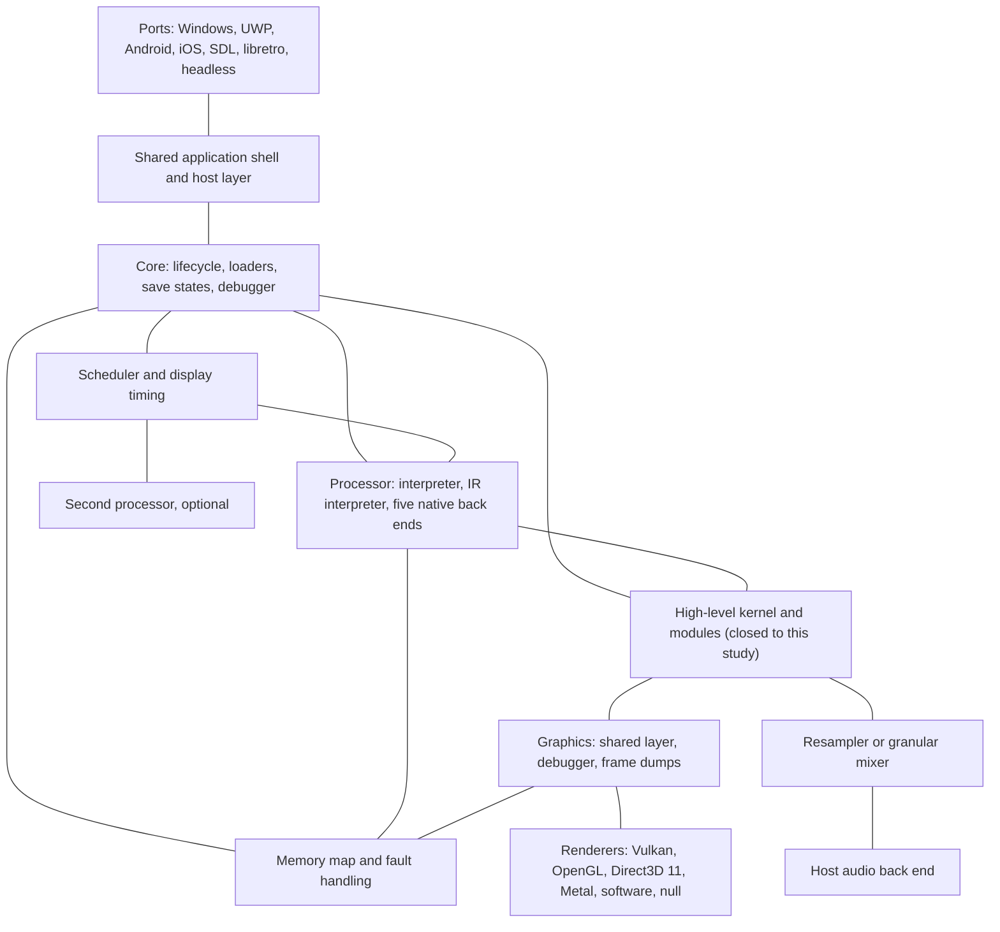

# PPSSPP

## Summary

The question is what [PPSSPP][pp-repo] does, why it works, and what Rustalgia should learn from it.
The [family survey](../topics/R1-20-psp-and-vita-family.md#summary) finds
that it dominates emulation of the PlayStation Portable (PSP).

PPSSPP is a high-level emulator, begun in 2012 and now maintained in practice by one person.
It replaces the console's kernel and system modules with its own code,
which [ADR 0006](../../adr/0006-read-sources-by-tier-under-a-compatibility-test.md#closed-tier) closes to this study.
Around that sits an open machine: a scheduler counted in processor cycles,
one intermediate representation that feeds its own interpreter and five native back ends, beside a plain interpreter,
five renderers of which the software one is checked against a real console, and versioned save states.
It works because a project rule requires a claim about hardware to name a test recorded on a PSP,
and because the 536-test passing list runs in continuous integration, on Linux once for each processor core
(networking tests on the default core only).

Four points matter most to Rustalgia.
The first is the test method: hardware-recorded expected output,
a passing list and a to-fix list kept in the repository, differential fuzzing between cores,
and frame captures replayed on the console.
The second is the processor design, in which one shared front end fixes block ends and cycle charges for every core,
so the cores agree on timing as well as on results.
The third is the cost of the high-level approach:
a replacement operating system that its authors say cannot be finished, 1,482 per-game exceptions, of which 955
(64 %) are for rendering by this study's classification, and save states tied to the replacement's internals.
The fourth is legal: the tree embeds a key engine and decrypters,
and from version 1.21 installs the maker's firmware from the user's disc image,
so nothing about system services may be taken from its closed parts.

## Scope

- Examined on 2026-11-27: PPSSPP at commit `1cd06ff11dd7010123e0b5ada244f76597c42ea5` of branch master
  (committed 2026-11-27; GitHub API).
  The latest release is v1.20.4 of 2026-05-16; 1.21 is announced ([FAQ][pp-faq])
  and unreleased ([releases][pp-releases]).
- Kinds of source: source code and its comments; the README, the project's notes under `docs`, its agent rulebook,
  its release notes, and its site; pull request text, one commit message, and commit lists;
  GitHub metadata and the check results of the commit; and the compatibility report site.
  Published results only: nothing was built or run.
- Licence and tier: GPL-2.0-or-later and open tier,
  as the [family survey](../topics/R1-20-psp-and-vita-family.md#ppsspp)
  and the [register](../../../.claude/hooks/source-register.txt) record.
  The code was read, apart from the closed paths below, and none was copied or ported.
  Every description of the emulator's internals in this note was written after reading the implementation.
- Not examined, because [ADR 0006](../../adr/0006-read-sources-by-tier-under-a-compatibility-test.md#closed-tier) closes
  replacement system software and the register closes key handling: the folders `Core/HLE`, `Core/Dialog`, `Core/Font`,
  `assets/flash0`, `ext/libkirk`, `UWP/libkirk_UWP`, and `Tools/SaveTool`; the files `Core/ELF/PrxDecrypter.*`,
  `Core/Util/PSARUnpack.*`, `Core/Util/PkgUnpack.*`, `Core/Util/KL4E.*`, `Core/FileSystems/tlzrc.cpp`,
  `Tools/adhoc_decrypt.py`, `unittest/TestKirk.cpp`, and `UI/FirmwareScreen.*`; all of `Core/HW` except its display,
  resampler, and granular mixer files; and the notes `docs/VSHBootInvestigation.md`, `docs/PsarFileFormat.md`,
  `docs/POPS.md`, `docs/dnas-patches.md`, `docs/adhoc-packet-decryption.md`, `docs/pkg_notes.md`, and
  `docs/reverse-engineering.md`.
  Also closed and unopened: the repositories `hrydgard/pspautotests` and `hrydgard/ppsspp-framedumps`,
  and the site's game dumping and custom firmware pages.
  These are code spans, not links, because a reader bound by ADR 0006 must not open them.
  What the closed parts do is described from prose and file names only.
- Not opened as a precaution: `Core/MIPS/MeCore.cpp`, `Core/MIPS/MIPSVFPUUtils.cpp`
  (the [survey](../topics/R1-20-psp-and-vita-family.md#tests-and-published-results) records that PPSSPP's vector maths
  once used tables dumped from a console; by its name this file may hold them, which was not checked),
  `assets/compatvr.ini`, and `hrydgard/ppsspp-frametest-ci`, a second repository of frame dumps, of which only the
  metadata was read and which this change adds to the register as closed.
- Skipped inside open files, under the rule that a section which reimplements or describes kernel, firmware,
  or system-service behaviour is not described:
  - [`Core/MIPS/MeCore.h`][c-mecore] L35-L120; [`Core/MIPS/MIPS.cpp`][c-mips] L589-L593;
    [`Core/System.cpp`][c-system] L396-L749; [`Core/MemMap.cpp`][c-memmap] L124-L127;
    [`Core/MemMap.h`][c-memmap-h] L537-L539; and [`Core/MIPS/Interpreter.cpp`][c-interp] L141-L250.
  - `docs/HLEModules.md` L21-L65; [`docs/sceAudio.md`][d-sceaudio] L11-L29, L31-L129, and L153-L214;
    [`docs/sceGe.md`][d-scege] L13-L133 and L157-L227; [`docs/pspautotests.md`][d-pat] L133-L162, kept as one line,
    and L191-L198 and L213-L215; [`docs/pspautotests-hardware.md`][d-path] L32-L84, L103-L152, and L235-L313.
  - `docs/kernel-hle-review.md` L10-L104, which describes the inside of the closed kernel folder.
    Parts were read before that was plain; only classes of defect and one high-level point are kept.
    It and `docs/HLEModules.md` are code spans: this note recommended closing them,
    and the register closed them on 2026-11-27.
  - [`AGENTS.md`][pp-agents] L28-L37 and L237-L247; the test bodies of [`unittest/UnitTest.cpp`][c-unittest], L1-L5267,
    some of which are named for the key engine, a compression format, and a PlayStation 1 executable container;
    all of [`Core/Reporting.cpp`][c-reporting] but L60-L106, L386-L400, and L600-L636, where no hazard was seen;
    the first section of the site's ["Scheduling"][pp-sched] page; and the section names, game lists,
    and comments of [`assets/compat.ini`][pp-compat], used as kinds, counts, the header, and one comment.
  - Of these, the system, interpreter, and unit-test files, `docs/HLEModules.md`,
    and the "Scheduling" page were opened in part and support no claim here, so Sources leaves them out.
  - No key bytes, seed tables, or decryption were met in any open file read (research log).
- How the claims were checked: four evidence gatherers each read a share, fetching files one at a time as raw text.
  The writer wrote from their reports alone.
  Four independent verifiers, who saw only the note, then checked it, and a fix pass applied their findings.
- Reading the markers: a claim that cites a linked file, with no marker, was read in that file at the commit above,
  and one that cites a page, a note, or a pull request was read in that text.
  Other claims carry the markers of the [research guide](../README.md#claim-status).
  Counts "from the listing" were made on the saved file listing of the commit and are (observed).
  The files `AGENTS.md`, `.claude`, and `ai_instructions` were read as data about the project.

## Architecture

### Parts and ownership

The repository is one tree; `Common`, `Core`, `GPU`, and `UI` each have a build project of their own,
and no core library is published apart from the rest (observed in the listing).
`Core` holds the system lifecycle, the memory map, loaders, timing, save states, the debugger, file systems,
and the processor folder; `GPU` holds a shared layer and one folder for each renderer;
`Common` is the host layer shared by every port, with a drawing abstraction, a user-interface toolkit,
file and network helpers, and threading; `UI` is the shared application shell.
Ports sit beside them: Windows, UWP, Android, iOS, SDL for Linux and macOS, libretro, and a headless test runner.

The operating system is replaced.
The [README][pp-readme] (L14) says: "No BIOS file required to play, PPSSPP is an 'HLE' emulator."
By file names alone, `Core/HLE` holds 204 files, which is 35 % of the 588 under `Core`
(calculated from the listing),
and related closed folders hold system dialogs, a font library, replacement fonts, and most of the device folder.
The site's ["Introduction"][pp-dev] ("HLE") says of the approach:
"achieving 100% compatibility is difficult bordering on the impossible.
We can get close though."
From the readable side, a system call runs as host code
([`IRFrontend.cpp`][c-irfront], L235-L236),
and the cores leave the host's floating-point mode in place around it ([`docs/cpu-equivalence.md`][d-cpueq], L90-L98).
From 1.21 a few firmware libraries, the firmware's PlayStation 1 emulator,
and the system menu run as real code when the user has firmware installed,
but "The kernel underneath is still simulated" (["Known differences"][pp-known], "The OS is simulated, not emulated").

Emulation runs on one thread.
Other threads, such as the debuggers, queue changes that are applied on it at least once per host frame,
or take a frame lock to read ([`docs/DebuggerThreading.md`][d-dbgthr], L1-L72).
The scheduler's queue, timer, and clock rate are file-level state, and scheduling is allowed only from that thread
([`Core/CoreTiming.cpp`][c-timing], L47-L75 and L296-L298).
The memory map has an address-space object for each processor, so that the second processor can have its own
([`Core/MemMap.h`][c-memmap-h], L332-L334).

### Time

One tick is one cycle of the main processor's clock, 222,000,000 Hz at start, and a game can change the rate
([`CoreTiming.cpp`][c-timing], L39-L40 and L77-L102).
A microsecond clock is derived from ticks and re-based by whole seconds only,
because dropping part of a microsecond had made emulated time depend on which host code asked first
([`docs/lag-sync.md`][d-lag], L129-L135).

Events sit in a list sorted by due time, with a pool of free entries; inserting or cancelling walks the list
([`CoreTiming.cpp`][c-timing], L278-L360).

The processor state holds a signed countdown of cycles.
A slice is sized to end at the next due event,
and scheduling an event sooner than the slice end shortens the running slice;
a comment credits a hardware-recorded scheduling test in which an alarm had fired hundreds of microseconds late
([`CoreTiming.cpp`][c-timing], L307-L314 and L462-L500).

The cores check for events at block ends only.
The plain interpreter once checked after every instruction and was changed to stop where the other cores do,
"so events happen at the same instruction" ([`cpu-equivalence.md`][d-cpueq], L133-L143).
Each block charges one cycle count, and delay slots, skipped branch-likely slots,
and system calls were made to charge the same on every core.
Nothing read models caches or pipeline hazards
(inference from the files read);
[`test.py`][pp-testpy] (L717-L722) lists the tests for them as not emulated,
so the costs measured on a PSP that the
[survey](../topics/R1-20-psp-and-vita-family.md#how-hard-the-family-is-to-emulate) records are not applied by class of
instruction.

Graphics time is approximated.
[`docs/sceGe.md`][d-scege] (L134-L140) says "PPSSPP doesn't run the GE in parallel with the CPU."
A display list runs in one go until it stalls, signals, or finishes; the time it would have taken is summed,
and its interrupt is scheduled for that later point, which the note calls "the accepted inaccuracy".

The second processor, the Media Engine, is emulated only for PlayStation 1 games and optionally homebrew.
It runs on the same host thread, one slice behind the main processor, for the cycles that processor used
([`MeCore.h`][c-mecore], L18-L22; [`CoreTiming.cpp`][c-timing], L433-L446).

The scheduler is saved as a versioned section.
Event types are matched by identifier and registered again by their owners on load;
an unknown type becomes a handler that stops the core ([`CoreTiming.cpp`][c-timing], L197-L224 and L595-L676).
A debugger deadline in microseconds shortens a slice so that a stop lands on a reproducible tick,
and it is left out of states on purpose.

### Display, pacing, and latency

A frame lasts 1001/60 ms, 59.94 Hz, and has 286 lines;
the current line is calculated from the ticks since the frame began and is not stepped
([`Core/HW/Display.cpp`][c-display], L55 and L198-L204).
The lag-sync code lives in the closed display module
([`lag-sync.md`][d-lag], L8),
and the open display file only receives the vertical blank's start and end,
so the events that raise them are scheduled elsewhere (inference).

By default a frame is emulated flat out and the host then waits.
The stated design is to wait as long as possible before a frame, sample input, run the processor,
submit graphics work at once, and wait as little as possible before presenting
([`Core/FrameTiming.cpp`][c-frametiming], L1-L20).

An optional mode, "lag sync", holds emulated time to the wall clock every emulated millisecond
([`lag-sync.md`][d-lag], L1-L37).
Waits are measured from a fixed base so that late wake-ups do not add up,
and when the host has little idle time the mode reverts to per-frame pacing.
The note's rule is that pacing never changes emulation: "Lag sync only decides when the host sleeps,
so a run with it plays out exactly like one without" (L129).
Its published figures are an average audio buffer of 16 ms against 38 ms in one game with a 10 ms output period,
measured before a later allowance that adds a few milliseconds, and about 1 % of a core more on one Mac;
the mode is not the default, and Android is unmeasured (L107, L164-L176).

### Processor and memory

At this commit there are a plain interpreter, an interpreter of the intermediate representation (IR),
and one IR-fed native back end for each of ARM32, ARM64, x86 and x86-64, RISC-V 64, and LoongArch64;
a host with no back end gets the IR interpreter ([`JitCommon.cpp`][c-jitcommon], L43-L110).
[`cpu-equivalence.md`][d-cpueq] (L66-L67) says "Every JIT is now IR-based".
The older x86, x86-64, and ARM64 compilers
that went straight from guest to host code were deleted on 2026-10-14 by [pull request 22563][pp-pr22563],
which removed 19,314 lines in 46 files
(API counts); its description says the ARM32 one stayed for the moment, and at this commit that back end is IR-fed too.

The IR refers to the guest's register set implicitly and is built to be simple to interpret
([`IRInst.h`][c-irinst], L11-L19).
It is not in single-assignment form: operands are guest register numbers and a few temporaries,
and an instruction is a fixed 64 bits holding an operation, three register fields, and a 32-bit constant.

One front end and one set of passes serve every host.
Each back end reports capabilities, such as unaligned access and which combined vector operations it has,
and the front end emits only what that back end has ([`IRInst.h`][c-irinst], L500-L520).
An operation that a back end lacks falls to the IR interpreter's handler,
and a guest instruction that the front end lacks becomes a call to the plain interpreter
([`IRNativeCommon.cpp`][c-irnat], L160-L161; [`IRFrontend.cpp`][c-irfront], L232-L248).
The five host folders have twelve files each, split the same way (listing).

A block is a straight run that may continue past up to six untaken conditional branches,
with a conditional exit at each, and the plain interpreter ends its runs at the same places
([`IRInst.h`][c-irinst], L494-L498).
The nine passes are block-local, and most are skipped when the block holds none of the instructions they act on,
or when a setting turns them off ([`IRPassSimplify.cpp`][c-irpass], L91-L144 and L257-L286;
[`IRFrontend.cpp`][c-irfront], L360-L381):

| What a pass achieves | Applies to |
|---|---|
| Adds address checks when fast memory is off | all cores |
| Rewrites the guest's unaligned load and store pairs as plain accesses | all; lone halves split for native only |
| Replaces a move through an integer register with a direct floating-point move | all cores |
| Folds and propagates constants, and drops code after an exit that is always taken | all cores |
| Turns kernel-mode accesses at constant plain-memory addresses into plain accesses | all cores |
| Removes temporaries and dead writes by renaming registers across moves | all cores |
| Cuts transfers between one-lane and four-lane vector register forms | vector back ends |
| Replaces a load of a value the block stored or loaded with a register move | all cores |
| Fuses common pairs into special operations | IR interpreter |

Passes are skipped when a block holds a breakpoint ([`IRFrontend.cpp`][c-irfront], L360-L381).
All blocks' IR sits in one arena ([`IRInterpreter.cpp`][c-irinterp], L138-L166).

Blocks are found through a table with one 32-bit entry for each guest instruction,
holding the block's offset in the arena or in native code, and only ranges backed by guest memory are committed
([`MemMap.h`][c-memmap-h], L127-L151).
Native code has 24 MiB for every back end, block exits are linked directly,
and a full arena or code space clears the whole cache
([`IRNativeCommon.h`][c-irnat-h], L76-L87; [`IRJit.cpp`][c-irjit], L363-L414).
Blocks are indexed by guest pages of 1 KiB for invalidation, and each keeps a hash of its guest code
([`IRJit.cpp`][c-irjit], L504-L505 and L743-L816).
An invalidation by the game of 16 KiB or more, a threshold the file sets at the size of the PSP's instruction cache,
makes every block's code be checked ([`MIPS.cpp`][c-mips], L544-L588).
On a state load, blocks in memory that the load did not change are kept ([`IRJit.cpp`][c-irjit], L328-L361).

Guest memory is one host reservation with mirrored views.
Hosts of 64 bits add a base register, and 32-bit and some restricted hosts mask addresses
([`MemMap.cpp`][c-memmap], L307-L336).

Once the guest has set a non-default rounding or flush-to-zero mode,
blocks apply it to the host on entry and restore the host's mode around host code
([`IRFrontend.cpp`][c-irfront], L72-L90; [`cpu-equivalence.md`][d-cpueq], L90-L92).
The IR has operations marked as bit-exact with the PSP for the vector unit's special functions and its dot product
([`IRInst.h`][c-irinst], L203 and L230-L238).
The RISC-V and LoongArch back ends, like the ARM64 and x86-64 ones, generate the dot-product routine at start-up,
and a unit test checks every variant against a reference ([`cpu-equivalence.md`][d-cpueq], L298-L309).

### Video

One factory picks the renderer at start: OpenGL, Direct3D 11, Vulkan, Metal, software, or null
([`GPU/GPU.cpp`][g-gpu], L46-L84).
The Metal back end is new and is "the only backend in the iOS and tvOS apps, which no longer ship MoltenVK"
([`docs/metal-backend.md`][d-metal], L3-L5).

The hardware renderers interpret commands through a table that gives each command flags:
whether queued draws are flushed first, whether it executes anything, and which cached state it dirties
([`GPU/GPUCommonHW.cpp`][g-hw], L25-L60).
State is therefore applied only at a draw (inference from the dirty flags).
Draws are deferred and merged, with vertex decoding put off until the flush
([`DrawEngineCommon.h`][g-draweng], L384-L405),
and the vertex decoder has a file for each of five host architectures (listing),
which by their place beside the common decoder are code generators (inference).

Vulkan, OpenGL, and Metal each record commands on the emulation thread and replay them on a render thread;
"D3D11 has none and draws into its immediate context" ([`docs/render-manager-unification.md`][d-rmu], L41-L43).
The three recorders use three formats, and the note, a plan and not shipped behaviour,
proposes one shared command list (L159-L194).

Shaders are generated as text from a compact identifier, one kind for vertex and one for fragment shaders,
that encodes lighting, texture function, tests, blending, and palette lookup ([`ShaderId.h`][g-shaderid], L26-L119).
On Vulkan the shader is compiled on a thread, pipelines are built on a pool,
and the render thread waits at the first draw that needs an unfinished pipeline: "That wait is the stutter."
([`docs/shader-compilation.md`][d-shc], L6-L17).
A cache file for each game holds the identifiers and pipeline keys it used and is replayed at boot.
Measured on one Mac, nearly all cold cost was the host compiling each distinct shader, 85 to 110 ms each (L19-L40).

The graphics chip draws to addresses in emulated memory.
The hardware renderers keep a host framebuffer for each address, format, and stride,
always in 32-bit colour and scaled by a resolution multiplier ([`FramebufferManagerCommon.h`][g-fbm-h], L67-L99).
The chip never states a target's size, so it is guessed from viewport, region, scissor, and stride;
a comment on that routine calls it a collection of heuristics ([`FramebufferManagerCommon.cpp`][g-fbm], L444-L452).
Memory copies and sets that touch a framebuffer are done on the host where recognised,
and the emulated operation is then skipped
([`GPUCommon.h`][g-common-h], L167-L169),
so emulated video memory goes stale (inference); read-back exists in blocking and delayed forms (L171-L174).
[`FramebufferManagerCommon.cpp`][g-fbm] alone reads per-game flags on 31 lines (counted, observed).

The software renderer is the reference.
Its code generators for pixels and samplers were removed on 2026-10-10;
the [commit message][pp-swjit] says the portable paths work four pixels at a time and adds:
"They were also a second implementation of every GE rule, and ARM never had them."

A frame dump records one frame's display lists with the memory they use: vertices, indices, palettes, textures,
and framebuffer snapshots ([`RecordFormat.h`][g-recfmt], L24-L82).
A dump therefore holds a game's textures and geometry (inference).

### Audio

What produces samples is in closed files and was not read.
The open side begins where the emulation thread pushes mixed stereo samples and the host audio thread pulls them
([`Core/HW/StereoResampler.cpp`][c-resampler], L185 and L314-L315).
The classic path is a ring for one producer and one consumer, with linear interpolation to the output rate (L196-L282).
The read rate is nudged within bounds to hold the buffer near a target of 40 ms,
and underruns are padded with the last value.
The default ([`Core/Config.cpp`][c-config], L1147-L1163) is a granular mixer, credited in its header to Dolphin,
which overlaps windowed grains and repeats past grains with fades
when its queue runs dry ([`GranularMixer.cpp`][c-granular]).

The 40 ms target follows from per-frame bursts, since a whole frame of audio arrives at once;
under lag sync the target falls to the output period plus about 4.4 ms plus room for recent stalls
([`lag-sync.md`][d-lag], L21-L37).
[`docs/sceAudio.md`][d-sceaudio] (L130-L152) says the emulated mixer runs as a timed event and is re-phased
when output starts so that results do not vary between runs, and that two approximations remain below one mix block.

### Save states and rewind

In most cases one routine for each subsystem serves saving, loading, measuring, and verifying,
by walking the same fields in a mode; the header credits the scheme to Dolphin
([`Common/Serialize/Serializer.h`][c-serial-h], L1-L31 and L96-L102).
Each section starts with a 16-byte name and a version;
a reader accepts a range of versions and branches on the one found,
and a wrong or missing section fails the load and names the section ([`Serializer.cpp`][c-serial], L58-L116).

The top-level routine first waits for background work and flushes pending drawing.
It then writes the game's identity at a fixed width, so that a state's game can be read without loading it,
followed by memory, timing, the processor, the high-level layer, and the file system after the kernel objects,
because tearing them down can close files; two later additions follow it
([`Core/SaveState.cpp`][c-savestate], L228-L332).
Its top section is at version 6 and still accepts version 1.
The kernel and its modules save their own objects (observed in open comments only).

Compatibility across versions is best effort.
A comment on the load warning says: "Save states also preserve bugs from old PPSSPP versions, so warn."
([`SaveState.cpp`][c-savestate], L1175-L1183).
The project's [rulebook for agents][pp-agents] (L99-L105) says the tables of replaced system calls may only be appended
to, because states store positions in them.

[`docs/async-savestates.md`][d-async] (L8-L38) says: "A state is about 38 MB uncompressed,
and much of the hardware we run on is short of memory."
The snapshot and the apply stay on the emulation thread,
and compression and file writes move to one worker with a queue in order of arrival.
The note reports the stall on a save falling from between 49 and 75 ms to about 2.5 ms (L169-L178).
Rewind keeps snapshots as changed blocks against a base state and is opt-in ([`SaveStateRewind.cpp`][c-rewind]).

### Tests and published results

The main oracle is a real PSP.
The closed suite `hrydgard/pspautotests`, a submodule, holds prebuilt PSP programs,
each with expected output recorded on a console over a debugging link ([`pspautotests.md`][d-pat], L1-L13).
PPSSPP's runner executes each in the headless build and compares text or images ([`headless/README.md`][pp-headless]).
Most tests tag each output line with whether another thread ran since the last line,
so scheduling is compared as well as values ([`pspautotests.md`][d-pat], L133-L136 and L209).
Recording needs a console with custom firmware
([`pspautotests-hardware.md`][d-path], L10-L23),
which is a legal risk that Rustalgia avoids by using published results only.
The same note records that the oracle drifts with firmware version, toolchain, and the recording host (L173-L204).

The published results are two lists in [`test.py`][pp-testpy]: 536 tests that pass and are run as regressions,
and 107 that do not yet pass, each group counted today in the file (L94-L637, L711-L836).
The suite's own file list is closed, so 536 of 643 is a share of what PPSSPP lists, not of the suite.
Some failing entries carry reasons (28 of 107, counted),
and a table of known failures for each cross-built host architecture keeps a reason beside each entry
and is to be pruned "rather than letting the list rot" (L642-L663).

[Continuous integration][pp-ci] runs the unit tests and the passing list on Windows, Linux x86-64, Linux ARM64,
and macOS, with the default core.
On Linux the list runs once for each of four processor core settings,
and every setting but the default leaves out the networking tests, 40 of the 536
(L565-L586; counted in [`test.py`][pp-testpy]).
LoongArch64, RISC-V 64, and ARM32 are cross-built and tested under user-mode QEMU,
on the native back end only and without the known failures (L461-L476):
"It's the only coverage these JITs get - a compile is not much of a test for a code generator." (L454-L455).
All 29 check runs of the commit examined concluded with success
(`gh api repos/hrydgard/ppsspp/commits/1cd06ff11dd7010123e0b5ada244f76597c42ea5/check-runs`, read today);
that the test steps passed is an inference from the jobs' success, since the logs were not read.

A differential fuzzer in the unit tests generates random integer, floating-point, vector, memory,
and forward-branch code with a random start state, runs every core,
and compares the whole end state and the cycles charged with the plain interpreter's;
failing cases are minimised automatically ([`cpu-equivalence.md`][d-cpueq], L8-L60).
Its stated goal (L155-L156) is: "The goal, in order: every core gives the same result on both hosts,
and then that result is the PSP's.
Where matching the PSP is expensive, agreeing with each other comes first."
Published figures: integer, floating-point,
and memory code agrees on every core and both hosts in 20,000 cases bar one known item,
and with vector code the interpreter differs between hosts in 7 of 20,000 (L180-L184).
Against eight hardware-recorded tests, two integer tests differ by no lines on any core,
while a denormal test differs by 54 lines on every core;
two of the eight columns were measured on compilers since removed (L160-L173).
The fuzzer is lenient: "By default only a crash fails the test, as known differences remain." (L20).

Frame tests replay dumps through the headless build and compare with stored images by mean squared error
([`docs/frametest.md`][d-frametest], L98-L133).
The note says: "The references above are PPSSPP's own renders, so they catch regressions,
not wrong output." (L328-L329).
In continuous integration they run on x86-64 only,
because "the reference images don't match what the software renderer produces on arm64, 23 of the 30 dumps differ there,
one of them by an MSE of 100." ([workflow][pp-ci], L588-L590).
For correctness, a program in the closed suite replays the same dump on a PSP,
and the site's [news post][pp-ge-news] of 2026-10-02 reports the software renderer exact on 125 of 132 game dumps;
most of that post is marked as AI-written.
Between hardware renderers a tolerant comparison found Vulkan and OpenGL equivalent on 795 of 957 dumps
([`frametest.md`][d-frametest], L311-L324).

The [compatibility site][pp-report] is fed by the application, which refuses reports from runs with cheats,
a locked processor speed, or an unversioned build ([`Core/Reporting.cpp`][c-reporting], L72-L80 and L603-L626).
On 2026-11-27 it showed 3,088 entries rated Perfect and 653 Playable among 4,442 rated, 84 % (calculated).
Entries are keyed by game identifier and version, one title can appear twice with opposite ratings,
and the first page opens with entries filed as homebrew, 28 of its 100, about half of them untitled (observed),
so it is not an oracle.

### Project history and practice

The [README][pp-readme] (L4-L8) dates the first release to November 2012 under "the GPL 2.0 (and later)".
Version 1.0 is dated 2015-02-01, and major releases came 4 to 10 months apart from 1.10 to 1.20
([releases][pp-releases]).

The project rests on one person.
Of the commits by the 30 largest contributors, the author has 64.6 % and a second contributor 23.6 %
(GitHub contributors API; calculated).
The second, whom the 1.16 notes thank for the new compilers
([`history.md`][pp-history], L173-L180), has no commit after 2023-12-29 (commits list by author, observed).
Of the 400 most recent commits at the commit examined, 379 are the author's (commits API, counted).
Commit volume has risen: the three months to 2026-11-27 hold between 3,901 and 4,000 commits,
against 1,301 to 1,400 in the six months to 2026-02-27 (from the API's paging).

AI assistance is open policy.
The [AI policy][pp-ai] of 2026-05-11 allows it for research, coding, and reverse engineering,
says "contributors are expected to fully own and understand all code they submit",
and requires agent-opened pull requests to disclose it.
The repository carries a 397-line [rulebook for agents][pp-agents],
whose safety section (L95-L119) names what is fragile: save-state compatibility, the append-only tables,
shader caches that hold raw key bits with no layout marker,
and the rule "'As on hardware' needs a hardware test behind it."
A section of it directs agents to disassemble firmware when documents and another emulator cannot settle a behaviour
(L231-L236; the rest unread), which bears on where the closed folders' behaviour comes from (inference).

Per-game exceptions live in one file, [`assets/compat.ini`][pp-compat]:
87 sections and 1,482 entries over 953 game identifiers (counted by script).
Its header (L1-L21) says it is not for "Fixing general compatibility issues.
First try to find a general solution.
Try hard."
Classified by this study from section names and comments (inference):

| Kind | Sections | Entries |
|---|---|---|
| Rendering: framebuffers, transfers, depth, read-back, filtering | 53 | 955 |
| Timing and pacing | 13 | 276 |
| System services and storage | 12 | 132 |
| Media and audio | 5 | 46 |
| Input, save states discouraged, and network | 4 | 73 |

This study adds to the [family survey](../topics/R1-20-psp-and-vita-family.md#ppsspp) in five places:
every native compiler is now IR-fed, ARM32 included; a Metal renderer exists;
PPSSPP publishes results against `hrydgard/pspautotests` as the two lists above;
a second dump repository serves continuous integration;
and the paths that hold decryption outside the key engine folder, which the survey asked this study to find,
are the closed files listed in Scope, known by name from the listing.

## What works well

- **Hardware is the oracle, and a rule enforces it.**
  Expected output is recorded on a PSP, the passing list runs in continuous integration, on Linux once for each core,
  and a rule says that a claim about hardware names a recorded test ([`AGENTS.md`][pp-agents], L114-L119).
- **Two lists make a ratchet.**
  A passing test joins the regression list and cannot regress silently, failing tests stay visible,
  28 of the 107 with a reason beside them, and exceptions
  for cross-built hosts are narrow tables with a reason each ([`test.py`][pp-testpy]).
- **One IR front end serves five host back ends and the IR interpreter.**
  Fixed-width instructions, capability flags,
  and a guaranteed fallback for each operation ([`IRInst.h`][c-irinst]) go with back ends of twelve files each
  (listing); that the design is what keeps them small is an inference.
  A host without a compiler gets the IR interpreter ([`JitCommon.cpp`][c-jitcommon], L98-L110).
  The design let 19,314 lines of older x86 and ARM64 compilers be deleted ([pull request 22563][pp-pr22563]).
- **Cores agree on timing, not only on results.**
  Block ends and cycle charges are fixed in the shared front end and followed by the plain interpreter,
  so an event fires at the same instruction whichever core runs ([`cpu-equivalence.md`][d-cpueq], L133-L151).
- **Differential fuzzing with automatic minimisation.**
  Its list of fixed defects runs to dozens, among them two wrong encodings in the RISC-V emitter
  ([`cpu-equivalence.md`][d-cpueq], L63-L133 and L282-L296),
  and running cross-built back ends under QEMU tests hosts that have no runner ([workflow][pp-ci]).
- **A software renderer checked against the console, with frame dumps as the vehicle.**
  A dump needs no processor, kernel, or game file at replay
  (inference from the record format),
  runs headless on any back end or on a phone, and replays on a PSP,
  so hardware renderers have a reference ([`frametest.md`][d-frametest]).
  Portable vectorised code replaced a second, generated implementation and was faster ([commit][pp-swjit]).
- **Pacing is separate from emulation, and states are versioned by section.**
  Lag sync lowers latency without changing emulated results and backs off under load ([`lag-sync.md`][d-lag]).
  Named, versioned sections let a reader accept older versions of a section; the top one accepts versions 1 to 6
  ([`SaveState.cpp`][c-savestate], L236).
  Moving compression off the emulation thread removed most of the stall ([`async-savestates.md`][d-async]).

## What works poorly

- **The replacement operating system cannot be finished.**
  The project says so itself (["Introduction"][pp-dev], "HLE"), 107 listed tests fail,
  some of them needing the maker's firmware, and from 1.21 it runs some firmware libraries for real
  (["Known differences"][pp-known]).
  A review of the kernel part, about 16,000 lines in 14 files,
  found recurring classes of defect in how values and addresses from the game are checked, and,
  where the documents did not settle a behaviour, was cross-referenced against another emulator;
  its opening names no hardware test (`docs/kernel-hle-review.md`, L3-L8 and the part Scope records; not linked,
  as Scope explains).
- **Timing is coarse, and games are tuned one by one.**
  Per-block cycle counts, no cache or pipeline model,
  and graphics that takes approximated time sit beside 276 per-game timing and pacing entries
  (inference on the cause),
  of which 96 concern disc speed and 104 cap the frame rate
  (counted by section);
  one comment, on disc delay, says a game "won't boot at all with our standard unrealistically fast timing."
  ([`compat.ini`][pp-compat], L802).
  The scheduler's state is global, its queue is a list walked on insertion,
  and kernel-mode access to hardware registers is handled by a switch that a comment calls a hack
  ([`MemMap.h`][c-memmap-h], L606-L610).
- **Hardware renderers guess, and rendering as a whole needs 955 per-game entries.**
  The count is this study's classification (inference), and it takes in depth rounding and other kinds beside guesses.
  Target sizes are not stated by the chip and games overlap buffers in video memory
  ([`FramebufferManagerCommon.cpp`][g-fbm], L330 and L444-L452),
  so framebuffer handling is heuristic, colour is always 32-bit,
  and frame dumps replayed without the per-game settings "look wrong on every backend" for some games
  ([`frametest.md`][d-frametest], L206-L207).
  Four hand-written back ends over a shared layer duplicate logic, by the project's own plan
  ([`render-manager-unification.md`][d-rmu]).
- **Shader compilation still stalls.**
  A draw waits for its pipeline, nothing is skipped meanwhile,
  and on the one Mac measured the cost lies in the host's compiler,
  so fewer distinct shaders is "the lever that matters";
  not blocking on an unready pipeline and precompiling at boot are listed as not done
  ([`shader-compilation.md`][d-shc], L19-L40 and L89-L96).
- **Host floating point shows through, and the reference renderer differs by host.**
  Generated not-a-number values and denormal flushing follow the host, and a fix is held back until its cost is measured
  ([`cpu-equivalence.md`][d-cpueq], L191-L252).
  By default the fuzzer fails only on a crash, though a strict switch exists
  (L20 and L35);
  the [workflow][pp-ci] sets no fuzzer switch (searched for the switch's prefix, none found), so the default applies.
  The software renderer's images differ on ARM64 for 23 of 30 dumps, with no cause given ([workflow][pp-ci], L588-L590).
- **Save states are tied to the build.**
  They are about 38 MB uncompressed ([`async-savestates.md`][d-async], L8), written by hand for each subsystem,
  keep old bugs, store positions in internal tables, and carry the replacement kernel's objects,
  so the format follows that kernel's internals (inference); 28 game identifiers are flagged
  as unsuited to them ([`compat.ini`][pp-compat]).
- **One maintainer, and legal exposure in the closed parts.**
  The contributor thanked for the current compilers has not committed since 2023-12-29
  (inference: has left),
  and one person is the author of nearly all commits, at a rate about six times that of a year before
  (calculated from the two windows under "Project history and practice").
  The tree embeds a key engine, decrypters, and unpackers
  (names in the listing; unopened),
  and the [FAQ][pp-faq] says that from 1.21 "almost every game disc carries a firmware update,
  and PPSSPP installs it automatically when you start a game",
  so the emulator unpacks the maker's firmware on its own initiative (inference).
  Both test corpora are closed to Rustalgia: the suite has only a placeholder for a licence,
  neither dump repository has one (register; GitHub metadata of `hrydgard/ppsspp-frametest-ci`),
  and the dumps hold game data.

## Implications for Rustalgia

These are recommendations for the owner, who decides.
Roadmap items are those of the [research roadmap](../../roadmap/research.md#phase-2-cross-cutting-engineering).

- **Processor (R2-01, R4-08).**
  Recommended: one small fixed-width IR with a shared front end, capability flags for each back end,
  and an interpreter fallback for every operation,
  with block ends and cycle charges defined once in the front end and followed by every core,
  the reference interpreter included.
  PPSSPP reached this by deleting a generation of compilers; starting there avoids the three years,
  from 1.16 on 2023-09-09 to 2026-10-14, in which it kept both
  (calculated from the [release list][pp-releases]; [`history.md`][pp-history], L173-L180).
  This agrees with the owned recompiler that [R1-37](R1-37-panda3ds.md#implications-for-rustalgia) recommends.
  Also recommended: fix the floating-point policy before the second core exists,
  with the reference interpreter matching hardware bit for bit, every other core matching it,
  and the fuzzer strict from its first run.
  PPSSPP's fuzzer by default fails only on a crash, because known differences remain,
  so its default run cannot fail a build on a new difference.
- **Timing (R2-03).**
  Recommended: slices that end at the next event and shrink when a nearer one is scheduled,
  events saved by a stable identifier, a reproducible debugger deadline, and no process-wide scheduler or memory state:
  PPSSPP's scheduler state is file-level,
  and its memory map has an address-space object for each processor so that the second can have its own
  (that this was a retrofit is an inference).
  Per-block cycle counts suit a high-level PSP,
  but the scheduler's interface should allow costs for each class of instruction,
  because PPSSPP's 276 timing exceptions show what coarse charging costs.
- **Video (R2-05).**
  Recommended: a software renderer as the reference,
  as the [survey](../topics/R1-20-psp-and-vita-family.md#recommendation) proposes.
  Beyond the survey: build it first, in portable vectorised code with no generated variant until measured,
  required from its first test run to be bit-identical on every host architecture;
  hardware renderers compared with it by a tolerant metric; one recorded command list for every graphics interface,
  designed in from the start; and shader identifiers with a layout marker so that on-disk caches invalidate themselves.
  Also recommended: define a frame-capture format early and keep captures of commercial games out of the repository,
  because a dump holds a game's textures and geometry and PPSSPP's dump sets carry no licence.
- **Pacing and audio (R2-06, R2-07).**
  Recommended: pace against the wall clock in small steps from a fixed base, with a fallback under load,
  tie the audio buffer target to the pacing mode, and require that pacing never changes emulated results.
- **Save states (R2-08).**
  Recommended: named, versioned sections, a header that identifies the game without a load,
  a snapshot split from compression and file writes, a stated memory budget,
  and no dependence on the order of internal tables.
- **Verification (R2-15, R4-10, R4-11).**
  Recommended: a passing list and a to-fix list in the repository with a reason beside every exception,
  zero failures as the only accepted result,
  one list run on every core and host with user-mode emulation where no runner exists,
  and a record with each expected file of the console, firmware, toolchain, and host that produced it.
  References the emulator made itself should be labelled as regression tests, and player reports not used as an oracle.
  The rule that a claim about hardware names a recorded test is worth adopting as written.
- **Operating system and per-game flags (R2-12).**
  PPSSPP is evidence of the cost of a high-level operating system and of its ceiling;
  that informs the scope decision and is not a recommendation.
  If per-game exceptions are allowed, recommended is PPSSPP's form, one data file with a written admission rule,
  and in addition a count kept as a measure of health.
- **Sources and register.**
  Recommended: take no fact about PSP system services from PPSSPP's closed folders,
  since its own [rulebook][pp-agents] (L231-L236) directs agents to settle such behaviour from documents,
  another emulator, and, failing those, disassembled firmware.
  Done in this change: register lines that close `hrydgard/ppsspp-frametest-ci` and record `report.ppsspp.org`
  as user-submitted results.
  Recommended for the owner: close `docs/kernel-hle-review.md`, `docs/HLEModules.md`, and,
  until a later pass reads them, `Core/MIPS/MIPSVFPUUtils.*` and `Core/MIPS/MeCore.cpp`.
  The survey should take up the five additions listed under "Project history and practice".

## Open questions

- Why the software renderer's output differs between x86-64 and ARM64 hosts.
  The project gives no cause at this commit; a later reading of its repository, once it publishes one, would answer it,
  and [R4-11](../../roadmap/research.md#phase-4-technology-stack) should carry the risk meanwhile.
- Whether events delivered at block ends with per-block cycle charges meet the accuracy Rustalgia wants for the PSP.
  Only a run against the
  [survey's measured costs](../topics/R1-20-psp-and-vita-family.md#how-hard-the-family-is-to-emulate) can answer; a
  spike in [phase 5](../../roadmap/research.md#phase-5-hands-on-spikes) after R2-03 would.

## Sources

Every source below was read on 2026-11-27, as raw text or through GitHub's API.
Files of PPSSPP are fixed by commit `1cd06ff11dd7010123e0b5ada244f76597c42ea5`; pull requests, API results,
and web pages are as they stood on the day read.
The closed paths named in Scope are not sources and are not listed.

PPSSPP repository, [hrydgard/ppsspp][pp-repo]:

- Documents: [README][pp-readme]; [`history.md`][pp-history]; [`AGENTS.md`][pp-agents], as data;
  [`headless/README.md`][pp-headless]; [`assets/compat.ini`][pp-compat], for kinds, counts, the header, and one comment.
- Notes under `docs`: [`cpu-equivalence.md`][d-cpueq]; [`lag-sync.md`][d-lag]; [`frametest.md`][d-frametest];
  [`async-savestates.md`][d-async]; [`DebuggerThreading.md`][d-dbgthr]; [`render-manager-unification.md`][d-rmu];
  [`shader-compilation.md`][d-shc]; [`metal-backend.md`][d-metal]; and, in part, as Scope records,
  [`sceGe.md`][d-scege], [`sceAudio.md`][d-sceaudio], [`pspautotests.md`][d-pat], [`pspautotests-hardware.md`][d-path],
  and `docs/kernel-hle-review.md` (not linked).
- Tests and build: [`test.py`][pp-testpy]; [`.github/workflows/build.yml`][pp-ci].
- Time and lifecycle: [`Core/CoreTiming.cpp`][c-timing]; [`Core/FrameTiming.cpp`][c-frametiming];
  [`Core/HW/Display.cpp`][c-display].
- Processor and memory: [`Core/MIPS/MIPS.cpp`][c-mips]; [`Core/MIPS/MeCore.h`][c-mecore], comments only;
  [`Core/MIPS/IR/IRInst.h`][c-irinst]; [`IRFrontend.cpp`][c-irfront]; [`IRPassSimplify.cpp`][c-irpass];
  [`IRJit.cpp`][c-irjit]; [`IRInterpreter.cpp`][c-irinterp]; [`IRNativeCommon.cpp`][c-irnat];
  [`IRNativeCommon.h`][c-irnat-h]; [`Core/MIPS/JitCommon/JitCommon.cpp`][c-jitcommon]; [`Core/MemMap.h`][c-memmap-h];
  [`Core/MemMap.cpp`][c-memmap].
- Video: [`GPU/GPU.cpp`][g-gpu]; [`GPU/GPUCommon.h`][g-common-h]; [`GPU/GPUCommonHW.cpp`][g-hw];
  [`GPU/Common/DrawEngineCommon.h`][g-draweng]; [`FramebufferManagerCommon.h`][g-fbm-h];
  [`FramebufferManagerCommon.cpp`][g-fbm]; [`ShaderId.h`][g-shaderid]; [`GPU/Debugger/RecordFormat.h`][g-recfmt].
- Audio and state: [`Core/HW/StereoResampler.cpp`][c-resampler]; [`Core/HW/GranularMixer.cpp`][c-granular];
  [`Core/Config.cpp`][c-config], L1147-L1163; [`Common/Serialize/Serializer.h`][c-serial-h];
  [`Serializer.cpp`][c-serial]; [`Core/SaveState.cpp`][c-savestate]; [`Core/SaveStateRewind.cpp`][c-rewind];
  [`Core/Reporting.cpp`][c-reporting], in part.
- History: [pull request 22563][pp-pr22563], description and counts; [commit `a89fdb2c`][pp-swjit], message;
  the [releases list][pp-releases]; and, through the API, the contributors list, commit lists, and check runs,
  and the metadata of `hrydgard/ppsspp-frametest-ci` (not linked, because the repository is closed).

PPSSPP's site, with no revision shown:

- ["Introduction"][pp-dev]; ["Known differences from the real PSP"][pp-known]; [FAQ][pp-faq];
  ["AI policy and recommendations"][pp-ai], dated 2026-05-11;
  ["Cracking the PSP GPU's transform and raster"][pp-ge-news], 2026-10-02.
- [Compatibility reports, games list][pp-report], counters as shown on the day.

[c-config]: https://github.com/hrydgard/ppsspp/blob/1cd06ff11dd7010123e0b5ada244f76597c42ea5/Core/Config.cpp
[c-display]: https://github.com/hrydgard/ppsspp/blob/1cd06ff11dd7010123e0b5ada244f76597c42ea5/Core/HW/Display.cpp
[c-frametiming]: https://github.com/hrydgard/ppsspp/blob/1cd06ff11dd7010123e0b5ada244f76597c42ea5/Core/FrameTiming.cpp
[c-granular]: https://github.com/hrydgard/ppsspp/blob/1cd06ff11dd7010123e0b5ada244f76597c42ea5/Core/HW/GranularMixer.cpp
[c-interp]: https://github.com/hrydgard/ppsspp/blob/1cd06ff11dd7010123e0b5ada244f76597c42ea5/Core/MIPS/Interpreter.cpp
[c-irfront]: https://github.com/hrydgard/ppsspp/blob/1cd06ff11dd7010123e0b5ada244f76597c42ea5/Core/MIPS/IR/IRFrontend.cpp
[c-irinst]: https://github.com/hrydgard/ppsspp/blob/1cd06ff11dd7010123e0b5ada244f76597c42ea5/Core/MIPS/IR/IRInst.h
[c-irinterp]: https://github.com/hrydgard/ppsspp/blob/1cd06ff11dd7010123e0b5ada244f76597c42ea5/Core/MIPS/IR/IRInterpreter.cpp
[c-irjit]: https://github.com/hrydgard/ppsspp/blob/1cd06ff11dd7010123e0b5ada244f76597c42ea5/Core/MIPS/IR/IRJit.cpp
[c-irnat-h]: https://github.com/hrydgard/ppsspp/blob/1cd06ff11dd7010123e0b5ada244f76597c42ea5/Core/MIPS/IR/IRNativeCommon.h
[c-irnat]: https://github.com/hrydgard/ppsspp/blob/1cd06ff11dd7010123e0b5ada244f76597c42ea5/Core/MIPS/IR/IRNativeCommon.cpp
[c-irpass]: https://github.com/hrydgard/ppsspp/blob/1cd06ff11dd7010123e0b5ada244f76597c42ea5/Core/MIPS/IR/IRPassSimplify.cpp
[c-jitcommon]: https://github.com/hrydgard/ppsspp/blob/1cd06ff11dd7010123e0b5ada244f76597c42ea5/Core/MIPS/JitCommon/JitCommon.cpp
[c-mecore]: https://github.com/hrydgard/ppsspp/blob/1cd06ff11dd7010123e0b5ada244f76597c42ea5/Core/MIPS/MeCore.h
[c-memmap-h]: https://github.com/hrydgard/ppsspp/blob/1cd06ff11dd7010123e0b5ada244f76597c42ea5/Core/MemMap.h
[c-memmap]: https://github.com/hrydgard/ppsspp/blob/1cd06ff11dd7010123e0b5ada244f76597c42ea5/Core/MemMap.cpp
[c-mips]: https://github.com/hrydgard/ppsspp/blob/1cd06ff11dd7010123e0b5ada244f76597c42ea5/Core/MIPS/MIPS.cpp
[c-reporting]: https://github.com/hrydgard/ppsspp/blob/1cd06ff11dd7010123e0b5ada244f76597c42ea5/Core/Reporting.cpp
[c-resampler]: https://github.com/hrydgard/ppsspp/blob/1cd06ff11dd7010123e0b5ada244f76597c42ea5/Core/HW/StereoResampler.cpp
[c-rewind]: https://github.com/hrydgard/ppsspp/blob/1cd06ff11dd7010123e0b5ada244f76597c42ea5/Core/SaveStateRewind.cpp
[c-savestate]: https://github.com/hrydgard/ppsspp/blob/1cd06ff11dd7010123e0b5ada244f76597c42ea5/Core/SaveState.cpp
[c-serial-h]: https://github.com/hrydgard/ppsspp/blob/1cd06ff11dd7010123e0b5ada244f76597c42ea5/Common/Serialize/Serializer.h
[c-serial]: https://github.com/hrydgard/ppsspp/blob/1cd06ff11dd7010123e0b5ada244f76597c42ea5/Common/Serialize/Serializer.cpp
[c-system]: https://github.com/hrydgard/ppsspp/blob/1cd06ff11dd7010123e0b5ada244f76597c42ea5/Core/System.cpp
[c-timing]: https://github.com/hrydgard/ppsspp/blob/1cd06ff11dd7010123e0b5ada244f76597c42ea5/Core/CoreTiming.cpp
[c-unittest]: https://github.com/hrydgard/ppsspp/blob/1cd06ff11dd7010123e0b5ada244f76597c42ea5/unittest/UnitTest.cpp
[d-async]: https://github.com/hrydgard/ppsspp/blob/1cd06ff11dd7010123e0b5ada244f76597c42ea5/docs/async-savestates.md
[d-cpueq]: https://github.com/hrydgard/ppsspp/blob/1cd06ff11dd7010123e0b5ada244f76597c42ea5/docs/cpu-equivalence.md
[d-dbgthr]: https://github.com/hrydgard/ppsspp/blob/1cd06ff11dd7010123e0b5ada244f76597c42ea5/docs/DebuggerThreading.md
[d-frametest]: https://github.com/hrydgard/ppsspp/blob/1cd06ff11dd7010123e0b5ada244f76597c42ea5/docs/frametest.md
[d-lag]: https://github.com/hrydgard/ppsspp/blob/1cd06ff11dd7010123e0b5ada244f76597c42ea5/docs/lag-sync.md
[d-metal]: https://github.com/hrydgard/ppsspp/blob/1cd06ff11dd7010123e0b5ada244f76597c42ea5/docs/metal-backend.md
[d-pat]: https://github.com/hrydgard/ppsspp/blob/1cd06ff11dd7010123e0b5ada244f76597c42ea5/docs/pspautotests.md
[d-path]: https://github.com/hrydgard/ppsspp/blob/1cd06ff11dd7010123e0b5ada244f76597c42ea5/docs/pspautotests-hardware.md
[d-rmu]: https://github.com/hrydgard/ppsspp/blob/1cd06ff11dd7010123e0b5ada244f76597c42ea5/docs/render-manager-unification.md
[d-sceaudio]: https://github.com/hrydgard/ppsspp/blob/1cd06ff11dd7010123e0b5ada244f76597c42ea5/docs/sceAudio.md
[d-scege]: https://github.com/hrydgard/ppsspp/blob/1cd06ff11dd7010123e0b5ada244f76597c42ea5/docs/sceGe.md
[d-shc]: https://github.com/hrydgard/ppsspp/blob/1cd06ff11dd7010123e0b5ada244f76597c42ea5/docs/shader-compilation.md
[g-common-h]: https://github.com/hrydgard/ppsspp/blob/1cd06ff11dd7010123e0b5ada244f76597c42ea5/GPU/GPUCommon.h
[g-draweng]: https://github.com/hrydgard/ppsspp/blob/1cd06ff11dd7010123e0b5ada244f76597c42ea5/GPU/Common/DrawEngineCommon.h
[g-fbm-h]: https://github.com/hrydgard/ppsspp/blob/1cd06ff11dd7010123e0b5ada244f76597c42ea5/GPU/Common/FramebufferManagerCommon.h
[g-fbm]: https://github.com/hrydgard/ppsspp/blob/1cd06ff11dd7010123e0b5ada244f76597c42ea5/GPU/Common/FramebufferManagerCommon.cpp
[g-gpu]: https://github.com/hrydgard/ppsspp/blob/1cd06ff11dd7010123e0b5ada244f76597c42ea5/GPU/GPU.cpp
[g-hw]: https://github.com/hrydgard/ppsspp/blob/1cd06ff11dd7010123e0b5ada244f76597c42ea5/GPU/GPUCommonHW.cpp
[g-recfmt]: https://github.com/hrydgard/ppsspp/blob/1cd06ff11dd7010123e0b5ada244f76597c42ea5/GPU/Debugger/RecordFormat.h
[g-shaderid]: https://github.com/hrydgard/ppsspp/blob/1cd06ff11dd7010123e0b5ada244f76597c42ea5/GPU/Common/ShaderId.h
[pp-agents]: https://github.com/hrydgard/ppsspp/blob/1cd06ff11dd7010123e0b5ada244f76597c42ea5/AGENTS.md
[pp-ai]: https://www.ppsspp.org/docs/development/ai-policy/
[pp-ci]: https://github.com/hrydgard/ppsspp/blob/1cd06ff11dd7010123e0b5ada244f76597c42ea5/.github/workflows/build.yml
[pp-compat]: https://github.com/hrydgard/ppsspp/blob/1cd06ff11dd7010123e0b5ada244f76597c42ea5/assets/compat.ini
[pp-dev]: https://www.ppsspp.org/docs/development/getting-started/
[pp-faq]: https://www.ppsspp.org/docs/faq/
[pp-ge-news]: https://www.ppsspp.org/news/ge-bit-exact/
[pp-headless]: https://github.com/hrydgard/ppsspp/blob/1cd06ff11dd7010123e0b5ada244f76597c42ea5/headless/README.md
[pp-history]: https://github.com/hrydgard/ppsspp/blob/1cd06ff11dd7010123e0b5ada244f76597c42ea5/history.md
[pp-known]: https://www.ppsspp.org/docs/development/known-differences/
[pp-pr22563]: https://github.com/hrydgard/ppsspp/pull/22563
[pp-readme]: https://github.com/hrydgard/ppsspp/blob/1cd06ff11dd7010123e0b5ada244f76597c42ea5/README.md
[pp-releases]: https://github.com/hrydgard/ppsspp/releases
[pp-report]: https://report.ppsspp.org/games
[pp-repo]: https://github.com/hrydgard/ppsspp
[pp-sched]: https://www.ppsspp.org/docs/development/ppsspp-internals/scheduling/
[pp-swjit]: https://github.com/hrydgard/ppsspp/commit/a89fdb2c9a2114ca3a15b62358f21c389d318643
[pp-testpy]: https://github.com/hrydgard/ppsspp/blob/1cd06ff11dd7010123e0b5ada244f76597c42ea5/test.py
